# Kobian Backup — plan budowy
## Status: iteracja 24 (faza II — rozbudowa, runda 3)
**Faza I ukończona** (iteracje 1–10). Faza II — rozbudowa: od 2026-10-12.
## Dziennik iteracji

| Data | Iteracja | Rola prowadząca | Podsumowanie |
|---|---|---|---|
| 2026-10-12 | 1/10 | Product Owner / analityk wymagań | Założono szkielet dokumentu (sekcje 1–10). Opisano persony, kontekst rynkowy, user stories z MoSCoW, zakres MVP vs. v2, metryki sukcesu i ograniczenia. Dopisano recenzję bezpieczeństwa (STRIDE wstępny) i R&D (4 techniki). Utworzono tabelę audytu zależności (na razie bez zależności) oraz listę otwartych pytań. Uwaga: w katalogu istnieje pusty plik `plan.md.txt` (prawdopodobnie ukryte rozszerzenie Windows) — pozostawiony bez zmian, właściwym planem jest `plan.md`. |
| 2026-10-12 | 2/10 | Architekt systemowy | Dodano sekcję 2: drivery architektoniczne, decyzje D2.1–D2.6 (C#/.NET 10 LTS zamiast .NET 8 z powodu EOL 10.11.2026, Avalonia, SQLite WAL jako katalog, gRPC po named pipes, konto wirtualne usługi, dystrybucja self-contained). Opisano warstwy, diagramy C4 (kontekst, kontenery, komponenty) w Mermaid, przepływy uruchomienia/restore/odbudowy katalogu. Bezpieczeństwo: autoryzacja per SID na API, ograniczenia DPAPI, STRIDE dla pipe/katalogu/konta. R&D: model repo-serwera z Kopii, event-sourcing light. Audyt 6 zależności. |
| 2026-10-12 | 3/10 | Inżynier silnika backupu | Dodano sekcję 3: format repozytorium Kobian Repo v1 (pack/index/manifest, kompletne manifesty), semantykę trybów pełny/przyrostowy/różnicowy na jednolitej implementacji, pipeline strumieniowy, zstd (ZstdSharp.Port), hierarchię kluczy z AES-256-GCM i deterministycznymi nonce, PBKDF2 w MVP, obsługę NTFS (VSS copy-only, symlinki, OneDrive placeholders, ACL/ADS), 4 poziomy weryfikacji i retencję GFS z retentionLock. Bezpieczeństwo: restore jako parser niezaufanych danych, STRIDE repozytorium. R&D: FastCDC, tree blobs, słowniki zstd, ECC. Korekty K3.1 (D2.6) i K3.2 (D1.1). Audyt 6 pozycji (SharpCompress odrzucony). |
| 2026-10-12 | 4/10 | Inżynier transportu/protokołów | Dodano sekcję 4: rozwinięty kontrakt IStorageProvider z macierzą capabilities, rozdział poświadczeń backup/maintenance (D4.1), natywny klient SMB bez litery dysku (D4.2), FluentFTP z Explicit FTPS i pinningiem certyfikatów (D4.3), SSH.NET ≥ 2026.0.0 z zakazem ScpClient po dwóch CVE z 2026 (D4.4), tabelę realizacji append-only per cel i test zdolności celu (D4.5), klasyfikację błędów z Polly, wznawianie i limity pasma. Bezpieczeństwo i R&D dopisane (S3 Object Lock jako priorytet v2). Audyt 5 pozycji. |
| 2026-10-12 | 5/10 | Specjalista baz danych | Dodano sekcję 5: model źródła DB z grupami spójności, MSSQL przez BACKUP do stagingu (VDI w v1.1), domyślne COPY_ONLY i kontrolę differential_base_guid przeciw obcym backupom pełnym (D5.2), minimalne uprawnienia db_backupoperator, obsługę TDE, profile ERP wykrywane po schemacie (Optima potwierdzona w pomocy Comarch, reszta do weryfikacji), mysqldump/pg_dump z wymuszeniem wersji po CVE-2025-8714, SQLite Online Backup API oraz pre-checki chroniące pracę ERP. Bezpieczeństwo: staging jako ryzyko RODO, dumpy jako kod. R&D: VDI, snapshot backup SQL 2022, pgBackRest. Audyt 6 pozycji. |
| 2026-10-12 | 6/10 | Projektant UX/UI | Dodano sekcję 6: Avalonia 12.1 + CommunityToolkit.Mvvm (D6.1), tryby Prosty/Zaawansowany (D6.2), brak lokalnego web UI na rzecz desktop + CLI (D6.3), architekturę informacji, model stanu ochrony na pulpicie, 6-krokowy kreator kończony pierwszą kopią i mini-testem odtworzenia (D6.4), ekran klucza odzyskiwania z obowiązkowym potwierdzeniem (D6.5), przeglądarkę kopii z osią czasu i wyszukiwaniem w wersjach, step-up auth, zasady lokalizacji PL (liczba mnoga), WCAG 2.1 AA, mikrocopy i plan badań. Bezpieczeństwo: restore Operatora tylko do własnych folderów (impersonacja), ochrona klucza przed przechwyceniem ekranu. R&D: oś czasu, plakietki weryfikacji. |
| 2026-10-12 | 7/10 | Inżynier harmonogramów i automatyzacji | Dodano sekcję 7: własny trwały scheduler z Cronos (Quartz odroczony do Central), maszynę stanów uruchomienia, 11 typów wyzwalaczy (w tym USB, sesja, sieć), obsługę stref czasowych i DST, polityki misfire dla wyłączonego komputera, kolejkę z blokadami zasobów rozwiązującą błąd SMB 1219, DAG zależności i nowy typ zadania „Replikacja repozytorium” (3-2-1), wybudzanie, WoL celu, okna z pauzą na granicy packa, akcje wbudowane i skrypty z przypiętym hashem. Bezpieczeństwo: TOCTOU skryptów, podrobione repo na USB, ciche wyłączanie harmonogramu. Tabela 10 przypadków brzegowych dla QA. |
| 2026-10-12 | 8/10 | Inżynier odtwarzania i DR | Dodano sekcję 8: definicje RPO/RTO mierzone testami, rodzaje restore, restore planowany po packach z dziennikiem wznowień (D8.1), procedury restore per silnik DB i ERP, katalog jako cache z odbudową z repo (D8.2), przejęcie repozytorium przy wymianie komputera (D8.3), automatyczne testy odtwarzania z zapytaniami kontrolnymi ERP i raportem dowodowym (D8.4), zestaw ratunkowy z przenośnym kobian-restore (D8.5), 11 scenariuszy awarii i odroczenie montowania przez sterownik jądra (WinFsp CVE-2026-3006). Korekta K8.1 (trailer packa). Rozwiązano Q14, Q17, Q18, Q28. |
| 2026-10-12 | 9/10 | Inżynier monitoringu i powiadomień | Dodano sekcję 9: model zdarzeń, logi CLEF przez MEL + Serilog z Event Log (D9.1), dziennik audytu w łańcuchu hashy kotwiczony w raportach e-mail i repo (D9.2), 15 reguł alertów z heurystyką ransomware wstrzymującą retencję (D9.3), rozwiązanie „brak kopii od X dni” przez regułę lokalną + zewnętrzny heartbeat (D9.4), kanały (SMTP/MailKit, M365 OAuth2 jako Must wobec wyłączania Basic Auth SMTP pod koniec 2026, webhook z HMAC, Slack, Teams, Telegram), raporty zgodności, metryki bez portu TCP (textfile/OTLP — D9.5) i zarys Central. Bezpieczeństwo: CVE-2026-30227 MimeKit, SSRF webhooków, terminy KSC/NIS2 zweryfikowane. |
| 2026-10-12 | 10/10 | Inżynier jakości, wdrożenia i utrzymania | Dodano sekcję 10: wielowarstwową strategię testów (wektory formatu, property-based, fuzzing parserów, kontenery SFTP/SMB/FTP/DB, VM Windows, chaos, wydajność, kompatybilność formatu) z korpusem złotym, potok CI/CD z SBOM, lock files, source mapping i podpisem w izolowanym etapie (D10.1), MSI + winget (D10.2), aktualizacje TUF-like z rollbackiem i SLA łatek (D10.3), model open-core Apache-2.0 (D10.4), dokumentację, roadmap M0–2.0, Definition of Done i indeks decyzji. Zidentyfikowano ryzyko prawne nazwy „Kobian” (Q39). Korekty K10.1–K10.2. Plan ukończony. |
| 2026-10-12 | 11 | Product Owner / analityk wymagań (runda 2) | Rozpoczęto fazę II (nagłówek „Faza II — rozbudowa planu”). Dodano R2.1: kanoniczną tabelę zakresu (D1.4: 44 pozycje, 21 Must, nowe US-28…US-43), 43 kryteria akceptacji Given/When/Then z przykładem Gherkin i matrycą śledzenia, 15 mierzalnych NFR w składni EARS (w tym metodę pomiaru wpływu backupu na ERP — NFR-07), politykę platform (D1.5: Server 2016 i Win10 22H2 warunkowo), AC jako artefakt wykonywalny (D1.7) i rejestr kodów KB (D1.8). Zamknięto Q25 (Firebird — D1.6) i luki L1–L9 poza Q10. Korekty K11.1–K11.5 (zakres 1.5 vs 10.8, US-22, platformy, metryka ERP, szyfrowanie zawsze włączone). Bezpieczeństwo: przypadki nadużyć AS-01…AS-07; utworzono „Indeks decyzji — faza II”; audyt: Reqnroll, Firebird gbak. |
| 2026-10-12 | 12 | Architekt systemowy (runda 2) | Dodano R2.2: strukturę solucji z 16 projektami i regułami referencji (D2.7), kontrakt gRPC `kobian.v1` z mapą ról per metoda, idempotencją i kodami KB w trailerach (D2.10), model hostów/wątków z pojedynczym zapisującym do katalogu i diagram sekwencji uruchomienia, interceptor autoryzacji z tożsamością z tokenu pipe i weryfikacją serwera przez PID z SCM (D2.9), wspólny DDL katalogu z prefiksami per moduł i migracjami tylko do przodu (D2.11), profil uprawnień usługi i VSS przez `VssAccessControl` w procesie Worker (D2.8, D2.12). Zamknięto Q13. Korekty K12.1 (podszycie pipe), K12.2 (VSS). Audyt: Grpc.AspNetCore 2.84.0, Google.Protobuf 3.36.2, Grpc.Tools, Buf CLI. Plan czytany w całości na początku sesji; zmiany od it. 11 zweryfikowane. |
| 2026-10-12 | 13 | Inżynier silnika backupu (runda 2) | Dodano R2.3 — bajtową specyfikację Kobian Repo v1: konwencje i identyfikatory, metadane w deterministycznym CBOR (D3.8), tabelę kluczy HKDF z etykietami, reguły nonce i commitTag (D3.9), układ packa z ramkami AEAD, trailerem i stopką (D3.10), nagłówek repo z MAC nad JCS i pliki kluczy z AAD chroniącym parametry KDF (D3.11), formaty indeksu/snapshotu/drzewa, pseudokod zapisu z deduplikacją w łańcuchu, retencję GFS jako czystą funkcję (D3.12), blokady-dzierżawy (D3.13), limity parsera, 10 wektorów testowych i DDL `repo_*`/`snap_*`. Korekta K13.1. Bezpieczeństwo: test downgrade KDF, kolejność weryfikacji. Audyt: System.Formats.Cbor, re-audyt ZstdSharp. |
| 2026-10-12 | 14 | Inżynier transportu/protokołów (runda 2) | Dodano R2.4: pełny kontrakt C# dostawców magazynu z sesją, trybami zapisu i zdolnościami (D4.6), protokół obiektów write-once z maszyną stanów wznawiania zgodną z append-only (D4.7), tabelę mapowania ponad 20 błędów SMB/FTP/SFTP/TLS na klasy i kody KB-2xxx (D4.8), pseudokod probe, hierarchiczny token bucket z profilami i opcją LEDBAT (D4.9), pulę sesji i konfigurację Polly 8 (D4.10), pinning SPKI z maszyną stanów zatwierdzania (D4.11) i DDL `dest_*`. Korekta K14.1 (długość i suma kontrolna klucza odzyskiwania: 55 znaków Base32). Re-audyt SSH.NET, FluentFTP, Polly.Core. |
| 2026-10-12 | 15 | Specjalista baz danych (runda 2) | Dodano R2.5: diagram sekwencji backupu MSSQL ze stagingiem, zapytania T-SQL discovery/uprawnień/TDE zgodne z SQL 2014+ (bez STRING_AGG), pre-checki i kontrolę łańcucha przez msdb i differential_base_guid, parametryzowany szablon BACKUP z profilem niskiego wpływu, wykrywanie ERP regułami-danymi (D5.9), zapytania kontrolne zapisywane przy backupie (D5.11), politykę VERIFYONLY (D5.7), wspierane wersje SQL (D5.8), cykl życia stagingu (D5.10), 14 kodów KB-3xxx i DDL `dbsrc_*`. Zamknięto Q23 i Q24. Korekta K15.1 (AC-02.1). Re-audyt SqlClient. |
| 2026-10-12 | 16 | Projektant UX/UI (runda 2) | Dodano R2.6: inwentarz 17 ekranów z ViewModelami, wywołaniami API, rolami i AutomationId (D6.6), kreator jako maszynę stanów z walidacją przez `UpsertJob(validate_only)` i tabelą reguł (D6.7), katalog komponentów, zachowanie przy niedostępnej lub niezweryfikowanej usłudze, konwencje `.resx` z pseudolokalizacją, okno klucza odzyskiwania z `WDA_EXCLUDEFROMCAPTURE` (D6.9) i generowanie PDF przez PDFsharp + Noto Sans (D6.10) oraz 5 kryteriów dostępności. Zamknięto Q26. Korekta K16.1 (zapis roboczy w R2.5.1). Audyt: PDFsharp, Noto; re-audyt Avalonia i CommunityToolkit.Mvvm. |
| 2026-10-12 | 17 | Inżynier harmonogramów i automatyzacji (runda 2) | Dodano R2.7: DDL zadań, wyzwalaczy, najbliższych wystąpień, budżetu zdarzeń, uruchomień, historii przejść i zależności z unikalnością wystąpienia wymuszoną indeksem (D7.7), tabelę przejść stanów jako czystą funkcję (D7.8), pseudokod pętli schedulera z detekcją skoku zegara i wznowienia z uśpienia (D7.9), menedżer blokad „wszystko albo nic” z postarzaniem priorytetu (D7.10), algorytm wyzwalaczy zdarzeniowych z trwałym budżetem (D7.11), parametry PRESHUTDOWN i wybudzania oraz 13 kodów KB-4xxx. Korekta K17.1 (luka D6.8). Bezpieczeństwo: ochrona retencji przed skokiem zegara. Re-audyt Cronos. |
| 2026-10-12 | 18 | Inżynier odtwarzania i DR (runda 2) | Dodano R2.8: pseudokod planera i wykonawcy odtwarzania z odczytami zakresowymi i weryfikacją, dziennik wznowień `restore_*` (D8.8), 9 reguł mapowania ścieżek na Windows z ochroną przed junction/symlink (D8.9), hierarchię instancji testowych V4 z diagramem sekwencji (D8.7), algorytm `check --repair` bez usuwania (D8.10), format zestawu ratunkowego z `repos.json` i podpisanymi sumami (D8.11) oraz 13 kodów KB-5xxx. Zamknięto Q31 (LocalDB nie jako domyślna instancja testowa). R&D: Cloud Files API jako alternatywa montowania bez sterownika jądra. |
| 2026-10-12 | 19 | Inżynier monitoringu i powiadomień (runda 2) | Dodano R2.9: kopertę zdarzeń CloudEvents 1.0 z przykładem i typami v1 (D9.6), model alertu z kluczem deduplikacji i maszyną stanów (D9.7), reguły jako dane JSON z pseudokodem ewaluatora i nowymi regułami A16/A17 (D9.8), format łańcucha audytu z wyzwalaczami append-only i kotwicami (D9.9), podpis webhooka z timestampem i harmonogram ponowień (D9.10), kanały Teams (Workflows) i M365 z minimalnym zakresem (D9.11), DDL `alert_*`/`audit_*` i 11 kodów KB-6xxx. Zamknięto Q34 i Q36. Korekta K19.1 (podpis webhooka). Re-audyt MailKit. |
| 2026-10-12 | 20 | Inżynier jakości, wdrożenia i utrzymania (runda 2) | Dodano R2.10: kategorie testów i bramki PR/noc/wydanie z blokadą dla AC Must i testów bezpieczeństwa (D10.5), szkic potoku 7-etapowego z izolacją sekretów (D10.6), cztery osie wersjonowania i `compatibility.json` (D10.7), format podpisanego manifestu aktualizacji z ochroną przed rollbackiem i zamrożeniem (D10.8), deterministyczny generator korpusu i repozytoria złote (D10.9), macierz OS × funkcja oraz podsumowanie rundy 2. Q37 zaktualizowane faktami o WiX 7.0.0 (pozostaje decyzją budżetową). Nowe Q50. Runda 2 zakończona. |
| 2026-10-12 | 21 | Product Owner / analityk wymagań (runda 3) | Rozpoczęto rundę 3 (weryfikacja i ryzyko). Dodano R3.1: pre-mortem 8 scenariuszy porażki z sygnałami i mitygacjami, plan 12 spike’ów M0 z kryteriami go/no-go i bramką decyzji człowieka (D1.9), analizę kosztów, porównanie z 5 konkurentami na 6 scenariuszach, 7 kontrprzykładów dla AC/NFR z uzupełnieniami AC-34.1, AC-28.3, AC-01.4, kolejność cięć zakresu (D1.10), segment „następcy Cobian” z US-44 (D1.11), ilościowe kryteria wyjścia z bety (D1.12) i rewizję decyzji D1.1, D1.3, D1.5, D10.4. Korekty K21.1 (status Cobian Reflector), K21.2 (NFR-01). Nowe pytania Q51 (budżet — decyzja człowieka), Q52. |
| 2026-10-12 | 22 | Architekt systemowy (runda 3) | Dodano R3.2: pre-mortem PM-9…PM-14, spike’i SP-13…SP-16 (14 osobodni z SP-02), budżety NFR-16…NFR-21, koszt dziedziny KOSZT-1…KOSZT-8 (~90 osobodni), kontrprzykłady CE-8…CE-13 z AC-01.5, AC-37.2, AC-37.3, AC-34.2, AC-05.4 i kody KB-7005…KB-7008. Decyzje D2.13 (utwardzenie Kestrel i wyzwalacze planu B), D2.14 (kolejki CatalogWriter, SQLite ≥ 3.53.2 bez FTS5, plik rezerwy, tryby pracy), D2.15 (Deny NETWORK na pipe, pojedyncza instancja), D2.16 (rewizje i negocjacja wersji API). Utworzono rejestr ryzyk z PM-1…PM-8 i SP-01…SP-12. Korekta K22.1; nowe Q53; re-audyt .NET, Grpc.AspNetCore, Microsoft.Data.Sqlite. Czytanie selektywne (plan > 450 KB); utworzono decyzje.md. |
| 2026-10-12 | 23 | Inżynier silnika backupu (runda 3) | Dodano R3.3: pre-mortem PM-15…PM-20, spike’i SP-17…SP-20 (12 osobodni; M0 ≈ 72), budżety NFR-22…NFR-27, koszt KOSZT-9…KOSZT-17 (166 osobodni), kontrprzykłady CE-14…CE-19 z AC-08.4…AC-08.7, AC-10.3, AC-11.1 i kody KB-1401…KB-1405. Decyzje D3.14 (klasy błędów i commit po weryfikacji — lekcja z błędu Borg ENOSPC), D3.15 (dedup z filtrem Bloom), D3.16 (konsolidacja indeksów), D3.17 (odczyt spójny, racily clean), D3.18 (stronicowanie drzew i list bloków). Korekty K23.1…K23.3, re-audyt ZstdSharp.Port (bez zmian), nowe Q54, Q55; Q15 pozostaje otwarte do SP-01. Czytanie selektywne (plan > 450 KB). |

---

# Szkielet dokumentu

1. Wymagania, persony, zakres (MVP vs v2) — **uzupełnione w iteracji 1**
2. Architektura systemowa i stack — (do uzupełnienia w iteracji 2) → **uzupełnione w iteracji 2**
3. Silnik backupu — (do uzupełnienia w iteracji 3) → **uzupełnione w iteracji 3**
4. Transport i protokoły (SMB/FTP/FTPS/SFTP) — (do uzupełnienia w iteracji 4) → **uzupełnione w iteracji 4**
5. Bazy danych (MSSQL, MySQL, PostgreSQL, SQLite) — (do uzupełnienia w iteracji 5) → **uzupełnione w iteracji 5**
6. UX/UI — (do uzupełnienia w iteracji 6) → **uzupełnione w iteracji 6**
7. Harmonogramy i automatyzacja — (do uzupełnienia w iteracji 7) → **uzupełnione w iteracji 7**
8. Odtwarzanie i DR — (do uzupełnienia w iteracji 8) → **uzupełnione w iteracji 8**
9. Monitoring i powiadomienia — (do uzupełnienia w iteracji 9) → **uzupełnione w iteracji 9**
10. Jakość, wdrożenie, utrzymanie, roadmap — (do uzupełnienia w iteracji 10) → **uzupełnione w iteracji 10**

---

# 1. Wymagania, persony, zakres (iteracja 1 — Product Owner / analityk wymagań)

## 1.1 Problem i wartość produktu

Cobian Backup/Reflector był przez lata standardem w polskich MŚP: darmowy, prosty, z harmonogramem, FTP, kompresją i skryptami pre/post. Jego słabości: brak aktywnego rozwoju (status — do weryfikacji na forum cobiansoft.com i Wikipedii), brak nowoczesnego szyfrowania i deduplikacji, brak SFTP z kluczami/pinningiem host key w klasycznej wersji, brak ochrony przed ransomware, brak centralnego widoku wielu stanowisk. SQL Backup Master rozwiązuje backup baz MSSQL, ale jest płatny i oddzielny od backupu plików. Typowy polski admin MŚP używa dziś 2–3 narzędzi zszytych skryptami (robocopy + sqlcmd + Cobian).

**Propozycja wartości Kobian Backup:** jedno narzędzie do backupu plików i baz (w tym ERP popularnych w Polsce: Subiekt GT/Nexo, Optima, Symfonia) na cele lokalne, SMB, FTP/FTPS i SFTP — z prostotą Cobiana, bezpieczeństwem restic/Kopia (szyfrowanie, deduplikacja, weryfikacja) i monitoringiem „brak kopii od X dni".

## 1.2 Persony

| Persona | Opis | Cele | Bóle | Krytyczne wymaganie |
|---|---|---|---|---|
| **P1 Admin MŚP („Marek")** | Jedyny „IT" w firmie 10–50 osób; 1 serwer Windows z ERP (MSSQL), NAS, kilka stacji | Kopie nocne ERP + plików na NAS i zdalnie; spokój, że działa | Skrypty .bat które cicho przestają działać; brak raportów; ransomware | Backup MSSQL bez przerywania pracy + alert gdy backup się nie wykonał |
| **P2 Freelancer / mały serwisant IT („Ola")** | Obsługuje 5–30 klientów zdalnie | Jednolita konfiguracja u wielu klientów, szybki rollout, centralny status | Brak widoku „co u klientów"; dojazdy | Eksport/import profili zadań, centralny status (v2), niski koszt |
| **P3 Home user („Kasia i Tomek")** | Zdjęcia, dokumenty, laptop + dysk USB/NAS | „Ustaw i zapomnij" | Złożoność narzędzi, zapomniane kopie | Kreator 5-klikowy, uruchomienie po podłączeniu dysku |
| **P4 Audytor/właściciel firmy (rola wtórna)** | Nie konfiguruje, czyta raporty | Dowód wykonywania kopii (RODO, NIS2) | Brak dowodów | Raport okresowy PDF/e-mail, log niezmienialny |

## 1.3 Założenia i ograniczenia

- Platforma docelowa MVP: **Windows 10/11 i Windows Server 2016+**; Linux — v2 (decyzja stacku w it. 2).
- Działanie jako usługa systemowa (brak konieczności zalogowanego użytkownika).
- Brak chmury własnej producenta w MVP; zdalne cele wyłącznie SMB/FTP/FTPS/SFTP wskazane przez użytkownika.
- Sekrety nigdy plaintext (szczegóły w it. 2 i 10, wstępne wymagania w sekcji „Bezpieczeństwo — iteracja 1").
- Język UI: PL + EN od MVP.
- Licencja produktu: do decyzji w iteracji 10 (kandydaci: open-core / źródła otwarte dla silnika).

## 1.4 User stories z priorytetami MoSCoW

Oznaczenia: **M** = Must (MVP), **S** = Should (MVP jeśli czas lub 1.1), **C** = Could (v2), **W** = Won't (poza horyzontem).

| ID | Persona | Historia | MoSCoW | Sekcja docelowa |
|---|---|---|---|---|
| US-01 | P1,P3 | Jako użytkownik tworzę zadanie backupu katalogów na cel lokalny/sieciowy przez kreator | M | 6 |
| US-02 | P1 | Jako admin robię backup bazy MSSQL (full) bez zatrzymywania ERP | M | 5 |
| US-03 | P1 | Jako admin ustawiam harmonogram (dzienny/tygodniowy/cron) | M | 7 |
| US-04 | P1,P2 | Jako admin wysyłam kopie na SFTP (klucz) i SMB | M | 4 |
| US-05 | P1 | Jako admin dostaję e-mail o błędzie i alert „brak kopii od X dni" | M | 9 |
| US-06 | wszyscy | Jako użytkownik szyfruję kopię hasłem/kluczem | M | 3 |
| US-07 | wszyscy | Jako użytkownik odtwarzam wybrane pliki z wybranej wersji | M | 8 |
| US-08 | P1 | Jako admin mam kopię przyrostową i różnicową plików | M | 3 |
| US-09 | P1 | Jako admin weryfikuję kopię (hash, RESTORE VERIFYONLY) | M | 3, 5 |
| US-10 | P1 | Jako admin ustawiam retencję (liczba wersji / dni) | M | 3 |
| US-11 | P1 | Jako admin kopiuję pliki otwarte/zablokowane (VSS) | S | 3 |
| US-12 | P1 | Jako admin wysyłam kopie przez FTPS | S | 4 |
| US-13 | P1 | Jako admin uruchamiam skrypty przed/po zadaniu | S | 7 |
| US-14 | P3 | Jako użytkownik uruchamiam backup po podłączeniu dysku USB | S | 7 |
| US-15 | P1 | Jako admin robię backup MySQL/MariaDB/PostgreSQL | S | 5 |
| US-16 | P1 | Jako admin robię backup różnicowy i logów transakcji MSSQL | S | 5 |
| US-17 | P1 | Jako admin ograniczam pasmo i okno czasowe transferu | S | 4 |
| US-18 | P1 | Jako admin wznawiam przerwany transfer | S | 4 |
| US-19 | P1 | Retencja GFS (dziennie/tygodniowo/miesięcznie) | S | 3 |
| US-20 | P2 | Centralny status wielu komputerów | C | 9 |
| US-21 | P1 | Automatyczne testowe odtwarzanie | C | 8 |
| US-22 | P1 | Deduplikacja blokowa (content-defined chunking) | C (patrz Decyzja D1.2) | 3 |
| US-23 | P1 | Tryb immutable/append-only na celu | C (S dla SFTP z kontem append-only — do weryfikacji w it. 4) | 3, 4 |
| US-24 | P3 | Wersja web UI/zdalny panel | C | 6 |
| US-25 | P2 | Chmury S3/WebDAV przez abstrakcję StorageProvider | C | 4 |
| US-26 | P1 | Bare-metal restore (obraz systemu) | W | 8 |
| US-27 | P1 | Backup maszyn wirtualnych (Hyper-V/VMware) | W | — |

## 1.5 Zakres MVP vs v2

**MVP (wydanie 1.0):** kreator zadań; backup plików (pełny + przyrostowy + różnicowy); kompresja i szyfrowanie; weryfikacja hash; retencja liczbowa/dni; cele: lokalny, SMB, SFTP (+FTPS jeśli koszt niski); MSSQL full z VERIFYONLY; harmonogram; pre/post skrypty; e-maile SMTP; log; restore plików; PL/EN; usługa Windows.

**v1.1:** VSS, FTP/FTPS, MySQL/PostgreSQL/SQLite, MSSQL diff/log, GFS, limity pasma, wznawianie, uruchamianie po zdarzeniu (dysk USB), webhooki/Telegram.

**v2:** deduplikacja CDC i repozytorium w stylu restic/Kopia, centralny serwer statusu, web UI, Linux, StorageProvider S3/WebDAV, automatyczne restore-testy, Prometheus.

### Decyzja D1.1 — Zakres MVP
- **Decyzja:** MVP = klasyczne zadania „źródło → archiwum/kopia → cel" z szyfrowaniem i weryfikacją, bez deduplikacji.
- **Alternatywy:** (a) od razu repozytorium deduplikowane à la restic/Kopia; (b) tylko kopiowanie plików à la robocopy.
- **Uzasadnienie:** persony P1/P3 oczekują „widzę swoje pliki na NAS" i prostego restore; (a) zwiększa ryzyko i czas, a wartość (oszczędność miejsca) jest mniejsza niż niezawodność; (b) nie daje szyfrowania ani wersjonowania.
- **Ryzyka:** późniejsza migracja formatu do repozytorium dedup → wymagany wersjonowany format metadanych od dnia 1 (zadanie dla it. 3 i 8).

### Decyzja D1.2 — Deduplikacja jako cel strategiczny, nie MVP
- **Decyzja:** zaprojektować format kopii i katalog (indeks) tak, aby dedup blokowa mogła zostać dodana bez zmiany modelu zadań.
- **Alternatywy:** wykluczyć dedup całkowicie; wdrożyć w MVP.
- **Uzasadnienie:** duże bazy .bak i obrazy dyskowe zyskują najwięcej; restic/Kopia/Borg dowodzą wartości, lecz złożoność (GC, kompakcja, indeksy) jest wysoka.
- **Ryzyka:** pokusa „zbyt późnego" refaktoru; mitigacja: przegląd formatu w it. 3 i 8.

### Decyzja D1.3 — Bazy ERP jako obywatel pierwszej kategorii
- **Decyzja:** profile gotowe dla Subiekt GT/Nexo, Comarch Optima, Symfonia (nazwy baz, instancje, uprawnienia) — szczegóły w iteracji 5.
- **Alternatywy:** wyłącznie generyczny MSSQL.
- **Uzasadnienie:** to wyróżnik na polskim rynku względem Duplicati/restic; rozmowy z adminami wskazują ERP jako główny powód istnienia kopii (do weryfikacji w badaniu użytkowników).
- **Ryzyka:** różnice wersji ERP; zależność od ich dokumentacji — oznaczone „do weryfikacji".

## 1.6 Inspiracje — co bierzemy, czego nie

| Źródło | Bierzemy | Nie bierzemy |
|---|---|---|
| Cobian Backup/Reflector | Prostota zadań, pre/post zdarzenia, jasne tryby (full/inc/diff), serwis | Brak szyfrowania w repo, przestarzała architektura |
| SQL Backup Master | Prosty kreator dla baz, kompresja i weryfikacja backupów SQL, powiadomienia | Osobny produkt dla baz; model licencyjny |
| Duplicati | Kreator, wiele backendów | Ryzyko korupcji lokalnej bazy SQLite i długie weryfikacje (opinie użytkowników — do weryfikacji) |
| restic / Kopia / Borg | Dedup, szyfrowanie by-design, snapshoty, weryfikacja | CLI-first UX dla P3 |
| Veeam Agent / UrBackup | Zdarzenia, VSS, centralny serwer, obraz | Obraz systemu w MVP |
| Bacula | Model katalogu i jobów, retencja | Złożoność wdrożenia |
| rclone | Abstrakcja backendów, filtry | Brak natywnej semantyki backupu |

## 1.7 Metryki sukcesu (MVP)

| Metryka | Cel |
|---|---|
| Czas od instalacji do pierwszej udanej kopii (P3) | ≤ 5 min |
| Odsetek zadań z poprawnie wykonanym restore-testem w QA | 100% na zestawie referencyjnym |
| Wykrycie braku kopii | alert ≤ 1 cykl harmonogramu po terminie |
| Wpływ backupu MSSQL na pracę ERP | brak blokad aplikacyjnych (pomiar w it. 10) |
| Regresja bezpieczeństwa | 0 sekretów plaintext w konfiguracji/logach |

## 1.8 Wymagania niefunkcjonalne (wstępne)

- **Niezawodność:** każdy błąd ma być widoczny; zadanie kończy się jednym ze stanów: Success / Warning / Failed / Skipped; brak „cichych" porażek.
- **Wydajność:** backup nie może monopolizować dysku/sieci (priorytet niski, limit pasma).
- **Zgodność:** RODO (szyfrowanie danych osobowych w kopiach, retencja), NIS2 (ciągłość działania, dowody) — szczegóły w sekcji bezpieczeństwa i w it. 9.
- **Dostępność:** brak wymogu 24/7 UI, ale usługa musi startować automatycznie po restarcie i nadrabiać pominięte zadania (it. 7).
- **Lokalizacja:** PL/EN, daty ISO w logach.

## 1.9 Ryzyka produktowe

| Ryzyko | Prawdopodobieństwo | Wpływ | Mitigacja |
|---|---|---|---|
| Zbyt szeroki zakres MVP | Wysokie | Wysoki | Twardy podział MoSCoW; przegląd po it. 2 |
| Niekompatybilność z wersjami ERP/MSSQL | Średnie | Wysoki | Profile + testy na kontenerach/VM (it. 10) |
| Utrata kopii przez ransomware na celu SMB | Średnie | Krytyczny | Wymóg konta append-only / kopia offsite (it. 3, 4) |
| Utrata klucza szyfrowania przez użytkownika | Średnie | Krytyczny | Eksport klucza odzyskiwania, jasne ostrzeżenia (it. 6, 8) |

---

# Bezpieczeństwo — iteracja 1 (rola 11: Ekspert bezpieczeństwa)

Recenzja treści sekcji 1 — wnioski i wymagania przekazywane do kolejnych iteracji:

1. **SEC-1.1 Szyfrowanie jako Must (US-06) potwierdzone** — ale szyfrowanie ma być domyślnie włączone w kreatorze (opt-out z ostrzeżeniem), nie opt-in. Dotyczy kopii na celach zdalnych w szczególności (RODO art. 32).
2. **SEC-1.2 Sekrety** — hasła do SMB/FTP/SFTP/SQL oraz klucze szyfrowania nie mogą trafić do plain-text konfiguracji, logów ani raportów e-mail. Kandydaci: DPAPI (LocalMachine dla usługi) / Windows Credential Manager; decyzja w it. 2.
3. **SEC-1.3 Ransomware** — przy persona P1 główny wektor: ransomware szyfruje także udział SMB, do którego konto usługi ma zapis. Wymaganie: rekomendacja konta z uprawnieniem tylko do zapisu/dopisywania (append-only, bez usuwania) na celu, kopia offsite/offline, retencja ≥ 30 dni; realizacja w it. 3/4.
4. **SEC-1.4 Uprawnienia usługi** — usługa powinna działać na koncie o minimalnych uprawnieniach (z prawami SeBackupPrivilege tylko gdy konieczne), nie jako interaktywny administrator; wyjątki udokumentować (VSS, MSSQL).
5. **SEC-1.5 Integralność** — weryfikacja hash jest Must (US-09); dodatkowo podpisane/uwierzytelnione metadane kopii (AEAD), by wykryć manipulację katalogiem.
6. **SEC-1.6 NIS2/RODO** — raporty z kopii jako dowód należytej staranności (P4); nie zawierają danych osobowych poza nazwami zasobów.
7. **SEC-1.7 Brak kwestii wymagających blokady** — na tym etapie brak komponentów zewnętrznych (patrz „Zależności — audyt").

### Wstępny model zagrożeń STRIDE (zakres: zadanie backupu + cel zdalny)

| Kategoria | Zagrożenie | Mitigacja (wymaganie) |
|---|---|---|
| Spoofing | Podszycie się pod serwer SFTP/FTPS (MITM) | Host key pinning, walidacja certyfikatu TLS, brak „akceptuj wszystko" (it. 4) |
| Tampering | Modyfikacja kopii/katalogu na celu | AEAD, hash, weryfikacja okresowa (it. 3, 8) |
| Repudiation | Brak dowodu wykonania/usunięcia kopii | Logi strukturalne, rotacja, rozważyć łańcuch hash logów (it. 9) |
| Information disclosure | Wyciek kopii lub sekretów | Szyfrowanie domyślne, DPAPI, maskowanie w logach |
| Denial of service | Zapełnienie celu, wyczerpanie pasma, ransomware kasujący kopie | Limity, alert o miejscu, append-only, retencja z blokadą |
| Elevation of privilege | Usługa SYSTEM jako wektor ataku przez skrypty pre/post | Skrypty tylko z katalogu chronionego ACL, podpis/hash skryptu (it. 7) |

---

# R&D — iteracja 1 (rola 12: Dział R&D)

Temat iteracji: wymagania i zakres — R&D ocenia techniki wpływające na decyzje MVP vs v2.

| Technika / rozwiązanie | Opis | Wykonalność | Decyzja |
|---|---|---|---|
| **Content-defined chunking (CDC), np. Rabin/FastCDC** | Podział danych na bloki o zmiennej długości wg treści; dedup odporna na wstawienia w plik (restic, Kopia, Borg) | Wysoka technicznie, średnia kosztowo (GC, indeks) | **Odroczone do v2** (D1.2); format ma być na to przygotowany |
| **Merkle tree katalogów (hash drzewa)** | Szybkie wykrycie zmienionych poddrzew bez skanu każdego pliku (Git, Kopia) | Średnia; przydatna dla przyrostowych i weryfikacji | **Do oceny w it. 3**; kandydat do indeksu |
| **Scan journal NTFS (USN Journal)** | Wykrywanie zmian plików bez pełnego skanu (Veeam/Everything) | Średnia; tylko NTFS, wymaga uprawnień | **Do oceny w it. 3**; potencjalne przyspieszenie przyrostowych |
| **Zdarzeniowe okno „backup po podłączeniu dysku"** (WMI/Device notifications, podejście Veeam/UrBackup) | Uruchomienie zadania po zdarzeniu systemowym | Wysoka | **Przyjęte** (US-14), szczegóły it. 7 |
| **Append-only konto SFTP / chroot** (np. wzorzec restic `--append-only` z serwerem rest) | Cel nie pozwala usuwać, więc ransomware nie skasuje historii | Wysoka dla SFTP z konfiguracją serwera; dla SMB — ograniczone | **Przyjęte jako wymaganie rekomendacji** (SEC-1.3), do weryfikacji w it. 4 |
| **Dane badań użytkowników** | Brak ankiet — wymagania pochodzą z wiedzy domenowej | — | **Do weryfikacji** w becie |

Źródła rynkowe sprawdzone tylko w poglądowym zakresie (wyszukiwanie tytułów: Wikipedia — Cobian Backup; forum cobiansoft.com — status; duplicati.com — wydanie 2.3; artykuły o immutable backups z restic/borg). Szczegółowe twierdzenia o statusie i licencjach oznaczono „do weryfikacji" do czasu audytu w iteracji 2.

---

# 2. Architektura systemowa i stack (iteracja 2 — Architekt systemowy)

Wejście: wymagania z sekcji 1 (US-01…US-27, D1.1–D1.3, wymagania niefunkcjonalne 1.8) oraz SEC-1.1…SEC-1.7. Cel: ustalić granice komponentów, stack i model wdrożenia tak, by MVP (1.5) dało się zbudować bez blokowania v2 (dedup, Linux, centralny serwer).

## 2.1 Drivery architektoniczne

| ID | Driver | Źródło | Konsekwencja architektoniczna |
|---|---|---|---|
| AD-1 | Praca bez zalogowanego użytkownika | 1.3, US-03 | Silnik i scheduler w usłudze systemowej; UI to osobny, opcjonalny proces |
| AD-2 | Głęboka integracja z Windows: VSS, DPAPI, NTFS ACL, MSSQL | US-02, US-11, SEC-1.2 | Stack z natywnym dostępem do COM/Win32 i dojrzałym klientem SQL Server |
| AD-3 | Format przygotowany pod dedup | D1.2 | Warstwa „Repository format" oddzielona od „Job model"; pipeline strumieniowy |
| AD-4 | Linux w v2 | Q2 | Rdzeń silnika wieloplatformowy; zależności Windows za interfejsami platformowymi |
| AD-5 | Brak cichych porażek | 1.8 | Jeden autorytatywny katalog stanu (SQLite) + zdarzenia domenowe → log/alerty |
| AD-6 | Minimalne uprawnienia | SEC-1.4 | Usługa na dedykowanym koncie wirtualnym, UI bez uprawnień administracyjnych |
| AD-7 | Centralny status (v2) | US-20 | Ten sam kontrakt API lokalnie (named pipe) i zdalnie (TLS) |

## 2.2 Wybór stacku

### Decyzja D2.1 — Język i runtime: C# na .NET 10 LTS
- **Decyzja:** C# / **.NET 10 (LTS, wsparcie do listopada 2028)**; plan migracji na następne LTS (.NET 12, spodziewane XI 2027 — do weryfikacji) w roadmapie (sekcja 10).
- **Alternatywy:** Go 1.2x; Rust; Python 3.12+; .NET 8.
- **Uzasadnienie:**
  - .NET 8 i 9 kończą wsparcie **10.11.2026** (devblogs.microsoft.com, wpis z 29.06.2026) — start nowego projektu na .NET 8 byłby błędem; .NET 10 to bieżące LTS.
  - Natywny dostęp do VSS (COM), DPAPI (`System.Security.Cryptography.ProtectedData`), ACL (`System.IO.FileSystemAclExtensions`), Windows Service (`Microsoft.Extensions.Hosting.WindowsServices`), Event Log; `Microsoft.Data.SqlClient` jako referencyjny klient MSSQL (krytyczne dla D1.3).
  - Wbudowane prymitywy kryptograficzne (AES-GCM, HKDF, SHA-256/512) — mniej zależności zewnętrznych.
  - Jeden język dla usługi, CLI i UI (Avalonia) oraz przyszłego serwera centralnego (ASP.NET Core).
- **Alternatywy — dlaczego nie:**
  - **Go:** świetne pojedyncze binaria i dojrzałe biblioteki backupowe (restic, Kopia), ale VSS/COM i DPAPI wymagają cgo/syscalli; brak dojrzałego natywnego UI desktop; klient MSSQL (go-mssqldb) mniej kompletny niż SqlClient.
  - **Rust:** najlepsze bezpieczeństwo pamięci i wydajność, ale wolniejsze tempo dla małego zespołu, ekosystem UI desktop niedojrzały, klient MSSQL (tiberius) bez pełnej parytetu funkcji.
  - **Python:** szybkie prototypowanie, ale słaba dystrybucja jako usługa Windows, GIL przy kompresji/szyfrowaniu, większa powierzchnia supply-chain (PyPI).
- **Ryzyka:** rozmiar dystrybucji (self-contained ~70–100 MB — do pomiaru); konieczność rebuildu przy każdej łatce runtime w trybie self-contained (patrz D2.6); GC pause przy dużych buforach → używać `ArrayPool`/`System.IO.Pipelines`.

### Decyzja D2.2 — UI desktop: Avalonia UI (MVVM)
- **Decyzja:** Avalonia 11.3.x (MIT), wzorzec MVVM; ostateczna wersja (11.3 vs 12.x) do potwierdzenia w it. 6.
- **Alternatywy:** WPF (tylko Windows, dojrzały), WinUI 3 (tylko Windows, problemy z dystrybucją/WinAppSDK), web UI (Blazor/React) serwowane przez usługę.
- **Uzasadnienie:** wieloplatformowość (AD-4) bez przepisywania UI; licencja MIT; aktywny rozwój (sponsoring Devolutions 06.2025 wg Wikipedii); dark mode i stylowanie wbudowane.
- **Ryzyka:** mniejszy ekosystem kontrolek niż WPF; firma AvaloniaUI OÜ oferuje płatne dodatki — trzymamy się wyłącznie rdzenia MIT; web UI pozostaje opcją v2 (US-24) na tym samym API (D2.4).

### Decyzja D2.3 — Katalog i konfiguracja: SQLite (WAL) + eksport JSON
- **Decyzja:** jeden plik `catalog.db` (SQLite, tryb WAL) przechowuje definicje zadań, historię uruchomień, indeks kopii i stan schedulera. Definicje zadań eksportowalne do JSON (bez sekretów — tylko referencje `secretRef`).
- **Alternatywy:** pliki XML/JSON (jak Cobian), LiteDB, PostgreSQL embedded.
- **Uzasadnienie:** transakcyjność (AD-5), brak serwera, dojrzałość; JSON dla P2 (import/eksport profili u klientów).
- **Ryzyka:** korupcja przy awarii zasilania (mitygacja: WAL + `synchronous=FULL` dla zapisów stanu, okresowy `PRAGMA integrity_check`, backup katalogu samego siebie do celu — **katalog musi być odtwarzalny z celu**, sekcja 8); historia CVE SQLite (wymagane ≥ 3.50.2, CVE-2025-6965).

### Decyzja D2.4 — IPC: gRPC po named pipes (lokalnie), gRPC po TLS (zdalnie, v2)
- **Decyzja:** usługa wystawia API gRPC przez Kestrel na **named pipe** z ACL (dostęp: grupa lokalna `Kobian Operators` + SYSTEM + Administratorzy). Ten sam kontrakt `.proto` posłuży serwerowi centralnemu w v2 (mTLS).
- **Alternatywy:** StreamJsonRpc po named pipe; REST na localhost:port; WCF.
- **Uzasadnienie:** silnie typowany kontrakt, streaming logów na żywo (server streaming), wspólny kontrakt lokalny/zdalny (AD-7). Named pipe zamiast TCP eliminuje ekspozycję sieciową i ataki DNS-rebinding na localhost.
- **Ryzyka:** Kestrel w procesie usługi zwiększa powierzchnię ataku — CVE-2025-55315 (request smuggling, CVSS 9.9) pokazuje wagę łatek; wymagane ASP.NET Core ≥ 10.0 GA i polityka aktualizacji (D2.6). Alternatywa StreamJsonRpc pozostaje planem B, jeśli audyt Kestrel na pipe okaże się problematyczny.

### Decyzja D2.5 — Model procesów i kont
- **Decyzja:**
  - `Kobian.Agent` — usługa Windows (`Automatic (Delayed Start)`), konto **wirtualne `NT SERVICE\KobianAgent`**; uprawnienia `SeBackupPrivilege`/`SeRestorePrivilege` nadawane jawnie (bez członkostwa w Administrators). VSS wymaga uprawnień backupowych — weryfikacja w it. 3.
  - `Kobian.UI` — proces użytkownika, bez podwyższenia; operacje uprzywilejowane wyłącznie przez API usługi.
  - `Kobian.Cli` (`kobian.exe`) — ten sam klient API, do skryptów i serwisantów (P2).
  - `Kobian.Worker` (opcjonalnie) — proces potomny dla izolacji ryzykownych operacji (parsowanie zdalnych listingów FTP, skrypty pre/post) z ograniczonym tokenem (job object).
- **Alternatywy:** LocalSystem (jak wiele narzędzi backupowych); usługa per użytkownik.
- **Uzasadnienie:** SEC-1.4; konto wirtualne nie ma hasła do zarządzania, a jego tożsamość sieciowa to konto komputera — dostęp do SMB realizowany jawnymi poświadczeniami celu (it. 4).
- **Ryzyka:** dostęp do baz MSSQL przez konto wirtualne wymaga loginu w SQL Server (it. 5); część plików użytkowników (EFS) nieczytelna bez klucza użytkownika — dokumentujemy jako ograniczenie.

### Decyzja D2.6 — Dystrybucja: framework-dependent dla usługi, z kontrolą wersji runtime
- **Decyzja:** MVP dystrybuowane **self-contained** (brak zależności od zainstalowanego runtime u P3), ale z mechanizmem auto-update (it. 10) wydającym build w ≤ 7 dni od Patch Tuesday dotyczącego .NET.
- **Alternatywy:** framework-dependent (runtime aktualizowany przez Windows Update / Microsoft Update), Native AOT.
- **Uzasadnienie:** przewidywalność środowiska; Native AOT niekompatybilny z częścią refleksji (gRPC/Avalonia — do weryfikacji), więc odrzucony w MVP.
- **Ryzyka:** self-contained wymaga rekompilacji przy CVE runtime (uwaga przy CVE-2025-55315: aplikacje self-contained trzeba przebudować) — wpisane jako wymaganie procesu wydawniczego.

## 2.3 Warstwy

| Warstwa | Projekt | Zawartość | Zależy od |
|---|---|---|---|
| Domain | `Kobian.Domain` | Job, Source, Destination, Schedule, RetentionPolicy, Snapshot, RunResult, zdarzenia domenowe | — |
| Application | `Kobian.Application` | JobRunner, Planner (co skopiować), RetentionEngine, use-case’y API | Domain |
| Engine | `Kobian.Engine` | Pipeline: Enumerate → Snapshot/Open → Read → Chunk → Compress → Encrypt → Write → Verify | Domain, abstrakcje |
| Providers | `Kobian.Providers.*` | `ISourceProvider` (Files, MSSQL, MySQL, PostgreSQL, SQLite), `IStorageProvider` (Local, SMB, FTP/FTPS, SFTP; v2: S3/WebDAV) | Engine abstrakcje |
| Platform | `Kobian.Platform.Windows` / `.Linux` | IVolumeSnapshot (VSS / LVM/btrfs), ISecretStore (DPAPI / libsecret+plik), IAclCodec, IDeviceEvents | — |
| Infrastructure | `Kobian.Infrastructure` | Katalog SQLite, logowanie, powiadomienia, scheduler | Application |
| Hosting | `Kobian.Agent`, `Kobian.Cli`, `Kobian.UI` | Kompozycja DI, usługa, gRPC | wszystko |

Reguła: Engine i Providers nie znają UI ani gRPC; Platform ładowany przez DI na podstawie OS. Test architektury (NetArchTest lub własne testy refleksji — audyt w it. 10) pilnuje kierunku zależności.

## 2.4 Diagramy C4

### Poziom 1 — Kontekst

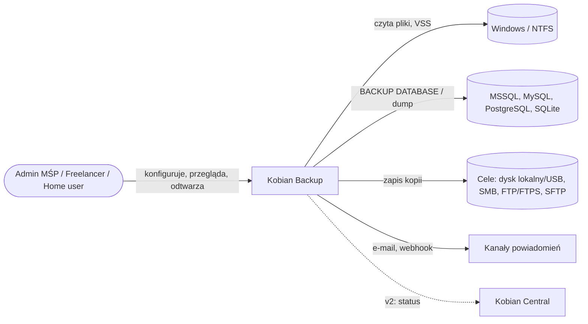

### Poziom 2 — Kontenery

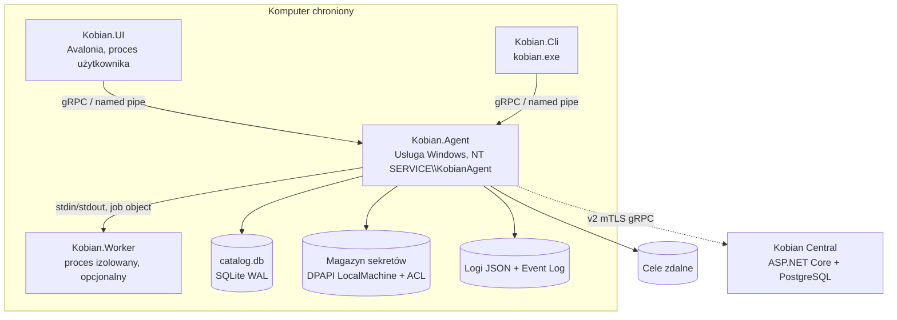

### Poziom 3 — Komponenty usługi

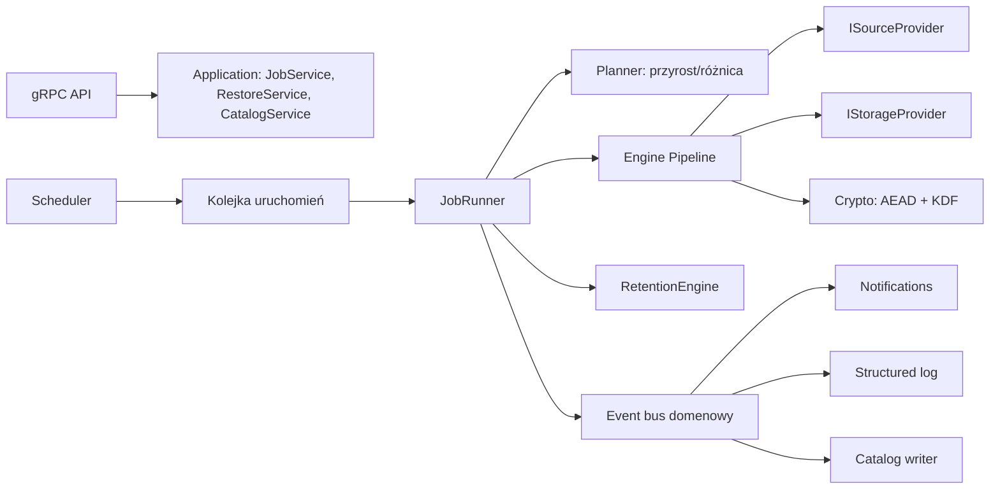

## 2.5 Kluczowe przepływy

1. **Uruchomienie zadania:** Scheduler (it. 7) → wpis `Run(Queued)` w katalogu (transakcja) → JobRunner pobiera lock zadania (brak równoległych uruchomień tego samego zadania) → pre-skrypt → Planner wylicza listę zmian (wejście: poprzedni snapshot z katalogu) → Pipeline strumieniuje dane do celu z buforem ograniczonym (`Channel<T>` bounded, backpressure) → manifest snapshotu zapisany **na celu jako ostatni** (atomowy commit: snapshot istnieje dopiero, gdy manifest jest kompletny) → weryfikacja → retencja → post-skrypt → `Run(Success|Warning|Failed)` → zdarzenia.
2. **Restore:** UI → `RestoreService` → odczyt manifestu z celu (nie tylko z lokalnego katalogu — scenariusz utraty komputera, sekcja 8) → selekcja → pipeline odwrotny → raport.
3. **Utrata katalogu:** katalog odbudowywany z manifestów na celach (`kobian catalog rebuild`). Wymaganie projektowe dla it. 3: manifesty samowystarczalne, szyfrowane, wersjonowane (`formatVersion`).

## 2.6 Model wdrożenia

| Platforma | MVP | v2 |
|---|---|---|
| Windows 10/11, Server 2016+ x64 | Usługa + UI + CLI | ARM64 (do weryfikacji wsparcia VSS/SqlClient) |
| Linux (Debian/Ubuntu/RHEL) | — | systemd (`Microsoft.Extensions.Hosting.Systemd`), CLI + opcjonalnie UI |
| Kobian Central | — | Kontener/usługa, PostgreSQL |

Ścieżki: binaria w `%ProgramFiles%\Kobian`, dane w `%ProgramData%\Kobian` (ACL: SYSTEM, Administrators, `NT SERVICE\KobianAgent` — pełny; `Kobian Operators` — brak dostępu bezpośredniego, tylko przez API).

## 2.7 Kontrakt rozszerzalności

- `IStorageProvider`: `OpenWrite(path, options)`, `OpenRead`, `List(prefix)`, `Delete`, `Stat`, `Capabilities` (np. `SupportsAtomicRename`, `SupportsResume`, `SupportsImmutability`, `MaxPathLength`) — szczegóły w it. 4.
- `ISourceProvider`: `Enumerate`, `Open`, `Prepare/Finalize` (np. VSS snapshot, `BACKUP DATABASE` do strumienia) — it. 3 i 5.
- **Brak dynamicznego ładowania wtyczek zewnętrznych w MVP** — każdy provider kompilowany w produkt (supply-chain, podpis).

## 2.8 Korelacja z otwartymi pytaniami

- Q1 rozstrzygnięte (D2.1, D2.2). Q2 rozstrzygnięte: Linux v2, rdzeń wieloplatformowy od MVP (AD-4).
- Q7 częściowo: architektura zakłada magazyn sekretów DPAPI LocalMachine + **klucz odzyskiwania eksportowany przez użytkownika** (format i UX w it. 6/8).

---

# Bezpieczeństwo — iteracja 2 (rola 11: Ekspert bezpieczeństwa)

Recenzja sekcji 2:

1. **SEC-2.1 Kestrel w usłudze uprzywilejowanej** — akceptowalne wyłącznie na named pipe z jawnym ACL (bez `Everyone`/`Authenticated Users`), z wyłączonym nasłuchem TCP w buildzie MVP (test w CI: brak otwartych portów po starcie usługi). Wymagany runtime ≥ wersji łatającej CVE-2025-55315.
2. **SEC-2.2 Autoryzacja na API** — samo połączenie z pipe ≠ autoryzacja. Każde wywołanie sprawdza SID klienta (`GetNamedPipeClientProcessId` + token) wobec ról: `Viewer` (status/logi), `Operator` (uruchom/odtwórz do lokalizacji użytkownika), `Admin` (zmiana zadań, sekrety, odtwarzanie w dowolne miejsce). Odtwarzanie do dowolnej ścieżki przez usługę z `SeRestorePrivilege` = eskalacja uprawnień, jeśli nie ograniczymy go do `Admin`.
3. **SEC-2.3 DPAPI LocalMachine** — chroni przed kradzieżą pliku poza maszyną, **nie** przed lokalnym administratorem ani malware działającym jako SYSTEM. Dodatkowo: entropia (`optionalEntropy`) przechowywana w rejestrze z ACL tylko dla konta usługi; sekrety nigdy w `catalog.db` w postaci jawnej; maskowanie w logach (filtr na poziomie loggera).
4. **SEC-2.4 Klucz szyfrowania kopii ≠ sekret dostępowy** — klucz główny repozytorium (MK) generowany losowo, opakowany (key wrapping) kluczem z hasła użytkownika (KDF — wybór Argon2id vs PBKDF2 w it. 3) i dodatkowo przez DPAPI dla pracy bezobsługowej. Utrata maszyny nie może oznaczać utraty danych → klucz odzyskiwania (Q7).
5. **SEC-2.5 Worker i skrypty** — proces `Kobian.Worker` z ograniczonym tokenem (Low/Medium IL, job object bez UI, limit pamięci); skrypty pre/post nigdy nie uruchamiane z katalogów zapisywalnych przez użytkowników.
6. **SEC-2.6 Katalog SQLite** — `catalog.db` zawiera metadane (nazwy plików = potencjalnie dane osobowe, RODO). ACL jak w 2.6; rozważyć szyfrowanie katalogu (SQLCipher) — odroczone, bo ACL + BitLocker zalecany; ryzyko udokumentowane.
7. **SEC-2.7 Podpisywanie** — wszystkie binaria i instalator podpisane (Authenticode, it. 10); usługa przy starcie weryfikuje podpis `Kobian.Worker.exe` przed uruchomieniem.

### STRIDE — nowe elementy (API, usługa, katalog)

| Element | S | T | R | I | D | E |
|---|---|---|---|---|---|---|
| Named pipe gRPC | Podszycie pod serwer pipe (pipe squatting) → tworzyć pipe z `FILE_FLAG_FIRST_PIPE_INSTANCE`, klient weryfikuje PID/SID serwera | Modyfikacja żądań — lokalnie, mitygacja ACL | Audyt wywołań Admin do logu | Wyciek statusu/ścieżek → rola Viewer | Zalew żądań → limity współbieżności | Restore do dowolnej ścieżki → tylko Admin |
| catalog.db | — | Manipulacja historią → hash-chain wpisów `Run` (it. 9) | j.w. | Nazwy plików → ACL | Korupcja → rebuild z manifestów | — |
| Konto usługi | — | — | — | SeBackupPrivilege czyta wszystko → minimalizacja kodu w kontekście usługi | — | Kompromitacja usługi = odczyt całego dysku → izolacja Workerów, fuzzing parserów |

---

# R&D — iteracja 2 (rola 12: Dział R&D)

| Technika / rozwiązanie | Opis i odniesienie | Ocena | Decyzja |
|---|---|---|---|
| **Architektura „repo-first” Kopii** (Kopia: serwer repozytorium + klienci, polityki dziedziczone) | Klient nie ma bezpośrednich poświadczeń do magazynu, tylko do serwera repo — ogranicza skutki kompromitacji klienta | Wysoka wartość dla P2 (wielu klientów), koszt: osobny serwer | **Przyjęte koncepcyjnie dla v2** (Kobian Central jako opcjonalny „repository server”) |
| **Rozdział planowania i wykonania (Bacula Director/Storage/File daemon)** | Trzy role: sterowanie, magazyn, klient | W MVP zbyt ciężkie | **Odrzucone dla MVP**, ale kontrakt gRPC pozwala przenieść scheduler do Central w v2 |
| **Named pipe + sprawdzanie tożsamości klienta (wzorzec usług Windows, np. agenty EDR)** | Brak portów TCP, autoryzacja per SID | Wysoka, niskie koszty | **Przyjęte** (D2.4, SEC-2.2) |
| **Event sourcing historii uruchomień** | Historia jako nieusuwalny strumień zdarzeń, stan = projekcja | Średnia; ułatwia audyt NIS2, komplikuje migracje | **Częściowo przyjęte**: tabela zdarzeń append-only + projekcje, bez pełnego ES |
| **Native AOT** | Mniejsze binaria, szybszy start | Niekompatybilność refleksji (gRPC/Avalonia — do weryfikacji) | **Odrzucone w MVP**, ponowna ocena przy .NET 12 |

---

# 3. Silnik backupu (iteracja 3 — Inżynier silnika backupu)

Wejście: D1.1 (MVP bez deduplikacji globalnej), D1.2 (format gotowy pod dedup), AD-3/AD-5, przepływ 2.5 (manifest zapisywany jako ostatni), SEC-1.5, SEC-2.4. Sekcja definiuje format repozytorium, tryby kopii, pipeline, kryptografię, weryfikację, retencję i obsługę specyfiki NTFS.

## 3.1 Format kopii

### Decyzja D3.1 — Własny format repozytorium „Kobian Repo v1” (pack + index + manifest)
- **Decyzja:** Na celu tworzymy repozytorium o strukturze treściowo-adresowalnej (wzorzec restic/Kopia/Borg), ale w MVP z **dedup ograniczoną do łańcucha zadania** i **stałym podziałem na bloki** (fixed-size chunking). CDC (v2) nie wymaga zmiany formatu, bo bloki mają zmienną długość od dnia 1.
- **Alternatywy:** (a) ZIP/7z per uruchomienie (jak Cobian); (b) kopia 1:1 plików (mirror) + szyfrowanie per plik; (c) tar + zstd + age.
- **Uzasadnienie:**
  - Nazwy obiektów na celu to identyfikatory packów (krótkie, ASCII) → **brak problemów z długimi ścieżkami, znakami PL i limitami serwerów FTP** (sekcja 4).
  - Metadane (nazwy plików = dane osobowe, RODO) szyfrowane razem z danymi; ZIP szyfruje tylko zawartość, nie nazwy (AE-2 nie uwierzytelnia nagłówków).
  - Manifest każdego snapshotu jest **kompletny** (synthetic full) → odtworzenie nie wymaga odtwarzania łańcucha inc/diff, a uszkodzenie jednego przyrostu nie unieważnia późniejszych.
  - Atomowy commit (manifest ostatni) i odbudowa katalogu z celu (2.5 pkt 3).
- **Ryzyka:** użytkownik nie „widzi plików” na NAS (sprzeczność z narracją D1.1 — patrz Korekty K3.2); zależność od własnego narzędzia przy odtwarzaniu → wymagamy **otwartej specyfikacji formatu** i niezależnego narzędzia `kobian-restore` (CLI, bez usługi) — sekcja 8 i 10.

### Struktura repozytorium

```
<cel>/<nazwa-repo>/
  kobian.repo          # nagłówek jawny: formatVersion, repoId, kdf, parametry, wrapped keys (JSON, podpisany MAC)
  keys/<keyId>         # dodatkowe opakowania klucza głównego (hasło, klucz odzyskiwania, DPAPI-host)
  data/<2 znaki>/<packId>.pack   # packi 16–64 MiB: sekwencja zaszyfrowanych bloków
  index/<indexId>.idx  # mapowanie chunkId → (packId, offset, length), zaszyfrowane
  snapshots/<snapId>.snap        # manifest snapshotu (drzewo katalogów + metadane), zaszyfrowany
  locks/<hostId>-<runId>.lock    # blokady współbieżności (zwykła/ekskluzywna dla prune)
  journal/                       # v1.1: append-only log operacji (audyt, it. 9)
```

| Element | Rozmiar docelowy | Uzasadnienie |
|---|---|---|
| Blok (chunk) MVP | pliki ≤ 1 MiB = 1 blok; większe: bloki 4 MiB | kompromis: liczba obiektów indeksu vs. ponowne wysyłanie przy zmianie |
| Pack | 16 MiB domyślnie, 64 MiB dla celów lokalnych/SMB, 8 MiB dla FTP/SFTP z wznawianiem | mniej obiektów na serwerze, krótsze retransmisje (parametr dostrajany w it. 4) |
| Manifest | strumieniowy (drzewo podzielone na „tree blobs” per katalog) | duże drzewa (miliony plików) bez ładowania do RAM — wzorzec restic |

## 3.2 Tryby kopii

| Tryb | Co czyta ze źródła | Co wysyła | Od czego zależy restore | Kiedy |
|---|---|---|---|---|
| **Pełny** | wszystko | wszystkie bloki do **nowych packów** (bez reużycia) | tylko ten snapshot + jego packi | okresowo (np. co miesiąc) — niezależny „łańcuch” odporny na uszkodzenie starszych packów |
| **Przyrostowy** | pliki zmienione od **ostatniego dowolnego** snapshotu | tylko nowe bloki | snapshot + packi wcześniejszych snapshotów, do których się odwołuje | domyślnie codziennie |
| **Różnicowy** | pliki zmienione od **ostatniego pełnego** | bloki nieobecne w pełnym | snapshot + packi ostatniego pełnego | gdy użytkownik chce maks. 2 „ogniwa” |
| **Migawka bazy** | delegacja do `ISourceProvider` DB (it. 5) | strumień `.bak`/dump dzielony na bloki | j.w. | zadania DB |

### Decyzja D3.2 — Semantyka trybów zachowana dla użytkownika, implementacja jednolita
- **Decyzja:** wszystkie tryby produkują kompletny manifest; różnią się wyłącznie **zbiorem packów, z których wolno reużyć bloki** (pełny: żaden; różnicowy: packi ostatniego pełnego; przyrostowy: wszystkie w łańcuchu).
- **Alternatywy:** klasyczna implementacja Cobian (osobne archiwa, przyrost = tylko zmienione pliki).
- **Uzasadnienie:** zachowuje zrozumiały model mentalny (P1 zna full/inc/diff z Cobiana i SQL), a eliminuje wady łańcuchów (restore z 30 przyrostów).
- **Ryzyka:** różnicowy po długim czasie rośnie — UI ostrzega przy przekroczeniu progu (np. > 50% rozmiaru pełnego).

### Wykrywanie zmian

| Metoda | MVP | Opis |
|---|---|---|
| Rozmiar + mtime + ctime + FileId (NTFS File Reference Number) | ✔ | porównanie z poprzednim manifestem; zmiana FileId przy tej samej ścieżce = plik podmieniony |
| Wymuszone porównanie hash | ✔ (opcja) | dla aplikacji zachowujących mtime (np. niektóre bazy plikowe) |
| USN Change Journal | v1.1 | przyspieszenie dla wolumenów z milionami plików; fallback na skan przy przepełnieniu journala lub zmianie `UsnJournalID` |
| Archive bit (jak Cobian) | ✘ | modyfikuje źródło, konflikt z innymi narzędziami — **odrzucone** |

## 3.3 Pipeline

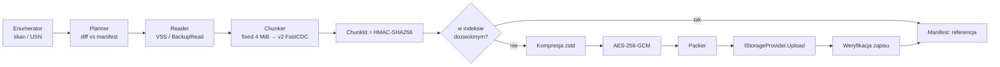

- Kanały ograniczone (`Channel<T>` bounded) między etapami; równoległość: kompresja/szyfrowanie N = liczba rdzeni − 1 (limit konfigurowalny), upload wg it. 4.
- Bufory z `ArrayPool<byte>`; klucze i plaintext w buforach zerowane po użyciu (`CryptographicOperations.ZeroMemory`).
- Priorytet I/O: wątek czytający ustawia `FILE_FLAG_SEQUENTIAL_SCAN` i niski priorytet I/O procesu (Background mode) — wymaganie 1.8.

## 3.4 Kompresja

### Decyzja D3.3 — zstd (ZstdSharp.Port), poziom adaptacyjny
- **Decyzja:** zstd poziom 3 domyślnie; profile „Szybki” (1), „Zbalansowany” (3), „Maks.” (19, tylko lokalne CPU-bogate); automatyczne pomijanie kompresji dla danych nieściśliwych (próbka 64 KiB: jeśli współczynnik > 0,97 → blok zapisany bez kompresji z flagą) oraz dla znanych typów (`.zip`, `.7z`, `.jpg`, `.mp4`, `.docx`… — lista konfigurowalna).
- **Alternatywy:** LZMA/LZMA2 (7-Zip), Deflate (wbudowany `System.IO.Compression`), Brotli (wbudowany), LZ4.
- **Uzasadnienie:** zstd daje najlepszy kompromis szybkość/stopień; ZstdSharp.Port to czysty port zarządzany (bez natywnej DLL → prostsze podpisywanie i ARM64), MIT, aktywnie wydawany (0.8.8, 29.04.2026). LZMA jest 5–10× wolniejsze przy kompresji (do pomiaru w benchmarku it. 10), a implementacja w SharpCompress miała podatności (CVE-2021-39208, CVE-2026-44788 — path traversal przy rozpakowywaniu).
- **Ryzyka:** port zarządzany wolniejszy niż natywne libzstd (szacunek 10–30% — do weryfikacji benchmarkiem); fallback: Brotli wbudowany w razie problemów z biblioteką (flaga algorytmu w nagłówku bloku → format nie zależy od jednej biblioteki).

Nagłówek bloku: `version(1) | algo(1: none/zstd/brotli) | flags | rawLength | compressedLength` — wszystko wewnątrz szyfrowanej koperty.

## 3.5 Kryptografia

### Decyzja D3.4 — Hierarchia kluczy i AEAD
- **Decyzja:**
  - **MK** (master key, 256 bit, CSPRNG) → wyprowadzone przez **HKDF-SHA256**: `K_data` (szyfrowanie bloków), `K_meta` (manifesty/indeksy), `K_id` (HMAC chunkId), `K_mac` (MAC nagłówka repo).
  - Szyfrowanie: **AES-256-GCM** (wbudowane `AesGcm`, przyspieszane AES-NI). Dla każdego packa osobny podklucz `K_pack = HKDF(K_data, packId)` i nonce = licznik bloku w packu (96 bit) → brak ryzyka kolizji losowego nonce przy milionach bloków (limit NIST 2^32 wywołań z losowym nonce na klucz).
  - AAD = `repoId | packId | chunkId | formatVersion` → blokuje podmianę bloków między packami/repozytoriami.
  - **ChunkId = HMAC-SHA256(K_id, plaintext)** zamiast zwykłego SHA-256 → atakujący z dostępem do celu nie potwierdzi obecności znanego pliku (atak „confirmation of file”).
  - MK opakowany (AES-KW / AES-GCM) przez: (1) KEK z hasła, (2) klucz odzyskiwania (losowy, 256 bit, prezentowany użytkownikowi jako ciąg Base32 z sumą kontrolną), (3) DPAPI LocalMachine hosta — do pracy bezobsługowej.
- **Alternatywy:** XChaCha20-Poly1305 (wymaga libsodium), age, szyfrowanie ZIP AES.
- **Uzasadnienie:** wyłącznie prymitywy z .NET (brak natywnych zależności kryptograficznych); deterministyczne nonce eliminują najgroźniejszy błąd GCM.
- **Ryzyka:** GCM nie jest key-committing → dodajemy **commitment tag** (HMAC(K_pack, „commit”) w nagłówku packa); błąd implementacji → wektory testowe + przegląd zewnętrzny (it. 10).

### Decyzja D3.5 — KDF hasła: PBKDF2-HMAC-SHA256 w MVP, Argon2id po audycie biblioteki (rozwiązuje Q12)
- **Decyzja:** PBKDF2-HMAC-SHA256, ≥ 600 000 iteracji (rekomendacja OWASP 2023, do weryfikacji aktualności), sól 256 bit; parametry zapisane w `kobian.repo` (`kdf: {alg, iter, salt}`) → przejście na Argon2id bez zmiany formatu.
- **Alternatywy:** Argon2id (Konscious.Security.Cryptography.Argon2 1.3.1, MIT, ostatnia aktualizacja 19.06.2024), scrypt.
- **Uzasadnienie:** Argon2id jest odporniejszy na GPU, ale jedyna popularna implementacja .NET jest rzadko aktualizowana (1 maintainer — do weryfikacji); PBKDF2 jest wbudowany i certyfikowalny (FIPS).
- **Ryzyka:** słabe hasła użytkowników → wymuszamy minimalną entropię w kreatorze (it. 6) i rekomendujemy klucz odzyskiwania.

## 3.6 Specyfika Windows/NTFS

| Zagadnienie | Zachowanie MVP | Uwagi |
|---|---|---|
| Pliki zablokowane | **VSS** snapshot wolumenu na czas uruchomienia (Should, US-11); bez VSS: ponów 3× co 5 s, potem pomiń z `Warning` | VSS przez cienką warstwę COM (Decyzja D3.6) |
| VSS writers | Tryb `VSS_BT_COPY` (nie narusza łańcucha logów SQL/Exchange innych narzędzi); writer SQL ignorowany dla zadań plikowych — bazy obsługuje it. 5 | „Copy-only” chroni łańcuch backupów ERP |
| Długie ścieżki | .NET obsługuje ścieżki > 260 znaków; wewnętrznie prefiks `\\?\`; w repo brak ograniczeń (nazwy w manifeście) | Restore na cel z limitem (FAT32/FTP) → raport konfliktów |
| Symlinki / junctions / reparse points | Domyślnie **nie podążamy** — zapisujemy jako link (cel + typ); opcja „podążaj” z wykrywaniem cykli (zbiór FileId) | Junctions systemowe (`Documents and Settings`) pomijane |
| Pliki chmurowe (OneDrive/Files On-Demand) | Pliki z `FILE_ATTRIBUTE_RECALL_ON_DATA_ACCESS` **pomijane domyślnie** (brak masowego pobierania); opcja „pobierz i kopiuj” | Inaczej backup wyzwala pobranie TB danych |
| Atrybuty, znaczniki czasu | zapisywane zawsze (R/H/S/A, created/modified/accessed) | |
| ACL (security descriptor) | opcja (domyślnie włączona dla serwerów): SDDL w manifeście; restore ACL wymaga `SeRestorePrivilege` i roli Admin (SEC-2.2) | |
| ADS (alternate data streams) | opcja, przez `BackupRead`; domyślnie pomijamy `Zone.Identifier` | |
| Pliki rzadkie (sparse) | zachowanie flagi i zakresów; puste zakresy nie są czytane | Ważne dla VHDX |
| EFS | v2 (`ReadEncryptedFileRaw`); MVP: ostrzeżenie | |
| Hard linki | MVP: kopiowane jako osobne pliki z tą samą treścią (dedup bloków ogranicza koszt) | v2: odtwarzanie relacji |

### Decyzja D3.6 — VSS: własna warstwa interop (CsWin32) zamiast AlphaVSS
- **Decyzja:** interfejsy `IVssBackupComponents` generowane przez Microsoft.Windows.CsWin32 (do weryfikacji pokrycia `vsbackup.h` w win32metadata); minimalny zakres: utworzenie snapshotu, ekspozycja, usunięcie, obsługa writerów w trybie copy.
- **Alternatywy:** AlphaVSS 2.0.3 (Apache-2.0, ostatnie wydanie 27.07.2023, targety .NET Core 3.1/.NET Fx 4.5); `vshadow.exe`/`diskshadow` jako proces zewnętrzny; WMI `Win32_ShadowCopy`.
- **Uzasadnienie:** AlphaVSS jest nieaktualizowany od 2023 i zawiera natywną bibliotekę C++/CLI (trudniejszy audyt, brak ARM64); procesy zewnętrzne utrudniają obsługę błędów.
- **Ryzyka:** więcej własnego kodu niskopoziomowego → testy integracyjne na Windows Server w CI (it. 10); plan B: AlphaVSS przypięty do hasha pakietu.

## 3.7 Weryfikacja

| Poziom | Kiedy | Co sprawdza | Koszt |
|---|---|---|---|
| V1 — przy zapisie | każde uruchomienie | rozmiar po stronie celu = wysłany; SHA-256 packa liczony lokalnie i zapisany w indeksie; (SFTP/FTP: komenda hash jeśli serwer wspiera — it. 4) | niski |
| V2 — strukturalna | po każdym uruchomieniu | odczyt manifestu i indeksu z celu, deszyfrowanie, spójność referencji (każdy chunkId ma pack) | niski |
| V3 — próbkowa | harmonogram (np. tygodniowo) | pobranie losowych X% packów (domyślnie 5%, rotacyjnie — w N tygodniach pokrycie 100%), odszyfrowanie, kontrola MAC i HMAC bloków | średni (transfer) |
| V4 — test restore | it. 8 | pełne odtworzenie do piaskownicy + porównanie hash ze źródłem/manifestem | wysoki |

Wynik weryfikacji wpływa na status: brak V2 = `Failed`; błąd V3 = alert krytyczny „repozytorium uszkodzone” + automatyczne wymuszenie kolejnej kopii pełnej.

## 3.8 Retencja

### Decyzja D3.7 — Polityka GFS z blokadą minimalnego wieku
- **Decyzja:** polityka = suma reguł: `keepLast N`, `keepDaily D`, `keepWeekly W`, `keepMonthly M`, `keepYearly Y`, `keepWithin T`; **zawsze** zachowany ostatni udany snapshot i ostatni pełny, na którym opiera się zachowany różnicowy; **retentionLock** (minimalny wiek, np. 14 dni) — snapshotów młodszych nie usuwa ani polityka, ani API bez okresu karencji (it. 9: alert o próbie).
- **Alternatywy:** tylko „liczba wersji” (Cobian); tylko czas.
- **Uzasadnienie:** GFS to standard (Veeam, restic `forget`); blokada ogranicza skutki przejęcia konsoli przez napastnika (SEC-1.3).
- **Ryzyka:** usuwanie packów („prune”) — w MVP usuwamy tylko packi **całkowicie** nieużywane (bez przepakowywania); częściowo używane packi zostają → narzut miejsca (repack w v1.1). Prune wymaga blokady ekskluzywnej repozytorium i dwufazowego usuwania (oznacz → usuń po T godzinach), by nie zniszczyć danych równoległego uruchomienia.

## 3.9 Wydajność — cele do weryfikacji (benchmark w it. 10)

| Scenariusz | Cel |
|---|---|
| 100 GB, 500 tys. plików, pierwszy pełny na lokalny SSD | ≥ 150 MB/s (ograniczenie: dysk źródłowy) |
| Przyrostowy bez zmian, 1 mln plików | ≤ 3 min (skan metadanych) |
| RAM usługi podczas kopii | ≤ 500 MB przy domyślnej równoległości |

---

# Bezpieczeństwo — iteracja 3 (rola 11: Ekspert bezpieczeństwa)

1. **SEC-3.1 Kryptografia — akceptacja z warunkami:** D3.4 poprawnie rozwiązuje nonce-reuse i podmianę bloków (AAD). Warunki: (a) oficjalne wektory testowe formatu w repozytorium kodu, (b) zakaz własnych prymitywów — tylko `AesGcm`, `HMACSHA256`, `HKDF`, `Rfc2898DeriveBytes.Pbkdf2`, (c) zewnętrzny przegląd kryptograficzny przed 1.0 (it. 10).
2. **SEC-3.2 Kompresja przed szyfrowaniem** — wyciek długości (klasa CRIME) nieistotny dla danych w spoczynku bez interaktywnego atakującego; akceptowane. Długości packów są stałe (padding do 16 MiB nie jest wymagany — ryzyko szacowane jako niskie, dokumentujemy).
3. **SEC-3.3 Restore = parser niezaufanych danych.** Dane z celu traktujemy jak wrogie (cel może być przejęty): normalizacja ścieżek z manifestu (odrzucenie `..`, ścieżek absolutnych, ADS w nazwach, nazw zarezerwowanych `CON`, `NUL`), brak podążania za symlinkami podczas zapisu (klasa zip-slip, por. CVE-2026-44788 w SharpCompress), limity rozmiarów przed alokacją (zip-bomb: `rawLength` ≤ 2× rozmiar bloku), weryfikacja MAC **przed** dekompresją.
4. **SEC-3.4 Ransomware:** retentionLock (D3.7) + dwufazowe usuwanie + alert. Uwaga: lokalny napastnik z uprawnieniami SYSTEM może usunąć repozytorium bezpośrednio na celu, jeśli konto ma prawo usuwania → **wymaganie dla it. 4:** poświadczenia celu w trybie „write/no-delete”, a prune z osobnych poświadczeń (lub z serwera celu).
5. **SEC-3.5 Klucz DPAPI hosta** daje pracę bezobsługową, ale kompromitacja hosta = dostęp do repo (odczyt). Akceptowane (napastnik i tak ma dane źródłowe); kluczowe, by **nie** pozwalało usuwać (pkt 4).
6. **SEC-3.6 Zerowanie pamięci i zrzuty:** wyłączenie zrzutów pamięci procesu usługi zawierających klucze nie jest w pełni możliwe — dokumentujemy; krótki czas życia kluczy w RAM, brak logowania wartości.
7. **SEC-3.7 HMAC chunkId** — chroni przed atakiem potwierdzenia pliku; dedup między różnymi repozytoriami jest celowo niemożliwy (różne `K_id`).

### STRIDE — silnik i repozytorium

| Zagrożenie | Kategoria | Mitygacja |
|---|---|---|
| Podmiana packa na celu na starszą wersję (rollback) | T | Indeks zawiera SHA-256 packa; manifest zawiera listę indeksów z hashami; monotoniczny licznik snapshotów w katalogu lokalnym |
| Usunięcie snapshotów przez napastnika | D/T | retentionLock, poświadczenia bez prawa usuwania, alert o „zniknięciu” snapshotu (porównanie katalog ↔ cel) |
| Odczyt nazw plików z celu | I | Manifesty szyfrowane `K_meta` |
| Złośliwy manifest prowadzący do zapisu poza katalogiem restore | E | SEC-3.3 |
| Wyczerpanie RAM przez spreparowany indeks | D | Strumieniowy parser z limitami |

---

# R&D — iteracja 3 (rola 12: Dział R&D)

| Technika | Opis | Ocena | Decyzja |
|---|---|---|---|
| **FastCDC** (Xia i in., USENIX ATC 2016) | CDC z gear hash, 3–10× szybszy niż Rabin, normalizacja rozkładu rozmiarów | Implementacja ~300 linii, brak zależności; wymaga indeksu globalnego | **Przyjęte dla v2** (format już wspiera zmienną długość bloków) |
| **Tree blobs / Merkle DAG katalogów** (restic, Kopia) | Każdy katalog = blob z listą wpisów i hashy dzieci; niezmienione poddrzewo = ta sama referencja | Wysoka wartość: manifest przyrostu jest mały, porównanie drzew szybkie | **Przyjęte w MVP** (manifest strumieniowy 3.1) |
| **Słownik zstd dla małych plików** | Trening słownika na próbce małych plików (np. XML/JSON/ERP) → wyraźnie lepszy stopień dla plików < 16 KiB (wg dokumentacji zstd — do weryfikacji na danych P1) | Średnia; słownik musi być w repo i wersjonowany | **Odroczone do v1.1**, z benchmarkiem |
| **Kodowanie korekcyjne (Reed-Solomon / PAR2) na packach** | Odporność na bit-rot na tanich NAS/USB bez ZFS; Kopia ma eksperymentalną funkcję ECC (do weryfikacji) | Narzut 5–10% miejsca, złożoność | **Odroczone do v2**; MVP: detekcja (V3) zamiast korekcji |
| **USN Journal** | Lista zmian bez skanu | Wysoka dla serwerów plików | **v1.1** (3.2) |

---

# 4. Transport i protokoły (iteracja 4 — Inżynier transportu/protokołów)

Wejście: kontrakt `IStorageProvider` (2.7), struktura repozytorium i rozmiary packów (3.1, Q16), wymaganie poświadczeń bez prawa usuwania (SEC-3.4), US-04, US-12, US-17, US-18, US-23, US-25. Zasada nadrzędna: **cel jest niezaufany** — integralność gwarantuje kryptografia repozytorium (D3.4), transport odpowiada za poufność poświadczeń, uwierzytelnienie serwera i odporność na awarie.

## 4.1 Kontrakt IStorageProvider (rozwinięcie 2.7)

```csharp
interface IStorageProvider : IAsyncDisposable {
  ProviderCapabilities Capabilities { get; }
  Task<StatResult?> StatAsync(string path, CancellationToken ct);
  IAsyncEnumerable<StatResult> ListAsync(string prefix, CancellationToken ct);
  Task<Stream> OpenReadAsync(string path, long offset, CancellationToken ct);
  Task<IUploadSession> BeginUploadAsync(string path, long expectedLength, UploadOptions o, CancellationToken ct);
  Task DeleteAsync(string path, CancellationToken ct);          // używane tylko przez prune z poświadczeniami „maintenance”
}
interface IUploadSession { long CommittedOffset { get; } Task WriteAsync(ReadOnlyMemory<byte> b, CancellationToken ct); Task CommitAsync(CancellationToken ct); }
```

| Capability | Local | SMB | FTP/FTPS | SFTP | Znaczenie |
|---|---|---|---|---|---|
| `AtomicRename` | ✔ | ✔ | zależnie od serwera (RNFR/RNTO) | ✔ (`posix-rename@openssh.com`) | upload do `*.tmp` → rename = brak półplików |
| `ResumeUpload` | ✔ | ✔ | ✔ (REST/APPE — zależnie od serwera) | ✔ (open + offset) | wznowienie packa |
| `ServerSideHash` | — | — | opcjonalnie (`HASH`/`XSHA256`/`XCRC`) | opcjonalnie (`check-file`, rzadkie) | V1 bez ponownego pobrania |
| `AppendOnlyMode` | ACL | ograniczone (4.6) | zależnie od serwera | ✔ (OpenSSH `sftp-server -P`) | ochrona przed ransomware |
| `MaxObjectNameLength` | 255 | 255 | serwer | serwer | repo używa krótkich nazw ASCII (3.1) |

### Decyzja D4.1 — Dwa zestawy poświadczeń na cel: „backup” i „maintenance”
- **Decyzja:** każdy cel ma poświadczenie **backup** (zapis/tworzenie, bez usuwania i nadpisywania tam, gdzie protokół na to pozwala) oraz opcjonalne **maintenance** (prune/retencja). Gdy maintenance nie jest skonfigurowane, retencja na celu wykonywana jest tylko logicznie (snapshoty oznaczone do usunięcia), a fizyczne usuwanie — ręcznie lub przez skrypt po stronie serwera.
- **Alternatywy:** jedno konto z pełnymi prawami (Cobian, większość narzędzi).
- **Uzasadnienie:** realizuje SEC-1.3/SEC-3.4 — przejęta usługa nie skasuje historii; wzorzec restic rest-server `--append-only`.
- **Ryzyka:** wyższy próg konfiguracji dla P3 → kreator (it. 6) proponuje tryb uproszczony z jednym kontem i wyraźnym ostrzeżeniem.

## 4.2 SMB

### Decyzja D4.2 — Natywny klient SMB Windows (UNC + `WNetAddConnection2`) w MVP
- **Decyzja:** dostęp przez ścieżki UNC `\\serwer\udział\repo` z jawnie podanymi poświadczeniami celu, nawiązywanymi przez `WNetAddConnection2` **bez litery dysku** w sesji logowania usługi; połączenie zamykane po zadaniu (`WNetCancelConnection2`). Wymagane SMB 2.1+; zalecane SMB 3.x z szyfrowaniem i podpisywaniem; SMB1 — zablokowane.
- **Alternatywy:** SMBLibrary (TalAloni, 1.5.7, LGPL-3.0, 1 maintainer) — klient w czystym C#; montowanie litery dysku (jak skrypty `net use`); Linux v2: montowanie `cifs` lub SMBLibrary.
- **Uzasadnienie:** natywny klient wspiera Kerberos, SMB 3.1.1 (AES-GCM, pre-auth integrity), podpisywanie i jest łatany przez Windows Update. Brak litery dysku = ransomware skanujące litery nie widzi celu, a użytkownik interaktywny nie ma do niego dostępu (sesja usługi jest odrębna).
- **Ryzyka:**
  - Błąd **1219** (wiele poświadczeń do tego samego serwera w jednej sesji logowania) → reguła: jedno poświadczenie per serwer per uruchomienie; zadania z różnymi kontami do tego samego serwera serializowane w kolejce (it. 7) lub adresowane aliasem (FQDN vs IP — dokumentowane obejście, do weryfikacji).
  - Konto wirtualne usługi przy braku jawnych poświadczeń uwierzytelnia się jako konto komputera (`DOMENA\HOST$`) — dopuszczalne w domenie i opisane w kreatorze.
  - NAS-y z przestarzałym SMB (tylko SMB1) → komunikat z instrukcją, bez obejścia.

| Ustawienie SMB | Domyślnie | Uwagi |
|---|---|---|
| Minimalny dialekt | 2.1 | SMB1 zawsze odrzucone |
| Szyfrowanie SMB 3 | „Wymagaj, jeśli serwer wspiera”; opcja „Wymagaj zawsze” | dla celów poza LAN obowiązkowe |
| Podpisywanie | wymagane | ochrona przed NTLM relay |
| Uwierzytelnianie | Kerberos → NTLMv2; NTLMv1 zablokowane | |
| Timeout operacji | 60 s, keep-alive przez sesję zadania | |

## 4.3 FTP i FTPS

### Decyzja D4.3 — FluentFTP, domyślnie Explicit FTPS (AUTH TLS) w trybie pasywnym
- **Decyzja:** biblioteka **FluentFTP ≥ 55.0.0** (MIT); kolejność preferencji: Explicit FTPS (port 21 + `AUTH TLS`) → Implicit FTPS (990) → FTP jawny tylko z flagą „niezabezpieczony” (wymaga potwierdzenia, ostrzeżenie w raporcie, szyfrowanie repo obowiązkowe — poświadczenia lecą jawnie).
- **Alternatywy:** `FtpWebRequest` (przestarzałe, odradzane przez Microsoft), własna implementacja, WinSCP .NET assembly (GPL, zewnętrzny proces).
- **Uzasadnienie:** najszerzej używany, aktywnie rozwijany klient .NET (wydanie 17.09.2026), wspiera EPSV/PASV/PORT, TLS na kanale danych, REST/APPE, komendy hash, UTF-8.
- **Ryzyka:** różnorodność serwerów (FileZilla Server, vsftpd, ProFTPD, IIS, NAS) → macierz testów (it. 10); wymóg **TLS session reuse** na kanale danych w vsftpd (`require_ssl_reuse`) — obsługa w FluentFTP do weryfikacji testem.

| Parametr | Domyślnie | Uzasadnienie |
|---|---|---|
| Tryb | Pasywny (EPSV → PASV) | NAT/firewalle po stronie klienta |
| Tryb aktywny | opcja | stare serwery w LAN |
| TLS | 1.2 minimum, 1.3 preferowany | |
| Walidacja certyfikatu | systemowy magazyn zaufania + nazwa hosta; dla self-signed: **pinning SHA-256 odcisku** zatwierdzonego ręcznie | brak opcji „akceptuj wszystko” (STRIDE S, it. 1) |
| PASV z innym IP niż serwer | ignoruj adres z odpowiedzi, użyj IP sterowania | ochrona przed FTP bounce/NAT |
| Kodowanie | `OPTS UTF8 ON`, fallback | nazwy repo są ASCII |
| Weryfikacja | `HASH SHA-256` → `XSHA256` → rozmiar | V1 (3.7) |
| Wznawianie | `REST` + `STOR`/`APPE` jeśli `Capabilities.ResumeUpload` | Q16: pack 8 MiB |

## 4.4 SFTP

### Decyzja D4.4 — SSH.NET ≥ 2026.0.0, wyłącznie `SftpClient`; `ScpClient` zakazany
- **Decyzja:** biblioteka **SSH.NET 2026.0.0+** (MIT). Używamy tylko `SftpClient`; użycie `ScpClient` blokowane regułą analizatora (banned API) w CI.
- **Alternatywy:** Rebex SFTP (komercyjny), wywołanie `sftp.exe`/`ssh.exe` z OpenSSH for Windows (zewnętrzny proces, trudna obsługa błędów), libssh2 przez P/Invoke.
- **Uzasadnienie:** dojrzały, utrzymywany klient (wydanie 09.08.2026); wersje ≤ 2025.1.0 mają podatności wysokie w **ScpClient**: CVE-2026-48798 (path traversal przy rekurencyjnym pobieraniu, CVSS 7.1, GHSA-q939-rpr3-3284) i CVE-2026-85756 (OS command injection przez ścieżkę zdalną, CVSS 7.5, GHSA-mggc-4xg6-vcxf). SFTP ich nie dotyczy, ale minimalna wersja i zakaz SCP eliminują klasę problemu.
- **Ryzyka:** wydajność SSH.NET niższa od OpenSSH przy wysokim RTT (okno SFTP) → równoległe połączenia (4.7) i pomiar w it. 10.

| Parametr | Domyślnie |
|---|---|
| Uwierzytelnianie | klucz **Ed25519** (generowany przez Kobian, klucz prywatny w magazynie sekretów — DPAPI); RSA ≥ 3072 z `rsa-sha2-256/512`; hasło dopuszczalne |
| Algorytmy | KEX: `curve25519-sha256`, `ecdh-sha2-nistp256`; szyfry: `aes256-gcm@openssh.com`, `aes128-gcm`, `aes256-ctr`; wyłączone: `ssh-rsa` (SHA-1), CBC, `diffie-hellman-group1/14-sha1`; tryb **strict KEX** (ochrona przed Terrapin, CVE-2023-48795) |
| Host key | **Pinning**: przy pierwszym połączeniu UI pokazuje odcisk SHA256 do porównania (out-of-band) i zapisuje go; niezgodność = twardy błąd `HostKeyMismatch` + alert; brak automatycznego TOFU w trybie bezobsługowym (CLI wymaga `--host-key SHA256:...`) |
| Atomowość | upload `*.tmp` → `posix-rename@openssh.com`; w trybie append-only bez rename (4.6) |
| Keep-alive | 30 s |

## 4.5 Cel lokalny i USB

- Identyfikacja dysku przez **GUID wolumenu + plik znacznika repozytorium** (`kobian.repo` z `repoId`), nie przez literę → zmiana litery nie psuje zadania; zdarzenie podłączenia (US-14) w it. 7.
- Po zakończeniu: opcja „bezpieczne odłączenie” (`CM_Request_Device_Eject`) — redukuje ekspozycję na ransomware (dysk offline = kopia offline 3-2-1).
- Kontrola wolnego miejsca przed zadaniem (szacunek z Plannera) i w trakcie (błąd `Insufficient space` jako błąd trwały).

## 4.6 Tryb append-only / ochrona przed nadpisaniem

| Cel | Realizacja | Poziom ochrony | Zalecenie w kreatorze |
|---|---|---|---|
| SFTP (OpenSSH) | konto chroot + `ForceCommand internal-sftp -P remove,rmdir,rename,posix-rename@openssh.com` (lista zabronionych żądań sftp-server); upload bez rename, packi zapisywane od razu pod docelową nazwą, niekompletne wykrywane po hashu w indeksie | **Wysoki** (serwer egzekwuje) | rekomendowane dla P1/P2; przykładowa konfiguracja serwera w dokumentacji (it. 10) |
| SMB na Windows Server | ACL: konto backup ma „Create files/write data” i „Create folders/append data”, **bez** „Delete”, „Delete subfolders and files”, „Change permissions”, „Take ownership” | **Średni** — nadal możliwe nadpisanie treści istniejących plików | uzupełnić o migawki VSS na serwerze lub NAS |
| SMB na NAS (Synology/QNAP) | niezmienialne migawki (immutable snapshots) po stronie NAS — funkcje producenta, do weryfikacji modeli | **Wysoki**, jeśli włączone | kreator pyta i dokumentuje |
| FTP/FTPS | uprawnienia serwera (np. odbiór prawa delete/overwrite — zależne od produktu) | Zmienny | test zdolności przy konfiguracji (próba usunięcia pliku testowego **musi się nie udać**) |
| Lokalny/USB | brak (ACL NTFS łatwe do obejścia z SYSTEM) | Niski | rotacja dysków offline |

### Decyzja D4.5 — Test zdolności celu przy konfiguracji
- **Decyzja:** kreator wykonuje „probe”: utworzenie, odczyt, rename, próba nadpisania i **próba usunięcia** pliku testowego poświadczeniem „backup”; wynik zapisuje się w `Capabilities` i raporcie (np. „cel nie chroni przed usunięciem”).
- **Alternatywy:** zaufanie deklaracji użytkownika.
- **Uzasadnienie:** obiektywny dowód poziomu ochrony (P4 — audyt NIS2).
- **Ryzyka:** pliki testowe pozostające po próbie (gdy delete zabronione) → stała nazwa `/.kobian-probe` nadpisywana przy kolejnych testach (jeśli nadpisanie też zabronione — unikalna nazwa z datą, raportowane).

## 4.7 Odporność, równoległość, pasmo

### Klasyfikacja błędów

| Klasa | Przykłady | Reakcja |
|---|---|---|
| Przejściowe | timeout, reset połączenia, `421`/`425`/`426` FTP, `STATUS_NETWORK_NAME_DELETED`, SSH disconnect | retry z backoff wykładniczym + jitter (1 s → 2 → 4 … max 5 min), maks. 8 prób per operacja, potem pauza zadania i ponowienie całości wg harmonogramu |
| Trwałe | złe poświadczenia, `530`, `HostKeyMismatch`, brak miejsca (`552`, `STATUS_DISK_FULL`), brak uprawnień | natychmiastowe `Failed`, bez retry (unikamy blokady konta przez wielokrotne logowania) |
| Integralności | niezgodny rozmiar/hash po uploadzie | ponowny upload packa (maks. 2), potem `Failed` + alert |

- Biblioteka odporności: **Polly 8.x** (BSD-3-Clause) — retry, timeout, circuit breaker per cel (po 5 kolejnych błędach przejściowych → otwarcie na 10 min, by nie zalewać serwera).
- **Wznawianie zadania:** każdy wysłany pack zapisywany w lokalnym dzienniku uploadu (katalog SQLite) i w częściowym indeksie (`index/partial-<runId>`); po przerwaniu (restart, utrata sieci) kolejne uruchomienie reużywa już wysłane packi — snapshot pozostaje atomowy (3.1, manifest ostatni).
- **Równoległość domyślna:** Local 2 strumienie, SMB 4, SFTP 3 połączenia, FTP 2 (serwery często limitują połączenia per IP), konfigurowalne.
- **Limit pasma:** token bucket per cel + globalny; profile czasowe (np. 08:00–17:00 → 2 MB/s, w nocy bez limitu) — integracja z oknami czasowymi it. 7.

## 4.8 Rozszerzalność v2 (US-25)

| Backend | Planowana realizacja | Uwagi |
|---|---|---|
| S3 (AWS, MinIO, Wasabi, Backblaze B2 S3) | AWS SDK lub lekki klient S3 (audyt w v2) | **S3 Object Lock (compliance mode)** = najmocniejsza immutability → kluczowy argument ransomware |
| WebDAV | `HttpClient` + własna implementacja | Nextcloud/SharePoint |
| rclone | proces `rclone serve`/`rcd` jako backend | 70+ chmur, ale zewnętrzny binarny → podpis, przypięta wersja |
| Kobian Central jako repo-serwer | gRPC mTLS (R&D it. 2) | klient bez poświadczeń do magazynu |

---

# Bezpieczeństwo — iteracja 4 (rola 11: Ekspert bezpieczeństwa)

1. **SEC-4.1 Uwierzytelnienie serwera obowiązkowe:** brak trybu „ufaj wszystkim certyfikatom/kluczom”. Zmiana odcisku wymaga roli Admin i jest logowana (Repudiation).
2. **SEC-4.2 FTP jawny** — dopuszczalny wyłącznie w LAN i z flagą; raport zadania zawiera ostrzeżenie „poświadczenia przesyłane jawnie”. Rekomendacja: dedykowane konto o minimalnych prawach.
3. **SEC-4.3 Klucze SSH** generowane lokalnie (Ed25519), prywatne nigdy nie opuszczają magazynu sekretów; eksport tylko klucza publicznego. Obsługa agenta SSH/Pageant — v2.
4. **SEC-4.4 NTLM relay / SMB** — wymagane podpisywanie; w środowiskach domenowych zalecany Kerberos (SPN `cifs/serwer`). Brak litery dysku (D4.2) ogranicza zasięg ransomware.
5. **SEC-4.5 Rozdział poświadczeń (D4.1)** — realizuje zasadę najmniejszych uprawnień; poświadczenie maintenance przechowywane z dodatkową ochroną: odszyfrowywane tylko na czas prune i opcjonalnie wymagające potwierdzenia administratora (v1.1).
6. **SEC-4.6 Logi transportu** — maskowanie haseł w logach FluentFTP/SSH.NET (wyłączone logowanie surowych komend `PASS`; filtr na adapterze logów).
7. **SEC-4.7 Zależności** — SSH.NET z minimalną wersją 2026.0.0 i zakazem `ScpClient` (dwa CVE wysokie 2026); FluentFTP i Polly bez znanych podatności; SMBLibrary nieużywany w MVP (LGPL + 1 maintainer).

### STRIDE — transport

| Zagrożenie | Kat. | Mitygacja |
|---|---|---|
| MITM na SFTP/FTPS | S, I | pinning host key / certyfikatu, strict KEX, TLS 1.2+ |
| Downgrade SMB / NTLMv1 | S, I | min. SMB 2.1, signing required, NTLMv1 off |
| Kradzież poświadczeń z konfiguracji | I | DPAPI + ACL (SEC-2.3), brak plaintext |
| Usunięcie/nadpisanie kopii przez przejętą usługę | T, D | D4.1, D4.5, append-only SFTP, NAS snapshots |
| Wyczerpanie połączeń/blokada konta | D | klasyfikacja błędów trwałych bez retry, circuit breaker |
| Złośliwy serwer zwracający spreparowane listingi | E | parsowanie listingów w `Kobian.Worker` (SEC-2.5), limity długości nazw |

---

# R&D — iteracja 4 (rola 12: Dział R&D)

| Technika | Opis | Ocena | Decyzja |
|---|---|---|---|
| **rsync delta (rolling checksum)** | Przesyłanie różnic plików | Nieprzydatne przy szyfrowanym repo (szyfrogram zmienia się cały); bloki repo już ograniczają transfer | **Odrzucone** |
| **restic rest-server `--append-only`** | Serwer HTTP repo bez prawa usuwania | Wzorzec dla D4.1 i Kobian Central v2 | **Przyjęte koncepcyjnie** |
| **SMB over QUIC** (Windows Server 2022 Azure Edition / Server 2025 — do weryfikacji dostępności edycji) | SMB po UDP/443 z TLS 1.3, bez VPN | Ciekawe dla P2 (biura zdalne); zależne od edycji serwera | **Obserwacja — v2** (transparentne dla natywnego klienta D4.2) |
| **S3 Object Lock** | WORM na poziomie obiektu, tryb compliance | Najsilniejsza ochrona przed ransomware | **Przyjęte do v2** jako priorytet po MVP |
| **Wiele równoległych strumieni zamiast jednego (jak `rclone --transfers`)** | Lepsze wykorzystanie łącza przy wysokim RTT | Prosta realizacja w pipeline | **Przyjęte** (4.7) |

---

# 5. Bazy danych (iteracja 5 — Specjalista baz danych)

Wejście: D1.3 (ERP jako obywatel pierwszej kategorii), US-02, US-09, US-15, US-16, `ISourceProvider` (2.7), tryb „Migawka bazy” (3.2), konto usługi `NT SERVICE\KobianAgent` (D2.5, Q13), VSS w trybie copy (3.6). Zasada: **backup bazy nie może zakłócić pracy ERP ani łańcucha kopii wykonywanych przez sam program ERP lub innego administratora**.

## 5.1 Model źródła bazodanowego

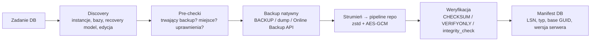

Manifest snapshotu bazy (rozszerzenie 3.1) zawiera: silnik i wersję serwera, edycję, nazwę bazy, typ kopii (full/diff/log/dump), `first_lsn`/`last_lsn`/`database_backup_lsn`/`differential_base_guid` (MSSQL), recovery model, rozmiar, hash strumienia, informację o TDE oraz **grupę spójności** (bazy kopiowane razem — np. konfiguracyjna + firmowe Optimy).

## 5.2 Microsoft SQL Server

### Decyzja D5.1 — Backup natywny `BACKUP DATABASE` do lokalnego katalogu staging w MVP; streaming VDI w v1.1
- **Decyzja:** MVP wykonuje `BACKUP DATABASE … TO DISK = '<staging>\<guid>.bak' WITH COPY_ONLY, CHECKSUM, FORMAT, INIT` na hoście SQL; plik jest natychmiast strumieniowany do repozytorium i usuwany. v1.1: **SQL Server VDI** (Virtual Device Interface) — strumień bez pliku tymczasowego.
- **Alternatywy:** (a) VSS SQL Writer (kopia plików `.mdf/.ldf`); (b) SMO (`Microsoft.SqlServer.Management.Smo`); (c) `sqlcmd` jako proces; (d) BACKUP bezpośrednio na udział SMB celu (jak SQL Backup Master w trybie lokalnym).
- **Uzasadnienie:** `BACKUP DATABASE` jest online, wspierany we wszystkich edycjach (także Express), daje spójność transakcyjną i weryfikowalność; staging to najprostsza ścieżka z przewidywalną obsługą błędów. VDI eliminuje podwójny I/O i jawny plik `.bak` na dysku, ale to COM z niewielką dokumentacją — odroczone.
- **Ryzyka:** staging wymaga wolnego miejsca ≈ rozmiar bazy (pre-check) i jest **niezaszyfrowaną kopią danych** na dysku (SEC-5.2); plik zapisuje konto usługi SQL Server (`NT SERVICE\MSSQL$<instancja>`), nie konto Kobian → katalog staging tworzony przez instalator z ACL dla obu SID.

### Decyzja D5.2 — Domyślnie `COPY_ONLY`; diff/log tylko po świadomym włączeniu „łańcucha Kobian”
- **Decyzja:**
  - Tryb **Prosty (domyślny):** pełne kopie `COPY_ONLY` — nie zmieniają bazy różnicowej ani nie obcinają logu; bezpieczne obok mechanizmów kopii wbudowanych w ERP.
  - Tryb **Łańcuch Kobian (opcja Admin):** pełna bez `COPY_ONLY` + różnicowe + logi (tylko recovery model FULL/BULK_LOGGED). Przed każdą różnicową Kobian sprawdza w `msdb.dbo.backupset`, czy `differential_base_guid` bazy odpowiada **jego** ostatniej pełnej; jeśli nie (ktoś inny wykonał pełną) → automatycznie wykonuje pełną i raportuje `Warning: obcy backup pełny wykryty`.
  - Logi: `BACKUP LOG` co 15–60 min (it. 7); przy recovery model SIMPLE opcja niedostępna z wyjaśnieniem w UI.
- **Alternatywy:** zawsze pełny łańcuch (agresywne, psuje kopie innych narzędzi); tylko pełne (bez PITR).
- **Uzasadnienie:** najczęstszy realny problem w MŚP to **dwa niezależne narzędzia psujące sobie łańcuch** (np. archiwizacja z poziomu ERP + skrypt admina); kontrola `differential_base_guid` usuwa klasę „różnicowa bez bazy”.
- **Ryzyka:** log backup przez Kobian obcina log — gdy równolegle działa inne narzędzie log-backup, PITR jest rozdzielony między narzędzia → detekcja obcych `BACKUP LOG` w `msdb` i alert.

### Kompresja i weryfikacja

| Element | Decyzja | Uzasadnienie |
|---|---|---|
| `WITH COMPRESSION` natywne | **wyłączone domyślnie** | kompresuje zstd w repo; skompresowany `.bak` niszczy przyszłą deduplikację (D1.2); Express historycznie nie wspierał kompresji natywnej (dla 2025 — do weryfikacji) |
| `WITH CHECKSUM` | zawsze | wykrywa uszkodzone strony już przy backupie |
| `RESTORE VERIFYONLY … WITH CHECKSUM` | po każdym backupie na pliku staging (MVP) | weryfikacja nośnika i nagłówków — **nie** gwarantuje odtwarzalności logicznej |
| `RESTORE … + DBCC CHECKDB` | w teście odtwarzania (it. 8, V4) | jedyny pełny dowód |
| `BUFFERCOUNT`/`MAXTRANSFERSIZE` | domyślne SQL; profil „niski wpływ” zmniejsza | ograniczenie I/O w godzinach pracy |
| `BACKUP … ENCRYPTION` | nie | szyfruje repo (D3.4); natywne wymaga certyfikatu na serwerze |

### Uprawnienia (częściowo rozwiązuje Q13)

| Operacja | Wymagane minimum | Uwagi |
|---|---|---|
| Lista baz, edycja, recovery model | `VIEW ANY DATABASE`, `VIEW SERVER STATE` | discovery |
| `BACKUP DATABASE/LOG` | rola `db_backupoperator` w każdej bazie | **bez** `sysadmin` |
| Odczyt `msdb.dbo.backupset` | `SELECT` na `msdb.dbo.backupset`, `backupmediafamily` | kontrola łańcucha D5.2 |
| `RESTORE VERIFYONLY` | `CREATE DATABASE` (wymóg SQL Server — do weryfikacji dla VERIFYONLY) lub sysadmin | alternatywnie VERIFYONLY w teście restore na instancji testowej |
| Restore produkcyjny | `dbcreator` / sysadmin — wyłącznie ręcznie, rola Admin w Kobian | it. 8 |

Login: `NT SERVICE\KobianAgent` (Windows auth, brak hasła) — instalator generuje skrypt T-SQL do uruchomienia przez admina SQL (nie wykonuje go sam z poświadczeniami sa). SQL login z hasłem tylko gdy SQL na innym hoście bez domeny; hasło w magazynie sekretów.

**Połączenie:** `Microsoft.Data.SqlClient` 7.x domyślnie `Encrypt=Mandatory`. Instancje Express ERP mają zwykle certyfikat self-signed → zamiast `TrustServerCertificate=true` używamy pinningu certyfikatu (`ServerCertificate=<plik .cer>` — dostępne od SqlClient 5.1, do weryfikacji w 7.x) zatwierdzanego w kreatorze; `TrustServerCertificate` tylko dla `localhost` z ostrzeżeniem.

### Edycje i limity

| Edycja | Istotne dla backupu |
|---|---|
| Express 2025 | limit 50 GB na bazę (wcześniej 10 GB), brak SQL Agent → harmonogram Kobian zastępuje Agenta; kompresja natywna — do weryfikacji |
| Express 2019/2022 | limit 10 GB; typowy dla Subiekt GT/Optima w małych firmach |
| Standard/Enterprise | kompresja natywna, Resource Governor (Enterprise), log shipping — Kobian nie koliduje przy `COPY_ONLY` |

### TDE i bazy zaszyfrowane
Bazy z Transparent Data Encryption: `.bak` jest bezużyteczny bez certyfikatu TDE z `master`. Discovery wykrywa `sys.dm_database_encryption_keys`; zadanie **wymaga** dołączenia kopii certyfikatu i klucza (`BACKUP CERTIFICATE … WITH PRIVATE KEY`, hasło z magazynu sekretów) do repo, inaczej status `Warning: kopia nieodtwarzalna na innym serwerze`.

## 5.3 Profile ERP (polski rynek)

### Decyzja D5.3 — Wykrywanie baz ERP po schemacie, nie po nazwie
- **Decyzja:** profil ERP identyfikuje bazy po obecności charakterystycznych tabel/schematów, a nazwę instancji traktuje jako podpowiedź. Profil ustawia grupę spójności, harmonogram domyślny i instrukcję odtworzenia.
- **Alternatywy:** wzorce nazw (`CDN_*`, `Nexo_*`).
- **Uzasadnienie:** nazwy baz nadaje użytkownik (Subiekt GT), wzorce różnią się między wersjami; schemat jest stabilniejszy.
- **Ryzyka:** zmiany schematu między wersjami ERP → profile wersjonowane i testowane na bazach demonstracyjnych (it. 10); wszystkie nazwy poniżej mają status do weryfikacji w dokumentacji producenta, poza wskazanymi.

| ERP | Instancja SQL (typowa) | Bazy | Wykrywanie (schemat) | Szczególne wymagania | Status źródła |
|---|---|---|---|---|---|
| **Comarch ERP Optima** | `HOST\OPTIMA` (starsze: `HOST\CDN_OPTIMA`) | baza konfiguracyjna `CDN_KNF_Konfiguracja` lub `CDN_Konfiguracja` + bazy firmowe | tabela `CDN.Bazy` w bazie konfiguracyjnej — **lista firm czytana z niej** | grupa spójności: konfiguracyjna + wszystkie firmowe w jednym uruchomieniu; przy odtwarzaniu zachować identyfikator bazy w `CDN.Bazy` (inaczej utrata atrybutów „Operacje wielofirmowe”); po restore konfiguracyjnej poza programem — utworzyć pustą konfiguracyjną, by odtworzyć loginy | pomoc.comarch.pl (Optima 2026) — potwierdzone |
| **InsERT Subiekt GT / Rachmistrz / Rewizor / Gratyfikant GT** | `HOST\INSERTGT` | nazwy nadawane przez użytkownika, jedna baza na podmiot | tabele `dok__Dokument`, `tw__Towar`, `kh__Kontrahent` | rozmiar zwykle < 10 GB (Express); wbudowana archiwizacja w programie → **COPY_ONLY obowiązkowe** (D5.2) | do weryfikacji (instancja) |
| **InsERT nexo (Subiekt nexo i in.)** | `HOST\INSERTNEXO` | bazy podmiotów (prefiks nazwy — do weryfikacji) | schemat modelu nexo — do weryfikacji | możliwe dane poza SQL (załączniki/konfiguracja klienta) → profil łączony DB + pliki | do weryfikacji |
| **Symfonia (Sage/Symfonia ERP, Symfonia 2.0)** | różne, nadawane przy instalacji | bazy firm | do weryfikacji | starsze moduły Symfonii mogą używać innego silnika niż MSSQL → profil pyta o wersję | do weryfikacji |
| **enova365, WAPRO, Comarch XL (rozszerzenie)** | różne | MSSQL | profil generyczny MSSQL | — | v1.1 |

## 5.4 MySQL / MariaDB

### Decyzja D5.4 — Logiczny dump przez `mysqldump`/`mariadb-dump` z systemu użytkownika; fizyczny backup v2
- **Decyzja:** `mysqldump --single-transaction --routines --triggers --events --hex-blob --set-gtid-purged=AUTO` (MariaDB: `mariadb-dump`) uruchamiany w `Kobian.Worker`, wyjście strumieniowane przez stdout do pipeline’u (bez pliku tymczasowego). Binaria — wykryte w instalacji serwera użytkownika lub wskazane ręcznie; **Kobian ich nie dystrybuuje** (GPL, supply-chain). Hasło przekazywane przez plik opcji `--defaults-extra-file` z ACL tylko dla procesu (nigdy w argumentach — widoczne w liście procesów).
- **Alternatywy:** MySqlConnector + własny dumper; MySQL Shell `util.dumpInstance`; Percona XtraBackup / Mariabackup (fizyczne, hot backup InnoDB).
- **Uzasadnienie:** dump narzędziem producenta jest najbardziej kompatybilny przy restore; `--single-transaction` daje spójność dla InnoDB bez blokad. XtraBackup/Mariabackup lepsze dla > 50 GB — v2.
- **Ryzyka:** tabele MyISAM nie są spójne w `--single-transaction` → pre-check `information_schema.TABLES.ENGINE` i ostrzeżenie; dump jest **kodem SQL** — złośliwa zawartość może atakować przy restore (klasa CVE-2024-21096 dla mysqldump) → SEC-5.4.

## 5.5 PostgreSQL

### Decyzja D5.5 — `pg_dump -Fc` per baza + `pg_dumpall --globals-only`; PITR (WAL) v2
- **Decyzja:** dla każdej bazy `pg_dump --format=custom` (kompresja pg wyłączona: `-Z0`, kompresuje repo), plus `pg_dumpall --globals-only` (role, tablespaces) w tym samym snapshotcie. Minimalne wersje klienta: **17.6 / 16.10 / 15.14 / 14.19 / 13.22** (CVE-2025-8714). Hasło przez `PGPASSFILE` z ACL. MVP: tylko serwery PostgreSQL dostępne lokalnie lub w LAN.
- **Alternatywy:** `pg_basebackup` + archiwizacja WAL (PITR), pgBackRest, WAL-G.
- **Uzasadnienie:** format custom pozwala selektywny restore (`pg_restore -t`), jest wersjonowany i nie wymaga uprawnień superusera do odczytu własnych baz.
- **Ryzyka:** CVE-2025-8714 — złośliwy superuser serwera źródłowego może wstrzyknąć meta-komendy psql do dumpa (CVSS 8.8) → wymuszenie wersji klienta + restore przez `pg_restore`, nie przez `psql` z plain SQL.

## 5.6 SQLite

### Decyzja D5.6 — Online Backup API lub `VACUUM INTO`
- **Decyzja:** dla wskazanych plików `.db/.sqlite` Kobian używa SQLite Online Backup API (przez `Microsoft.Data.Sqlite` — `SqliteConnection.BackupDatabase`) do pliku staging, potem `PRAGMA integrity_check` na kopii; przy bazach w trybie WAL — kopia spójna bez zatrzymania aplikacji.
- **Alternatywy:** kopia pliku przez VSS (spójność crash-consistent), `VACUUM INTO`.
- **Uzasadnienie:** transakcyjna spójność, brak zależności od VSS (również na Linux v2).
- **Ryzyka:** aplikacje trzymające wyłączną blokadę → fallback na VSS z ostrzeżeniem „crash-consistent”.

## 5.7 Wpływ na pracę ERP i scenariusze operacyjne

| Ryzyko operacyjne | Mechanizm Kobian |
|---|---|
| Backup w trakcie zamknięcia miesiąca / ciężkiej operacji ERP | pre-check `sys.dm_exec_requests` (trwający `BACKUP`, `DBCC`, `RESTORE`) → odczekanie do X min, potem `Skipped` z alertem |
| Spowolnienie użytkowników w dzień | profil „niski wpływ” (mniejsze bufory), okna czasowe (it. 7), limit I/O stagingu |
| SQL na innym serwerze niż Kobian | **agent Kobian instalowany na hoście SQL** (zalecenie); alternatywa: staging na udziale UNC dostępnym dla konta SQL Server (z ostrzeżeniem o ścieżce sieciowej) |
| Brak miejsca na staging | pre-check: wolne ≥ 1,1 × rozmiar danych bazy (`sp_spaceused`); w v1.1 VDI usuwa wymóg |
| Logi transakcyjne rosną (FULL bez log backup) | discovery: `log_reuse_wait_desc = LOG_BACKUP` → alert i propozycja włączenia log backup lub zmiany na SIMPLE (decyzja admina) |

## 5.8 Harmonogram referencyjny (przekazanie do it. 7)

| Profil | Pełny | Różnicowy | Log | Weryfikacja |
|---|---|---|---|---|
| MŚP ERP, SIMPLE (domyślny) | codziennie 22:00 `COPY_ONLY` + w trakcie dnia 13:00 | — | — | VERIFYONLY po każdej; test restore tygodniowo |
| MŚP ERP, FULL („Łańcuch Kobian”) | tygodniowo | codziennie | co 30 min 07:00–20:00 | j.w. |
| MySQL/PostgreSQL | codziennie | — | — (PITR v2) | `pg_restore --list` / próbny import w teście (it. 8) |

---

# Bezpieczeństwo — iteracja 5 (rola 11: Ekspert bezpieczeństwa)

1. **SEC-5.1 SQL injection we własnych poleceniach:** nazwy baz i ścieżki w `BACKUP DATABASE` zawsze przez `QUOTENAME()` i parametry; nazwy baz pochodzą z discovery, ale mogą zawierać `]`, `'` — testy z nazwami złośliwymi w CI.
2. **SEC-5.2 Staging `.bak` = jawne dane osobowe na dysku** (RODO art. 32): katalog staging na wolumenie systemowym z ACL (SYSTEM, konto Kobian, konto SQL), usuwanie natychmiast po wysłaniu, sprzątanie osieroconych plików przy starcie usługi; zalecenie BitLocker; VDI w v1.1 usuwa ryzyko.
3. **SEC-5.3 Najmniejsze uprawnienia:** `db_backupoperator` zamiast `sysadmin`; instalator generuje skrypt T-SQL zamiast prosić o hasło `sa` (Kobian nigdy nie przechowuje poświadczeń sysadmin).
4. **SEC-5.4 Dumpy to kod:** dump MySQL/PostgreSQL może zawierać instrukcje wykonywane przy odtwarzaniu (CVE-2025-8714, CVE-2024-21096) → restore wyłącznie przez `pg_restore`/kontrolowany import do instancji testowej w izolacji (it. 8); minimalne wersje klientów wymuszane przez pre-check `--version`.
5. **SEC-5.5 Sekrety w procesach potomnych:** zakaz przekazywania haseł w linii poleceń; pliki opcji tymczasowe z ACL i usuwane po zakończeniu; zmienne środowiskowe tylko jeśli nie da się inaczej (widoczne dla procesów z tym samym kontem).
6. **SEC-5.6 Szyfrowanie połączeń SQL:** `Encrypt=Mandatory` + pinning certyfikatu; `TrustServerCertificate` tylko localhost.
7. **SEC-5.7 TDE:** kopia certyfikatu TDE w repo jest kluczem do danych — przechowywana w osobnym obiekcie zaszyfrowanym `K_meta` i oznaczona w audycie (dostęp do restore certyfikatu tylko rola Admin).

### STRIDE — źródła bazodanowe

| Zagrożenie | Kat. | Mitygacja |
|---|---|---|
| Odczyt pliku staging przez innego użytkownika | I | ACL, natychmiastowe usunięcie, VDI v1.1 |
| Podmiana pliku `.bak` w stagingu przed wysłaniem | T | hash liczony podczas strumieniowania + VERIFYONLY; staging tylko z ACL |
| Eskalacja przez login SQL o szerokich prawach | E | `db_backupoperator`, Windows auth |
| Złośliwy dump wykonujący kod przy restore | E | SEC-5.4 |
| Zablokowanie ERP przez backup | D | pre-checki 5.7, profil niskiego wpływu |
| Brak dowodu wykonania kopii bazy | R | wpisy w katalogu + porównanie z `msdb.backupset` |

---

# R&D — iteracja 5 (rola 12: Dział R&D)

| Technika | Opis | Ocena | Decyzja |
|---|---|---|---|
| **SQL Server VDI (Virtual Device Interface)** | Strumień backupu bez pliku (używany przez narzędzia komercyjne) | Usuwa staging i podwójny I/O; COM, słabsza dokumentacja | **v1.1** (D5.1) |
| **T-SQL snapshot backup (SQL Server 2022+: `ALTER DATABASE … SET SUSPEND_FOR_SNAPSHOT_BACKUP`)** | Zamrożenie I/O na czas migawki wolumenu, metadane `BACKUP … WITH METADATA_ONLY` | Bardzo szybkie kopie dużych baz z VSS; tylko 2022+ (nie dotyczy starszych Express w ERP) | **Obserwacja — v2** |
| **SQL Server `BACKUP TO URL` na S3-compatible (SQL 2022)** | Natywny backup do obiektowego magazynu | Omija szyfrowanie Kobian i format repo | **Odrzucone** (sprzeczne z D3.1), ewentualnie jako cel zewnętrzny v2 |
| **Litestream (SQLite WAL streaming)** | Ciągła replikacja WAL SQLite do magazynu | Ciekawy model PITR dla SQLite; mała grupa docelowa | **Odrzucone w MVP**, inspiracja dla PITR PostgreSQL |
| **pgBackRest / WAL-G** | Fizyczne backupy + WAL, równoległość, delta | Wzorzec dla PITR PostgreSQL v2 (integracja przez archive_command) | **v2 — integracja zamiast reimplementacji** |

---

# 6. UX/UI (iteracja 6 — Projektant UX/UI)

Wejście: persony P1–P4 i metryka „≤ 5 min do pierwszej kopii” (1.2, 1.7), D2.2 (Avalonia, MVVM), role API Viewer/Operator/Admin (SEC-2.2), klucz odzyskiwania (D3.4, Q7), test zdolności celu (D4.5), profile ERP (D5.3), K3.2 (przeglądarka kopii zamiast jawnych plików na celu). Zasada: **UI jest opcjonalne dla działania** (usługa działa bez niego), ale jest jedynym miejscem, gdzie użytkownik buduje zaufanie do kopii — dlatego projektujemy „od odtwarzania”, nie „od konfiguracji”.

## 6.1 Decyzje wstępne

### Decyzja D6.1 — Avalonia 12.x (rozstrzyga wersję z D2.2)
- **Decyzja:** Avalonia **12.1.x** (MIT; 12.0.0 wydane 07.04.2026, 12.1.4 — 09.10.2026), motyw Fluent wbudowany, MVVM przez **CommunityToolkit.Mvvm 8.4.x** (generatory źródeł, brak refleksji w runtime).
- **Alternatywy:** Avalonia 11.3 (dłużej obecna na rynku), ReactiveUI, Prism.
- **Uzasadnienie:** nowa gałąź główna, aktywne wydania; 11.3 będzie wygaszana w trakcie życia produktu. CommunityToolkit.Mvvm — utrzymywany przez .NET Foundation, mniejsza krzywa uczenia niż ReactiveUI.
- **Ryzyka:** zmiany łamiące w 12.x względem dokumentacji/przykładów 11.x — przypięcie wersji minor, aktualizacje kwartalne po testach UI (it. 10).

### Decyzja D6.2 — Dwa tryby interfejsu: „Prosty” i „Zaawansowany”
- **Decyzja:** jeden program, przełącznik trybu w ustawieniach; tryb Prosty domyślny dla instalacji „Dom/Laptop”, Zaawansowany dla „Serwer/Firma” (wybór w instalatorze). Tryb Prosty ukrywa: tryby inc/diff (zawsze przyrostowy + miesięczny pełny), parametry packów, równoległość, poświadczenia maintenance.
- **Alternatywy:** jeden interfejs z sekcjami „Zaawansowane”; dwa osobne produkty.
- **Uzasadnienie:** P3 i P1 mają skrajnie różne potrzeby; progressive disclosure w jednym widoku nadal przytłacza P3 (doświadczenia z Cobian/Duplicati — do weryfikacji testami).
- **Ryzyka:** podwójna ścieżka testów; zadanie utworzone w trybie Zaawansowanym otwarte w Prostym → widok tylko do odczytu z adnotacją „ustawienia zaawansowane”.

### Decyzja D6.3 — Lokalny UI tylko desktop; web UI wyłącznie w Kobian Central (v2)
- **Decyzja:** brak wbudowanego serwera WWW w usłudze (spójne z SEC-2.1 — brak portów TCP). Web UI (US-24) pojawi się w Central (gRPC-Web, mTLS).
- **Alternatywy:** web UI na `localhost` serwowany przez usługę (Duplicati, Kopia).
- **Uzasadnienie:** web na localhost to znany wektor (CSRF, DNS-rebinding, słabe hasła panelu); desktop + named pipe daje uwierzytelnienie Windows bez dodatkowych haseł.
- **Ryzyka:** brak zarządzania z przeglądarki dla serwerów bez pulpitu (Server Core) → **CLI** jako pełnoprawny interfejs (6.8).

## 6.2 Architektura informacji

| Obszar | Zawartość | Rola minimalna |
|---|---|---|
| **Pulpit (Dashboard)** | stan ochrony, kafelki zadań, alerty, wolne miejsce na celach | Viewer |
| **Zadania** | lista, kreator, edycja, uruchom teraz, wstrzymaj, duplikuj, eksport/import JSON (P2) | Operator (uruchom) / Admin (edycja) |
| **Przywracanie** | przeglądarka snapshotów, wyszukiwarka plików w wersjach, kreator restore DB | Operator / Admin (zależnie od celu restore) |
| **Historia i logi** | uruchomienia, szczegóły, log na żywo, eksport | Viewer |
| **Cele** | lista celów, test zdolności (D4.5), poziom ochrony, odcisk host key/certyfikatu | Admin |
| **Ustawienia** | powiadomienia (it. 9), język, motyw, tryb Prosty/Zaawansowany, klucze, aktualizacje | Admin |
| **Ikona w zasobniku** | stan (ikona + tooltip), „Uruchom kopię teraz”, ostatnie powiadomienie | Viewer |

## 6.3 Pulpit — model stanu ochrony

Stan liczony per zadanie i globalnie (najgorszy z zadań), zawsze **ikona + tekst + kolor** (WCAG 1.4.1 — nie tylko kolor):

| Stan | Warunek | Przykładowy komunikat |
|---|---|---|
| ✔ **Chronione** | ostatni udany snapshot w oczekiwanym oknie; V2 OK; brak alertów | „Ostatnia kopia: dziś 22:04 · Następna: jutro 22:00” |
| ⚠ **Uwaga** | `Warning` w ostatnim uruchomieniu, cel bez ochrony przed usunięciem (D4.5), zbliżający się brak miejsca (< 15%), V3 zaległa | „Kopia wykonana z ostrzeżeniami: 3 pliki pominięte (zablokowane)” |
| ✖ **Zagrożone** | brak udanej kopii od > 1 cyklu (+ tolerancja), `Failed`, błąd V3 (repozytorium uszkodzone), `HostKeyMismatch` | „Brak kopii od 3 dni. Przyczyna: odmowa logowania na serwer SFTP. [Napraw połączenie]” |
| ⏸ **Wstrzymane** | zadanie wyłączone przez użytkownika | „Wstrzymane przez admin@… 2 dni temu” (przypominanie co 24 h) |

Każdy komunikat błędu ma: przyczynę w języku użytkownika, **jedną główną akcję naprawczą**, kod `KB-xxxx` (link do dokumentacji) i „Szczegóły techniczne” (zwinięte).

## 6.4 Kreator zadania

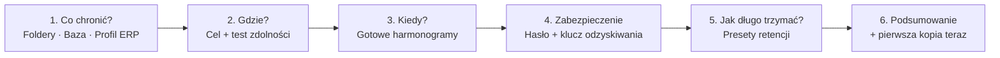

| Krok | Tryb Prosty | Tryb Zaawansowany | Walidacja |
|---|---|---|---|
| 1. Co | kafelki: „Dokumenty”, „Pulpit”, „Zdjęcia”, „Wybierz foldery”; wykrywanie ERP („Znaleziono Comarch ERP Optima — 1 baza konfiguracyjna, 3 firmy. Chronić?”) | drzewo z filtrami include/exclude (glob), opcje ACL/ADS/symlinki/OneDrive (3.6), wybór baz i trybu D5.2 | ostrzeżenie o plikach chmurowych i dużych folderach (szacunek rozmiaru w tle) |
| 2. Gdzie | „Dysk USB”, „Dysk sieciowy (NAS)”, „Serwer SFTP” | wszystkie providery, poświadczenie maintenance, parametry packów, limity pasma | **test zdolności (D4.5) obowiązkowy**; wynik jako plakietka „Chroni przed usunięciem: tak/nie” |
| 3. Kiedy | „Codziennie o 22:00”, „Po podłączeniu dysku”, „Co godzinę w czasie pracy” | edytor cron/kalendarza, okna czasowe, zależności (it. 7) | podgląd „najbliższe 5 uruchomień” |
| 4. Zabezpieczenie | hasło (min. 12 znaków, lista popularnych haseł odrzucana) + **ekran klucza odzyskiwania** | j.w. + KDF parametry (D3.5), przechowywanie DPAPI tak/nie | nie można przejść dalej bez potwierdzenia zapisania klucza (6.5) |
| 5. Retencja | „Standard: 30 dni codziennych + 12 miesięcznych”, „Minimalna: 14 dni”, „Archiwum: + 7 rocznych” | pełny edytor GFS + retentionLock (D3.7) | szacunek zajętości celu |
| 6. Podsumowanie | opis zdaniowy („Codziennie o 22:00 Kobian zaszyfruje i skopiuje…”) | j.w. + eksport JSON | przycisk „Wykonaj pierwszą kopię teraz” zaznaczony domyślnie |

### Decyzja D6.4 — Kreator kończy się prawdziwą kopią i mini-testem odtwarzania
- **Decyzja:** po pierwszej kopii UI proponuje „Sprawdź, czy działa”: odtworzenie jednego losowego pliku do folderu tymczasowego użytkownika i porównanie hash.
- **Alternatywy:** zakończenie na zapisie konfiguracji (większość narzędzi).
- **Uzasadnienie:** „backup bez testu odtworzenia nie istnieje” — buduje zaufanie P3 i jest dowodem dla P4.
- **Ryzyka:** wydłuża onboarding — test opcjonalny, ale przypominany na pulpicie do czasu wykonania.

## 6.5 Klucz odzyskiwania (rozstrzyga Q7 w warstwie UX)

### Decyzja D6.5 — Klucz odzyskiwania pokazywany raz, z obowiązkowym potwierdzeniem
- **Decyzja:** po utworzeniu repozytorium ekran „Twój klucz odzyskiwania”: 52 znaki Base32 w grupach po 4 + suma kontrolna (D3.4), akcje: „Zapisz jako PDF do wydruku”, „Zapisz do pliku” (zalecane: pendrive / sejf / menedżer haseł), „Kopiuj”. Przejście dalej wymaga **przepisania 2 losowych grup** (dowód zapisania). Ponowne wyświetlenie możliwe tylko dla roli Admin po ponownym uwierzytelnieniu Windows (6.7) i jest logowane.
- **Alternatywy:** brak klucza odzyskiwania (tylko hasło); klucz w chmurze producenta (escrow); fraza mnemoniczna BIP-39.
- **Uzasadnienie:** utrata hasła lub maszyny = utrata danych (ryzyko „krytyczny” w 1.9); escrow sprzeczny z 1.3 (brak chmury producenta); BIP-39 wymaga listy słów (licencja, tłumaczenie PL) — odrzucone dla MVP.
- **Ryzyka:** użytkownik zapisze klucz na tym samym dysku co dane → komunikat w kreatorze i na pulpicie („Klucz nie może być przechowywany na chronionym komputerze”); schowek czyszczony po 60 s.

## 6.6 Przeglądarka kopii i odtwarzanie

| Funkcja | Opis |
|---|---|
| **Oś czasu** | pasek/kalendarz snapshotów z oznaczeniem typu (pełny/przyr./różn./DB) i statusu weryfikacji (V2/V3/V4) |
| **Drzewo plików** | nawigacja jak w Eksploratorze, kolumny: rozmiar, data modyfikacji, „zmieniony w tym snapshotcie” |
| **Wyszukiwanie w wersjach** | „Znajdź `faktura_2026*.pdf` we wszystkich kopiach” → lista wersji z datami (indeks nazw w katalogu lokalnym; przy braku katalogu — z manifestów, wolniej) |
| **Porównanie wersji** | dwa snapshoty → lista dodanych/usuniętych/zmienionych plików (tree blobs, R&D it. 3) |
| **Podgląd** | tylko pliki tekstowe/obrazy ≤ 10 MB, dekodowane w pamięci, bez plików tymczasowych |
| **Cel odtworzenia** | „Do oryginalnej lokalizacji” (Admin), „Do innego folderu” (Operator — tylko folder, do którego użytkownik ma zapis), „Eksport do ZIP” |
| **Konflikty** | pomiń / nadpisz / zachowaj obie (sufiks `(odtworzony 2026-10-12)`) / nadpisz tylko starsze |
| **Restore DB** | kreator: snapshot → (dla łańcucha) suwak punktu w czasie → **domyślnie nowa baza z sufiksem `_restore_YYYYMMDD`**; nadpisanie produkcyjnej bazy wymaga roli Admin, wpisania nazwy bazy i potwierdzenia, że użytkownicy ERP są wylogowani |

Szczegóły logiki odtwarzania i scenariuszy — sekcja 8.

## 6.7 Uprawnienia w UI i ponowne uwierzytelnienie

- UI pokazuje tylko akcje dostępne dla roli z API (SEC-2.2); niedostępne — wyszarzone z wyjaśnieniem „wymaga roli Administrator Kobian”.
- **Step-up authentication** dla operacji krytycznych: zmiana/wyłączenie retentionLock, usunięcie snapshotu, wyświetlenie klucza odzyskiwania, zmiana odcisku host key, nadpisanie bazy produkcyjnej → systemowe okno poświadczeń Windows (`CredUIPromptForWindowsCredentials`) weryfikowane przez usługę; v1.1: Windows Hello.
- Brak UAC przy codziennej pracy: UI działa bez podwyższenia, całą uprzywilejowaną pracę wykonuje usługa.

## 6.8 CLI jako równorzędny interfejs

| Polecenie | Przykład | Uwagi |
|---|---|---|
| Status | `kobian status --json` | kody wyjścia: 0 OK, 1 Warning, 2 Failed, 3 brak połączenia z usługą |
| Uruchomienie | `kobian job run "ERP-noc" --wait` | strumień postępu na stderr, wynik JSON na stdout |
| Restore | `kobian restore --snapshot latest --path "D:\Dane\*.xlsx" --to C:\Restore` | |
| Repo offline | `kobian-restore` (osobne narzędzie, bez usługi — Q17) | odtwarzanie na „gołym” komputerze |
| Eksport/import | `kobian job export --all > zadania.json` | bez sekretów (`secretRef`) |

## 6.9 Wizualia, motyw, dostępność, lokalizacja

| Obszar | Decyzja |
|---|---|
| Motyw | Fluent (wbudowany w Avalonia), tryb jasny/ciemny/systemowy; tokeny kolorów stanów zdefiniowane raz (Chronione/Uwaga/Zagrożone) z kontrastem ≥ 4.5:1 w obu motywach |
| Dostępność | WCAG 2.1 AA: pełna obsługa klawiatury, kolejność fokusu, UI Automation (czytniki ekranu — NVDA/Narrator, test w it. 10), skalowanie 100–200%, brak informacji tylko kolorem |
| Lokalizacja | `.resx` PL/EN; **liczba mnoga w PL** (1 plik / 2 pliki / 5 plików) przez własny helper reguł CLDR (bez zależności); formaty dat/liczb wg kultury UI; logi i eksporty zawsze ISO-8601 i niezależne od języka; kody błędów `KB-xxxx` stałe między językami |
| Terminologia | słownik PL: „kopia” (backup), „migawka” (snapshot), „cel” (destination), „repozytorium”, „zachowywanie kopii” (retencja — w UI Prostym), „odtwarzanie”; terminy angielskie tylko w trybie Zaawansowanym w nawiasach |
| Powiadomienia desktop | toasty Windows z ikony zasobnika (wyłącznie stany Zagrożone/Uwaga i zakończenie ręcznie uruchomionej kopii) |

## 6.10 Mikrocopy — przykłady

| Sytuacja | Źle | Dobrze |
|---|---|---|
| Błąd SFTP host key | „Exception: HostKeyMismatch” | „Serwer kopii przedstawia się innym kluczem niż zwykle. To może oznaczać atak lub reinstalację serwera. Kopie są wstrzymane. [Porównaj odcisk] (KB-2104)” |
| Brak miejsca | „Write failed” | „Na dysku NAS zabrakło miejsca (wolne 0,4 GB z 2 TB). Kopia z dziś nie powstała. [Zwolnij miejsce: przegląd zachowywania kopii]” |
| Pominięte pliki | „3 errors” | „Skopiowano 41 210 plików. 3 pliki były otwarte w innym programie i zostały pominięte. [Pokaż pliki] [Włącz kopię plików otwartych (VSS)]” |

## 6.11 Plan badań użyteczności

| Persona | Zadania testowe | Kryterium sukcesu |
|---|---|---|
| P3 (5 osób) | skonfiguruj kopię Dokumentów na USB; odtwórz usunięty plik sprzed tygodnia | ≤ 5 min / ≤ 2 min, bez pomocy |
| P1 (5 osób) | chroń bazy Optimy na NAS z alertem e-mail; odtwórz bazę do nowej nazwy | ≤ 10 min / ≤ 5 min; 0 krytycznych błędów (np. nadpisanie produkcji) |
| P2 (3 osoby) | wyeksportuj zadanie i zaimportuj u „klienta” | ≤ 3 min |

Testy na klikalnym prototypie (przed implementacją) i na wersji beta; wyniki zasilają it. 10.

---

# Bezpieczeństwo — iteracja 6 (rola 11: Ekspert bezpieczeństwa)

1. **SEC-6.1 Brak web UI lokalnie (D6.3)** — akceptowane jako istotna redukcja powierzchni ataku; potwierdzone wymaganie testu „brak nasłuchu TCP” (SEC-2.1).
2. **SEC-6.2 Klucz odzyskiwania:** wyświetlany w oknie z flagą wykluczenia z przechwytywania ekranu (`SetWindowDisplayAffinity(WDA_EXCLUDEFROMCAPTURE)` — utrudnia zrzuty przez malware/zdalny pulpit; do weryfikacji w Avalonia), schowek czyszczony po 60 s, PDF generowany lokalnie bez zapisu w plikach tymczasowych poza wybranym przez użytkownika miejscem.
3. **SEC-6.3 Restore jako wektor eskalacji:** Operator odtwarza wyłącznie do folderu, do którego **sam** ma prawo zapisu — usługa sprawdza ACL wobec tokenu klienta (impersonacja `ImpersonateNamedPipeClient` podczas sprawdzenia), nie wobec własnych uprawnień `SeRestorePrivilege`.
4. **SEC-6.4 Step-up auth** dla operacji niszczących — realizuje ochronę przed przejęciem otwartej sesji UI (np. zdalny dostęp atakującego z TeamViewer/AnyDesk — częsty scenariusz ataków na MŚP).
5. **SEC-6.5 Hasła:** minimalnie 12 znaków + lista najpopularniejszych haseł (lista wbudowana — wymaga weryfikacji licencji źródła listy); brak limitu maksymalnej długości poniżej 256 znaków; brak reguł złożoności wymuszających wzorce (NIST SP 800-63B).
6. **SEC-6.6 Podgląd plików** w przeglądarce kopii używa wyłącznie dekoderów bezpiecznych (tekst, PNG/JPEG przez Avalonia/Skia) z limitem rozmiaru; brak podglądu dokumentów Office/PDF (złożone parsery).
7. **SEC-6.7 Import JSON zadań** (P2) — walidacja schematu, odrzucenie skryptów pre/post z importu bez jawnego zatwierdzenia przez Admin (import zadania z obcego źródła = potencjalne wykonanie kodu jako usługa).

### STRIDE — UI i CLI

| Zagrożenie | Kat. | Mitygacja |
|---|---|---|
| Malware w sesji użytkownika steruje UI | S, E | role per SID, step-up auth, Operator ograniczony do własnych folderów |
| Zrzut ekranu klucza odzyskiwania | I | SEC-6.2 |
| Zaprzeczenie wykonania operacji niszczącej | R | audyt z SID i czasem, eksport audytu (it. 9) |
| Złośliwy plik zadania JSON | E, T | SEC-6.7 |
| Zalewanie UI zdarzeniami logów | D | stronicowanie, bufor kołowy w UI, throttling strumienia |

---

# R&D — iteracja 6 (rola 12: Dział R&D)

| Rozwiązanie / technika | Co inspiruje | Ocena | Decyzja |
|---|---|---|---|
| **Apple Time Machine — oś czasu wersji** | nawigacja „w czasie” zamiast listy snapshotów | wysoka czytelność dla P3 | **Przyjęte** jako oś czasu w 6.6 (bez animacji 3D) |
| **Veeam SureBackup / „verified” badge** | widoczny dowód, że kopia była testowo odtworzona | buduje zaufanie, wspiera NIS2 | **Przyjęte**: plakietki V2/V3/V4 w osi czasu |
| **Kopia UI / Duplicati web UI** | pełna konfiguracja w przeglądarce | zarządzanie z dowolnego miejsca, ale ryzyka localhost-web | **Odrzucone lokalnie** (D6.3), przeniesione do Central v2 |
| **Command palette (Ctrl+K, jak VS Code)** | szybkie akcje dla P1/P2 („uruchom ERP-noc”, „pokaż ostatni błąd”) | niski koszt w Avalonia | **v1.1** |
| **„Restore drill” mode w UI** | ćwiczenie odtwarzania z checklistą i raportem PDF | dowód dla audytu (P4) | **Przekazane do it. 8** |

---

# 7. Harmonogramy i automatyzacja (iteracja 7 — Inżynier harmonogramów i automatyzacji)

Wejście: komponenty Scheduler → Kolejka → JobRunner (2.4, poziom 3), przepływ uruchomienia (2.5), wznawianie na granicy packów (4.7), okna czasowe i limity pasma (4.7), serializacja poświadczeń SMB (Q20), harmonogram referencyjny DB (5.8), presety kreatora (6.4), US-03, US-13, US-14. Zasada: **żadne uruchomienie nie może „zniknąć”** — każde zaplanowane wystąpienie kończy się zapisanym stanem, także gdy komputer był wyłączony.

## 7.1 Silnik harmonogramu

### Decyzja D7.1 — Własny, trwały scheduler w usłudze + Cronos do wyrażeń cron
- **Decyzja:** scheduler zaimplementowany w `Kobian.Infrastructure` (stan w `catalog.db`: tabele `Trigger`, `NextFire`, `Run`), do parsowania i wyliczania wystąpień cron — **Cronos 0.13.0** (MIT, HangfireIO).
- **Alternatywy:** Quartz.NET 4.4.0 (Apache-2.0, aktywny — 07.10.2026); Harmonogram zadań Windows (Task Scheduler) jako jedyny mechanizm; NCrontab.
- **Uzasadnienie:** potrzebujemy semantyki specyficznej dla backupu (polityki pominiętych uruchomień, blokady zasobów, okna z pauzą na granicy packa, zdarzenia urządzeń), którą w Quartz trzeba by i tak dopisać obok jego własnego schematu bazy; Cronos poprawnie obsługuje strefy czasowe i zmiany czasu (DST), a jest małą, łatwą do audytu biblioteką. Task Scheduler Windows używamy wyłącznie pomocniczo do wybudzania (7.5).
- **Ryzyka:** własny kod schedulera = ryzyko błędów brzegowych (DST, zmiana zegara, restart w trakcie) → testy oparte o `TimeProvider` (.NET 8+, fałszywy zegar) z tabelą przypadków granicznych (7.9).

### Model stanów uruchomienia

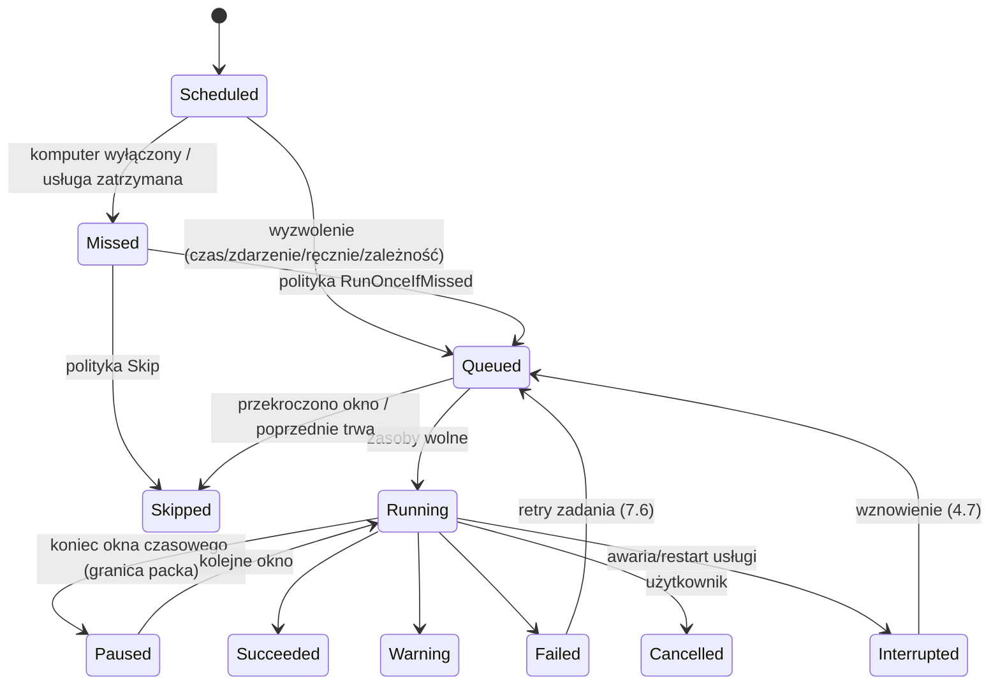

Każde przejście = zdarzenie domenowe zapisane w tabeli append-only (R&D it. 2) → podstawa alertów „brak kopii” (it. 9) i audytu.

## 7.2 Typy wyzwalaczy

| Typ | Przykład | Implementacja | MVP |
|---|---|---|---|
| **Kalendarz prosty** | codziennie 22:00; pn–pt 13:00; 1. dzień miesiąca | generowany do wyrażenia Cronos | ✔ |
| **Cron** | `*/30 7-20 * * 1-5` | Cronos (5 pól; opcjonalnie sekundy w trybie Zaawansowanym) | ✔ |
| **Interwał w oknie** | co 30 min w godz. 07:00–20:00 | wewnętrzny, zegar monotoniczny + okno | ✔ (log backup MSSQL, 5.8) |
| **Start systemu** | 10 min po starcie | `IHostedService` + opóźnienie + jitter | ✔ |
| **Logowanie/wylogowanie użytkownika** | kopia przy wylogowaniu | `SERVICE_CONTROL_SESSIONCHANGE` (WTS) | Should |
| **Podłączenie dysku** (US-14) | dysk USB z repo `repoId=…` | `SERVICE_CONTROL_DEVICEEVENT` + `RegisterDeviceNotification` (interfejs wolumenów) → dopasowanie GUID wolumenu **i** zweryfikowanego `kobian.repo` (SEC-7.3) | Should |
| **Dostępność sieci/celu** | gdy NAS osiągalny | `NetworkChange` + sonda celu (debounce 2 min) | v1.1 |
| **Bezczynność** | gdy komputer bezczynny ≥ 15 min | `GetLastInputInfo` przez komponent sesyjny (ikona zasobnika) | v1.1 |
| **Przed zamknięciem systemu** | małe zadania przy shutdown | `SERVICE_ACCEPT_PRESHUTDOWN` — ograniczony czas | Could (ryzyko przerwania) |
| **Zależność** | po sukcesie zadania „ERP-dump” | DAG (7.4) | ✔ |
| **Ręcznie / API / CLI** | `kobian job run` | gRPC | ✔ |

### Decyzja D7.2 — Strefy czasowe i zmiana czasu
- **Decyzja:** harmonogram zapisywany z jawną strefą (`Europe/Warsaw` domyślnie z systemu, identyfikator IANA i Windows); przy „dziurze” (zmiana na czas letni, 02:00–03:00 nie istnieje) zadanie uruchamia się w pierwszej poprawnej chwili; przy „nakładce” (zmiana na czas zimowy) — **raz**, przy pierwszym wystąpieniu. Interwały liczone zegarem monotonicznym, kalendarz — zegarem ściennym.
- **Alternatywy:** wszystko w UTC (zadania „przesuwają się” o godzinę dla użytkownika); naiwne czasy lokalne (podwójne/pominięte uruchomienia).
- **Uzasadnienie:** zgodność z oczekiwaniem P1 („o 22:00 czasu polskiego”) bez podwójnych kopii; zachowanie zgodne z obsługą DST w Cronos.
- **Ryzyka:** skok zegara (ręczna zmiana, NTP) → nasłuch zmiany czasu systemowego i ponowne wyliczenie `NextFire`; skok w tył nie powoduje powtórzenia już wykonanego wystąpienia (porównanie z ostatnim `Run`).

## 7.3 Wyłączony komputer i pominięte uruchomienia

### Decyzja D7.3 — Polityki „misfire” per zadanie
- **Decyzja:**
  - `RunOnceIfMissed` (domyślna): po starcie usługi, jeśli minęło ≥ 1 wystąpienie, wykonaj **jedno** uruchomienie po opóźnieniu 5 min + losowy jitter 0–5 min (nie obciążamy startu systemu i nie startują wszystkie stacje w firmie naraz).
  - `Skip`: tylko zapis `Missed` (np. zadania w oknie nocnym na serwerze, gdzie dzienne uruchomienie przeszkadzałoby ERP).
  - `RunIfMissedWithin(T)`: nadrabiaj tylko, jeśli spóźnienie < T (np. 12 h).
  - Logi transakcyjne MSSQL: zawsze `RunOnceIfMissed` — jedna kopia logu obejmuje cały zaległy zakres.
- **Alternatywy:** zawsze pomijaj (Cobian domyślnie — do weryfikacji), zawsze nadrabiaj wszystkie.
- **Uzasadnienie:** laptopy P3 rzadko są włączone o 22:00; brak nadrabiania = brak kopii tygodniami. Wzorzec anacron / systemd `Persistent=true` / Task Scheduler „Run task as soon as possible after a scheduled start is missed”.
- **Ryzyka:** nadrabianie w złym momencie (prezentacja, bateria) → warunki zasilania i sieci (7.5) mają pierwszeństwo; alert „brak kopii” liczony niezależnie (it. 9), więc pominięcie nigdy nie jest ciche.

## 7.4 Kolejkowanie, współbieżność i zależności

### Decyzja D7.4 — Kolejka z blokadami zasobów zamiast prostego limitu równoległości
- **Decyzja:** uruchomienie startuje, gdy uzyska wszystkie wymagane **blokady zasobów**:

| Zasób | Klucz blokady | Typ | Powód |
|---|---|---|---|
| Zadanie | `job:<id>` | wyłączna | to samo zadanie nigdy równolegle; drugie wystąpienie → `Skipped (poprzednie trwa)` lub kolejka 1 (opcja) |
| Repozytorium | `repo:<repoId>` | współdzielona dla backupu, wyłączna dla prune/check (3.8) | spójność repo |
| Cel SMB z poświadczeniem | `smb:<serwer>:<konto>` | wyłączna per **różne** konto na tym samym serwerze | **rozwiązuje błąd 1219 (Q20)**: różne konta do jednego serwera są serializowane; to samo konto współdzielone |
| Baza danych | `db:<instancja>:<baza>` | wyłączna | jeden backup bazy naraz (5.7) |
| Wolumen źródłowy VSS | `vss:<volumeGuid>` | współdzielona (jeden snapshot dla wielu zadań w tym samym czasie) | VSS ma limit równoległych snapshotów — reużycie |
| Globalny limit | `global` | semafor (domyślnie 2 serwer / 1 laptop) | zasoby maszyny |

- **Priorytety:** `High` (log MSSQL, zadania ręczne), `Normal`, `Low` (weryfikacja V3, replikacja offsite); w obrębie priorytetu FIFO; ochrona przed zagłodzeniem (wiek w kolejce podnosi priorytet).
- **Zależności (DAG):** „po A (sukces)”, „po A (zawsze)”, „po A i B”; walidacja cykli przy zapisie; łańcuch przykładowy dla P1: `ERP-dump (DB)` → `Pliki ERP + załączniki` → `Replikacja repo na USB/offsite`.
- **Alternatywy:** stały limit N równoległych zadań (Cobian — kolejka sekwencyjna).
- **Uzasadnienie:** konflikty dotyczą zasobów, nie liczby zadań; model blokad usuwa klasę problemów (1219, równoległe prune, dwa backupy jednej bazy).
- **Ryzyka:** zakleszczenia przy wielu blokadach → pobieranie blokad w ustalonej kolejności (globalny porządek kluczy), timeout oczekiwania → `Skipped` z przyczyną.

### Decyzja D7.5 — Nowy typ zadania „Replikacja repozytorium” (3-2-1)
- **Decyzja:** zadanie kopiujące snapshoty z repo A do repo B (inny cel) bez ponownego czytania źródła: packi są deszyfrowane i ponownie szyfrowane kluczami B (różne `K_id` — SEC-3.7), z weryfikacją V2 na B. Kategoria **Should**.
- **Alternatywy:** dwa niezależne zadania backupu ze źródła (podwójne obciążenie źródła, różne punkty w czasie); kopia plików repo 1:1 (te same klucze w dwóch miejscach — kompromitacja jednego klucza = obu kopii).
- **Uzasadnienie:** realizuje zasadę 3-2-1 przy jednym odczycie ERP; podobne do `restic copy` / Kopia „sync-to”.
- **Ryzyka:** koszt CPU (re-szyfrowanie) — akceptowalny, zadanie o priorytecie Low.

## 7.5 Zasilanie, wybudzanie, sieć

| Sytuacja | Zachowanie |
|---|---|
| **Wake-on-schedule** | opcja per zadanie: `SetWaitableTimerEx` z `fResume=TRUE` na 2 min przed wystąpieniem; fallback: zadanie Harmonogramu Windows z `WakeToRun` utworzone przez instalator. Wymaga włączonych „timerów wybudzania” w planie zasilania — UI sprawdza (`powercfg`-ekwiwalent przez API) i ostrzega. Po zakończeniu: powrót do uśpienia **tylko** jeśli to Kobian wybudził, a w trakcie nie było aktywności użytkownika (Could) |
| **Wake-on-LAN celu** | wbudowana akcja „Wybudź NAS”: magic packet na MAC celu, oczekiwanie na osiągalność SMB/SFTP (do 5 min) — zastępuje typowe skrypty |
| **Bateria** | laptop na baterii < 30% → odroczenie (stan `Queued` z przyczyną); poniżej 15% przerwanie na granicy packa |
| **Sieć taryfowana (metered)** | zadania na cele zdalne odraczane (opcja „ignoruj”); lokalne/USB działają |
| **Tryb oszczędzania / gra / prezentacja** | `SHQueryUserNotificationState` (przez komponent sesyjny): odroczenie do 2 h dla zadań nie-krytycznych |
| **Zamykanie systemu w trakcie kopii** | usługa przyjmuje `PRESHUTDOWN`, kończy bieżący pack, zapisuje stan `Interrupted` → wznowienie po starcie (4.7) |

## 7.6 Okna czasowe i ponawianie

- **Okno czasowe** zadania (np. 20:00–06:00): poza oknem zadanie nie startuje; uruchomione i trwające po końcu okna → **pauza na granicy packa** (`Paused`), kontynuacja w następnym oknie (snapshot atomowy, 3.1); opcja „dokończ mimo okna” dla zadań krytycznych.
- **Okna pasma** (4.7) mogą być niezależne od okien uruchomień (np. start 18:00, limit pasma do 20:00).
- **Ponawianie zadania** (poziom wyżej niż retry operacji w 4.7): domyślnie 2 ponowienia co 30 min dla błędów przejściowych; błędy trwałe (poświadczenia, host key) — bez ponowień. Alert przy pierwszym błędzie konfigurowalny (domyślnie: dopiero po wyczerpaniu ponowień, chyba że błąd trwały).
- **Kalendarz wyjątków:** wbudowany kalendarz świąt PL (wyliczany, w tym święta ruchome: Wielkanoc, Boże Ciało — algorytm, bez zależności) i firmowe dni wolne; akcja „pomiń” lub „przesuń”.

## 7.7 Skrypty i akcje pre/post (US-13)

### Decyzja D7.6 — Akcje wbudowane przed skryptami; skrypty tylko z chronionego katalogu i z przypiętym hashem
- **Decyzja:**
  - **Akcje wbudowane** (bez kodu użytkownika): zatrzymaj/uruchom usługę Windows, czekaj na plik/port, wybudź NAS (WoL), wykonaj zapytanie SQL (tylko odczyt lub procedura z listy), zamknij/uśpij komputer po zakończeniu, uruchom inne zadanie.
  - **Skrypty**: PowerShell (`.ps1`), `.cmd`, `.exe` — tylko z `%ProgramData%\Kobian\scripts` (ACL: zapis wyłącznie Administrators/SYSTEM); definicja zadania przechowuje **SHA-256 skryptu**; przy niezgodności uruchomienie odmówione (`Failed: skrypt zmieniony`), zmiana wymaga zatwierdzenia przez Admin (step-up, 6.7).
  - Wykonanie w `Kobian.Worker` (SEC-2.5) z timeoutem (domyślnie 10 min), katalogiem roboczym = katalog skryptów, przekazanymi zmiennymi: `KOBIAN_JOB_ID`, `KOBIAN_RUN_ID`, `KOBIAN_PHASE` (`pre|post`), `KOBIAN_STATUS`, `KOBIAN_SNAPSHOT_ID` — **nigdy sekrety**.
  - Polityka kodu wyjścia: `0` OK; inne → per akcja: przerwij zadanie / ostrzeżenie / ignoruj. Post-skrypt uruchamia się także po błędzie (opcja „tylko po sukcesie”).
- **Alternatywy:** dowolna ścieżka skryptu (Cobian), inline-skrypty w konfiguracji.
- **Uzasadnienie:** skrypty pre/post wykonywane z uprawnieniami usługi to klasyczny wektor eskalacji (STRIDE E, it. 1); akcje wbudowane pokrywają większość realnych przypadków (zatrzymanie usługi aplikacji, wybudzenie NAS).
- **Ryzyka:** mniejsza elastyczność dla P2 → katalog przykładów skryptów w dokumentacji; PowerShell z `-ExecutionPolicy AllSigned` jako opcja dla firm z PKI.

## 7.8 Konfiguracja przykładowa (JSON — eksport, bez sekretów)

```json
{
  "id": "erp-noc",
  "type": "database",
  "source": { "provider": "mssql", "instance": ".\\OPTIMA", "profile": "comarch-optima", "mode": "copyOnlyFull" },
  "destination": { "repoRef": "nas-repo", "credential": { "backup": "secretRef:nas-backup" } },
  "schedule": {
    "triggers": [ { "type": "calendar", "cron": "0 22 * * *", "timeZone": "Europe/Warsaw" } ],
    "misfire": "runOnceIfMissed",
    "window": { "start": "20:00", "end": "06:00", "onWindowEnd": "pauseAtPackBoundary" },
    "wake": true,
    "retries": { "count": 2, "delayMinutes": 30 }
  },
  "pre":  [ { "action": "wakeOnLan", "mac": "<MAC-NAS>", "waitFor": "smb", "timeoutMinutes": 5 } ],
  "post": [ { "action": "runJob", "jobId": "replikacja-usb", "when": "success" } ],
  "priority": "normal"
}
```

## 7.9 Przypadki brzegowe do testów (przekazanie do it. 10)

| # | Scenariusz | Oczekiwane zachowanie |
|---|---|---|
| E1 | Wystąpienie 02:30 w noc zmiany na czas letni | uruchomienie 03:00, jedno |
| E2 | Wystąpienie 02:30 w noc zmiany na czas zimowy | jedno uruchomienie (pierwsze 02:30) |
| E3 | Komputer wyłączony 5 dni, polityka RunOnceIfMissed | 1 uruchomienie po starcie + jitter; 5 wpisów `Missed` w historii |
| E4 | Restart usługi w trakcie uploadu | `Interrupted` → wznowienie bez ponownego wysyłania packów |
| E5 | Ręczna zmiana zegara o +1 dzień i powrót | brak podwójnych uruchomień, przeliczenie `NextFire` |
| E6 | Dwa zadania do `\\nas` z różnymi kontami | serializacja (D7.4), brak błędu 1219 |
| E7 | Cykl zależności A→B→A przy zapisie | odrzucenie z komunikatem |
| E8 | Zmiana treści skryptu pre | `Failed: skrypt zmieniony`, alert |
| E9 | Podłączenie dysku USB z podrobionym `kobian.repo` | odmowa zapisu, alert bezpieczeństwa (SEC-7.3) |
| E10 | Koniec okna w trakcie 200 GB kopii | `Paused`, kontynuacja w następnym oknie, jeden snapshot |

---

# Bezpieczeństwo — iteracja 7 (rola 11: Ekspert bezpieczeństwa)

1. **SEC-7.1 Skrypty (D7.6)** — akceptacja; dodatkowo: przed wykonaniem skrypt kopiowany do prywatnego katalogu tymczasowego Workera i tam weryfikowany hashem (ochrona przed TOCTOU — podmiana między sprawdzeniem a uruchomieniem); `PATH` Workera ograniczony do katalogów systemowych (DLL/binary planting).
2. **SEC-7.2 Import zadań z akcjami** — akcje `runSql`, `stopService` oraz skrypty z importowanego JSON nieaktywne do zatwierdzenia przez Admin (spójne z SEC-6.7).
3. **SEC-7.3 Wyzwalacz USB** — atakujący może podłączyć dysk z kopią pliku `kobian.repo` (ten sam `repoId`), by przechwycić kolejne kopie. Mitygacja: przed zapisem usługa weryfikuje MAC nagłówka repo kluczem `K_mac` (D3.4) i obecność znanych snapshotów; brak zgodności = odmowa i alert „nieznany nośnik udaje repozytorium”. Dane i tak są szyfrowane, ale napastnik zyskałby metadane rozmiarów i możliwość DoS.
4. **SEC-7.4 Zdarzenia jako DoS** — debounce (min. 2 min) i limit uruchomień z wyzwalaczy zdarzeniowych (np. maks. 6/h), aby wielokrotne podłączanie urządzenia nie zalewało systemu.
5. **SEC-7.5 Wake timers i shutdown** — akcje „wyłącz/uśpij po zakończeniu” tylko z roli Admin; brak możliwości wywołania przez Operatora (nadużycie = DoS stacji).
6. **SEC-7.6 Integralność harmonogramu** — zmiana/wyłączenie harmonogramu zadania krytycznego (oznaczonego „chronione”) wymaga step-up i generuje zdarzenie audytowe; napastnik wyłączający kopie przed atakiem ransomware to typowy scenariusz (wyłączenie = alert w it. 9, nie cicha zmiana).
7. **SEC-7.7 Akcja `runSql`** — wykonywana loginem o minimalnych prawach (osobny `secretRef`), domyślnie w transakcji tylko do odczytu; brak dynamicznego składania SQL z danych zadania.

### STRIDE — scheduler i automatyzacja

| Zagrożenie | Kat. | Mitygacja |
|---|---|---|
| Podmiana skryptu pre/post | T, E | ACL katalogu, przypięty hash, kopia przed wykonaniem |
| Podrobione repo na USB | S, I | MAC nagłówka `K_mac`, weryfikacja snapshotów |
| Ciche wyłączenie harmonogramu przez napastnika | T, R | step-up, audyt, alert o wyłączeniu i braku kopii |
| Zalew zdarzeń | D | debounce, limity |
| Wyciek sekretów do skryptu przez zmienne | I | zakaz przekazywania sekretów (D7.6) |

---

# R&D — iteracja 7 (rola 12: Dział R&D)

| Rozwiązanie / technika | Opis | Ocena | Decyzja |
|---|---|---|---|
| **anacron / systemd timers `Persistent=true`** | nadrabianie pominiętych uruchomień po włączeniu | dokładnie potrzebna semantyka | **Przyjęte** jako wzorzec D7.3 |
| **Durable execution (Temporal, Azure Durable Functions)** | wznawialne przepływy z historią zdarzeń | idea trafna (checkpoint na granicy packa), platformy zbyt ciężkie | **Odrzucone jako zależność**, przyjęta idea checkpointów |
| **Bacula — priorytety i rezerwacja zasobów (Storage/Device)** | kolejka z rezerwacją urządzeń | model blokad zasobów | **Przyjęte koncepcyjnie** (D7.4) |
| **Quartz.NET 4.4** | dojrzały scheduler z klastrowaniem | klastrowanie zbędne lokalnie; użyteczne w Central v2 (rozsyłanie polityk) | **Odroczone do v2 (Central)** |
| **Kalendarz świąt jako dane vs algorytm** | biblioteki świąt (np. Nager.Date) | zależność dla 13 dat rocznie — algorytm (Gauss/Meeus dla Wielkanocy) wystarczy | **Odrzucona zależność**, własny algorytm |

---

# 8. Odtwarzanie i Disaster Recovery (iteracja 8 — Inżynier odtwarzania i DR)

Wejście: format repo i atomowy commit (3.1, D3.1), kompletne manifesty (D3.2), V1–V4 (3.7), hierarchia kluczy i klucz odzyskiwania (D3.4, D6.5), restore jako parser niezaufanych danych (SEC-3.3), przeglądarka kopii i restore DB w UI (6.6), restore Operatora tylko do własnych folderów (SEC-6.3), replikacja repo (D7.5), otwarte Q14, Q17, Q18, Q23, Q28. Zasada: **projektujemy pod najgorszy dzień** — komputer i katalog nie istnieją, dostępne są tylko cel, hasło lub klucz odzyskiwania i dokumentacja.

## 8.1 Cele RPO/RTO i ich pomiar

| Pojęcie | Definicja w Kobian | Skąd dane |
|---|---|---|
| **RPO** (maks. utrata danych) | czas od ostatniego **zweryfikowanego** (≥ V2) snapshotu | harmonogram + historia uruchomień |
| **RTO** (czas odtworzenia) | szacowany czas odtworzenia całego zadania = rozmiar / zmierzona przepustowość restore z ostatniego testu V4 | test restore (8.6) |
| **Cele per zadanie** | użytkownik deklaruje RPO/RTO (np. ERP: RPO 30 min, RTO 2 h); pulpit pokazuje „spełnione/niespełnione” | 6.3, alerty it. 9 |

## 8.2 Rodzaje odtwarzania

| Rodzaj | Opis | Rola (SEC-2.2/6.3) | MVP |
|---|---|---|---|
| Selektywne pliki/foldery | z dowolnego snapshotu, wyszukiwanie w wersjach | Operator (do własnego folderu) / Admin | ✔ |
| Pełny snapshot | całe zadanie do lokalizacji oryginalnej lub innej | Admin | ✔ |
| Eksport | snapshot/podzbiór → ZIP (bez szyfrowania lub z AES — ostrzeżenie RODO) lub folder | Operator | ✔ |
| Punkt w czasie — pliki | wybór najbliższego snapshotu ≤ T | jak wyżej | ✔ |
| Punkt w czasie — MSSQL | pełna (+ różnicowa) + logi `WITH STOPAT = T` (tylko „Łańcuch Kobian”, D5.2) | Admin | Should |
| Baza do nowej nazwy | domyślny tryb restore DB (6.6) | Admin | ✔ |
| Na innym komputerze | dostęp do repo hasłem/kluczem odzyskiwania, bez DPAPI starego hosta | Admin | ✔ |
| Montowanie snapshotu jako dysku | przeglądanie w Eksploratorze | — | v2 (8.9, D8.4) |
| Bare-metal (obraz systemu) | — | — | **W** (US-26) — plan DR w 8.7 |

## 8.3 Silnik odtwarzania

### Decyzja D8.1 — Restore planowany „po packach”, nie „po plikach”
- **Decyzja:** dla wybranego zbioru plików planner wylicza potrzebne bloki, grupuje je według packów i czyta każdy pack **jeden raz** (odczyt zakresowy `OpenReadAsync(path, offset)` dla providerów, które to wspierają — 4.1; dla pozostałych cały pack do bufora tymczasowego), rozdzielając bloki do plików docelowych. Zapis: najpierw treść (pliki rzadkie zachowane — 3.6), potem atrybuty, znaczniki czasu, na końcu ACL (żeby nie zablokować sobie zapisu).
- **Alternatywy:** odtwarzanie plik po pliku (proste, ale ten sam pack pobierany wielokrotnie — katastrofalne na FTP/SFTP przy przyrostach).
- **Uzasadnienie:** czas restore ograniczony transferem; wzorzec restic (restorer z kolejnością packów).
- **Ryzyka:** pliki otwarte częściowo przez długi czas (wiele packów) → zapis do `*.kobian-partial` i atomowy rename po weryfikacji hash; przerwanie → **dziennik restore** pozwala wznowić (analogicznie do 4.7).

Weryfikacja przy restore (zawsze): MAC bloku przed dekompresją (SEC-3.3), hash pliku wobec manifestu po złożeniu; niezgodność = plik oznaczony jako uszkodzony w raporcie, nie zapisany w miejscu docelowym (opcja „zapisz mimo to do kwarantanny”).

### Polityki konfliktów (rozwinięcie 6.6)
`Skip` (domyślnie przy restore do oryginału), `Overwrite`, `OverwriteIfOlder`, `KeepBoth` (sufiks z datą), `AskEach` (tylko UI). Tryb **dry-run** pokazuje plan: liczba plików, rozmiar, konflikty, szacowany czas — obowiązkowy podgląd przed restore pełnym do lokalizacji oryginalnej.

## 8.4 Odtwarzanie baz danych

| Silnik | Przebieg | Kroki po odtworzeniu |
|---|---|---|
| **MSSQL** | strumień `.bak` z repo → staging (MVP) / VDI (v1.1) → `RESTORE DATABASE [nowa_nazwa] FROM DISK … WITH MOVE …, CHECKSUM, NORECOVERY` → różnicowa → logi `STOPAT` → `RECOVERY` | naprawa użytkowników osieroconych (`ALTER USER … WITH LOGIN`), `TRUSTWORTHY OFF`, kontrola `compatibility_level`; dla nadpisania produkcji: `SINGLE_USER WITH ROLLBACK IMMEDIATE` dopiero po potwierdzeniu (6.6) |
| **Comarch Optima** | baza konfiguracyjna + firmowe **z tej samej grupy spójności** (5.1) | zachowanie identyfikatorów w `CDN.Bazy`; przy restore konfiguracyjnej poza programem — instrukcja utworzenia pustej konfiguracyjnej w Optimie w celu odtworzenia loginów (5.3, pomoc Comarch) |
| **InsERT GT/nexo, Symfonia** | restore do nowej nazwy + instrukcja podłączenia w programie | instrukcje producenta (Q22) dołączone do raportu |
| **MySQL/MariaDB** | import dumpa do **nowego schematu** w procesie Worker (`mysql` klienta użytkownika) | domyślnie bez `DEFINER` z obcymi kontami (filtr) — SEC-8.4 |
| **PostgreSQL** | `pg_restore --dbname nowa --no-owner` (opcjonalnie `--role`) + globals | brak wykonania plain SQL przez `psql` (CVE-2025-8714, SEC-5.4) |
| **SQLite** | plik do lokalizacji tymczasowej → `integrity_check` → podmiana przy zamkniętej aplikacji | — |

## 8.5 Katalog (indeks) i jego cykl życia

### Decyzja D8.2 — Katalog lokalny jest pamięcią podręczną; źródłem prawdy jest repozytorium
- **Decyzja:** wszystko, co potrzebne do odtworzenia, znajduje się w repo (manifesty, indeksy, nagłówek z opakowanymi kluczami). `catalog.db` przechowuje kopie metadanych dla szybkości (historia, wyszukiwanie nazw), a `kobian catalog rebuild --repo <cel>` odbudowuje go z repo.
- **Alternatywy:** katalog jako jedyne źródło metadanych (Bacula — utrata katalogu = żmudny bscan).
- **Uzasadnienie:** scenariusz „komputer nie istnieje” jest podstawowym scenariuszem DR.
- **Ryzyka:** rozjazd katalogu i repo (snapshot usunięty na celu poza Kobian) → okresowa rekoncyliacja przy każdym uruchomieniu (lista `snapshots/` vs katalog) i **alert o zniknięciu snapshotu** (SEC-3.4, it. 9).

**Indeks nazw do wyszukiwania (rozwiązanie Q28):** dla każdego snapshotu zapisywane są tylko wpisy zmienione względem poprzedniego (delta: dodane/zmienione/usunięte) + słownik ścieżek z kompresją prefiksów. Szacunek: 1 mln plików, 1% zmian dziennie, 365 snapshotów → ok. 1 mln + 3,65 mln wpisów, przy ~100 B/wpis ≈ **0,5 GB** — akceptowalne dla serwera; dla laptopów P3 limit historii wyszukiwania (np. 90 dni) z fallbackiem na przeszukiwanie manifestów z repo. Wartości do weryfikacji benchmarkiem (it. 10).

**Szyfrowanie katalogu (rozwiązanie Q14):** **nie** w MVP — katalog chroniony ACL (2.6) i zalecanym BitLockerem, jest odtwarzalny z repo, a SQLCipher dodałby natywną zależność z osobnym cyklem łatek. Ryzyko (nazwy plików jako dane osobowe na hoście, który i tak przechowuje oryginały) zaakceptowane i udokumentowane.

### Decyzja D8.3 — „Przejęcie repozytorium” przy wymianie komputera
- **Decyzja:** nowy komputer: instalacja → „Podłącz istniejące repozytorium” → cel + hasło lub klucz odzyskiwania → wybór: (a) **kontynuuj jako ten sam host** (przejęcie `hostId`, łańcuch przyrostów kontynuowany, poprzedni host oznaczony jako wycofany) lub (b) dodaj jako nowy host (osobne łańcuchy w jednym repo). MK opakowywany kluczem DPAPI nowego hosta; opakowanie starego hosta usuwane (wymaga poświadczenia maintenance, w przeciwnym razie oznaczane jako unieważnione w nagłówku).
- **Alternatywy:** eksport/import pliku katalogu między maszynami.
- **Uzasadnienie:** najczęstszy realny scenariusz P1/P2 (awaria/wymiana serwera ERP); brak potrzeby przenoszenia `catalog.db`.
- **Ryzyka:** dwa hosty jednocześnie jako ten sam `hostId` (stary jeszcze działa) → blokady w `locks/` z `hostId` + identyfikatorem instalacji; konflikt = odmowa i alert.

### Uzupełnienie formatu (patrz Korekty K8.1)
Aby `catalog rebuild` i naprawa repo działały także przy utracie plików `index/`, każdy pack zawiera na końcu **zaszyfrowany trailer** z listą `chunkId, offset, length` (wzorzec nagłówka packa restic) — indeks staje się odtwarzalny skanem packów.

## 8.6 Automatyczne testy odtwarzania (V4, US-21)

### Decyzja D8.4 — „Restore drill” jako typ zadania z raportem dowodowym
- **Decyzja:** zadanie typu `RestoreTest` w harmonogramie (domyślnie: tygodniowo dla DB, miesięcznie dla plików), priorytet Low (D7.4):
  - **Pliki:** losowa próbka N plików (domyślnie 200 + wszystkie pliki z listy „krytyczne”) z ostatniego snapshotu i z jednego losowego starszego → restore do piaskownicy (`%ProgramData%\Kobian\sandbox`, limit miejsca) → porównanie hash z manifestem **i** (gdy plik źródłowy nie zmienił się od snapshotu) z oryginałem.
  - **MSSQL:** restore do instancji testowej — domyślnie **SQL Server Express LocalDB** na hoście lub wskazanej instancji testowej → `DBCC CHECKDB WITH NO_INFOMSGS` → zapytanie kontrolne profilu ERP (np. liczba dokumentów `dok__Dokument` w Subiekcie GT, liczba firm w `CDN.Bazy` w Optimie) porównane z wartością zapisaną przy backupie → usunięcie bazy testowej.
  - **MySQL/PostgreSQL:** import do schematu/bazy tymczasowej → kontrola liczby tabel i wierszy wybranych tabel → usunięcie.
  - **Raport:** JSON + PDF (czas, zakres, wynik, zmierzona przepustowość → RTO, sumy kontrolne) zapisany w repo (`reports/`) i katalogu — dowód dla P4 (NIS2/RODO art. 32 ust. 1 lit. d: regularne testowanie skuteczności środków).
- **Alternatywy:** tylko V3 (odczyt i MAC packów); ręczne testy.
- **Uzasadnienie:** jedyny pełny dowód odtwarzalności; zapytania kontrolne ERP wykrywają kopie „technicznie poprawne, logicznie puste” (np. kopia złej bazy).
- **Ryzyka:** LocalDB ma limity edycji Express i wymaga wersji ≥ wersji źródła (do weryfikacji, Q31); test kopiuje dane osobowe do piaskownicy → usuwanie po teście i ACL (SEC-8.2).

## 8.7 Plan DR i „Zestaw ratunkowy”

### Decyzja D8.5 — Zestaw ratunkowy (DR kit) zamiast bare-metal w MVP
- **Decyzja:** kreator „Utwórz zestaw ratunkowy” zapisuje na pendrive/do folderu: przenośny `kobian-restore.exe` (podpisany, bez instalacji — Q17), plik `repos.json` z adresami celów i odciskami host key/certyfikatów (**bez haseł i kluczy**), wydrukowalny **runbook PDF** dopasowany do konfiguracji (kolejność odtwarzania: system → ERP → bazy → pliki; kontakty; gdzie jest klucz odzyskiwania — opis miejsca, nie klucz). Bare-metal: rekomendacja narzędzia obrazującego (np. obraz systemu Windows lub zewnętrzne narzędzie — do oceny w v2) + Kobian do danych i baz.
- **Alternatywy:** własny obraz systemu z WinPE (duży zakres: sterowniki, UEFI, BitLocker); brak planu.
- **Uzasadnienie:** dla MŚP najdłuższą częścią RTO jest „co teraz zrobić”, nie transfer; runbook + narzędzie offline skraca to bezpośrednio.
- **Ryzyka:** zestaw nieaktualny po zmianach konfiguracji → przypomnienie po każdej zmianie celu/zadania i data ważności na pulpicie.

**Otwarta specyfikacja (rozwiązanie Q17):** specyfikacja „Kobian Repo v1” (nagłówek, KDF, opakowania klucza, pack + trailer, indeks, manifest, wektory testowe) publikowana jako dokument publiczny wraz z kodem `kobian-restore` (licencja w it. 10) — odtwarzalność nie zależy od istnienia firmy/produktu.

## 8.8 Scenariusze awarii

| # | Scenariusz | Wykrycie | Procedura | Warunek sukcesu |
|---|---|---|---|---|
| S1 | Awaria dysku serwera ERP | brak heartbeat / alert it. 9 | nowy serwer → instalacja SQL + ERP → D8.3 przejęcie repo → restore baz (grupa spójności) → plików | RTO zgodne z deklaracją; zapytania kontrolne ERP OK |
| S2 | Ransomware na hoście, cel nienaruszony | EDR/użytkownik; nagły skok zmian w przyrostach (it. 9, anomalie — R&D) | izolacja → czysta instalacja → restore z ostatniego snapshotu **sprzed** infekcji (oś czasu + raport zmian) | brak zaszyfrowanych plików w restore |
| S3 | Ransomware zaszyfrował też NAS (SMB) | V2/V3 błędy MAC, zniknięcie snapshotów | restore z repliki offsite/USB (D7.5) lub z migawek NAS (4.6) | istnieje kopia poza zasięgiem kont hosta |
| S4 | Utrata hasła repo | — | klucz odzyskiwania (D6.5); bez niego, przy działającym hoście — DPAPI pozwala ustawić nowe hasło | dostęp bez utraty danych |
| S5 | Utrata hosta **i** hasła **i** klucza odzyskiwania | — | **brak możliwości odzyskania** — komunikowane wprost w kreatorze (6.5) | (świadomie zaakceptowane ryzyko) |
| S6 | Brakujący/uszkodzony pack | V2/V3 | `kobian check --repair`: identyfikacja dotkniętych snapshotów i plików, oznaczenie, wymuszenie kopii pełnej; pozostałe snapshoty nadal odtwarzalne | raport zakresu strat |
| S7 | Utrata/uszkodzenie `catalog.db` | błąd startu usługi / integrity_check | automatyczny `catalog rebuild` z repo | historia snapshotów kompletna |
| S8 | Logiczne uszkodzenie danych ERP (błędny import, usunięte dokumenty) odkryte po 2 dniach | użytkownik | restore DB do nowej nazwy z punktu sprzed błędu (PITR lub snapshot) → porównanie → decyzja o podmianie | brak nadpisania produkcji bez decyzji |
| S9 | Plik usunięty 3 miesiące temu | użytkownik | wyszukiwanie w wersjach (indeks / manifesty) → snapshot miesięczny GFS | plik odtworzony |
| S10 | Pożar/kradzież w biurze | — | DR kit + replika offsite | pełne odtworzenie w nowej lokalizacji |
| S11 | Insider/napastnik z kontem admina usuwa kopie | alert o zmianie retencji/usunięciu (SEC-7.6) | retentionLock + append-only + offsite | snapshoty z okresu blokady nienaruszone |

## 8.9 Montowanie snapshotów (v2)

### Decyzja D8.6 — Brak sterownika systemu plików w MVP
- **Decyzja:** montowanie snapshotu jako dysku (WinFsp/Dokan) odroczone do v2 i obwarowane audytem; w MVP: przeglądarka kopii + eksport.
- **Alternatywy:** WinFsp (GPLv3 z wyjątkiem FLOSS lub licencja komercyjna), Dokany, udział SMB serwowany lokalnie.
- **Uzasadnienie:** sterownik jądra to największa powierzchnia ataku w całym produkcie — WinFsp miał w 2026 podatność CVE-2026-3006 (race condition → przepełnienie sterty jądra → lokalna eskalacja uprawnień, wersje ≤ 2.1.25156; CSA Singapore AL-2026-043); licencja GPLv3 wymaga licencji komercyjnej przy zamkniętym kodzie.
- **Ryzyka:** brak „Eksploratora w kopii” dla P3 → przeglądarka kopii musi być wystarczająco dobra (badanie użyteczności 6.11).

## 8.10 Prune pełny (rozwiązanie Q18)
Repack częściowo używanych packów: **v1.1**. Algorytm: wybór packów z < X% żywych bloków → przepisanie żywych bloków do nowych packów → nowy indeks → oznaczenie starych do usunięcia → usunięcie po karencji (dwufazowo, 3.8) — wyłącznie z poświadczeniem maintenance (D4.1) i blokadą wyłączną repo (D7.4).

---

# Bezpieczeństwo — iteracja 8 (rola 11: Ekspert bezpieczeństwa)

1. **SEC-8.1 Restore między maszynami** wymaga hasła lub klucza odzyskiwania; nigdy nie wystarcza sam dostęp do celu. Odcisk host key/certyfikatu z DR kit weryfikowany przy pierwszym połączeniu (MITM w trakcie incydentu jest realny).
2. **SEC-8.2 Piaskownica testów:** ACL tylko dla konta usługi, usuwanie danych po teście (raport bez danych osobowych — tylko sumy kontrolne i liczby), limit miejsca; baza testowa MSSQL z `TRUSTWORTHY OFF`, wyłączonym CLR i bez uruchamiania procedur startowych.
3. **SEC-8.3 DR kit** nie zawiera sekretów; podpisany `kobian-restore.exe` (Authenticode) — instrukcja weryfikacji podpisu w runbooku (podmiana narzędzia na pendrive to wektor ataku).
4. **SEC-8.4 Import dumpów:** odrzucanie/neutralizacja `DEFINER` i instrukcji administracyjnych (`GRANT`, `CREATE USER`) w trybie testu; restore produkcyjny z pełną treścią tylko jako świadoma decyzja Admin.
5. **SEC-8.5 Odtwarzanie ACL** — opcja domyślnie włączona tylko dla restore do oryginalnej lokalizacji przez Admin; przy restore do innego folderu ACL nie są nakładane (inaczej Operator mógłby uzyskać pliki z ACL blokującymi jego własny dostęp lub — odwrotnie — nadać szersze prawa).
6. **SEC-8.6 Reakcja na incydent (NIS2):** runbook zawiera sekcję zgłoszeń: wczesne ostrzeżenie w 24 h, zgłoszenie incydentu w 72 h, raport końcowy w ciągu miesiąca (NIS2 art. 23); stan polskiej implementacji (nowelizacja ustawy o KSC) — do weryfikacji w it. 9/10. Kobian dostarcza dane do zgłoszenia: oś czasu snapshotów, raporty V4, logi audytu.
7. **SEC-8.7 Odrzucenie sterownika jądra w MVP (D8.6)** — popierane; ponowna ocena wymaga przeglądu bezpieczeństwa i polityki szybkich aktualizacji sterownika.

### STRIDE — odtwarzanie i DR

| Zagrożenie | Kat. | Mitygacja |
|---|---|---|
| Podszycie się pod serwer celu podczas DR | S | odciski w DR kit |
| Złośliwe repo (podmienione) prowadzące do zapisu poza celem | E, T | SEC-3.3, MAC przed użyciem, normalizacja ścieżek |
| Wyciek danych z piaskownicy testów | I | SEC-8.2 |
| Odtworzenie przez Operatora plików, do których nie miał dostępu | I, E | SEC-6.3 + flaga „tylko pliki, do których użytkownik miał dostęp” (porównanie zapisanych ACL z tokenem — v1.1) |
| Brak dowodu przeprowadzenia testów | R | raporty V4 w repo |
| Podmiana `kobian-restore.exe` w DR kit | T | podpis, weryfikacja w runbooku |

---

# R&D — iteracja 8 (rola 12: Dział R&D)

| Rozwiązanie / technika | Opis | Ocena | Decyzja |
|---|---|---|---|
| **Kolejność odczytu packów w restic restorer** | grupowanie bloków per pack | bezpośrednio zastosowane | **Przyjęte** (D8.1) |
| **Proxmox Backup Server — zadania „verify” i „sync”** | okresowa weryfikacja i replikacja jako zadania pierwszej klasy | spójne z V3/V4 i D7.5 | **Przyjęte** (D8.4) |
| **Veeam SureBackup / Instant Recovery** | automatyczne uruchomienie kopii w izolacji i testy aplikacyjne | zapytania kontrolne ERP to „mała SureBackup” dla baz | **Przyjęte w zakresie DB**; Instant Recovery VM — poza zakresem |
| **Wykrywanie anomalii (entropia/wolumen zmian) jako sygnał ransomware** | nagły wzrost zmienionych plików lub udziału danych nieściśliwych w przyroście | niski koszt (dane już liczymy: 3.4 detekcja nieściśliwości) | **Przekazane do it. 9** jako alert |
| **Montowanie przez WinFsp/Dokan (Kopia, rclone mount)** | snapshot jako dysk | wygoda vs sterownik jądra (CVE-2026-3006) | **Odroczone do v2** (D8.6) |

---

# 9. Monitoring i powiadomienia (iteracja 9 — Inżynier monitoringu i powiadomień)

Wejście: zasada „brak cichych porażek” (1.8, AD-5), stany uruchomień i zdarzenia domenowe (2.4, 7.1), stany ochrony pulpitu (6.3), RPO/RTO i raporty V4 (8.1, D8.4), alerty bezpieczeństwa (SEC-3.4, SEC-6.4, SEC-7.6), anomalie ransomware (R&D it. 8), brak portów TCP (SEC-2.1, D6.3), Q8, Q30, Q33, US-05, US-20. Zasada: **najważniejszy alert to ten, którego komputer nie jest w stanie wysłać** — dlatego monitoring ma część lokalną i zewnętrzną.

## 9.1 Model zdarzeń i przepływ

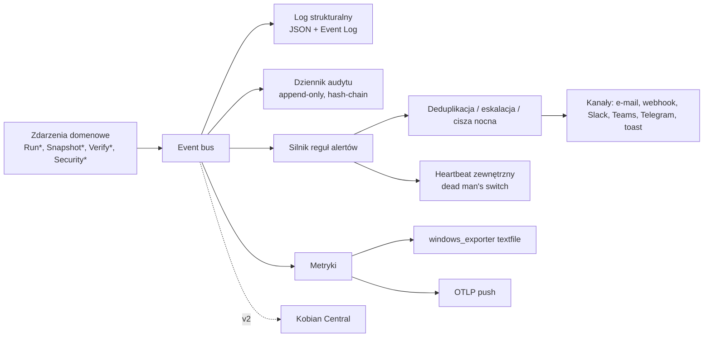

## 9.2 Logi

### Decyzja D9.1 — `Microsoft.Extensions.Logging` + Serilog (JSON CLEF), Event Log dla Warning+
- **Decyzja:** kod używa abstrakcji MEL; ujście: **Serilog** z formatem CLEF (JSON lines) do plików, plus dostawca Windows Event Log (`Microsoft.Extensions.Logging.EventLog`, źródło „Kobian Backup”) dla poziomów Warning i wyżej (zbieranie przez WEF/SIEM).
- **Alternatywy:** NLog; wyłącznie MEL z własnym zapisem plików; OpenTelemetry Logs.
- **Uzasadnienie:** szablony wiadomości ze strukturalnymi polami, dojrzałe ujścia plikowe z rotacją, szeroka adopcja; MEL pozwala wymienić backend bez zmian w kodzie.
- **Ryzyka:** Serilog ma niewielu maintainerów głównych (depscope: 1 — do weryfikacji) → abstrakcja MEL jako plan wyjścia.

| Aspekt | Ustalenie |
|---|---|
| Pola obowiązkowe | `@t` (UTC ISO-8601), `@l`, `@mt`, `EventId` (`KB-xxxx`), `HostId`, `JobId`, `RunId`, `SnapshotId`, `Component`, `CorrelationId` |
| Poziomy | `Trace` (tylko diagnostyka na żądanie, max 24 h), `Debug`, `Information` (start/koniec, liczniki), `Warning` (pominięte pliki, degradacje), `Error` (porażka operacji/zadania), `Critical` (uszkodzenie repo, bezpieczeństwo) |
| Pliki | `service-YYYYMMDD.clef` (rotacja dzienna i 20 MB, 30 plików) + `runs/<runId>.clef.zst` (log uruchomienia, kompresowany po zakończeniu, retencja = retencja historii uruchomień, domyślnie 400 dni) |
| Maskowanie | polityka destrukturyzacji: typy `Secret`, `SecretRef`, pola `Password`, `Token`, `ConnectionString` → `***`; testy jednostkowe na przykładach z 4.3 (komenda `PASS`) i 5.4 |
| Minimalizacja danych | ścieżki plików na Information tylko w licznikach; lista pominiętych plików na Warning (niezbędna do działania) — retencja logów jako element polityki RODO |
| Podgląd | log na żywo w UI przez strumień gRPC (6.2), filtr po poziomie/zadaniu/uruchomieniu, eksport |

## 9.3 Dziennik audytu (Repudiation)

### Decyzja D9.2 — Audyt w łańcuchu hashy z kotwiczeniem w raportach
- **Decyzja:** osobny dziennik audytu (tabela append-only w `catalog.db` + plik `audit.clef`), każdy wpis: kto (SID, nazwa, rola), co (operacja, parametry bez sekretów), kiedy, skąd (UI/CLI/API/scheduler), wynik, `prevHash`, `hash = SHA-256(prevHash | wpis)`. Ostatni hash umieszczany w **dziennym raporcie e-mail** i w `journal/` repozytorium (3.1) → zewnętrzne kotwice utrudniają niezauważone przepisanie historii.
- **Zakres audytu:** zmiany zadań/harmonogramów/retencji/celów/odcisków, wyświetlenie klucza odzyskiwania, usunięcie snapshotów, restore (zakres, cel), step-up (sukces/porażka), zmiany ról, import JSON, aktualizacje produktu.
- **Alternatywy:** zwykłe logi; podpisywanie wpisów kluczem (kompromitacja hosta = kompromitacja klucza).
- **Uzasadnienie:** realizuje R ze STRIDE (it. 1–8) i dostarcza dowodów do NIS2; kotwice zewnętrzne są tańsze i skuteczniejsze niż podpisy na skompromitowanym hoście.
- **Ryzyka:** napastnik z SYSTEM może dopisywać fałszywe wpisy po przejęciu → kotwice ograniczają tylko **zmianę przeszłości**, nie przyszłe wpisy; akceptowane.

## 9.4 Reguły alertów

| Kod | Reguła | Domyślna ważność | Wyzwolenie |
|---|---|---|---|
| A01 | Zadanie zakończone `Failed` (po wyczerpaniu ponowień, 7.6) | Krytyczny | zdarzenie |
| A02 | Zadanie zakończone `Warning` | Ostrzeżenie (w raporcie dziennym, nie natychmiast) | zdarzenie |
| A03 | **Brak udanej kopii dłużej niż RPO** / „od X dni” (domyślnie: 1,5 × interwał harmonogramu, min. 26 h dla dziennych) | Krytyczny | ewaluacja co 15 min |
| A04 | Weryfikacja V2/V3 nieudana — repozytorium uszkodzone | Krytyczny | zdarzenie |
| A05 | Test odtwarzania V4 nieudany / RTO powyżej celu | Krytyczny / Ostrzeżenie | zdarzenie |
| A06 | Wolne miejsce na celu < 15% lub prognoza zapełnienia < 14 dni (regresja liniowa przyrostów) | Ostrzeżenie | po uruchomieniu |
| A07 | Zniknięcie snapshotu z celu poza retencją Kobian (8.5) | **Bezpieczeństwo — krytyczny** | rekoncyliacja |
| A08 | Zmiana retencji / wyłączenie harmonogramu / usunięcie snapshotu (SEC-7.6) | Bezpieczeństwo | audyt |
| A09 | `HostKeyMismatch` / zmiana certyfikatu celu (4.3, 4.4) | Bezpieczeństwo — krytyczny | zdarzenie |
| A10 | Degradacja ochrony celu (test zdolności D4.5 wykazał możliwość usuwania) | Ostrzeżenie | probe |
| A11 | **Anomalia ransomware**: odsetek zmienionych plików > k × mediana z 14 dni **lub** udział danych nieściśliwych w przyroście > próg **lub** masowa zmiana rozszerzeń | Bezpieczeństwo — krytyczny | po skanie Plannera (przed wysłaniem danych) |
| A12 | Usługa zatrzymana / brak heartbeat (zewnętrznie, 9.5) | Krytyczny | zewnętrzny |
| A13 | Zbliżające się wygaśnięcie: certyfikat FTPS, sekret aplikacji M365, ważność DR kit (8.7) | Ostrzeżenie | codziennie |
| A14 | Dostępna aktualizacja bezpieczeństwa Kobian / runtime (D2.6) | Ostrzeżenie | codziennie |
| A15 | Nieudany step-up / wielokrotne odmowy API | Bezpieczeństwo | audyt |

### Decyzja D9.3 — Przy anomalii ransomware (A11) snapshot jest wykonywany, ale oznaczany i nie uruchamia retencji
- **Decyzja:** zadanie kontynuuje kopię (dane mogą być jeszcze ważne), ale snapshot dostaje znacznik `suspect`, **retencja i prune są wstrzymane** do potwierdzenia przez Admin, a alert zawiera link do raportu porównawczego (oś czasu 6.6).
- **Alternatywy:** przerwanie zadania; ignorowanie heurystyki.
- **Uzasadnienie:** retencja po zaszyfrowaniu źródła mogłaby wypchnąć ostatnie czyste wersje (GFS); wstrzymanie retencji chroni historię bez utraty nowych danych.
- **Ryzyka:** fałszywe alarmy (reorganizacja folderów, migracja) → przycisk „to oczekiwana zmiana” resetuje bazę porównawczą; próg dostrajany w becie.

**Higiena alertów:** deduplikacja (ten sam kod + zadanie → jeden alert do czasu rozwiązania), przypomnienie co 24 h dla nierozwiązanych krytycznych, powiadomienie „rozwiązano”, cisza nocna (nie dotyczy krytycznych i bezpieczeństwa), eskalacja (krytyczny nierozwiązany 24 h → drugi odbiorca).

## 9.5 „Brak kopii od X dni” bez serwera centralnego (rozwiązanie Q8)

### Decyzja D9.4 — Dwuwarstwowo: reguła lokalna A03 + zewnętrzny heartbeat (dead man’s switch)
- **Decyzja:** (1) agent lokalnie ewaluuje A03 i wysyła alert, dopóki działa; (2) opcjonalny **heartbeat zewnętrzny**: po każdym udanym zadaniu Kobian wywołuje skonfigurowany URL (`GET/POST https://…/ping/<uuid>`) usługi typu dead man’s switch (np. samodzielnie hostowane Healthchecks — open source, BSD; lub zgodne usługi SaaS); brak pingu w oczekiwanym oknie → alert wysyła **zewnętrzna** usługa. Dla P2 w v2 tę funkcję przejmuje Kobian Central.
- **Alternatywy:** wyłącznie lokalnie (nie wykryje martwego komputera); od razu Central (v2, odsuwa wartość).
- **Uzasadnienie:** jedyny sposób na wykrycie „komputer nie żyje / usługa wyłączona przez ransomware” bez własnej infrastruktury; prosty kontrakt HTTP.
- **Ryzyka:** zależność od zewnętrznej usługi i wyciek metadanych (nazwa zadania w URL) → identyfikator losowy UUID, bez nazw; ping zawiera tylko status i czas trwania.

## 9.6 Kanały powiadomień

| Kanał | Implementacja | Uwierzytelnianie | MVP |
|---|---|---|---|
| **E-mail SMTP** | **MailKit 4.18.1** (MimeKit ≥ 4.18.1) | STARTTLS/TLS obowiązkowe (jawne SMTP tylko z flagą); login+hasło lub OAuth2 XOAUTH2 | ✔ |
| **Microsoft 365** | SMTP AUTH z **OAuth2 (client credentials, uprawnienie `SMTP.SendAsApp`)** przez MSAL (`Microsoft.Identity.Client` 4.91.0) lub Graph `sendMail` | certyfikat aplikacji w magazynie maszyny (preferowany) lub sekret klienta | ✔ |
| Gmail / Google Workspace | SMTP z hasłem aplikacji; OAuth2 — v1.1 | | Should |
| **Webhook ogólny** | `HttpClient`, JSON (schemat wersjonowany), nagłówek `X-Kobian-Signature: sha256=HMAC(secret, body)`, ponowienia z backoff | sekret HMAC | ✔ |
| Slack | incoming webhook (URL = sekret) | | Should |
| Microsoft Teams | webhook przez Workflows (Power Automate); dawne konektory Office 365 wycofywane (do weryfikacji aktualnego stanu) | | Should |
| Telegram | Bot API `sendMessage` (token bota = sekret, `chat_id`) | | Should |
| Toast Windows | komponent sesyjny (6.9) | | ✔ |
| Heartbeat zewnętrzny | 9.5 | URL z UUID | ✔ |

**Microsoft 365 — kontekst czasowy:** Basic Auth dla SMTP AUTH w Exchange Online ma być **domyślnie wyłączony dla istniejących dzierżaw pod koniec grudnia 2026** (odpowiedź serwera: `550 5.7.30 Basic authentication is not supported for Client Submission`), z ostatecznym terminem ogłaszanym w II poł. 2027 (wg harmonogramu MC786329 opisanego przez captaindns.com, stan 02.2026). Konsekwencja: **OAuth2 dla M365 jest Must w MVP**; kreator wykrywa domenę M365 i od razu prowadzi do konfiguracji aplikacji Entra.

## 9.7 Raporty

| Raport | Częstotliwość | Zawartość | Odbiorca |
|---|---|---|---|
| Wynik uruchomienia | po zadaniu (domyślnie tylko Warning/Failed) | status, czas, rozmiar, przyczyna + akcja naprawcza, kod `KB-xxxx` | P1 |
| Podsumowanie dzienne/tygodniowe | 07:00 / poniedziałek | tabela zadań: ostatnia udana kopia, zgodność z RPO, miejsce na celach, alerty otwarte, **hash kotwicy audytu** (D9.2) | P1, P2 |
| Raport zgodności (miesięczny, PDF) | 1. dnia miesiąca | statystyki wykonania, wyniki V3/V4 z RTO, zmiany konfiguracji z audytu, poziomy ochrony celów, ślad testów odtwarzania — **dowód dla NIS2 / RODO art. 32 ust. 1 lit. d** (rozwiązuje Q33 w zakresie formatu: PDF dla ludzi + JSON maszynowo) | P4 |

Szablony PL/EN (6.9), bez danych wrażliwych: brak haseł, ścieżek pełnych tylko na życzenie (domyślnie pierwsze 5 nazw plików pominiętych), brak treści plików.

## 9.8 Metryki

### Decyzja D9.5 — Bez nasłuchującego endpointu: plik textfile dla `windows_exporter` + opcjonalny OTLP push
- **Decyzja:** usługa zapisuje metryki w formacie tekstowym Prometheus do katalogu kolektora textfile `windows_exporter` (atomowy zapis `*.prom.tmp` → rename) oraz — opcjonalnie — wysyła je przez **OTLP** (OpenTelemetry .NET, eksporter 1.19.1) do wskazanego kolektora.
- **Alternatywy:** `prometheus-net` z własnym endpointem HTTP `/metrics`; OpenTelemetry Prometheus HTTP listener.
- **Uzasadnienie:** endpoint HTTP w usłudze uprzywilejowanej łamie SEC-2.1 (brak portów TCP); `windows_exporter` jest już standardem w środowiskach z Prometheusem; OTLP to standard dla Grafana/Elastic/Datadog.
- **Ryzyka:** wymaga zainstalowanego `windows_exporter` (decyzja klienta, nie dystrybuujemy) → bez niego metryki dostępne tylko przez OTLP lub Central.

| Metryka | Typ | Etykiety |
|---|---|---|
| `kobian_job_last_success_timestamp_seconds` | gauge | `job`, `host` |
| `kobian_job_last_status` (0 OK, 1 Warning, 2 Failed, 3 Missed) | gauge | `job` |
| `kobian_job_duration_seconds` | gauge (ostatnie) + histogram (OTLP) | `job`, `mode` |
| `kobian_bytes_read_total`, `kobian_bytes_uploaded_total` | counter | `job`, `destination` |
| `kobian_repo_size_bytes`, `kobian_destination_free_bytes` | gauge | `repo`, `destination` |
| `kobian_verify_last_success_timestamp_seconds` | gauge | `repo`, `level` (V2/V3/V4) |
| `kobian_restore_test_rto_seconds` | gauge | `job` |
| `kobian_alerts_active` | gauge | `severity` |
| `kobian_rpo_compliant` (0/1) | gauge | `job` |

Brak nazw plików i ścieżek w etykietach (kardynalność i RODO).

## 9.9 Status centralny wielu komputerów (US-20, v2 — zarys)

| Element | Założenie |
|---|---|
| Rejestracja agenta | token jednorazowy z Central → agent generuje parę kluczy, Central podpisuje certyfikat klienta (mTLS, krótki okres ważności, automatyczne odnawianie) |
| Kanał | gRPC po TLS 1.3 inicjowany **przez agenta** (brak portów nasłuchujących u klienta — zgodne z SEC-2.1) |
| Dane | statusy, metryki, alerty, wyniki V4, hash kotwicy audytu; **bez nazw plików** domyślnie (minimalizacja RODO; opt-in per klient) |
| Multi-tenant (P2) | klienci → lokalizacje → komputery; role serwisanta per klient |
| Offline | brak raportu w oknie → alert A12 z Central (zastępuje heartbeat 9.5) |
| Polityki | szablony zadań i alertów rozsyłane do agentów (scheduler pozostaje lokalny — D7.1, R&D it. 7) |

MVP dla P2 bez Central: identyczna konfiguracja (eksport JSON — 6.8), podsumowania e-mail od każdego klienta do skrzynki serwisanta, heartbeat zewnętrzny z jednym panelem (np. własna instancja Healthchecks).

---

# Bezpieczeństwo — iteracja 9 (rola 11: Ekspert bezpieczeństwa)

1. **SEC-9.1 Iniekcja w e-mail** — CVE-2026-30227 (MimeKit < 4.15.1, CRLF w części lokalnej adresu → wstrzyknięcie komend SMTP/nagłówków, CVSS 3.1 5.3) → wymagane MailKit/MimeKit ≥ 4.18.1; dodatkowo walidacja adresów (odrzucenie CR/LF) i budowa nagłówków wyłącznie przez API biblioteki.
2. **SEC-9.2 M365 — najmniejsze uprawnienia:** preferowane `SMTP.SendAsApp` ograniczone do jednej skrzynki; przy Graph `Mail.Send` (uprawnienie aplikacyjne obejmujące całą dzierżawę) **obowiązkowe ograniczenie** zakresu (Application Access Policy / RBAC for Applications w Exchange Online — do weryfikacji aktualnego mechanizmu); uwierzytelnienie certyfikatem nieeksportowalnym w magazynie maszyny zamiast sekretu klienta.
3. **SEC-9.3 Webhooki:** konfigurowane tylko przez Admin; tylko `https://` (poza jawnym wyjątkiem LAN); blokada adresów link-local/metadanych chmury (`169.254.0.0/16`) i loopback (SSRF); podpis HMAC; limit rozmiaru i czasu odpowiedzi; brak przekierowań na inne hosty.
4. **SEC-9.4 Sekrety kanałów** (token Telegram, URL Slack, sekret HMAC, hasło SMTP) w magazynie sekretów DPAPI (SEC-2.3), maskowane w logach i eksporcie JSON.
5. **SEC-9.5 Integralność logów i audytu (D9.2)** — hash-chain + kotwice zewnętrzne; logi i audyt z ACL tylko dla usługi/Administrators; Event Log jako dodatkowa kopia poza kontrolą procesu (zbierana przez WEF/SIEM).
6. **SEC-9.6 Treść powiadomień** to kanał wycieku: domyślnie brak ścieżek pełnych i nazw baz klientów w temacie wiadomości; tryb „minimalny” dla kanałów publicznych (Telegram/Slack): tylko kod alertu i status.
7. **SEC-9.7 NIS2 / KSC (weryfikacja z SEC-8.6):** znowelizowana ustawa o KSC obowiązuje od **3.04.2026**, wniosek o wpis do wykazu podmiotów do **3.10.2026**, dostosowanie do **3.04.2027**, pierwszy audyt podmiotów kluczowych do **3.04.2028** (itwiz.pl); terminy zgłaszania incydentów (24 h wczesne ostrzeżenie, 72 h zgłoszenie, raport końcowy w miesiąc) wg art. 23 NIS2 — zgodność ich odwzorowania w KSC **do weryfikacji w tekście ustawy**. Raport zgodności (9.7) i audyt wspierają obowiązki ciągłości działania i testowania kopii.

### STRIDE — monitoring i powiadomienia

| Zagrożenie | Kat. | Mitygacja |
|---|---|---|
| Fałszywe powiadomienia „wszystko OK” (podszycie pod nadawcę) | S | SPF/DKIM po stronie domeny klienta (zalecenie), podpis HMAC webhooków, heartbeat zewnętrzny niezależny od e-maili |
| Wyłączenie alertów przez napastnika | T, D | zmiana konfiguracji powiadomień = zdarzenie audytu + alert A08 wysłany **przed** zastosowaniem zmiany do dotychczasowych odbiorców |
| Przepisanie historii logów | R, T | D9.2 |
| Wyciek danych przez treść alertów | I | SEC-9.6 |
| SSRF przez webhook | E, I | SEC-9.3 |
| Zalew alertami (alert fatigue jako DoS ludzki) | D | deduplikacja, raport dzienny dla Warning, eskalacja tylko krytycznych |

---

# R&D — iteracja 9 (rola 12: Dział R&D)

| Rozwiązanie / technika | Opis | Ocena | Decyzja |
|---|---|---|---|
| **Healthchecks (dead man’s switch, open source)** | usługa odbierająca pingi, alarmująca przy ich braku | idealne rozwiązanie Q8 bez własnej infrastruktury | **Przyjęte** jako kontrakt (D9.4); bez zależności w kodzie (zwykłe HTTP) |
| **windows_exporter textfile collector** | metryki przez plik, bez portu w aplikacji | zgodne z SEC-2.1 | **Przyjęte** (D9.5) |
| **Kotwiczenie łańcucha hashy (idea transparency logs: Certificate Transparency, Sigsum)** | publikowanie skrótu stanu w niezależnych miejscach | uproszczona wersja przez e-mail i repo jest tania i skuteczna | **Przyjęte** (D9.2); publiczny log — odrzucony (prywatność) |
| **Detekcja malware/ransomware w backupie (podejście Veeam: entropia, rozszerzenia, wskaźniki zmian)** | heurystyki na danych już przetwarzanych | niski koszt, ryzyko fałszywych alarmów | **Przyjęte** (A11, D9.3) z dostrajaniem w becie |
| **Proxmox — „notification matchers”** | reguły kierujące alerty do kanałów wg ważności/zadania | elastyczne routowanie bez złożoności | **Przyjęte** w modelu reguł (9.4) — v1.1 pełny edytor |

---

# 10. Jakość, wdrożenie, utrzymanie i roadmap (iteracja 10 — Inżynier jakości, wdrożenia i utrzymania)

Wejście: wszystkie sekcje 1–9, w szczególności cele wydajności (3.9), przypadki brzegowe schedulera (7.9), scenariusze awarii (8.8), wymagania procesu wydawniczego (D2.6), podpisywanie (SEC-2.7, SEC-8.3), prototypy i testy z otwartych pytań (Q15, Q19, Q21, Q22, Q23, Q24, Q26, Q31). Zasada: **produkt backupowy ocenia się po odtworzeniu** — każda warstwa testów kończy się porównaniem bajt w bajt z oryginałem.

## 10.1 Strategia testów

| Warstwa | Zakres | Narzędzia | Kryterium |
|---|---|---|---|
| **Jednostkowe** | Domain, Planner, RetentionEngine (GFS), scheduler na fałszywym zegarze (`TimeProvider`), klasyfikacja błędów (4.7), maskowanie logów (9.2), reguły alertów (9.4), liczba mnoga PL (6.9) | xUnit v3 (4.0.2, Apache-2.0) | pokrycie gałęzi ≥ 80% w Engine/Application; 100% dla modułu krypto i parsera manifestu |
| **Wektory formatu i krypto** | Kobian Repo v1: nagłówek, KDF, opakowanie klucza, AEAD z AAD, trailer packa (K8.1), manifest | własne wektory w repo (publikowane ze specyfikacją — Q17) | implementacja referencyjna i `kobian-restore` dają identyczny wynik |
| **Testy właściwości (property-based)** | round-trip: dowolne drzewo plików → backup → restore = identyczne (treść, atrybuty, ACL, ADS, sparse); retencja nigdy nie usuwa ostatniego udanego snapshotu | generator własny lub biblioteka PBT (do audytu przed użyciem) | 0 kontrprzykładów w 10 000 przypadków na build nocny |
| **Fuzzing** | parsery danych niezaufanych: manifest, indeks, trailer, nagłówek repo, listingi FTP, odpowiedzi SFTP, JSON importu zadań | fuzzer kompatybilny z .NET (np. SharpFuzz — do audytu) | brak awarii / alokacji > limitów (SEC-3.3) w 24 h kampanii przed wydaniem |
| **Integracyjne — kontenery** | SFTP, FTP/FTPS, SMB (Samba), MSSQL (Linux), MySQL, MariaDB, PostgreSQL | Testcontainers for .NET (4.16.0, MIT) + obrazy z tabeli 10.2 | macierz zielona na każdym PR (podzbiór) i nocą (pełna) |
| **Integracyjne — Windows** | VSS (CsWin32 — Q15), DPAPI, usługa i konto wirtualne, ACL/ADS/symlinki/OneDrive placeholders, natywny SMB 3 z szyfrowaniem i podpisem, LocalDB (Q31), Event Log, wybudzanie | maszyny wirtualne Windows Server 2019/2022/2025 i Windows 10/11 w CI (runnery self-hosted) | macierz OS × funkcja zielona nocą |
| **E2E** | scenariusze S1–S11 (8.8) w zautomatyzowanej formie; kreator → kopia → restore w UI | Avalonia.Headless (testy UI bez ekranu) + CLI | każdy scenariusz Must przechodzi przed wydaniem |
| **Chaos / awarie sieci** | zrywanie połączeń, opóźnienia, utrata pakietów, zapełnienie dysku, restart usługi w trakcie (E4, 7.9) | proxy z wstrzykiwaniem błędów (np. Toxiproxy — do audytu) + `Kill` procesu | brak uszkodzonych snapshotów; wznowienie bez ponownego wysłania packów |
| **Wydajność** | cele 3.9; restore (D8.1); SSH.NET vs RTT (Q21); ZstdSharp vs natywne (D3.3) | BenchmarkDotNet + scenariusze z korpusem | regresja > 10% blokuje wydanie |
| **Bezpieczeństwo** | SAST, SCA, sekrety, test „brak nasłuchu TCP” (SEC-2.1), autoryzacja per SID (SEC-2.2), restore Operatora (SEC-6.3), pentest zewnętrzny, przegląd kryptograficzny (SEC-3.1) | CodeQL/analizatory Roslyn, `BannedApiAnalyzers` (zakaz `ScpClient`, `TrustServerCertificate` poza listą), skaner OSV | 0 krytycznych/wysokich otwartych w dniu wydania |
| **Dostępność i lokalizacja** | WCAG 2.1 AA (6.9), NVDA/Narrator, kompletność `.resx` PL/EN | ręczne + automatyczne sprawdzenie kluczy | 100% kluczy przetłumaczonych |
| **Kompatybilność wsteczna** | nowa wersja czyta repozytoria wszystkich poprzednich `formatVersion`; aktualizacja katalogu SQLite | korpus repozytoriów „złotych” z każdej wersji | odczyt i restore zielony dla wszystkich |

### Korpus testowy „złoty”
Drzewa z: polskimi znakami i emoji w nazwach, ścieżkami > 260 znaków, plikami 0 B i > 4 GB, plikami rzadkimi (VHDX), ADS, hard linkami, symlinkami i junction (w tym pętle), plikami tylko do odczytu/ukrytymi/systemowymi, ACL z jawnymi deny, placeholderami OneDrive, plikami zablokowanymi (otwartymi wyłącznie przez proces testowy), bazami demo ERP (gdy licencje producentów na to pozwalają — Q22) i bazami syntetycznymi o nazwach złośliwych (`a];DROP DATABASE x;--`) — SEC-5.1.

## 10.2 Środowiska testowe (kontenery i VM)

| Rola | Obraz / środowisko | Uzasadnienie | Status audytu |
|---|---|---|---|
| SFTP | `linuxserver/openssh-server` (Alpine 3.24, regularne aktualizacje linuxserver.io) + własny obraz z konfiguracją append-only (`sftp-server -P`, 4.6) | aktywnie utrzymywany; własna warstwa dla trybu append-only | przyjęte — przypięcie digestu |
| SMB | `crazymax/samba` (Alpine, aktualizacja ~3 mies. temu) dla testów protokołu; **Windows Server VM** dla SMB 3.1.1, ACL i szyfrowania | Samba nie odwzorowuje w pełni ACL NTFS — VM obowiązkowa | przyjęte warunkowo (licencja obrazu do weryfikacji) |
| FTP/FTPS | vsftpd i pure-ftpd (obrazy do wyboru po audycie), FileZilla Server i IIS FTP na VM Windows | macierz serwerów z 4.3; vsftpd do testu TLS session reuse (Q19) | do audytu |
| MSSQL | `mcr.microsoft.com/mssql/server` (edycja Developer/Express do testów) + Express na VM Windows (LocalDB, Q31) | oficjalny obraz Microsoft | przyjęte |
| MySQL / MariaDB / PostgreSQL | oficjalne obrazy (`mysql`, `mariadb`, `postgres` w wersjach wspieranych; PostgreSQL ≥ 17.6/16.10 — CVE-2025-8714) | oficjalne | przyjęte — przypięcie digestu |
| Dead man’s switch | samodzielna instancja Healthchecks (9.5) | test kontraktu heartbeat | do audytu |

Zasady łańcucha dostaw dla obrazów: przypinanie po **digest SHA-256** (nie po tagu), skan obrazów przed użyciem, odświeżanie co miesiąc, brak obrazów z nieznanych kont.

## 10.3 CI/CD i bezpieczeństwo łańcucha dostaw

### Decyzja D10.1 — Potok z powtarzalnym buildem, SBOM i podpisem w izolowanym etapie
- **Decyzja:**
  1. **Build:** deterministyczny (`Deterministic`, `ContinuousIntegrationBuild`, SourceLink), `packages.lock.json` z `RestoreLockedMode`, **NuGet Package Source Mapping** (tylko nuget.org + własny feed) i **trustedSigners** (weryfikacja podpisów autorów/repozytorium).
  2. **Testy:** warstwy 10.1 (PR: jednostkowe + podzbiór integracyjnych; noc: pełne + Windows VM + wydajność).
  3. **Analizy:** SAST, SCA (`dotnet list package --vulnerable --include-transitive` + OSV-Scanner), skan sekretów, licencje (lista dozwolonych: MIT, Apache-2.0, BSD, PostgreSQL; LGPL/GPL tylko dla narzędzi niedystrybuowanych).
  4. **SBOM:** CycloneDX dla każdego artefaktu, publikowany z wydaniem.
  5. **Podpis:** osobny, chroniony etap z ręcznym zatwierdzeniem (dwie osoby), Authenticode z kluczem w HSM/usłudze chmurowej; **Azure Artifact Signing** (ok. 9,99 USD/mies.; dostępne dla organizacji z UE — wymaga zarejestrowanej działalności; dla osób fizycznych tylko USA/Kanada) lub certyfikat OV na tokenie sprzętowym.
  6. **Proweniencja:** atestacja buildu (poziom SLSA 2, cel 3), przechowywana z wydaniem.
- **Alternatywy:** podpisywanie lokalne na stacji dewelopera; certyfikat EV.
- **Uzasadnienie:** produkt działa z uprawnieniami backupowymi na wszystkich danych — kompromitacja potoku (klasa ataków SolarWinds/3CX) byłaby katastrofalna. EV od 2024 nie daje już natychmiastowej reputacji SmartScreen (learn.microsoft.com), więc nie uzasadnia kosztu.
- **Ryzyka:** reputacja SmartScreen budowana od zera → spójna tożsamość wydawcy od pierwszej bety; wymóg rejestracji działalności dla Artifact Signing (Q38).

## 10.4 Instalator i dystrybucja

### Decyzja D10.2 — MSI per-machine (WiX Toolset) + manifest winget
- **Decyzja:** instalator **MSI** zbudowany WiX Toolset (v6+ objęty Open Source Maintenance Fee — sponsoring FireGiant przez GitHub Sponsors jako koszt projektu; kwota i warunki do weryfikacji, Q37). MSI: instaluje usługę z kontem wirtualnym (D2.5), tworzy grupę `Kobian Operators`, katalogi z ACL (2.6, staging DB — D5.1), źródło Event Log, ewentualne zadanie wybudzania (7.5); wspiera instalację cichą z importem konfiguracji (`msiexec /qn CONFIG=zadania.json`) dla P2 i GPO/Intune. Publikacja w **winget** (manifest wskazujący podpisany MSI).
- **Alternatywy:** MSIX (usługi wymagają ograniczonej capability i mają ograniczenia — do weryfikacji), Inno Setup, Velopack (1.2.161, MIT — instalacja per-user, nieodpowiednia dla usługi systemowej).
- **Uzasadnienie:** MSI to standard wdrożeń firmowych (GPO, Intune, SCCM), transakcyjna instalacja i naprawa; winget dla P3/P2.
- **Ryzyka:** koszt i warunki OSMF; złożoność WiX → szablony i testy instalacji/aktualizacji/odinstalowania na VM w CI. Odinstalowanie **nie usuwa** repozytoriów ani katalogu (opcja jawna z ostrzeżeniem).

## 10.5 Aktualizacje automatyczne

### Decyzja D10.3 — Aktualizacje sterowane przez usługę, podwójnie weryfikowane, z rollbackiem
- **Decyzja:**
  - Usługa sprawdza **podpisany manifest wydań** (Ed25519; klucz główny offline + klucz podpisujący online z datą ważności — model inspirowany TUF: ochrona przed podmianą, rollbackiem wersji i „zamrożeniem” na starej wersji przez wygasające metadane).
  - Pobrany MSI weryfikowany: hash z manifestu **i** podpis Authenticode z przypiętym wydawcą → instalacja `msiexec` poza oknami zadań (7.6), po zakończeniu trwających uruchomień.
  - Kanały: `stable`, `beta`; wdrażanie stopniowe (np. 10% → 50% → 100% w 72 h) z wstrzymaniem przy wzroście błędów (sygnał z Central v2 lub z opt-in raportów).
  - Rollback: poprzednia wersja MSI przechowywana; po nieudanym starcie usługi (3 próby) automatyczny powrót i alert A14.
  - **SLA łatek bezpieczeństwa:** ≤ 7 dni od publikacji łatki .NET/zależności krytycznej (wymóg z D2.6 i K3.1), ≤ 48 h dla krytycznej podatności własnej.
  - Tryb „tylko powiadom” dla firm zarządzających aktualizacjami samodzielnie (winget/Intune).
- **Alternatywy:** Velopack/Squirrel; tylko winget; brak auto-update.
- **Uzasadnienie:** backup bez aktualizacji to rosnące ryzyko (przykłady z audytu: SSH.NET, MimeKit, SQLite, Kestrel — wszystkie w ciągu ostatniego roku); podwójna weryfikacja chroni przed przejęciem serwera aktualizacji.
- **Ryzyka:** nieudana aktualizacja na serwerze ERP w nocy → okno aktualizacji konfigurowalne, domyślnie dzień roboczy 10:00–14:00 dla profilu „Serwer”.

## 10.6 Licencjonowanie i model biznesowy (rozwiązanie Q6)

### Decyzja D10.4 — Open-core: rdzeń na Apache-2.0, Kobian Central i wsparcie komercyjnie
- **Decyzja:**
  - **Apache-2.0:** agent/usługa, CLI, UI desktop, `kobian-restore`, specyfikacja formatu Kobian Repo v1, profile ERP.
  - **Komercyjnie:** Kobian Central (multi-tenant dla P2, polityki, raporty zbiorcze), wsparcie z SLA, certyfikowane szkolenia/wdrożenia.
  - Zgodność zależności: wszystkie przyjęte biblioteki są MIT/Apache-2.0/BSD-3/PostgreSQL License — zgodne z Apache-2.0; narzędzia GPL (`mysqldump`) i LGPL (SMBLibrary — nieużywany) nie są dystrybuowane; WiX (instalator) — narzędzie budowania, nie część produktu.
- **Alternatywy:** AGPL-3.0 (ochrona przed „SaaS-owaniem”, ale bariera dla firm), freeware zamknięty (model Cobian), licencja per stanowisko (model SQL Backup Master), freemium z limitem maszyn (model Duplicati 2.3: konsola 2 USD/maszynę/mies., darmowy plan do 2 maszyn — duplicati.com, 04.2026).
- **Uzasadnienie:** otwarty format i narzędzie odtwarzania są argumentem zaufania („odtworzysz dane nawet bez nas”); otwarty rdzeń ułatwia audyt bezpieczeństwa; wartość płatna jest tam, gdzie płaci P2 (wiele komputerów klientów). Model zbieżny z rynkiem (Duplicati — płatna konsola).
- **Ryzyka:** konkurencja może zbudować własną konsolę na otwartym API → przewaga przez jakość, profile ERP i lokalne wsparcie PL. **Nazwa „Kobian”** jest fonetycznie bliska „Cobian” (znak/produkt Luisa Cobiana) — **ryzyko prawne (wprowadzanie w błąd/znak towarowy)**; wymagane badanie znaków (UPRP, EUIPO) i prawdopodobnie zmiana nazwy przed publikacją (Q39). (Plan nie stanowi porady prawnej.)

## 10.7 Dokumentacja

| Dokument | Odbiorca | Forma |
|---|---|---|
| Podręcznik użytkownika (Prosty/Zaawansowany) PL/EN | P3, P1 | docs-as-code, wyszukiwarka, linki z kodów `KB-xxxx` |
| Przewodnik administratora: SFTP append-only, ACL SMB bez prawa usuwania, migawki NAS, aplikacja Entra dla M365, login SQL `db_backupoperator` | P1, P2 | gotowe skrypty i konfiguracje (bez sekretów) |
| Specyfikacja formatu Kobian Repo v1 + wektory testowe | integratorzy, audytorzy | publiczna (Q17) |
| Biała księga bezpieczeństwa + model zagrożeń (zebrane STRIDE z it. 1–10) | P4, działy bezpieczeństwa | PDF |
| Runbooki DR (generowane per konfiguracja — D8.5) | P1 | PDF w DR kit |
| Polityka bezpieczeństwa i zgłaszania podatności (`SECURITY.md`, adres kontaktowy, okno 90 dni) | badacze | publiczna |
| Notatki wydań z listą zmian bezpieczeństwa i SBOM | wszyscy | z każdym wydaniem |

## 10.8 Roadmap wydań

| Etap | Zawartość | Kryteria wyjścia | Szacunek (zespół 3 dev + 1 QA, do weryfikacji) |
|---|---|---|---|
| **M0 — prototypy ryzyk** | VSS przez CsWin32 (Q15), FTPS session reuse (Q19), SSH.NET przy RTT 100 ms (Q21), `WDA_EXCLUDEFROMCAPTURE` w Avalonia (Q26), LocalDB vs wersje SQL (Q31), VERIFYONLY uprawnienia (Q23), kompresja Express 2025 (Q24) | każde pytanie zamknięte decyzją lub planem B | 1–2 mies. |
| **M1 — Alpha** | format repo + silnik (pełny/przyr./różn.), cele Local/SMB/SFTP, szyfrowanie, V1/V2, retencja podstawowa, CLI, usługa | round-trip korpusu złotego; wektory krypto | +3 mies. |
| **M2 — Beta** | MSSQL + profile ERP (Optima, GT; nexo/Symfonia po Q22), UI Avalonia (kreator, pulpit, przeglądarka kopii), scheduler pełny, e-mail/M365 OAuth, A01–A06, instalator MSI, auto-update | badania użyteczności 6.11 (kryteria spełnione), 0 krytycznych błędów przez 30 dni bety | +3 mies. |
| **1.0 GA** | wszystkie Must z 1.4 + Should: VSS, FTPS, GFS, testy V3/V4, DR kit, raport zgodności | przegląd kryptograficzny zewnętrzny, pentest, SBOM, podpis, dokumentacja PL/EN, SLA łatek wdrożone | +1–2 mies. |
| **1.1** | VDI MSSQL, MySQL/PostgreSQL/SQLite, USN Journal, repack, replikacja repo (D7.5), webhooki/Slack/Teams/Telegram, wyzwalacze sieć/bezczynność, Windows Hello step-up, command palette | — | +3 mies. |
| **2.0** | CDC/FastCDC i dedup globalna, Kobian Central (multi-tenant, web UI), Linux (systemd), S3 z Object Lock, WebDAV, rclone, montowanie snapshotów (po audycie sterownika — D8.6), PITR PostgreSQL | — | +6–9 mies. |

**Polityka utrzymania:** wspierane dwie ostatnie wersje minor; migracja runtime na .NET 12 LTS (spodziewane XI 2027) przed końcem wsparcia .NET 10 (XI 2028); format repo: **odczyt wszystkich wersji bezterminowo**, zapis — bieżąca wersja; telemetria wyłączona domyślnie (opt-in, anonimowa, bez nazw plików — RODO).

## 10.9 Definition of Done dla MVP (1.0)

| Obszar | Warunek |
|---|---|
| Funkcje | US-01…US-10 (Must) działają i mają testy E2E; Should z 1.0 jak w 10.8 |
| Odtwarzalność | S1, S4, S6, S7, S9 (8.8) zautomatyzowane i zielone; `kobian-restore` odtwarza repo bez usługi |
| Bezpieczeństwo | 0 sekretów plaintext (test skanujący konfigurację, logi, raporty), brak nasłuchu TCP, autoryzacja per SID, pentest bez krytycznych/wysokich, przegląd krypto zamknięty |
| Zależności | tabela „Zależności — audyt” zaktualizowana na dzień wydania; brak znanych CVE wysokich/krytycznych |
| Jakość | metryki 1.7 spełnione w badaniach (≤ 5 min do pierwszej kopii P3) |
| Operacje | SLA łatek, kanał zgłaszania podatności, SBOM i podpis każdej binarki |

## 10.10 Indeks decyzji (podsumowanie planu)

| Obszar | Kluczowe decyzje |
|---|---|
| Zakres | D1.1 MVP bez dedup globalnej; D1.2 format gotowy pod dedup; D1.3 ERP pierwszej kategorii |
| Architektura | D2.1 .NET 10 LTS; D2.2/D6.1 Avalonia 12; D2.3 SQLite WAL; D2.4 gRPC/named pipe; D2.5 konto wirtualne; D2.6 self-contained (K3.1) |
| Silnik | D3.1 Kobian Repo v1 (+K8.1 trailer); D3.2 jednolite tryby; D3.3 zstd; D3.4 AES-256-GCM, HKDF, HMAC chunkId; D3.5 PBKDF2; D3.6 VSS CsWin32; D3.7 GFS + retentionLock |
| Transport | D4.1 poświadczenia backup/maintenance; D4.2 natywny SMB; D4.3 FluentFTP/FTPS; D4.4 SSH.NET ≥ 2026.0.0 bez SCP; D4.5 test zdolności celu |
| Bazy | D5.1 BACKUP + staging (VDI 1.1); D5.2 COPY_ONLY + kontrola base GUID; D5.3 profile ERP po schemacie; D5.4–D5.6 MySQL/PostgreSQL/SQLite |
| UX | D6.2 Prosty/Zaawansowany; D6.3 brak lokalnego web UI; D6.4 kopia + mini-test w kreatorze; D6.5 klucz odzyskiwania |
| Automatyzacja | D7.1 własny scheduler + Cronos; D7.2 DST; D7.3 misfire; D7.4 blokady zasobów; D7.5 replikacja repo; D7.6 akcje i skrypty z hashem |
| DR | D8.1 restore po packach; D8.2 repo źródłem prawdy; D8.3 przejęcie repo; D8.4 restore drill; D8.5 DR kit; D8.6 bez sterownika jądra w MVP |
| Monitoring | D9.1 MEL + Serilog; D9.2 audyt hash-chain; D9.3 anomalia wstrzymuje retencję; D9.4 heartbeat zewnętrzny; D9.5 metryki bez portu |
| Wydanie | D10.1 potok z SBOM i podpisem; D10.2 MSI + winget; D10.3 auto-update TUF-like z rollbackiem; D10.4 open-core Apache-2.0 |

---

# Bezpieczeństwo — iteracja 10 (rola 11: Ekspert bezpieczeństwa)

1. **SEC-10.1 Potok jako najcenniejszy cel ataku** — akceptacja D10.1 z wymaganiami: MFA i klucze sprzętowe dla wszystkich kont z prawem zapisu do repozytorium kodu i potoku; ochrona gałęzi głównej z obowiązkowym przeglądem drugiej osoby; runnery Windows self-hosted efemeryczne (odtwarzane z obrazu po każdym zadaniu), bez dostępu do sekretów podpisu w etapach testowych.
2. **SEC-10.2 Klucze aktualizacji** — klucz główny manifestu offline (sejf, podział tajemnicy 2-z-3), rotacja klucza online co 12 miesięcy; procedura unieważnienia opisana i przećwiczona przed 1.0.
3. **SEC-10.3 Zależności** — przegląd tabeli audytu przy każdym wydaniu i automatycznie co tydzień (SCA); wszystkie pozycje oznaczone „do weryfikacji” muszą zostać zamknięte przed GA; dodawanie nowej zależności wymaga wpisu w tabeli (proces, nie tylko dokument).
4. **SEC-10.4 Testy bezpieczeństwa przed 1.0** — zewnętrzny przegląd kryptograficzny formatu (D3.4/D3.5) i pentest usługi (API named pipe, restore, aktualizacje, import JSON); fuzzing parserów 24 h bez awarii.
5. **SEC-10.5 Zgłaszanie podatności** — `SECURITY.md`, koordynowane ujawnianie (90 dni), rejestracja jako CNA lub współpraca z CERT Polska przy publikacji CVE własnych.
6. **SEC-10.6 RODO/NIS2 w produkcie** — telemetria opt-in; dokumentacja wspierająca klienta w ocenie skutków (DPIA) dla kopii danych osobowych; raport zgodności (9.7) jako element dowodów ciągłości działania (KSC: dostosowanie do 3.04.2027 dla podmiotów objętych).
7. **SEC-10.7 Instalator** — custom actions MSI działające jako SYSTEM ograniczone do minimum i podpisane; brak pobierania czegokolwiek z sieci podczas instalacji; naprawa (repair) nie resetuje ACL ani sekretów.

### STRIDE — wydanie, aktualizacje, instalator

| Zagrożenie | Kat. | Mitygacja |
|---|---|---|
| Podmiana aktualizacji (przejęty serwer/CDN) | T, E | manifest Ed25519 + Authenticode z przypiętym wydawcą |
| Wymuszenie starej, podatnej wersji (rollback attack) | T | monotoniczne numery wersji i wygasające metadane (TUF-like) |
| Kompromitacja potoku CI | T, E | SEC-10.1, podpis w izolowanym etapie z dwuosobowym zatwierdzeniem, SLSA |
| Złośliwa zależność (typosquatting, przejęte konto autora) | T | package source mapping, trustedSigners, lock files, przegląd tabeli audytu |
| Zaprzeczenie pochodzenia binarki | R | proweniencja buildu, SBOM, podpis z znacznikiem czasu |
| Eskalacja przez custom actions MSI | E | SEC-10.7 |

---

# R&D — iteracja 10 (rola 12: Dział R&D)

| Rozwiązanie / technika | Opis | Ocena | Decyzja |
|---|---|---|---|
| **The Update Framework (TUF)** | ramy bezpiecznych aktualizacji (role kluczy, wygasanie metadanych, ochrona przed rollbackiem/zamrożeniem) | pełna implementacja ciężka; kluczowe idee łatwe do przeniesienia | **Przyjęte koncepcyjnie** (D10.3) |
| **SLSA + atestacje proweniencji (in-toto)** | weryfikowalne pochodzenie artefaktów | standard rynkowy, rosnące wymagania zakupowe (NIS2 — łańcuch dostaw) | **Przyjęte**: poziom 2 na 1.0, cel 3 |
| **Reproducible builds .NET** | identyczny wynik buildu z tego samego źródła | ułatwia niezależną weryfikację (istotne dla open-source rdzenia) | **Przyjęte jako cel** dla `kobian-restore` w 1.0, dla całości w 1.1 |
| **Sigstore (keyless signing, przejrzystość)** | podpisy z certyfikatami krótkotrwałymi i logiem przejrzystości | dobre dla artefaktów deweloperskich/obrazów; Windows/SmartScreen wymaga Authenticode | **Uzupełniająco** — podpis SBOM/atestacji, nie binariów |
| **Testy deterministycznej symulacji (podejście FoundationDB/TigerBeetle)** | cały system w symulatorze z kontrolowanym czasem, siecią i dyskiem | bardzo skuteczne dla schedulera i wznowień; wymaga architektury z abstrakcją I/O (mamy: `TimeProvider`, `IStorageProvider`) | **Przyjęte częściowo**: symulator dla schedulera i pipeline’u uploadu w M1 |

---

# Faza II — rozbudowa planu

Faza I (iteracje 1–10) ustaliła zakres, architekturę i kluczowe decyzje każdej dziedziny; faza II ich nie powtarza, lecz przekształca w specyfikację, z której da się bezpośrednio budować i testować produkt. Każda iteracja fazy II dopisuje sekcję „R<runda>.<rola>” w dziedzinie roli prowadzącej, kontynuuje numerację decyzji dziedziny (np. D1.4 po D1.3) i rejestruje je w „Indeksie decyzji — faza II”. Tematy rund: 2 — specyfikacja implementacyjna (kryteria akceptacji, kontrakty API, DDL, formaty bajtowe, maszyny stanów), 3 — weryfikacja i ryzyko (pre-mortem, spike’i, budżety wydajności, rewizje decyzji), 4 — gotowość do budowy (epiki, zadania, DoR/DoD, runbooki), 5 — przyszłość i skala (Central, Linux, chmura, MSP, zgodność). Błędy treści fazy I są poprawiane wyłącznie wpisami w „Korektach”; oryginał pozostaje.

# R2.1 Wymagania i zakres — specyfikacja implementacyjna (iteracja 11 — Product Owner / analityk wymagań)

Wejście: user stories 1.4 (US-01…US-27), zakres 1.5, metryki 1.7, D1.1–D1.3, roadmap 10.8, Definition of Done 10.9 oraz decyzje fazy I, które nie mają odpowiednika w historiach użytkownika (D3.1, D4.5, D5.3, D6.5, D8.3, D8.4, D9.4, 9.6). Cel sekcji: **każda historia Must ma mierzalne kryteria akceptacji, przypisane testy i kamień milowy**, a zakres jest zapisany w jednym miejscu.

### Przegląd luk (materiał wejściowy iteracji)

| # | Luka / sprzeczność | Miejsce | Zamknięcie w tej iteracji |
|---|---|---|---|
| L1 | Zakres 1.5 umieszcza VSS, FTPS, GFS w v1.1, a automatyczne testy odtwarzania w v2; roadmap 10.8 umieszcza je w 1.0 GA | 1.5 vs 10.8 | D1.4, K11.1 |
| L2 | US-22 „deduplikacja blokowa — Could” vs D3.1 (dedup w obrębie łańcucha zadania od MVP) | 1.4 vs 3.1 | rozdzielenie US-22a/US-22b, K11.2 |
| L3 | Decyzje fazy I bez historii użytkownika: klucz odzyskiwania, eksport/import JSON (wymaganie krytyczne P2 z 1.2), M365 OAuth (Must wg 9.6), restore bazy, przejęcie repo, CLI, test zdolności celu, `kobian-restore` | 6.5, 6.8, 9.6, 8.3, D4.5, 10.9 | US-28…US-43 |
| L4 | DoD 10.9 wymaga „testów E2E dla Must”, ale nigdzie nie zapisano, co test ma udowodnić | 10.9 | R2.1.2, D1.7 |
| L5 | Metryka „wpływ backupu MSSQL na ERP — pomiar w it. 10” bez metody pomiaru i progów | 1.7, 10 | NFR-07, K11.4 |
| L6 | „Windows 10/11 i Server 2016+” bez uwzględnienia cykli wsparcia Microsoft i listy OS .NET 10 | 1.3 | D1.5, K11.3 |
| L7 | Q25 (Firebird) otwarte od it. 5 | Otwarte pytania | D1.6 |
| L8 | Kody `KB-xxxx` używane (6.3, 6.10: KB-2104) bez rejestru i zakresów | 6.3, 6.10, 9.2 | D1.8 |
| L9 | SEC-1.1 dopuszcza „opt-out” szyfrowania, a format D3.1/D3.4 szyfruje metadane zawsze | SEC-1.1 vs 3.1 | K11.5 |
| L10 | Q10 (pusty `plan.md.txt`) | — | **nie do zamknięcia bez człowieka** — pozostaje otwarte |

## R2.1.1 Kanoniczna tabela zakresu

### Decyzja D1.4 — Jedna, kanoniczna tabela zakresu z kategorią „S-1.0” (rozwija D1.1, 1.4, 1.5, 10.8)
- **Decyzja:** poniższa tabela jest jedynym źródłem prawdy o zakresie; przy sprzeczności z 1.4/1.5 obowiązuje ona (K11.1). Kategorie: **M** — blokuje 1.0 GA; **S-1.0** — cel 1.0, przesunięcie do 1.1 wyłącznie decyzją PO zapisaną w „Korektach”; **S** — 1.1; **C** — ≥ 2.0 lub warunkowo; **W** — poza horyzontem. Reguła budżetu: estymata Must ≤ 60% pracy do 1.0 (wytyczna MoSCoW z DSDM/Agile Business Consortium) — weryfikacja przy rozbiciu na epiki w rundzie 4.
- **Alternatywy:** utrzymywać zakres osobno w 1.4, 1.5 i 10.8; backlog wyłącznie w narzędziu (Jira/GitHub Projects) bez odbicia w planie.
- **Uzasadnienie:** trzy rozbieżne miejsca już wygenerowały sprzeczność (L1); kategoria S-1.0 oddaje rzeczywistość roadmapy (VSS, FTPS, GFS są planowane na GA, ale nie powinny blokować wydania krytycznej poprawki formatu).
- **Ryzyka:** tabela zestarzeje się względem backlogu → backlog generowany z tabeli (ID US jako etykiety), przegląd przy każdym kamieniu.

| ID | Persona | Historia (skrót) | Kat. | Kamień | Decyzje | Zmiana vs 1.4 |
|---|---|---|---|---|---|---|
| US-01 | P1,P3 | Kreator zadania plików → lokalny/USB/SMB/SFTP | M | M1 silnik, M2 UI | D6.4, D3.1 | — |
| US-02 | P1 | Pełny backup MSSQL `COPY_ONLY` bez przerywania ERP | M | M2 | D5.1, D5.2 | — |
| US-03 | P1 | Harmonogram kalendarz/cron z polityką misfire | M | M1 CLI, M2 UI | D7.1–D7.3 | dopisano misfire |
| US-04 | P1,P2 | SFTP (Ed25519, pinning) i SMB (bez litery dysku) | M | M1 | D4.2, D4.4 | — |
| US-05 | P1 | E-mail o błędzie (A01) i „brak kopii od X” (A03) | M | M2 | D9.4, 9.4 | — |
| US-06 | wszyscy | Szyfrowanie repozytorium (zawsze włączone) | M | M1 | D3.4 | K11.5 |
| US-07 | wszyscy | Odtworzenie wybranych plików z wybranej wersji | M | M1 CLI, M2 UI | D8.1 | — |
| US-08 | P1 | Kopie przyrostowe i różnicowe | M | M1 | D3.2 | — |
| US-09 | P1 | Weryfikacja V1/V2 i `RESTORE VERIFYONLY` | M | M1/M2 | 3.7 | V3/V4 → US-21 |
| US-10 | P1 | Retencja liczba wersji / dni + retentionLock | M | M1 | D3.7 | dopisano lock |
| US-11 | P1 | Pliki otwarte przez VSS | S-1.0 | 1.0 | D3.6 | v1.1 → 1.0 (K11.1) |
| US-12 | P1 | FTPS (i FTP z flagą) | S-1.0 | 1.0 | D4.3 | v1.1 → 1.0 |
| US-13 | P1 | Akcje wbudowane i skrypty pre/post z hashem | S-1.0 | M2 | D7.6 | — |
| US-14 | P3 | Kopia po podłączeniu dysku USB | S-1.0 | M2 | 7.2 | — |
| US-15 | P1 | MySQL/MariaDB/PostgreSQL | S | 1.1 | D5.4, D5.5 | — |
| US-16 | P1 | MSSQL różnicowe + logi („Łańcuch Kobian”), PITR | S | 1.1 | D5.2, 8.2 | doprecyzowano kamień (brak w 10.8) |
| US-17 | P1 | Limity pasma i okna czasowe | S-1.0 | M2 | 4.7, 7.6 | — |
| US-18 | P1 | Wznawianie przerwanego transferu na granicy packa | **M** | M1 | 4.7 | S → M (bez wznowienia kopie > 50 GB po WAN nie kończą się) |
| US-19 | P1 | Retencja GFS | S-1.0 | 1.0 | D3.7 | v1.1 → 1.0 |
| US-20 | P2 | Centralny status wielu komputerów | C | 2.0 | 9.9 | — |
| US-21 | P1,P4 | Automatyczne testy odtwarzania V3/V4 z raportem | S-1.0 | 1.0 | D8.4 | C → S-1.0 |
| US-22a | P1 | Dedup bloków w obrębie łańcucha zadania | M | M1 | D3.1, D3.2 | nowa (K11.2) |
| US-22b | P1 | Dedup globalna z CDC (FastCDC) | C | 2.0 | D1.2 | dawne US-22 |
| US-23 | P1 | Cel append-only / poświadczenia bez prawa usuwania | S-1.0 | 1.0 | D4.1 | C → S-1.0 |
| US-24 | P3 | Web UI | C | 2.0 (Central) | D6.3 | — |
| US-25 | P2 | S3 (Object Lock)/WebDAV | C | 2.0 | 4.8 | — |
| US-26 | P1 | Bare-metal | W | — | D8.5 (DR kit zamiast) | — |
| US-27 | P1 | Backup VM | W | — | — | — |
| US-28 | P1,P3 | Klucz odzyskiwania pokazany raz, z dowodem zapisania | M | M2 | D6.5 | nowa |
| US-29 | P2 | Eksport/import zadań JSON bez sekretów | M | M2 | 6.8, SEC-6.7 | nowa |
| US-30 | P1 | Wykrycie ERP po schemacie: Optima, Subiekt GT (nexo/Symfonia — S po Q22) | M | M2 | D5.3 | nowa |
| US-31 | P1 | Powiadomienia przez Microsoft 365 z OAuth2 | M | M2 | 9.6 | nowa |
| US-32 | P1 | Odtworzenie bazy MSSQL do nowej nazwy | M | M2 | 6.6, 8.4 | nowa |
| US-33 | P1,P2 | Podłączenie istniejącego repo na nowym komputerze | M | M1 CLI, M2 UI | D8.3 | nowa |
| US-34 | P1,P2 | Heartbeat zewnętrzny (dead man’s switch) | S-1.0 | M2 | D9.4 | nowa |
| US-35 | P4 | Miesięczny raport zgodności PDF/JSON | S-1.0 | 1.0 | 9.7 | nowa |
| US-36 | P1 | Zestaw ratunkowy (DR kit) | S-1.0 | 1.0 | D8.5 | nowa |
| US-37 | P1,P2 | CLI: status/uruchom/odtwórz z kodami wyjścia | M | M1 | 6.8 | nowa |
| US-38 | P1 | Test zdolności celu przy konfiguracji | M | M1 | D4.5 | nowa |
| US-39 | P1 | Anomalia ransomware wstrzymuje retencję | S-1.0 | 1.0 | D9.3 | nowa |
| US-40 | P1 | Replikacja repozytorium (3-2-1) | S | 1.1 | D7.5 | nowa |
| US-41 | P1 | Firebird (gbak) | C | ≥ 1.1 warunkowo | D1.6 | nowa (Q25) |
| US-42 | P3 | Tryb „Mirror” 1:1 bez szyfrowania | C | 1.1 | K3.2 | nowa (formalizacja K3.2) |
| US-43 | wszyscy | `kobian-restore` odtwarza repo bez instalacji i usługi | M | M1 | 8.7, 10.9 | nowa |

Bilans: **21 historii Must** (US-01…US-10, US-18, US-22a, US-28…US-33, US-37, US-38, US-43), 12 S-1.0, 3 S, 6 C, 2 W (razem 44 pozycje).

## R2.1.2 Kryteria akceptacji (Given / When / Then)

Konwencja: `AC-<US>.<n>`; progi liczbowe są normatywne; odwołania do E1–E10 (7.9) i S1–S11 (8.8) oznaczają, że tamte przypadki są częścią kryterium. Korpus i środowiska — 10.1/10.2.

| AC | Given | When | Then |
|---|---|---|---|
| AC-01.1 | czysta instalacja, tryb Prosty, `Dokumenty` 2 GB / 10 tys. plików, dysk USB NTFS | użytkownik przechodzi 6 kroków kreatora na presetach z zaznaczonym „Wykonaj pierwszą kopię teraz” | snapshot `Succeeded`, V2 OK, mini-test D6.4 zgodny, pulpit „Chronione”; czas spełnia NFR-01; żadne ustawienie domyślne nie musiało być zmienione |
| AC-01.2 | krok 2, cel SMB, błędne hasło | „Dalej” | kreator blokuje przejście, komunikat z kodem `KB-2xxx` i jedną akcją „Popraw hasło”; dokładnie 1 próba logowania na kliknięcie (błąd trwały, 4.7) |
| AC-01.3 | zadanie zapisane | eksport JSON | plik zawiera wyłącznie `secretRef`, przechodzi walidację schematu; skaner sekretów (NFR-11) — 0 trafień |
| AC-02.1 | SQL Express, baza 5 GB, recovery SIMPLE, obciążenie referencyjne (NFR-07) | zadanie DB w trybie Prostym | w `msdb.dbo.backupset` `is_copy_only = 1`; `differential_base_guid` bazy niezmieniony; VERIFYONLY OK; brak `*.bak` w stagingu po zakończeniu; NFR-07 spełnione |
| AC-02.2 | trwa `BACKUP`/`DBCC`/`RESTORE` innego narzędzia na tej bazie | start zadania | oczekiwanie maks. 30 min (konfigurowalne), potem `Skipped` z przyczyną `concurrent_backup`; brak nakładania się operacji |
| AC-02.3 | login bez `db_backupoperator` | „Testuj połączenie” | komunikat wskazuje brakujące uprawnienie i oferuje wygenerowany skrypt T-SQL; Kobian nie prosi o hasło `sa` (SEC-5.3) |
| AC-03.1 | „codziennie 22:00 Europe/Warsaw”, komputer wyłączony 3 dni, `RunOnceIfMissed` | start usługi | dokładnie 1 uruchomienie 5–10 min po starcie; 3 wpisy `Missed` |
| AC-03.2 | harmonogramy z 7.9 | przypadki E1, E2, E5 | wszystkie zgodne z oczekiwaniem 7.9 |
| AC-03.3 | edytor cron (tryb Zaawansowany) | wpisanie `*/30 7-20 * * 1-5` / wyrażenia błędnego | podgląd 5 najbliższych uruchomień zgodny z Cronos / zapis zablokowany z komunikatem wskazującym pole |
| AC-04.1 | serwer SFTP o nieznanym kluczu hosta, CLI bez `--host-key` | konfiguracja celu | odmowa (brak TOFU w trybie bezobsługowym); z `--host-key SHA256:…` zgodnym — sukces |
| AC-04.2 | zapisany odcisk; serwer zmienia klucz | uruchomienie | `Failed: HostKeyMismatch` bez ponowień, A09 wysłany ≤ 1 min, 0 bajtów danych wysłanych |
| AC-04.3 | udział SMB 3.x z szyfrowaniem | zadanie | brak litery dysku i wpisu w `net use` w sesji interaktywnej użytkownika; połączenie zamknięte po zadaniu; serwer tylko-SMB1 → `Failed` z komunikatem, bez obejścia |
| AC-05.1 | zadanie dzienne, ostatni sukces T0 | brak sukcesu do T0 + 26 h | e-mail A03 wysłany w czasie NFR-08; jeden e-mail (deduplikacja), przypomnienie po 24 h, e-mail „rozwiązano” po następnym sukcesie |
| AC-05.2 | serwer SMTP niedostępny | wyzwolenie alertu krytycznego | alert w trwałej kolejce z ponowieniami; wpis Warning+ w Event Log; pulpit „Zagrożone”; po przywróceniu SMTP doręczenie zaległego alertu |
| AC-05.3 | zadanie `Failed` po wyczerpaniu ponowień | wysyłka A01 | treść PL/EN z przyczyną, akcją naprawczą i kodem `KB-xxxx`; brak haseł; w temacie brak pełnych ścieżek i nazw baz (SEC-9.6) |
| AC-06.1 | repozytorium utworzone z korpusu „złotego” | przeszukanie wszystkich plików repo poza `kobian.repo` | żadna nazwa pliku źródłowego ani żaden z 20 znanych ciągów treści nie występuje jawnie |
| AC-06.2 | repozytorium, błędne hasło | otwarcie przez `kobian-restore` | odmowa z komunikatem „nieprawidłowe hasło lub klucz”; z poprawnym kluczem odzyskiwania — pełny dostęp |
| AC-07.1 | 30 snapshotów; plik usunięty 10 dni temu | Operator: wyszukiwanie nazwy → „Do innego folderu” | plik odtworzony bajt w bajt (SHA-256 = manifest), znaczniki czasu zachowane; czas NFR-02 |
| AC-07.2 | Operator bez prawa zapisu do wskazanego folderu | restore | odmowa przed odczytem danych (SEC-6.3) |
| AC-07.3 | jeden blok w packu uszkodzony | restore folderu 100 plików | 99 plików odtworzonych; uszkodzony nie trafia do miejsca docelowego, raport wskazuje plik (D8.1) |
| AC-08.1 | snapshot pełny, potem 1% zmian | przyrostowy | wysłane bajty ≤ 1,1 × rozmiar zmienionych bloków + metadane; usunięcie snapshotu pośredniego nie wpływa na odtwarzalność późniejszego |
| AC-08.2 | pełny, inc1, inc2 | różnicowy | reużyte bloki wyłącznie z packów ostatniego pełnego (kontrola indeksu); ostrzeżenie UI przy > 50% rozmiaru pełnego |
| AC-08.3 | plik podmieniony z zachowaniem rozmiaru i mtime (inny FileId) | przyrostowy | plik wykryty jako zmieniony |
| AC-09.1 | snapshot zapisany; jeden pack usunięty z celu | V2 | `Failed` + A04; przy kompletnym repo `Succeeded` z plakietką V2 |
| AC-09.2 | `.bak` uszkodzony w stagingu przed wysyłką | VERIFYONLY | `Failed`, snapshot nie zostaje zatwierdzony (manifest nie powstaje) |
| AC-10.1 | 60 snapshotów dziennych; `keepLast 7`, `keepDaily 14`, retentionLock 14 dni | retencja | zachowany dokładnie oczekiwany zbiór; test właściwości: nigdy nie usuwa ostatniego udanego ani snapshotu młodszego niż lock; bez poświadczenia maintenance — usunięcie tylko logiczne (D4.1) |
| AC-10.2 | Admin po step-up | API: usuń snapshot młodszy niż lock | odmowa, zdarzenie audytu, A08 |
| AC-18.1 | upload 2 GB na SFTP, zerwanie połączenia przy 60% | restart usługi i wznowienie | ponownie wysłany ≤ 1 pack; powstaje dokładnie jeden snapshot (E4) |
| AC-22a.1 | plik 1 GB z jedną zmianą w obrębie bloku 4 MiB | drugi przyrostowy | wysłane ≤ 2 bloki tego pliku |
| AC-28.1 | ekran klucza odzyskiwania | próba przejścia dalej | wymagane przepisanie 2 losowych grup; schowek czyszczony po 60 s; ponowne wyświetlenie tylko Admin + step-up + wpis audytu |
| AC-28.2 | inny komputer, tylko klucz odzyskiwania (bez hasła) | `kobian-restore` | pełny dostęp do repo |
| AC-29.1 | JSON z akcją `runSql` i skryptem pre | import | zadanie zaimportowane, akcje nieaktywne do zatwierdzenia przez Admin (SEC-6.7); `secretRef` bez sekretu → kreator prosi o poświadczenia |
| AC-29.2 | JSON niezgodny ze schematem | import | odrzucenie całego pliku z listą błędów (ścieżka JSON + powód), bez częściowego zapisu |
| AC-30.1 | instancja z bazą konfiguracyjną Optimy i 3 firmami | krok 1 kreatora | komunikat „Comarch ERP Optima — 1 konfiguracyjna, 3 firmy”; grupa spójności 4 baz w jednym snapshotcie |
| AC-30.2 | baza o dowolnej nazwie z tabelami `dok__Dokument`, `tw__Towar`, `kh__Kontrahent` | discovery | rozpoznana jako Subiekt GT; `COPY_ONLY` wymuszone, „Łańcuch Kobian” tylko z ostrzeżeniem |
| AC-31.1 | domena M365, aplikacja Entra z certyfikatem | „Wyślij test” | doręczenie przez XOAUTH2 bez hasła użytkownika; przy odpowiedzi `550 5.7.30` dla Basic Auth kreator kieruje do OAuth |
| AC-32.1 | snapshot bazy ERP | restore z ustawieniami domyślnymi | nowa baza `<nazwa>_restore_YYYYMMDD`; zapytanie kontrolne profilu ERP zgodne z wartością z backupu; produkcja nietknięta |
| AC-32.2 | Operator lub Admin bez step-up | nadpisanie bazy produkcyjnej | odmowa; Admin po step-up i wpisaniu nazwy bazy — dozwolone, wpis audytu |
| AC-33.1 | repo hosta A; nowy komputer B | „Podłącz istniejące repo” + klucz odzyskiwania + „kontynuuj jako ten sam host” | katalog odbudowany z pełną historią; następny przyrostowy reużywa bloki (nie jest pełny); A oznaczony jako wycofany |
| AC-33.2 | A i B jednocześnie jako ten sam `hostId` | uruchomienie na obu | drugi otrzymuje odmowę blokady i alert |
| AC-37.1 | usługa działa / zatrzymana | `kobian status --json` | kody 0/1/2/3 wg 6.8; JSON zgodny z wersjonowanym schematem; przy braku usługi kod 3 w ≤ 5 s |
| AC-38.1 | cel pozwalający usuwać / SFTP `-P remove,…` | probe D4.5 | plakietka „nie chroni przed usunięciem” + A10 / „chroni przed usunięciem”; wynik w raporcie zadania |
| AC-43.1 | repo utworzone przez wersję N; komputer bez instalacji | `kobian-restore.exe` (podpisany, przenośny) + hasło | drzewo odtworzone identyczne z restore przez usługę (porównanie hashy i metadanych) |

Przykład zapisu wykonywalnego (D1.7) — plik `specs/US-05.feature`:

```gherkin
@US-05 @M
Feature: Alert „brak kopii od X” (A03)

  Background:
    Given zadanie "Dokumenty" z harmonogramem "0 22 * * *" w strefie "Europe/Warsaw"
    And kanał e-mail "admin@firma.example" skonfigurowany i działający
    And ostatni udany snapshot zadania o "2026-03-02T22:04:00+01:00"

  @AC-05.1
  Scenario: Przekroczenie progu 26 h wysyła jeden alert i przypomnienie
    When zegar przesunie się do "2026-03-04T00:05:00+01:00"
    Then w ciągu 15 minut wysłano 1 wiadomość z kodem alertu "A03"
    And temat wiadomości nie zawiera ścieżek ani nazw baz
    When zegar przesunie się o 24 godziny bez udanej kopii
    Then wysłano 1 przypomnienie dla tego samego alertu
    When zadanie zakończy się statusem "Succeeded"
    Then wysłano 1 wiadomość "rozwiązano" i alert ma stan "Resolved"
```

## R2.1.3 Wymagania niefunkcjonalne mierzalne (NFR)

Zapis wymagania w składni EARS (R&D it. 11); progi są kryteriami akceptacji wydania 1.0. Wartości z 1.7 i 3.9 nie są powtarzane, lecz uzupełnione o metodę pomiaru.

| ID | Wymaganie (EARS) | Próg | Metoda pomiaru | Źródło |
|---|---|---|---|---|
| NFR-01 | Gdy P3 uruchomi kreator po instalacji, system umożliwi wykonanie pierwszej udanej kopii | mediana ≤ 5 min, p80 ≤ 8 min (ludzie); ≤ 60 s czasu maszyny dla 2 GB na SSD | badanie 6.11 (nagranie ekranu, start = pierwsze okno UI, stop = stan „Chronione”) + test automatyczny ścieżki kreatora | 1.7 |
| NFR-02 | Gdy Operator odtwarza pojedynczy plik, system dostarczy go | ≤ 2 min (ludzie); ≤ 10 s czasu systemu dla pliku ≤ 100 MB z celu lokalnego/LAN | badanie 6.11; test E2E z pomiarem od wywołania API do zamknięcia pliku | 6.11 |
| NFR-03 | Podczas pierwszej kopii pełnej na lokalny SSD system osiągnie przepustowość | ≥ 150 MB/s (100 GB, 500 tys. plików) | BenchmarkDotNet + scenariusz korpusu, sprzęt referencyjny opisany w repo | 3.9 |
| NFR-04 | Podczas przyrostu bez zmian system zakończy skan | ≤ 3 min dla 1 mln plików | j.w. | 3.9 |
| NFR-05 | Usługa zużyje pamięci | ≤ 500 MB podczas kopii (domyślna równoległość); ≤ 80 MB w bezczynności | licznik `Private Bytes` próbkowany co 1 s, p99 | 3.9 + nowe |
| NFR-06 | Gdy zadanie działa w profilu „niski wpływ” w godzinach pracy, usługa nie podniesie czasu odpowiedzi aplikacji referencyjnej (otwieranie/zapis pliku na tym samym wolumenie) | wzrost p95 ≤ 20% | skrypt obciążenia referencyjnego, porównanie z przebiegiem bez kopii | 1.8 |
| NFR-07 | Podczas backupu bazy ERP system nie zakłóci pracy użytkowników ERP | wzrost p95 czasu transakcji referencyjnych ≤ 25%; spadek przepustowości ≤ 15%; 0 sesji zablokowanych przez sesję Kobian > 1 s; 0 timeoutów aplikacyjnych | generator: 20 sesji, mieszanka 80% odczyt / 20% zapis na bazie demo ERP (Q22) lub syntetycznej o zbliżonym schemacie; 10 min bazowe + 10 min z backupem; Extended Events `sql_batch_completed` + próbkowanie `sys.dm_exec_requests.blocking_session_id` co 1 s | 1.7 (L5) |
| NFR-08 | Gdy warunek alertu krytycznego zostanie spełniony, system wyśle powiadomienie | ≤ 15 min ewaluacji (A03) / ≤ 1 min (zdarzeniowe A01, A04, A09) + ≤ 2 min kolejki | test na fałszywym zegarze (`TimeProvider`) + atrapa SMTP | 9.4 |
| NFR-09 | Jeśli proces usługi zakończy się nieoczekiwanie, system wznowi działanie | restart przez akcje odzyskiwania SCM ≤ 60 s; gotowość API ≤ 10 s od startu (SSD) | test chaos: zabicie procesu; pomiar do pierwszej odpowiedzi `status` | AD-1 |
| NFR-10 | Każde uruchomienie zakończy się stanem terminalnym zapisanym w katalogu | 100% (0 uruchomień „wiszących” po restarcie) | test chaos: zabicie procesu w 20 losowych punktach pipeline’u → po starcie każde `Running` przechodzi w `Interrupted` | 1.8, 7.1 |
| NFR-11 | System nie zapisze sekretu w postaci jawnej | 0 trafień | skaner wzorców (hasła testowe o znanej wartości, prefiksy kluczy) na: konfiguracji, logach, raportach, eksportach JSON, zrzucie `catalog.db`, Event Log | 1.7, SEC-1.2 |
| NFR-12 | Instalacja | MSI ≤ 150 MB; instalacja cicha ≤ 2 min; aktualizacja bez utraty zadań i sekretów | test VM w CI | D10.2 |
| NFR-13 | UI spełni WCAG 2.1 AA; teksty PL/EN | 100% kluczy przetłumaczonych; 0 błędów krytycznych audytu dostępności | 10.1 | 6.9 |
| NFR-14 | Nowa wersja odczyta repozytorium każdej wcześniejszej `formatVersion` | 100% korpusu repozytoriów „złotych” | 10.1 kompatybilność | 10.8 |
| NFR-15 | Gdy katalog zostanie utracony, system odbuduje go z repo | ≤ 10 min dla 365 snapshotów × 1 mln plików przez LAN 1 Gb/s (do weryfikacji w M1) | `kobian catalog rebuild` na korpusie syntetycznym | D8.2 |

## R2.1.4 Matryca śledzenia (historie Must)

| US | AC | Warstwy testów (10.1) | Przypadki z 7.9 / 8.8 | Kamień, w którym AC musi być zielone |
|---|---|---|---|---|
| US-01 | 01.1–01.3 | E2E UI (Avalonia.Headless), integracyjne kontenery | — | M2 |
| US-02 | 02.1–02.3 | integracyjne MSSQL (kontener + VM Express), wydajność (NFR-07) | S1 | M2 |
| US-03 | 03.1–03.3 | jednostkowe na fałszywym zegarze, symulacja deterministyczna | E1–E3, E5 | M1 |
| US-04 | 04.1–04.3 | kontenery SFTP, VM Windows (SMB 3.1.1) | — | M1 |
| US-05 | 05.1–05.3 | jednostkowe reguł, integracyjne SMTP (atrapa) | S1 (wykrycie) | M2 |
| US-06 | 06.1–06.2 | wektory krypto, property-based | S4 | M1 |
| US-07 | 07.1–07.3 | property-based round-trip, E2E | S9 | M1 |
| US-08 | 08.1–08.3 | property-based, integracyjne | — | M1 |
| US-09 | 09.1–09.2 | integracyjne, chaos (usunięty pack) | S6 | M1/M2 |
| US-10 | 10.1–10.2 | property-based retencji, bezpieczeństwa (API) | S11 | M1 |
| US-18 | 18.1 | chaos (zrywanie połączeń), symulacja | E4 | M1 |
| US-22a | 22a.1 | integracyjne (liczniki bajtów) | — | M1 |
| US-28 | 28.1–28.2 | E2E UI, bezpieczeństwa | S4 | M2 |
| US-29 | 29.1–29.2 | fuzzing importu JSON, integracyjne | — | M2 |
| US-30 | 30.1–30.2 | integracyjne na bazach demo/syntetycznych | S1 | M2 |
| US-31 | 31.1 | integracyjne (dzierżawa testowa M365 — koszt w rundzie 3) | — | M2 |
| US-32 | 32.1–32.2 | integracyjne MSSQL, bezpieczeństwa (step-up) | S1, S8 | M2 |
| US-33 | 33.1–33.2 | E2E na dwóch VM | S1, S7 | M1 (CLI) |
| US-37 | 37.1 | integracyjne CLI | — | M1 |
| US-38 | 38.1 | kontenery SFTP (append-only), VM SMB z ACL | S3 | M1 |
| US-43 | 43.1 | wektory formatu, E2E bez usługi | S1, S10 | M1 |

Reguła: historia Must bez zielonych AC w kamieniu z tabeli blokuje wyjście z kamienia (uzupełnia 10.8 i 10.9).

## R2.1.5 Polityka wspieranych platform

### Decyzja D1.5 — Wsparcie OS powiązane z cyklem wsparcia Microsoft i .NET 10 (rozwija 1.3, D2.1; koryguje K11.3)
- **Decyzja:**

| System | Status w 1.0 | Warunek / uwaga (stan na 12.10.2026) |
|---|---|---|
| Windows 11 24H2 / 25H2 (23H2 tylko Enterprise/Education; LTSC 24H2) | **Wspierany** | pełna macierz testów; zgodnie z listą OS .NET 10 |
| Windows 10 Enterprise LTSC 2019/2021, IoT | **Wspierany** | wymienione na liście OS .NET 10 |
| Windows 10 22H2 (Home/Pro) | **Warunkowo** — „best effort” | brak na liście OS .NET 10 (lista obejmuje tylko wydania LTSC/IoT: 1607, 1809, 21H2); konsumenckie ESU przedłużone do 12.10.2027, komercyjne ESU rok 2 do 12.10.2027, rok 3 do 10.2028; testy w CI, poprawki bez gwarancji SLA; instalator i agent ostrzegają (Q40) |
| Windows Server 2019 / 2022 / 2025 (w tym Server Core) | **Wspierany** | pełna macierz |
| Windows Server 2016 | **Wspierany warunkowo** | wsparcie rozszerzone kończy się **12.01.2027**; potem tylko z płatnym ESU (Azure Arc, do 2030); bez ESU — alert bezpieczeństwa „system bez łatek” |
| Windows Server 2012 / 2012 R2 | **Niewspierany w 1.0** | .NET 10 wspiera je tylko z ESU; brak SMB 3.1.1 i nowszego VSS; decyzja do rewizji na danych z bety (Q42) |
| Linux | v2 | AD-4 |

- **Alternatywy:** „wszystko, na czym działa .NET 10” (w tym 2012 R2); wyłącznie systemy z aktywnym wsparciem podstawowym.
- **Uzasadnienie:** serwery ERP w polskich MŚP często pozostają na Server 2016 (instalacje sprzed 2019 — do weryfikacji w wywiadach, Q41); odcięcie ich w dniu GA (spodziewanym w 2027) wykluczyłoby P1. Jednocześnie agent z uprawnieniami backupowymi na systemie bez łatek zwiększa ryzyko, więc wsparcie jest warunkowe i sygnalizowane.
- **Ryzyka:** koszt macierzy testów VM (runda 3); zmiana listy OS .NET w trakcie życia 1.x → przegląd przy każdym wydaniu minor.

## R2.1.6 Firebird i silniki niszowe (zamyka Q25)

### Decyzja D1.6 — Firebird jako Could (≥ 1.1) warunkowo, przez `gbak` użytkownika (rozwija D5.4 jako wzorzec „narzędzie producenta, niedystrybuowane”)
- **Decyzja:** profil Firebird (US-41) budowany dopiero, gdy w becie ≥ 10% instalacji P1 zgłosi system na Firebird (ankieta Kano, R&D it. 11). Realizacja: `gbak -b` z binariów serwera użytkownika, wyjście na stdout do pipeline’u w `Kobian.Worker` (wzorzec D5.4), hasło przez plik (`-fetch_password` — do weryfikacji dla Firebird 3/4/5), pre-check wersji serwera: ostrzeżenie przy < 3.0.14 / 4.0.7 / 5.0.4 (CVE-2026-28224). Restore testowy: `gbak -c` do bazy tymczasowej + kontrola liczby rekordów tabel profilu.
- **Alternatywy:** kopia pliku `.fdb` przez VSS (crash-consistent, ryzykowne przy aktywnych transakcjach); `nbackup` (przyrostowy fizyczny); pominięcie Firebird.
- **Uzasadnienie:** Firebird jest silnikiem m.in. systemów Streamsoft (Prestiż/Verto — potwierdzone w dokumentacji migracji Firebird 2.5 → 3.0 na podreczniki.streamsoft.pl i studium przypadku firebirdsql.org); inne polskie systemy (np. RAKS) — do weryfikacji. Udział w grupie P1 nieznany, więc decyzja jest warunkowa i oparta na danych z bety, a nie na przypuszczeniu. `gbak` daje kopię logicznie spójną bez zatrzymania serwera.
- **Ryzyka:** `gbak` jest wolny dla dużych baz (FAQ Firebird) → przy > 20 GB rozważyć `nbackup` (v2); różnice między wersjami 2.5/3/4/5 → profil wymaga wersji ≥ 3.0.

## R2.1.7 Kryteria akceptacji jako artefakt wykonywalny

### Decyzja D1.7 — AC w plikach `.feature` w repozytorium kodu, każdy AC Must powiązany z testem automatycznym (rozwija 10.1, 10.9)
- **Decyzja:** kryteria z R2.1.2 przenoszone do `specs/US-xx.feature` (Gherkin, tagi `@US-xx @AC-xx.n @M`); w M1–M2 wykonywane przez xUnit v3 z atrybutem `[Trait("AC","AC-05.1")]` i raportem pokrycia „AC → test” generowanym w CI (AC Must bez testu = czerwony build od M1). Wykonywanie Gherkin przez Reqnroll — decyzja po spike’u M0 (Q43). Zmiana pliku w `specs/` wymaga zatwierdzenia PO (CODEOWNERS), a dla AC z tagiem `@security` — także roli bezpieczeństwa (SEC-11.1).
- **Alternatywy:** AC tylko w planie/narzędziu do backlogu; pełne BDD z Reqnroll od dnia 1.
- **Uzasadnienie:** jednoznaczne przejście od planu do testu bez dodawania zależności na starcie; Gherkin pozostaje czytelny dla P4/audytora; Reqnroll (BSD-3-Clause, 3.3.4 z 23.03.2026, wsparcie xUnit v3 od 3.1) jest kandydatem, ale ma przerwę w wydaniach ~6,5 mies. — ocena w spike’u.
- **Ryzyka:** rozjazd treści `.feature` i testu bez wykonawcy Gherkin → test CI porównujący tekst kroków z nazwami testów (lint).

## R2.1.8 Rejestr kodów błędów `KB-xxxx`

### Decyzja D1.8 — Zakresy kodów per dziedzina, rejestr w repozytorium jako jedno źródło (rozwija 6.3, 6.10, 9.2)
- **Decyzja:**

| Zakres | Dziedzina | Właściciel (rola) | Przykład |
|---|---|---|---|
| KB-0001–0999 | konfiguracja, walidacja, import/eksport | 1 / 6 | KB-0410 import JSON niezgodny ze schematem |
| KB-1000–1999 | silnik, format repo, krypto, weryfikacja | 3 | — |
| KB-2000–2999 | transport i cele | 4 | KB-2104 zmiana klucza hosta (6.10) |
| KB-3000–3999 | bazy danych | 5 | — |
| KB-4000–4999 | scheduler, automatyzacja, skrypty | 7 | — |
| KB-5000–5999 | odtwarzanie, DR | 8 | — |
| KB-6000–6999 | monitoring, powiadomienia | 9 | — |
| KB-7000–7999 | bezpieczeństwo, autoryzacja API, step-up | 11 | — |
| KB-8000–8999 | instalacja, aktualizacje, licencje | 10 | — |
| KB-9000–9999 | UI/CLI, klient | 6 | — |

  Rejestr `docs/kb-codes.yaml`: `code`, `class` (przejściowy / trwały / integralność / bezpieczeństwo — 4.7), `severity`, `message.pl`, `message.en`, `action` (jedna główna akcja naprawcza — 6.3), `docUrl`, `since`. Z rejestru generowane są: `enum KbCode` (C#), zasoby `.resx`, strona dokumentacji. Kody nigdy nie są ponownie używane ani zmieniane; wycofany kod dostaje `deprecated`. Szczegółowe tabele kodów wypełniają role 3–10 w iteracjach 13–20.
- **Alternatywy:** kody nadawane ad hoc w kodzie; kody liczbowe bez zakresów; same identyfikatory tekstowe.
- **Uzasadnienie:** stabilne kody między językami (6.9), wyszukiwalne w dokumentacji i wsparciu; zakresy eliminują kolizje przy równoległej pracy zespołów; generacja z jednego pliku wyklucza rozjazd komunikatów PL/EN.
- **Ryzyka:** inflacja kodów → zasada „kod tylko dla sytuacji wymagającej innej akcji użytkownika”; przegląd rejestru w DoD każdego epiku (runda 4).

## R2.1.9 Zamknięte i przekazane pytania

- **Q25** — zamknięte decyzją D1.6 (Firebird Could ≥ 1.1 warunkowo; Streamsoft potwierdzony jako użytkownik Firebird).
- **L5 / metryka ERP z 1.7** — zamknięta przez NFR-07 (metoda i progi).
- **L1, L2, L6, L9** — zamknięte przez D1.4, D1.5 i korekty K11.1–K11.5.
- **Q10** — nie do zamknięcia bez decyzji człowieka (czy usunąć/zignorować `plan.md.txt`); pozostaje otwarte, nie blokuje prac.
- Nowe pytania: Q40 (Windows 10 22H2 na liście .NET 10), Q41 (wywiady walidujące persony i NFR-07), Q42 (Server 2012 R2), Q43 (Reqnroll vs xUnit) — w „Otwartych pytaniach”.

# Bezpieczeństwo — iteracja 11 (rola 11: Ekspert bezpieczeństwa)

Recenzja R2.1 (zakres, AC, NFR, polityka platform, Firebird, rejestr KB):

1. **SEC-11.1 Przypadki nadużyć (abuse cases) jako kryteria akceptacji — wymaganie do implementacji i testu.** Każda historia Must z wpływem na bezpieczeństwo ma ≥ 1 kryterium `AS-xx` z tagiem `@security`, wykonywane w tej samej bramce CI co AC (D1.7):

| AS | Given | When | Then |
|---|---|---|---|
| AS-01 | Operator zalogowany w UI | restore do `C:\Windows\System32` lub cudzego profilu | odmowa przed odczytem danych; wpis audytu; `KB-7xxx` (SEC-6.3) |
| AS-02 | plik JSON zadania ze skryptem spoza `%ProgramData%\Kobian\scripts` lub z niezgodnym SHA-256 | import i uruchomienie | import bez aktywnej akcji; uruchomienie → `Failed: skrypt zmieniony` (D7.6, SEC-6.7) |
| AS-03 | proces malware w sesji członka `Kobian Operators` | wywołanie API usunięcia snapshotu / zmiany retencji | odmowa (rola Admin + step-up), A15 po 3 odmowach w 10 min |
| AS-04 | dysk USB z kopią `kobian.repo` (ten sam `repoId`, zły MAC) | podłączenie (wyzwalacz US-14) | brak zapisu, alert „nieznany nośnik” (E9, SEC-7.3) |
| AS-05 | Admin wyłącza kanał e-mail | zapis zmiany | A08 wysłany do dotychczasowych odbiorców **przed** zastosowaniem zmiany (STRIDE 9) |
| AS-06 | spreparowany manifest z wpisem `..\..\Windows\win.ini` / nazwą `CON` | restore | wpis odrzucony, reszta odtworzona, raport (SEC-3.3) |
| AS-07 | hasło testowe o znanej wartości użyte w celu SMB, SQL i SMTP | pełny cykl: konfiguracja → kopia → błąd → eksport → raport | NFR-11: 0 wystąpień w artefaktach |

2. **SEC-11.2 Dane testowe i badania (RODO):** zakaz używania realnych baz klientów w korpusie, benchmarkach NFR-07 i badaniach użyteczności; bazy demo producentów ERP tylko przy licencji pozwalającej na użycie w CI (Q22), w pozostałych przypadkach syntetyczne dane osobowe z generatora, oznaczone jako fikcyjne. Nagrania z badań 6.11 bez pulpitu uczestnika z danymi firmy.
3. **SEC-11.3 Platformy warunkowe (D1.5):** agent raportuje wersję i build OS oraz datę ostatniej zainstalowanej łatki zbiorczej; brak łatki > 60 dni lub OS po końcu wsparcia bez ESU → alert bezpieczeństwa (propozycja nowej reguły **A16** dla roli 9 w it. 19) i adnotacja w raporcie zgodności (9.7). Uzasadnienie: agent z `SeBackupPrivilege` na niełatanym systemie to cel o wysokiej wartości.
4. **SEC-11.4 Rewizja SEC-1.1:** opt-out szyfrowania w repozytorium jest **wycofany** (K11.5) — repozytorium Kobian Repo v1 jest zawsze szyfrowane; jedyną drogą do niezaszyfrowanej kopii jest tryb Mirror (US-42, C) z ostrzeżeniem RODO i oznaczeniem w raporcie. Bezpieczeństwo akceptuje rewizję jako wzmocnienie.
5. **SEC-11.5 Komunikaty i kody KB (D1.8):** pole „Szczegóły techniczne” przechodzi przez tę samą politykę maskowania co logi (9.2) — zakaz connection stringów, tokenów, pełnych odpowiedzi serwerów zawierających nagłówki uwierzytelnienia; kody kategorii `bezpieczeństwo` nie ujawniają w kanałach publicznych (SEC-9.6) szczegółów poza kodem.
6. **SEC-11.6 Firebird (D1.6):** hasło nigdy w argumentach `gbak` (lista procesów); pre-check wersji serwera z ostrzeżeniem o CVE-2026-28224 (DoS bez uwierzytelnienia, CVSS 8.2) i CVE-2025-24975; Kobian nie łączy się z serwerem Firebird wystawionym poza LAN bez ostrzeżenia.
7. **SEC-11.7 Integralność specyfikacji:** `specs/` objęte CODEOWNERS (PO + bezpieczeństwo dla `@security`), aby osłabienie testu nie odbywało się bez przeglądu; usunięcie AC Must wymaga wpisu w „Korektach”.

### STRIDE — nowe elementy

| Element | Zagrożenie | Kat. | Mitygacja |
|---|---|---|---|
| Specyfikacje `specs/*.feature` | osłabienie/usunięcie AC, by „zazielenić” build | T | SEC-11.7, raport pokrycia AC w CI |
| Rejestr `kb-codes.yaml` | szczegóły techniczne ujawniające sekrety/infrastrukturę | I | SEC-11.5 |
| Źródło Firebird | hasło w liście procesów; złośliwy serwer | I, E | SEC-11.6, Worker z ograniczonym tokenem (SEC-2.5) |
| Platformy warunkowe (Win10 22H2, Server 2016) | eksploatacja niełatanego OS → przejęcie agenta | E | SEC-11.3, alert A16 |
| Import zadań (US-29) | wykonanie kodu jako usługa | E | AS-02, SEC-6.7 |

Wcześniejsze decyzje bezpieczeństwa wymagające rewizji: **SEC-1.1** (opt-out szyfrowania) — zrewidowana w pkt 4. Pozostałe bez zmian.

# R&D — iteracja 11 (rola 12: Dział R&D)

Temat: inżynieria wymagań i weryfikowalność zakresu. Sprawdzono poprzednie sekcje R&D (it. 1–10) — poniższe techniki nie były oceniane.

| Technika / rozwiązanie | Opis | Ocena wykonalności | Decyzja |
|---|---|---|---|
| **EARS — Easy Approach to Requirements Syntax** (Mavin i in., IEEE RE 2009; Rolls-Royce) | 5 wzorców zdań („While…”, „When…”, „If… then…”, „Where…”, ubiquitous) redukujących niejednoznaczność wymagań | bardzo wysoka, zerowy koszt narzędziowy; dobrze pasuje do NFR i wymagań bezpieczeństwa (SEC-x) | **Przyjęte** dla NFR (R2.1.3) i nowych wymagań SEC od it. 12 |
| **Example Mapping** (Matt Wynne, Cucumber) | 25-minutowe warsztaty: historia → reguły → przykłady → pytania; wynik bezpośrednio w Gherkin | wysoka; wymaga obecności PO, dewelopera i QA | **Przyjęte** jako proces Definition of Ready (runda 4); karty „pytań” zasilają sekcję „Otwarte pytania” |
| **Model Kano** (Noriaki Kano, 1984) — ankieta funkcjonalna/dysfunkcjonalna | klasyfikacja funkcji: oczekiwane / liniowe / zachwycające / obojętne | średnia: wymaga ≥ 20–30 respondentów na personę, by wynik był stabilny (do weryfikacji w literaturze) | **Przyjęte dla bety** — weryfikacja S-1.0 vs S oraz progu Firebird (D1.6) |
| **Wykonywalne specyfikacje BDD — Reqnroll 3.3.4** (następca SpecFlow; BSD-3-Clause; xUnit v3 od 3.1) | Gherkin wykonywany jako testy .NET | średnia: dodatkowa warstwa wiązań kroków; przerwa w wydaniach od 23.03.2026 | **Odroczone do spike’a M0** (Q43); na start xUnit + tagi (D1.7) |

---

# R2.2 Architektura systemowa — specyfikacja implementacyjna (iteracja 12 — Architekt systemowy)

Wejście: sekcja 2 (AD-1…AD-7, D2.1–D2.6, warstwy 2.3, C4 2.4, przepływy 2.5, kontrakty 2.7), SEC-2.1–SEC-2.7 i STRIDE it. 2, D6.3 (brak web UI), D7.1 (scheduler w usłudze), D9.5 (metryki bez portu), R2.1 (AC, NFR-09/10, D1.7, D1.8), otwarte Q11, Q13. Cel: struktura solucji, kontrakt API (proto), model procesów i wątków, autoryzacja wywołań, własność schematu katalogu i migracje — tak, by zespół mógł założyć repozytorium i pisać kod bez dalszych decyzji architektonicznych.

### Przegląd luk

| # | Luka / sprzeczność | Miejsce | Zamknięcie |
|---|---|---|---|
| L1 | Brak listy projektów, zależności i reguł referencji | 2.3 | R2.2.1, D2.7 |
| L2 | Brak kontraktu `.proto` — UI, CLI i Central (v2) nie mają wspólnej definicji | D2.4 | R2.2.2, D2.10 |
| L3 | „Autoryzacja per SID” bez mechanizmu technicznego w Kestrel na named pipe | SEC-2.2 | R2.2.4, D2.9 |
| L4 | STRIDE it. 2: „klient weryfikuje PID/SID serwera” — weryfikacja SID właściciela pipe nie wykrywa podszycia (dokumentacja ASP.NET Core) | STRIDE it. 2 | D2.9, K12.1 |
| L5 | VSS z konta wirtualnego: Q13 otwarte; D2.5 zakłada, że wystarczy `SeBackupPrivilege` | D2.5, Q13 | D2.8, D2.12, K12.2 |
| L6 | Kto jest właścicielem tabel `catalog.db`, jak wyglądają migracje i wersjonowanie schematu | D2.3 | R2.2.5, D2.11 |
| L7 | Model wątków i `IHostedService` w usłudze nieopisany (ryzyko zakleszczeń, NFR-09) | 2.4 | R2.2.3 |

## R2.2.1 Struktura solucji

### Decyzja D2.7 — Solucja `Kobian.sln` z 16 projektami produkcyjnymi i regułami referencji egzekwowanymi testem (rozwija 2.3, D2.1)
- **Decyzja:** struktura poniżej; reguły zależności sprawdzane testem architektury (refleksja na `AssemblyName` referencji — bez zewnętrznej biblioteki), wszystkie projekty `net10.0` (biblioteki platformowe `net10.0-windows10.0.17763.0`), `Nullable=enable`, `TreatWarningsAsErrors=true`, `AnalysisLevel=latest-recommended`, centralne zarządzanie wersjami (`Directory.Packages.props`).
- **Alternatywy:** jeden duży projekt z folderami; podział na mikro-pakiety NuGet; szablon Clean Architecture z MediatR.
- **Uzasadnienie:** granice projektów = granice testów i przeglądów bezpieczeństwa (krypto i parsery w małych, w pełni pokrytych projektach — 10.1); brak MediatR i podobnych — mniej zależności (SEC-10.3), jawne wywołania łatwiejsze do audytu.
- **Ryzyka:** nadmierna fragmentacja wydłuża build → budżet: pełny build Release ≤ 4 min w CI (pomiar w M1).

```text
src/
  Kobian.Domain/                 # encje, value objects, zdarzenia domenowe; 0 zależności
  Kobian.Format/                 # Kobian Repo v1: nagłówek, pack, trailer, indeks, manifest (parsery niezaufanych danych)
  Kobian.Crypto/                 # HKDF, AES-GCM, HMAC chunkId, KDF, opakowania MK (tylko BCL)
  Kobian.Engine/                 # pipeline backup/restore, Planner, Chunker, Packer, RetentionEngine
  Kobian.Application/            # use-case'y: JobService, RestoreService, CatalogService; porty (interfejsy)
  Kobian.Catalog.Sqlite/         # implementacja katalogu, migracje, projekcje zdarzeń
  Kobian.Scheduler/              # trwały scheduler, kolejka, blokady zasobów (D7.1, D7.4)
  Kobian.Providers.Storage/      # Local, Smb, Ftp, Sftp (+ v2: S3, WebDav)
  Kobian.Providers.Sources/      # Files, MsSql, MySql, PostgreSql, Sqlite (+ warunkowo Firebird — D1.6)
  Kobian.Platform.Windows/       # VSS (CsWin32), DPAPI, ACL/BackupRead, urządzenia, zasilanie, SCM
  Kobian.Notifications/          # e-mail (MailKit), M365 OAuth (MSAL), webhook, Slack, Teams, Telegram
  Kobian.Api.Contracts/          # pliki .proto + wygenerowany kod klienta/serwera (Grpc.Tools)
  Kobian.Agent/                  # host usługi: DI, Kestrel named pipe, interceptory autoryzacji
  Kobian.Worker/                 # proces izolowany: skrypty, dumpy, parsowanie listingów, host VSS (D2.8)
  Kobian.Cli/                    # kobian.exe (klient API)
  Kobian.UI/                     # Avalonia 12 (klient API)
  Kobian.Restore.Standalone/     # kobian-restore.exe: Format + Crypto + Engine(restore) + Storage, bez Agent/Catalog
tests/  (Unit, Format.Vectors, Property, Fuzz, Integration.Containers, Integration.Windows, E2E, Perf, Architecture)
specs/  (*.feature — D1.7)   docs/ (kb-codes.yaml — D1.8, format-spec/)
```

| Projekt | Może referować | Nie może referować (test architektury) |
|---|---|---|
| Domain | — | wszystko |
| Format, Crypto | Domain (tylko typy wartości) | Engine, Application, Providers, Platform, Agent |
| Engine | Domain, Format, Crypto, Application (tylko porty) | Catalog.Sqlite, Agent, UI, Grpc |
| Application | Domain | Format (szczegóły), Providers, Platform, Grpc |
| Providers.*, Platform.*, Catalog.Sqlite, Scheduler, Notifications | Application (porty), Domain | Agent, UI, Cli |
| Agent | wszystkie powyżej + Api.Contracts | UI |
| Cli, UI | Api.Contracts, Domain (DTO) | Engine, Providers, Platform, Catalog |
| Restore.Standalone | Domain, Format, Crypto, Engine, Providers.Storage, Platform.Windows | Agent, Catalog.Sqlite, Scheduler, Notifications |

Reguła dodatkowa: `Kobian.Restore.Standalone` nie może pośrednio zależeć od `Microsoft.AspNetCore.*` ani `Microsoft.Data.Sqlite` (mały, audytowalny artefakt DR — US-43).

## R2.2.2 Kontrakt API (gRPC, pakiet `kobian.v1`)

### Decyzja D2.10 — Jeden pakiet `kobian.v1`, model błędów z kodem KB w metadanych, zgodność wstecz wymuszana w CI (rozwija D2.4, D1.8, AD-7)
- **Decyzja:** usługi i komunikaty poniżej; reguły: (1) pola tylko dodawane, nigdy renumerowane ani zmieniane typem, usunięte → `reserved`; (2) błędy jako standardowy `StatusCode` gRPC + trailer `kb-code` (np. `KB-7003`) + `kb-detail` (zamaskowany — SEC-11.5); (3) operacje długie zwracają `run_id`, postęp przez strumień `WatchRun`; (4) każde wywołanie mutujące przyjmuje `request_id` (UUID) dla idempotencji (deduplikacja 24 h w katalogu); (5) `v2` dopiero przy łamiącej zmianie, z równoległym utrzymaniem `v1` przez ≥ 1 wydanie minor.
- **Alternatywy:** REST/JSON po pipe; osobne kontrakty dla UI i Central; `google.rpc.Status` w details (wymaga dodatkowych typów).
- **Uzasadnienie:** jeden kontrakt dla UI/CLI/Central (AD-7); trailer z kodem KB jest prosty do obsłużenia w CLI (kody wyjścia 6.8) i nie wymaga dodatkowych pakietów; idempotencja chroni przed podwójnym uruchomieniem/restore przy ponowieniu po zerwaniu pipe.
- **Ryzyka:** rozrost kontraktu → przegląd każdego `.proto` przez architekta; kontrola łamiących zmian w CI (R&D it. 12: `buf breaking`).

```proto
syntax = "proto3";
package kobian.v1;
option csharp_namespace = "Kobian.Api.V1";
import "google/protobuf/timestamp.proto";
import "google/protobuf/duration.proto";

service AgentService {            // Viewer
  rpc GetStatus(GetStatusRequest) returns (AgentStatus);
  rpc GetCallerInfo(Empty) returns (CallerInfo);           // rola wyliczona przez serwer
}
service JobService {
  rpc ListJobs(ListJobsRequest) returns (ListJobsResponse);              // Viewer
  rpc GetJob(GetJobRequest) returns (Job);                               // Viewer
  rpc UpsertJob(UpsertJobRequest) returns (Job);                         // Admin
  rpc DeleteJob(DeleteJobRequest) returns (Empty);                       // Admin + step-up
  rpc SetJobEnabled(SetJobEnabledRequest) returns (Job);                 // Admin; „chronione” → step-up (SEC-7.6)
  rpc RunJob(RunJobRequest) returns (RunRef);                            // Operator
  rpc ExportJobs(ExportJobsRequest) returns (ExportJobsResponse);        // Admin (bez sekretów)
  rpc ImportJobs(ImportJobsRequest) returns (ImportJobsResponse);        // Admin (kwarantanna akcji — SEC-6.7)
}
service RunService {
  rpc ListRuns(ListRunsRequest) returns (ListRunsResponse);              // Viewer
  rpc WatchRun(WatchRunRequest) returns (stream RunEvent);               // Viewer
  rpc CancelRun(CancelRunRequest) returns (Empty);                       // Operator
  rpc TailLog(TailLogRequest) returns (stream LogEntry);                 // Viewer
}
service SnapshotService {
  rpc ListSnapshots(ListSnapshotsRequest) returns (ListSnapshotsResponse);  // Viewer
  rpc BrowseTree(BrowseTreeRequest) returns (BrowseTreeResponse);           // Viewer
  rpc SearchFiles(SearchFilesRequest) returns (stream FileVersion);         // Viewer
  rpc DiffSnapshots(DiffSnapshotsRequest) returns (stream TreeChange);      // Viewer
  rpc ForgetSnapshot(ForgetSnapshotRequest) returns (Empty);                // Admin + step-up (retentionLock)
}
service RestoreService {
  rpc PlanRestore(RestoreRequest) returns (RestorePlan);                 // dry-run (8.3); Operator
  rpc StartRestore(RestoreRequest) returns (RunRef);                     // Operator (cel = folder z prawem zapisu klienta) / Admin
}
service DestinationService {
  rpc ListDestinations(Empty) returns (ListDestinationsResponse);        // Viewer
  rpc UpsertDestination(UpsertDestinationRequest) returns (Destination); // Admin
  rpc ProbeDestination(ProbeRequest) returns (ProbeResult);              // Admin (D4.5)
  rpc ApproveServerIdentity(ApproveIdentityRequest) returns (Empty);     // Admin + step-up (SEC-4.1)
  rpc SetSecret(SetSecretRequest) returns (SecretRef);                   // Admin; sekret nigdy nie wraca w odpowiedzi
}
service RepositoryService {
  rpc InitRepository(InitRepositoryRequest) returns (InitRepositoryResponse);   // Admin; klucz odzyskiwania tylko tu i w RevealRecoveryKey
  rpc AttachRepository(AttachRepositoryRequest) returns (AttachRepositoryResponse); // Admin (D8.3)
  rpc RevealRecoveryKey(RevealRecoveryKeyRequest) returns (RecoveryKey);   // Admin + step-up, audyt (D6.5)
  rpc CheckRepository(CheckRequest) returns (RunRef);                      // Operator
}
service SettingsService {
  rpc GetSettings(Empty) returns (Settings);                             // Viewer (sekrety jako SecretRef)
  rpc UpdateSettings(UpdateSettingsRequest) returns (Settings);          // Admin; zmiana kanałów → A08 przed zastosowaniem
}
service AuditService {
  rpc QueryAudit(QueryAuditRequest) returns (stream AuditEntry);         // Admin
}
service StepUpService {
  rpc BeginStepUp(BeginStepUpRequest) returns (StepUpChallenge);
  rpc CompleteStepUp(CompleteStepUpRequest) returns (StepUpToken);       // token jednorazowy, 120 s, związany z SID i operacją
}

message Empty {}
message RunRef { string run_id = 1; }
message RunEvent {
  string run_id = 1; google.protobuf.Timestamp at = 2;
  RunState state = 3; Progress progress = 4; string kb_code = 5; string message_key = 6;
}
enum RunState { RUN_STATE_UNSPECIFIED = 0; SCHEDULED = 1; QUEUED = 2; RUNNING = 3; PAUSED = 4;
  SUCCEEDED = 5; WARNING = 6; FAILED = 7; CANCELLED = 8; INTERRUPTED = 9; SKIPPED = 10; MISSED = 11; }
message Progress { int64 files_done = 1; int64 files_total = 2; int64 bytes_read = 3;
  int64 bytes_uploaded = 4; google.protobuf.Duration eta = 5; string phase = 6; }
message CallerInfo { string sid = 1; string account = 2; Role role = 3; }
enum Role { ROLE_UNSPECIFIED = 0; VIEWER = 1; OPERATOR = 2; ADMIN = 3; }
message RunJobRequest { string request_id = 1; string job_id = 2; RunMode mode_override = 3; }
enum RunMode { RUN_MODE_DEFAULT = 0; FULL = 1; INCREMENTAL = 2; DIFFERENTIAL = 3; }
message RestoreRequest {
  string request_id = 1; string snapshot_id = 2; repeated string include = 3;
  string target_path = 4; ConflictPolicy conflict = 5; bool restore_acl = 6; string step_up_token = 7;
}
enum ConflictPolicy { CONFLICT_SKIP = 0; OVERWRITE = 1; OVERWRITE_IF_OLDER = 2; KEEP_BOTH = 3; }
// Pozostałe komunikaty: pełne definicje w src/Kobian.Api.Contracts/kobian/v1/*.proto (D1.7: zmiany przez CODEOWNERS).
```

Limity transportu: maks. rozmiar komunikatu 4 MiB (domyślny gRPC), strumienie stronicowane (`page_size` ≤ 1000); `TailLog` z buforem kołowym 10 000 wpisów i throttlingiem 50 wpisów/s na klienta (SEC-6 STRIDE D).

## R2.2.3 Model procesów, hostów i wątków

| Komponent (IHostedService w `Kobian.Agent`) | Wątki / współbieżność | Kolejność startu | Zachowanie przy zatrzymaniu |
|---|---|---|---|
| `CatalogBootstrap` | synchronicznie przed resztą: `PRAGMA integrity_check` (quick), migracje (D2.11) | 1 | — |
| `RecoveryService` | jednorazowo: `Running` → `Interrupted`, sprzątanie stagingu (SEC-5.2), osierocone pliki `*.kobian-partial` | 2 | — |
| `ApiHost` (Kestrel, named pipe) | pula wątków; limit 32 równoległych wywołań, 8 strumieni na klienta | 3 | odmowa nowych wywołań, domknięcie strumieni (5 s) |
| `SchedulerService` | 1 pętla (`PeriodicTimer` 1 s + zdarzenia), `TimeProvider` | 4 | zatrzymanie wyzwalania |
| `RunExecutor` | N runnerów (semafor `global`, D7.4), każdy z własnym pipeline (`Channel<T>` bounded) | 4 | `PRESHUTDOWN`: domknięcie bieżącego packa → `Interrupted` (7.5) |
| `AlertEvaluator` | pętla co 15 min + zdarzenia (A03) | 5 | flush kolejki powiadomień do katalogu |
| `NotificationDispatcher` | 1 konsument trwałej kolejki (outbox w katalogu) | 5 | kolejka pozostaje trwała |
| `MetricsWriter` | co 60 s, plik `.prom` (D9.5) | 6 | ostatni zapis |
| `DeviceEventBridge` | wątek okna komunikatów / `RegisterDeviceNotification` przez handler SCM | 6 | wyrejestrowanie |

Zasady: jedyny zapisujący do `catalog.db` to `CatalogWriter` (pojedynczy wątek z kolejką poleceń, transakcje krótkie) — eliminuje `SQLITE_BUSY` przy WAL i porządkuje zdarzenia; odczyty z puli połączeń tylko do odczytu. Brak `async void`, brak `Task.Run` bez nadzoru — każde zadanie w tle rejestrowane w `BackgroundTaskRegistry` z obsługą wyjątków → zdarzenie `Critical` i `Failed` uruchomienia (NFR-10).

### Sekwencja uruchomienia zadania (rozwija 2.5 pkt 1)

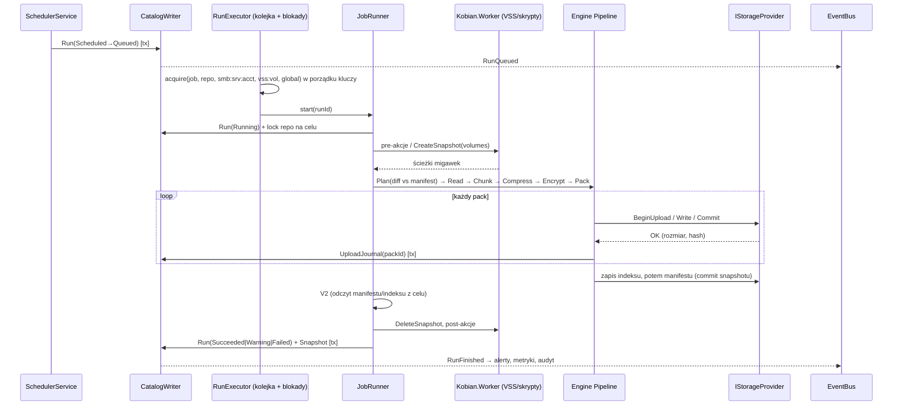

## R2.2.4 Uwierzytelnianie i autoryzacja wywołań

### Decyzja D2.9 — Tożsamość klienta z tokenu pipe (poziom Identification), weryfikacja serwera przez PID z SCM (rozwija SEC-2.2; koryguje STRIDE it. 2 — K12.1)
- **Decyzja:**
  - **Serwer:** Kestrel `ListenNamedPipe("Kobian.Agent.v1")` z `CurrentUserOnly=false` i własnym `PipeSecurity`: konto usługi — `ReadWrite | CreateNewInstance`; `Kobian Operators`, `Administrators`, `SYSTEM` — wyłącznie `ReadWrite` (**nigdy** `CreateNewInstance` dla klientów — dokumentacja ASP.NET Core wskazuje to jako wektor podszycia). SID-y grup budowane z `SecurityIdentifier` (nie z nazw — lokalizowane nazwy grup w PL Windows).
  - **Tożsamość klienta:** interceptor gRPC pobiera `NamedPipeServerStream` z funkcji połączenia Kestrel i wykonuje `RunAsClient` → `WindowsIdentity` (klient łączy się z `TokenImpersonationLevel.Identification`; poziom `Anonymous` = odmowa `KB-7001`). Rola = najwyższa z: członkostwo w grupie `Kobian Admins` lub lokalnych Administratorach z tokenem pełnym (elevated) → Admin; `Kobian Operators` → Operator; pozostali dopuszczeni ACL → Viewer. Wynik cache’owany per połączenie (nie per wywołanie), unieważniany przy zamknięciu połączenia.
  - **Weryfikacja serwera przez klienta (UI/CLI):** po połączeniu `GetNamedPipeServerProcessId` == PID usługi `KobianAgent` z `QueryServiceStatusEx` (SCM) **oraz** obraz procesu podpisany Authenticode wydawcy Kobian; niezgodność = przerwanie z komunikatem o możliwym podszyciu (pipe squatting, gdy usługa nie działa).
  - **Mapa autoryzacji:** atrybut `[RequiresRole(Role.X, StepUp = bool)]` na każdej metodzie implementacji; test architektury: metoda usługi bez atrybutu = błąd builda; domyślnie odmowa.
- **Alternatywy:** sprawdzanie SID właściciela pipe po stronie klienta; TLS na pipe z certyfikatem serwera; osobne pipe’y per rola (.NET 9+ `CreateNamedPipeServerStream`).
- **Uzasadnienie:** SID właściciela pipe nie odróżnia instancji intruza (wszystkie instancje mają deskryptor pierwszej); PID z SCM wiąże pipe z faktycznie uruchomioną usługą. Poziom Identification wystarcza do odczytu grup i `AccessCheck` (SEC-6.3) bez dawania usłudze możliwości działania jako klient.
- **Ryzyka:** UAC — administrator bez podniesienia ma token ograniczony → rola Operator/Viewer; UI pokazuje „Uruchom jako administrator dla zmian konfiguracji” lub stosuje step-up (6.7). Zachowanie `RunAsClient` w Kestrel named pipes potwierdzić w spike’u M0 (Q44).

```text
Interceptor.UnaryServerHandler(request, ctx, continuation):
  conn ← ctx.GetHttpContext().Features.Get<IConnectionNamedPipeFeature>()
  if conn is null: throw RpcException(Unauthenticated, kb="KB-7001")
  caller ← connCache.GetOrAdd(conn.Id, () => ResolveCaller(conn.NamedPipe))   // RunAsClient → SID, grupy, elevated
  attr ← method.GetCustomAttribute<RequiresRole>() ?? throw (build-time test gwarantuje istnienie)
  if caller.Role < attr.Role: audit(Denied); rateLimit.Note(caller.Sid); throw PermissionDenied kb="KB-7002"
  if attr.StepUp:
     tok ← ctx.RequestHeaders["x-kobian-stepup"]
     if !stepUp.Consume(tok, caller.Sid, method.FullName): throw PermissionDenied kb="KB-7003"
  if method.IsMutating and !idempotency.TryBegin(request.request_id, caller.Sid): return idempotency.CachedResponse
  using scope ← CallerContext.Push(caller)          // dostępny dla RestoreService (AccessCheck ścieżki)
  resp ← await continuation(request, ctx)
  if attr.Audited: audit(Allowed, method, Redact(request))
  return resp
```

## R2.2.5 Katalog: własność schematu i migracje

### Decyzja D2.11 — Prefiksy tabel per moduł, migracje „tylko do przodu” w transakcji, kopia przed migracją (rozwija D2.3, D8.2)
- **Decyzja:** każdy moduł posiada swoje tabele z prefiksem i własny numer wersji w `schema_versions`; migracje to ponumerowane skrypty SQL osadzone w assembly (`Catalog/Migrations/<moduł>/NNNN_opis.sql`), wykonywane w jednej transakcji przy starcie (`CatalogBootstrap`), poprzedzone `VACUUM INTO 'catalog.pre-<wersja>.db'` (kopia do rollbacku przy nieudanej aktualizacji — D10.3). Brak migracji „w dół”; rollback produktu = przywrócenie kopii. Wersja schematu nowsza niż znana binarce → usługa startuje w trybie tylko do odczytu z alertem A14.
- **Alternatywy:** EF Core Migrations; Dapper + FluentMigrator; jeden globalny numer wersji.
- **Uzasadnienie:** brak ORM w ścieżce krytycznej (przewidywalne zapytania, mniej zależności); prefiksy pozwalają rolom 3/5/7/8/9 projektować DDL niezależnie w kolejnych iteracjach bez kolizji; kopia przed migracją realizuje rollback aktualizacji.
- **Ryzyka:** rozmiar kopii przy dużym katalogu (do 0,5 GB — 8.5) → kopia tylko przy zmianie wersji schematu; sprawdzenie wolnego miejsca przed migracją.

```sql
-- Tabele wspólne (właściciel: Architekt / Kobian.Catalog.Sqlite)
PRAGMA journal_mode = WAL;            -- D2.3
PRAGMA foreign_keys = ON;
CREATE TABLE schema_versions (
  module      TEXT PRIMARY KEY,        -- 'core','job','run','sched','snap','dbsrc','restore','alert','audit'
  version     INTEGER NOT NULL,
  applied_at  TEXT NOT NULL            -- ISO-8601 UTC
) STRICT;
CREATE TABLE core_host (
  host_id         TEXT PRIMARY KEY,    -- UUID, D8.3
  installation_id TEXT NOT NULL,       -- zmienia się przy reinstalacji; blokady repo (D8.3)
  created_at      TEXT NOT NULL
) STRICT;
CREATE TABLE core_events (            -- append-only (R&D it. 2), źródło projekcji
  seq         INTEGER PRIMARY KEY AUTOINCREMENT,
  at          TEXT NOT NULL,
  type        TEXT NOT NULL,           -- np. 'RunStateChanged'
  aggregate   TEXT NOT NULL,           -- 'run:<id>', 'job:<id>'
  payload     BLOB NOT NULL,           -- JSON UTF-8, bez sekretów
  correlation TEXT
) STRICT;
CREATE INDEX core_events_aggregate ON core_events(aggregate, seq);
CREATE TABLE core_idempotency (
  request_id  TEXT PRIMARY KEY, caller_sid TEXT NOT NULL,
  method TEXT NOT NULL, response BLOB, created_at TEXT NOT NULL
) STRICT;                              -- czyszczenie po 24 h
CREATE TABLE core_outbox (            -- trwała kolejka powiadomień i heartbeatów
  id INTEGER PRIMARY KEY AUTOINCREMENT, channel TEXT NOT NULL, payload BLOB NOT NULL,
  attempts INTEGER NOT NULL DEFAULT 0, next_attempt_at TEXT NOT NULL, state TEXT NOT NULL
    CHECK (state IN ('pending','sent','dead'))
) STRICT;
CREATE TABLE core_secrets_ref (       -- tylko referencje; sekret w magazynie DPAPI (SEC-2.3)
  secret_ref TEXT PRIMARY KEY, kind TEXT NOT NULL, created_at TEXT NOT NULL, rotated_at TEXT
) STRICT;
-- Prefiksy zarezerwowane: job_* (it. 12/17), run_* i sched_* (it. 17), snap_* i repo_* (it. 13), dbsrc_* (it. 15),
-- restore_* (it. 18), alert_* i audit_* (it. 19). Każda iteracja definiuje DDL w swoim prefiksie.
```

Tryb `STRICT` wymaga SQLite ≥ 3.37 — spełnione przez wymóg ≥ 3.50.2 (D2.3).

## R2.2.6 Utwardzenie usługi i VSS z konta wirtualnego (zamyka Q13)

### Decyzja D2.12 — Profil uprawnień usługi ustawiany przez instalator (rozwija D2.5, SEC-1.4; koryguje K12.2)
- **Decyzja:** instalator (MSI custom action — SEC-10.7) konfiguruje:
  1. `SERVICE_CONFIG_REQUIRED_PRIVILEGES_INFO` — token usługi ograniczony do: `SeBackupPrivilege`, `SeRestorePrivilege`, `SeChangeNotifyPrivilege`, `SeShutdownPrivilege` (akcja „wyłącz po zadaniu” — D7.6), `SeImpersonatePrivilege` **nie** (Identification wystarcza — D2.9; do potwierdzenia w M0, Q44).
  2. Uprawnienia LSA dla `NT SERVICE\KobianAgent`: `SeBackupPrivilege`, `SeRestorePrivilege` (bez członkostwa w Administrators/Backup Operators).
  3. **VSS:** wpis `HKLM\SYSTEM\CurrentControlSet\Services\VSS\VssAccessControl\NT SERVICE\KobianAgent = 2` (dostęp requestera) — mechanizm opisany przez Microsoft dla kont spoza Administrators/Backup Operators/LocalSystem; bez niego wywołania COM VSS kończą się `E_ACCESSDENIED`.
  4. Akcje odzyskiwania SCM: restart po 1 min ×2, potem co 5 min (NFR-09); `ServiceSidType = Restricted` **nie** (utrudnia dostęp do sieci/SMB — do potwierdzenia), `Unrestricted` domyślnie.
  5. MSSQL: login `NT SERVICE\KobianAgent` (lokalnie) / konto komputera `DOMENA\HOST$` (zdalnie) — skrypt T-SQL z 5.2.
- **Alternatywy:** członkostwo w Backup Operators (szerokie uprawnienia, w tym logowanie lokalne i zamykanie systemu na DC); LocalSystem.
- **Uzasadnienie:** realizuje SEC-1.4 i zamyka Q13: VSS przez `VssAccessControl`, MSSQL przez login Windows — bez grup uprzywilejowanych.
- **Ryzyka:** requestery z kopią stanu systemu (system state) wymagają Administrators/LocalSystem — Kobian nie wykonuje backupu stanu systemu (US-26 W), więc nie dotyczy; wpis VssAccessControl usuwany przy odinstalowaniu.

### Decyzja D2.8 — Requester VSS w procesie `Kobian.Worker --role vss`, nie w procesie usługi (rozwija D3.6, SEC-2.5)
- **Decyzja:** obiekty `IVssBackupComponents` tworzone w osobnym procesie potomnym usługi (ten sam token konta usługi, bez sieci), który wywołuje `CoInitializeSecurity` z **jawnym deskryptorem bezpieczeństwa** dopuszczającym tylko: LocalSystem, LocalService, NetworkService, Administrators, Backup Operators (wymóg wywołań zwrotnych writerów VSS), poziom `RPC_C_AUTHN_LEVEL_PKT_PRIVACY`, `RPC_C_IMP_LEVEL_IMPERSONATE`, `EOAC_STATIC_CLOAKING`, oraz opcję `COMGLB_EXCEPTION_DONOT_HANDLE`. Komunikacja usługa ↔ Worker: anonimowy pipe (stdin/stdout), protokół ramkowany długością z JSON (limit ramki 1 MiB). Migawka żyje tak długo, jak proces Worker; jego śmierć = automatyczne zwolnienie migawki przez VSS (brak „wiszących” migawek).
- **Alternatywy:** VSS w procesie usługi (wymagałby globalnego `CoInitializeSecurity` dla całej usługi, w której działa też Kestrel); `vshadow.exe`.
- **Uzasadnienie:** `CoInitializeSecurity` jest jednorazowe i procesowe; przykładowa konfiguracja z dokumentacji (`NULL` = wszystkie procesy) otwierałaby proces usługi na wywołania COM z innych procesów — izolacja ogranicza skutek do krótkotrwałego procesu bez sekretów.
- **Ryzyka:** narzut uruchomienia procesu (~100–300 ms, pomijalny); błędy writerów raportowane przez ramki z kodami `KB-1xxx`.

## R2.2.7 Zamknięte pytania

- **Q13** — zamknięte (D2.12): VSS przez `VssAccessControl = 2`, MSSQL przez login Windows; potwierdzenie testem integracyjnym na Windows Server 2019/2022/2025 w M0.
- **Q11** — uzupełnione: Kestrel na named pipe pozostaje (D2.4), z mechanizmami D2.9; plan B StreamJsonRpc bez zmian.
- Nowe: **Q44** (spike M0: `RunAsClient` w Kestrel named pipes, poziom Identification, brak `SeImpersonatePrivilege`, zachowanie przy UAC).

# Bezpieczeństwo — iteracja 12 (rola 11: Ekspert bezpieczeństwa)

1. **SEC-12.1 Test podszycia pod pipe (wymaganie testu E2E):** przy zatrzymanej usłudze proces testowy tworzy serwer `\\.\pipe\Kobian.Agent.v1`; `kobian status` i UI muszą odmówić połączenia (`KB-7004 serwer niezweryfikowany`) i nie wysłać żadnego żądania poza handshake HTTP/2. Drugi test: konto z grupy `Kobian Operators` nie może utworzyć instancji pipe (brak `CreateNewInstance`) — `ERROR_ACCESS_DENIED`.
2. **SEC-12.2 Domyślna odmowa:** test architektury D2.9 (metoda bez `[RequiresRole]` = błąd builda) jest bramką CI; dodatkowy test refleksji: każda metoda mutująca ma `request_id` i `Audited=true`.
3. **SEC-12.3 Token step-up:** jednorazowy, 120 s, związany z SID, nazwą metody i hashem parametrów (np. `snapshot_id`), przechowywany tylko w pamięci usługi; po restarcie usługi unieważniony.
4. **SEC-12.4 Worker VSS:** jawny deskryptor w `CoInitializeSecurity` (nie `NULL`); Worker bez dostępu do sekretów i sieci (job object, brak dziedziczenia uchwytów poza stdin/stdout).
5. **SEC-12.5 Migracje katalogu:** skrypty osadzone w podpisanym assembly, brak ładowania SQL z dysku; kopia `catalog.pre-*.db` z ACL katalogu danych (2.6) i usuwana po 2 udanych startach nowej wersji (dane osobowe — nazwy plików).
6. **SEC-12.6 Rewizja:** STRIDE it. 2 (S dla named pipe) skorygowany (K12.1); D2.5 uzupełniony o VSS (K12.2). Pozostałe decyzje bez zmian.

### STRIDE — nowe elementy

| Element | Zagrożenie | Kat. | Mitygacja |
|---|---|---|---|
| Pipe `Kobian.Agent.v1` | podszycie (squatting, dodatkowa instancja) | S | ACL bez `CreateNewInstance` dla klientów; weryfikacja PID z SCM + podpis (D2.9) |
| Interceptor autoryzacji | brak atrybutu na nowej metodzie | E | domyślna odmowa + test builda |
| Idempotencja `request_id` | odtworzenie odpowiedzi innego klienta | I | klucz = `request_id` + SID |
| Worker VSS | wywołania COM z obcych procesów | E | jawny SD, krótkotrwały proces |
| Kopia katalogu przed migracją | pozostawione dane osobowe | I | ACL, usuwanie po 2 startach |
| `TailLog`/`WatchRun` | wyczerpanie zasobów przez wiele strumieni | D | limity 8 strumieni/klient, 32 wywołania globalnie |

# R&D — iteracja 12 (rola 12: Dział R&D)

| Rozwiązanie / technika | Opis | Ocena | Decyzja |
|---|---|---|---|
| **`buf` (Buf CLI) — lint i `buf breaking`** | statyczna kontrola stylu i łamiących zmian w `.proto` względem poprzedniego wydania | wysoka wartość dla D2.10 przy zerowym wpływie na produkt (narzędzie CI, Apache-2.0); binarka Go — przypięcie wersji i hash | **Przyjęte do CI** (M1) po audycie przy wdrożeniu |
| **Osobne pipe’y per rola (.NET 9+ `NamedPipeTransportOptions.CreateNamedPipeServerStream`)** | pipe „admin” dostępny tylko dla Administrators, pipe „viewer” dla operatorów | dodatkowa warstwa obrony (ACL zamiast tylko interceptora) | **Przyjęte jako warstwa uzupełniająca** w 1.1, po pentestcie 1.0 |
| **Windows Service Hardening: write-restricted service SID** | token usługi z ograniczeniem zapisu tylko do zasobów jawnie przyznanych SID usługi | silna izolacja, ale koliduje z zapisem restore do dowolnych lokalizacji (Admin) | **Odrzucone dla procesu usługi**; **rozważane dla Worker** (role skryptów/listingów) — spike 1.1 |
| **Architecture Decision Records w repozytorium (format MADR)** | decyzje D*.* jako pliki `docs/adr/` powiązane z kodem | tanie, zgodne z Indeksem decyzji | **Przyjęte**: generacja ADR z planu przy zakładaniu repozytorium (M0) |

---

# R2.3 Silnik backupu — specyfikacja formatu i algorytmów (iteracja 13 — Inżynier silnika backupu)

Wejście: D3.1–D3.7, struktura repo 3.1, nagłówek bloku 3.4, hierarchia kluczy D3.4, K8.1 (trailer), K10.1, SEC-3.1–SEC-3.7, wektory 10.1, prefiksy katalogu D2.11 (`snap_*`, `repo_*`), AC-06.x, AC-08.x, AC-10.x, AC-22a.1, US-43. Cel: **specyfikacja „Kobian Repo v1” na poziomie bajtów**, wystarczająca do napisania niezależnego czytnika (`kobian-restore`, Q17) oraz pseudokod algorytmów zapisu, deduplikacji i retencji.

### Przegląd luk

| # | Luka | Miejsce | Zamknięcie |
|---|---|---|---|
| L1 | Brak układu bajtowego packa, trailera, indeksu, manifestu | 3.1, K8.1 | R2.3.3–R2.3.5, D3.10 |
| L2 | Nonce dla obiektów metadanych (indeks, snapshot) i etykiety HKDF nieokreślone | D3.4 | R2.3.2, D3.9 |
| L3 | Kodowanie metadanych (JSON? binarne?) i kanoniczność potrzebna do deduplikacji drzew | 3.1 („tree blobs”) | D3.8 |
| L4 | Ochrona parametrów KDF przed obniżeniem (downgrade) przez napastnika z dostępem do celu | D3.5 | D3.11 |
| L5 | Algorytm GFS i zbioru „dozwolonych do reużycia” bloków tylko opisowo | 3.2, 3.8 | R2.3.6–R2.3.7, D3.12 |
| L6 | Format i wygasanie blokad `locks/` (przerwany host trzyma blokadę wiecznie) | 3.1, 3.8 | D3.13 |
| L7 | „Commitment tag” bez definicji | D3.4 | R2.3.2 |

## R2.3.1 Konwencje

- Liczby całkowite w strukturach binarnych: **little-endian**; nonce GCM: big-endian licznik (R2.3.2).
- Identyfikatory: `repoId`, `packId`, `indexId`, `snapId`, `objectId` — 16 bajtów losowych (CSPRNG), w nazwach plików jako 32 znaki hex małymi literami; `chunkId`/`treeId` — 32 bajty (HMAC-SHA256), w nazwach — 64 znaki hex.
- Ścieżki obiektów: `data/<pp>/<packId>.pack` (`pp` = pierwsze 2 znaki hex), `index/<indexId>.idx`, `snapshots/<snapId>.snap`, `keys/<keyId>.key`, `locks/<lockId>.lock`.
- Wszystkie obiekty poza `kobian.repo`, `keys/*.key` i `locks/*.lock` są szyfrowane; nazwy plików na celu nie zawierają żadnej informacji o źródle (AC-06.1).

### Decyzja D3.8 — Metadane w deterministycznym CBOR (RFC 8949 §4.2, „Core Deterministic Encoding”) przez `System.Formats.Cbor` (rozwija 3.1, R&D it. 3 „tree blobs”)
- **Decyzja:** drzewa, manifesty snapshotów, indeksy i trailery packów kodowane CBOR w trybie `CborConformanceMode.Canonical` (klucze map jako małe liczby całkowite, posortowane; najkrótsze kodowanie liczb; brak długości nieokreślonych, brak floatów). Czytnik odrzuca dane niekanoniczne (identyczny `treeId` dla identycznej treści).
- **Alternatywy:** JSON (+ JCS, RFC 8785); Protobuf (serializacja deterministyczna niegwarantowana między implementacjami); własny TLV; PeterO.Cbor (CVE-2024-21909 — DoS przez nieefektywny algorytm w 4.0.0–4.5.0).
- **Uzasadnienie:** binarny, zwarty (~40–60% rozmiaru JSON dla drzew), kanoniczny z normy, biblioteka Microsoftu (MIT, 10.0.12 z 08.09.2026, bez zależności na .NET 8+); niezależny czytnik może użyć dowolnej biblioteki CBOR w innym języku (Q17).
- **Ryzyka:** parser niezaufanych danych → limity R2.3.8 i fuzzing (10.1); zmiana zachowania biblioteki między wersjami → wektory testowe V-xx w CI.

## R2.3.2 Klucze, nonce i zobowiązanie (commitment)

### Decyzja D3.9 — Etykiety HKDF, klucze per obiekt i reguły nonce (rozwija D3.4)
- **Decyzja:**

| Klucz | Wyprowadzenie (HKDF-SHA256: IKM, salt, info) | Długość | Użycie |
|---|---|---|---|
| `MK` | CSPRNG | 32 B | korzeń; nigdy nie opuszcza pamięci w postaci jawnej |
| `K_data` | `MK`, `repoId`, `"kobian/v1/data"` | 32 B | wyprowadzanie `K_pack` |
| `K_meta` | `MK`, `repoId`, `"kobian/v1/meta"` | 32 B | wyprowadzanie `K_obj` |
| `K_id` | `MK`, `repoId`, `"kobian/v1/chunk-id"` | 32 B | `chunkId = HMAC-SHA256(K_id, plaintext)`, `treeId = HMAC-SHA256(K_id, cbor(tree))` |
| `K_mac` | `MK`, `repoId`, `"kobian/v1/header-mac"` | 32 B | MAC `kobian.repo` i `locks/*.lock` |
| `K_pack` | `K_data`, `packId`, `"kobian/v1/pack"` | 32 B | AES-256-GCM blobów w packu |
| `K_commit(pack)` | `K_data`, `packId`, `"kobian/v1/pack-commit"` | 32 B | `commitTag = HMAC-SHA256(K_commit, "kobian/v1/commit" ‖ packId)` |
| `K_obj` | `K_meta`, `objectId`, `"kobian/v1/obj/" + typ` (`index`/`snapshot`) | 32 B | AES-256-GCM obiektu metadanych |
| `KEK` | PBKDF2-HMAC-SHA256(hasło, sól 32 B, iter ≥ 600 000) / klucz odzyskiwania (32 B, bez KDF) / DPAPI (`LocalMachine`, entropia — SEC-2.3) | 32 B | opakowanie `MK` w `keys/*.key` |

  **Nonce blobu** w packu: `00 00 00 00 ‖ u64be(i)`, gdzie `i` = numer blobu w packu od 0; trailer: `FF FF FF FF ‖ FF…FF` (8 B). Unikalność gwarantuje para (unikalny `K_pack` na pack, monotoniczny `i`); zapis packa o istniejącym `packId` jest błędem `KB-1003` (Stat przed uploadem). **Nonce obiektu metadanych:** 12 B losowe, zapisane w nagłówku obiektu; dodatkowo `K_obj` jest unikalny per `objectId` (podwójne zabezpieczenie przed powtórzeniem nonce). Tag GCM: 16 B.
- **Alternatywy:** jeden klucz `K_data` z nonce losowym 96 b (limit 2^32 wiadomości); XChaCha20-Poly1305 (zależność natywna).
- **Uzasadnienie:** klucze per pack/obiekt usuwają limit liczby wiadomości na klucz i ryzyko kolizji nonce; wszystkie prymitywy z BCL (`HKDF`, `AesGcm`, `HMACSHA256`, `Rfc2898DeriveBytes.Pbkdf2`) — SEC-3.1(b).
- **Ryzyka:** koszt HKDF per pack (pomijalny: 1 wywołanie na 16 MiB); błąd implementacji etykiet → wektory V-01…V-04.

`commitTag` w nagłówku packa jest sprawdzany przed odszyfrowaniem pierwszego blobu; niezgodność = `KB-1101` (pack nie należy do tego repozytorium/klucza). Wiąże pack z kluczem (GCM nie jest key-committing — D3.4).

## R2.3.3 Nagłówek repozytorium i pliki kluczy

### Decyzja D3.11 — `kobian.repo` jako JSON z MAC nad postacią kanoniczną JCS; parametry KDF chronione przez AAD opakowania (rozwija D3.4, D3.5; koryguje 3.1 — K13.1)
- **Decyzja:** `kobian.repo` (jawny, czytelny dla człowieka i narzędzi diagnostycznych):

```json
{
  "body": {
    "magic": "kobian-repo",
    "formatVersion": 1,
    "repoId": "3f9c…(32 hex)",
    "createdAt": "2026-10-12T20:15:00Z",
    "chunker": { "alg": "fixed", "size": 4194304, "smallFileMax": 1048576 },
    "pack": { "targetSize": 16777216 },
    "compression": { "default": "zstd", "level": 3 },
    "keys": ["a1b2…", "c3d4…"],
    "minReaderVersion": 1,
    "features": []
  },
  "mac": "hex(HMAC-SHA256(K_mac, UTF-8(JCS(body))))"
}
```

  Plik `keys/<keyId>.key` (jawny JSON): `{ "keyId", "type": "password"|"recovery"|"dpapi-host", "hostId"?, "kdf": {"alg":"pbkdf2-sha256","iter":600000,"salt":"base64"} | null, "nonce": "base64(12 B)", "wrapped": "base64(AES-256-GCM(KEK, MK))", "createdAt", "revoked": false }`; **AAD opakowania** = `UTF-8(JCS(obiekt bez pól "wrapped" i "revoked"))` — zmiana `iter`, `salt`, `type` lub `keyId` powoduje błąd odszyfrowania (ochrona przed downgrade). Unieważnienie klucza (D8.3) = ustawienie `revoked` i usunięcie z `body.keys` (wymaga poświadczenia maintenance); czytnik ignoruje klucze spoza `body.keys` po weryfikacji MAC.
  `features` — lista funkcji wymaganych do odczytu (np. `"cdc"` w v2); czytnik nieznający funkcji odmawia (`KB-1002`), zamiast błędnie interpretować dane.
- **Alternatywy:** cały nagłówek szyfrowany (utrudnia diagnostykę i wybór KDF przed odblokowaniem); podpis Ed25519 nagłówka (klucz prywatny i tak na hoście).
- **Uzasadnienie:** JCS (RFC 8785) dla podzbioru bez liczb zmiennoprzecinkowych to kilkadziesiąt linii kodu; MAC wykrywa podmianę nagłówka po odblokowaniu, AAD — przed (parametry KDF).
- **Ryzyka:** napastnik może usunąć wpis klucza (DoS) — wykrywane jako błąd MAC po odblokowaniu innym kluczem; kopia nagłówka w każdym snapshotcie (`headerSha256`) umożliwia odtworzenie.

## R2.3.4 Pack — układ bajtowy (formalizuje K8.1)

### Decyzja D3.10 — Pack: nagłówek 64 B jawny, sekwencja ramek AEAD, zaszyfrowany trailer i stopka 16 B (rozwija 3.1, K8.1, 3.4)

**Nagłówek (64 B, jawny):**

| Offset | Rozmiar | Pole | Wartość |
|---|---|---|---|
| 0 | 8 | `magic` | ASCII `KOBPACK1` |
| 8 | 2 | `formatVersion` | 1 |
| 10 | 2 | `flags` | 0 (zarezerwowane) |
| 12 | 4 | `blobCount` | liczba ramek (bez trailera) |
| 16 | 16 | `packId` | = nazwa pliku |
| 32 | 32 | `commitTag` | R2.3.2 |

**Ramka blobu i (powtarzana):**

| Offset względny | Rozmiar | Pole | Uwagi |
|---|---|---|---|
| 0 | 4 | `frameLength` | długość szyfrogramu + tag; ≤ 2 × rozmiar bloku + 64 (SEC-3.3) |
| 4 | `frameLength` | `ciphertext‖tag` | AES-256-GCM(`K_pack`, nonce(i), AAD, plaintext) |

  **AAD ramki** = `repoId(16) ‖ packId(16) ‖ u64le(i) ‖ chunkId(32) ‖ u16le(formatVersion)` (realizuje AAD z D3.4 i dodatkowo wiąże pozycję).
  **Plaintext ramki** = `blobVersion u8 (=1) ‖ blobType u8 (1=data, 2=tree) ‖ algo u8 (0=none, 1=zstd, 2=brotli) ‖ flags u8 ‖ rawLength u32le ‖ payload` (nagłówek bloku z 3.4).

**Trailer (ostatnia ramka, nonce `FF…FF`, AAD = `repoId ‖ packId ‖ "trailer"`)** — plaintext: CBOR `[ [chunkId(bstr32), offset(uint), frameLength(uint), blobType(uint), rawLength(uint)], … ]` w kolejności ramek.

**Stopka (16 B, jawna, na końcu pliku):** `trailerOffset u64le ‖ trailerFrameLength u32le ‖ ASCII "KTRL"`.

  Odczyt bez indeksu (odbudowa — 8.5, S6/S7): odczyt stopki → trailer → weryfikacja `commitTag` i tagów → lista bloków. Hash pliku `SHA-256(cały pack)` zapisywany w indeksie (V1, 3.7).
- **Alternatywy:** brak stopki (skan sekwencyjny ramek — wolny na FTP); trailer jawny (ujawnia liczbę i rozmiary bloków — i tak ujawnione przez ramki, ale chunkId nie).
- **Uzasadnienie:** stopka o stałej długości pozwala czytnikowi pobrać trailer dwoma odczytami zakresowymi (`OpenReadAsync(offset)` — 4.1); trailer szyfrowany chroni `chunkId` (SEC-3.7).
- **Ryzyka:** pack ucięty w trakcie uploadu nie ma stopki → traktowany jako niekompletny (nie trafia do indeksu; usuwany przez prune); serwery bez odczytu zakresowego → pobranie całego packa (8 MiB dla FTP — Q16).

## R2.3.5 Indeks, snapshot, drzewo

**Obiekt metadanych (indeks i snapshot):** `magic 8 B ("KOBIDX01" / "KOBSNP01") ‖ formatVersion u16le ‖ flags u16le ‖ reserved u32 ‖ objectId 16 B ‖ nonce 12 B ‖ reserved 4 B` (48 B jawnych) ‖ `AES-256-GCM(K_obj, nonce, AAD = 48 B nagłówka ‖ repoId, plaintext = zstd(CBOR))`.

| Obiekt | CBOR (klucze-liczby → znaczenie) |
|---|---|
| Indeks | `{1: [ {1: packId, 2: sha256(pack), 3: size, 4: [[chunkId, offset, frameLength, blobType, rawLength], …]} ], 2: [indexId zastąpione (prune)], 3: hostId, 4: runId}` |
| Snapshot | `{1: snapId, 2: hostId, 3: jobId, 4: runId, 5: time (tag 1, sekundy UTC), 6: mode (0 full,1 inc,2 diff,3 db), 7: parentSnapId?, 8: baseFullSnapId?, 9: rootTreeId, 10: stats {1 files,2 dirs,3 bytesRaw,4 bytesNew,5 packsNew}, 11: [[indexId, sha256]], 12: headerSha256, 13: tags ("suspect" — D9.3), 14: dbMeta? (5.1), 15: formatVersion, 16: sourceRoots [ścieżki — szyfrowane razem z obiektem]}` |
| Drzewo (blob type 2 w packu) | `{1: [entry…]}`; entry: `{1: name (tstr, NFC bez zmian — zachowanie oryginału), 2: kind (0 file,1 dir,2 symlink,3 junction,4 hardlink-ref), 3: size, 4: mtime (ns od epoki), 5: ctime, 6: btime, 7: attrs (u32 FILE_ATTRIBUTE_*), 8: fileId (bstr16), 9: chunks [chunkId…], 10: subtreeId, 11: linkTarget, 12: sdRef (chunkId blobu z SDDL), 13: ads [[name, [chunkId…], size]], 14: sparse [[offset,length]…], 15: fileSha256}` — wpisy posortowane bajtowo po UTF-8 nazwy |

`fileSha256` (pełny hash pliku) umożliwia AC-07.1 i V4 bez rekonstrukcji z bloków; liczony w locie podczas odczytu.

## R2.3.6 Algorytm zapisu (pseudokod)

```text
Backup(job, mode):
  prev  ← catalog.LastSnapshot(job, Succeeded|Warning)          // lokalnie; brak → odbudowa z repo (D8.2)
  base  ← (mode = DIFF) ? catalog.LastFull(job) : prev
  allowedPacks ← case mode:
      FULL → ∅                                                   // D3.2: niezależny łańcuch
      DIFF → PacksReferencedBy(base)
      INC  → PacksReferencedBy(łańcuch job od ostatniego FULL)   // AC-22a.1
  dedup ← IndexEntries(allowedPacks)                            // chunkId → lokalizacja; HashSet w RAM (32 B + 24 B/wpis)
  for dir in Enumerate(sourceRoots) post-order:
     entries ← []
     for f in dir.files:
        old ← prevTree.Lookup(f.path)
        if old ≠ null ∧ old.size = f.size ∧ old.mtime = f.mtime ∧ old.ctime = f.ctime ∧ old.fileId = f.fileId ∧ ¬job.forceHash ∧ mode ≠ FULL:
             entries.add(old)                                   // bez odczytu
        else:
             chunks ← []; h ← SHA256()
             for block in Read(f, size ≤ smallFileMax ? f.size : 4 MiB):
                 h.update(block); id ← HMAC(K_id, block)
                 if id ∉ dedup: packer.Add(id, Compress(block)); dedup.add(id)
                 chunks.add(id)
             entries.add(Entry(f, chunks, h.final()))
     tree ← CanonicalCbor(entries); tid ← HMAC(K_id, tree)
     if tid ∉ dedup: packer.Add(tid, Compress(tree), type=TREE)
     parent.add(dirEntry with subtreeId = tid)
  packer.FlushAll()                                             // każdy pack: upload → V1 → UploadJournal
  WriteObject(index, entries nowych packów)
  WriteObject(snapshot, rootTreeId, indexes, stats)             // commit — ostatni zapis (2.5)
  V2(snapshot)
```

Pamięć zbioru `dedup`: 1 mln bloków ≈ 56 MB — w budżecie NFR-05 (500 MB); dla większych repozytoriów (v2, dedup globalna) — filtr Bloom + indeks na dysku.

## R2.3.7 Retencja GFS (pseudokod deterministyczny)

### Decyzja D3.12 — Retencja jako czysta funkcja `Keep(snapshots, policy, now) → zbiór` z regułą „ostatni w okresie” (rozwija D3.7)
- **Decyzja:** algorytm poniżej; wynik zależy wyłącznie od listy snapshotów (czas UTC przeliczony na strefę zadania — D7.2), polityki i `now`; uruchamiany w trybie podglądu (dry-run) w UI przed zapisem polityki.

```text
Keep(S, p, now):     // S posortowane malejąco po czasie; tylko Succeeded/Warning z V2 OK
  K ← ∅
  K ∪= first(S, p.keepLast)
  for (n, bucket) in [(p.keepDaily, day), (p.keepWeekly, isoWeek), (p.keepMonthly, month), (p.keepYearly, year)]:
      seen ← ∅
      for s in S:
          b ← bucket(local(s.time))
          if b ∉ seen ∧ |seen| < n: K ∪= {s}; seen ∪= {b}      // najnowszy snapshot w okresie
  K ∪= { s ∈ S : now − s.time ≤ p.keepWithin }
  K ∪= { s ∈ S : now − s.time < p.retentionLock }              // nienaruszalne (D3.7)
  K ∪= { newest(S) }                                            // zawsze ostatni udany
  K ∪= { s.baseFull : s ∈ K ∧ s.mode = DIFF }                   // zależności różnicowych
  K ∪= { s : s.tags ∋ "suspect" } ∪ (retencjaWstrzymana ? S : ∅) // D9.3
  return K
Forget = S \ Keep — usuwane logicznie (znacznik w katalogu + plik snapshots/<id>.snap usuwany tylko z poświadczeniem maintenance)
```

- **Alternatywy:** okresy liczone „od teraz” (np. ostatnie 7 dni kalendarzowych zamiast 7 dni z kopią); retencja per typ kopii.
- **Uzasadnienie:** semantyka zgodna z restic `forget` (najnowszy snapshot w każdym z N ostatnich okresów, w których istnieje kopia) — przewidywalna przy lukach (wyłączony laptop); czysta funkcja = testy właściwości (AC-10.1).
- **Ryzyka:** różnica interpretacji tygodnia (ISO 8601 vs niedziela) → zawsze ISO (poniedziałek), opis w UI.

**Prune (MVP, D3.7):** (1) blokada wyłączna; (2) zbiór żywych packów = suma packów referencjonowanych przez snapshoty z `Keep`; (3) packi nieżywe w całości → plik `index/<new>.idx` bez nich + lista „do usunięcia” w katalogu z czasem `markAt`; (4) fizyczne usunięcie po karencji 24 h w kolejnym prune (dwufazowo), tylko jeśli nadal nieżywe i brak blokad współdzielonych młodszych niż `markAt`.

## R2.3.8 Blokady i limity parsera

### Decyzja D3.13 — Blokady repo jako dzierżawy (lease) z MAC i odświeżaniem (rozwija 3.1, D7.4, D8.3)
- **Decyzja:** `locks/<lockId>.lock` = JSON `{lockId, hostId, installationId, kind: "shared"|"exclusive", createdAt, renewedAt, ttlSec: 1800, mac}` (MAC `K_mac` nad JCS bez `mac`). Odświeżanie co 5 min (nadpisanie pliku; dla celów append-only — nowy plik z nowym `lockId`, stary pozostaje i wygasa). Blokada przeterminowana (`now − renewedAt > ttlSec`) jest ignorowana; blokada z błędnym MAC — ignorowana i raportowana (`KB-1201`, alert bezpieczeństwa). Wyłączna wymaga braku żywych współdzielonych i odczekania 2 × okres odświeżania po zapisaniu własnej (wykrycie wyścigu).
- **Alternatywy:** blokady bez wygasania (restic: ręczne `unlock`); blokady tylko lokalne w katalogu.
- **Uzasadnienie:** przerwany host (S1) nie blokuje repo na zawsze; MAC uniemożliwia DoS fałszywymi blokadami przez kogoś bez klucza.
- **Ryzyka:** zegar hosta przestawiony → tolerancja 5 min i ostrzeżenie przy różnicy czasu względem celu (mtime pliku).

| Limit parsera (SEC-3.3) | Wartość | Kod przy przekroczeniu |
|---|---|---|
| `frameLength` | ≤ 8 MiB + 64 | KB-1301 |
| `rawLength` (po dekompresji) | ≤ 4 MiB (data) / ≤ 16 MiB (tree) | KB-1302 |
| Rozmiar obiektu metadanych po dekompresji | ≤ 256 MiB | KB-1303 |
| Głębokość zagnieżdżenia CBOR | ≤ 16 | KB-1304 |
| Wpisów w jednym drzewie | ≤ 1 000 000 | KB-1305 |
| Długość nazwy (UTF-8) | ≤ 1 024 B; zakaz `/`, `\`, NUL, `..`, `.` | KB-1306 |
| Głębokość drzewa katalogów | ≤ 512 | KB-1307 |
| Ramek w packu | ≤ 65 536 | KB-1308 |

### Wektory testowe (publikowane ze specyfikacją — Q17)

| ID | Zawartość | Weryfikuje |
|---|---|---|
| V-01 | `MK`, `repoId` → wszystkie klucze z tabeli D3.9 | HKDF i etykiety |
| V-02 | `K_pack`, i = 0, 1, 2^32 → nonce i szyfrogram ramki | nonce, AAD |
| V-03 | hasło „zażółć gęślą jaźń”, sól, 600 000 iteracji → KEK, opakowany `MK` | PBKDF2, UTF-8 hasła, AAD klucza |
| V-04 | zmodyfikowane `iter` w pliku klucza | odrzucenie (downgrade) |
| V-05 | pack 3 bloki (none/zstd/tree) + trailer + stopka | układ D3.10 |
| V-06 | pack ucięty o 1 B | wykrycie niekompletności |
| V-07 | drzewo z nazwami PL, emoji, długą ścieżką | kanoniczny CBOR, `treeId` |
| V-08 | CBOR niekanoniczny tej samej treści | odrzucenie |
| V-09 | `kobian.repo` + JCS + MAC | D3.11 |
| V-10 | 60 snapshotów + polityka z AC-10.1 | `Keep` (D3.12) |

## R2.3.9 Tabele katalogu silnika (prefiksy `repo_*`, `snap_*` — D2.11)

```sql
CREATE TABLE repo_repositories (
  repo_id TEXT PRIMARY KEY, destination_id TEXT NOT NULL, format_version INTEGER NOT NULL,
  header_sha256 BLOB NOT NULL, last_reconciled_at TEXT, state TEXT NOT NULL CHECK (state IN ('ok','degraded','corrupt'))
) STRICT;
CREATE TABLE repo_packs (
  repo_id TEXT NOT NULL REFERENCES repo_repositories, pack_id BLOB NOT NULL, size INTEGER NOT NULL,
  sha256 BLOB NOT NULL, index_id BLOB, created_run TEXT, mark_delete_at TEXT,
  PRIMARY KEY (repo_id, pack_id)
) STRICT, WITHOUT ROWID;
CREATE TABLE repo_upload_journal (     -- wznawianie (4.7, AC-18.1)
  run_id TEXT NOT NULL, pack_id BLOB NOT NULL, state TEXT NOT NULL CHECK (state IN ('uploading','committed','verified')),
  bytes INTEGER NOT NULL, updated_at TEXT NOT NULL, PRIMARY KEY (run_id, pack_id)
) STRICT, WITHOUT ROWID;
CREATE TABLE snap_snapshots (
  snap_id TEXT PRIMARY KEY, repo_id TEXT NOT NULL REFERENCES repo_repositories, job_id TEXT NOT NULL,
  run_id TEXT NOT NULL, host_id TEXT NOT NULL, time_utc TEXT NOT NULL,
  mode INTEGER NOT NULL CHECK (mode BETWEEN 0 AND 3), base_full TEXT, parent TEXT, root_tree BLOB NOT NULL,
  files INTEGER, bytes_raw INTEGER, bytes_new INTEGER, verify_level INTEGER NOT NULL DEFAULT 1,
  suspect INTEGER NOT NULL DEFAULT 0, forgotten_at TEXT
) STRICT;
CREATE INDEX snap_by_job_time ON snap_snapshots(job_id, time_utc DESC);
CREATE TABLE snap_name_index (         -- wyszukiwanie w wersjach (Q28, 8.5): delta per snapshot
  snap_id TEXT NOT NULL, path_id INTEGER NOT NULL, change INTEGER NOT NULL CHECK (change IN (0,1,2)), -- dodany/zmieniony/usunięty
  size INTEGER, mtime INTEGER, PRIMARY KEY (snap_id, path_id)
) STRICT, WITHOUT ROWID;
CREATE TABLE snap_paths (path_id INTEGER PRIMARY KEY, parent_id INTEGER, name TEXT NOT NULL) STRICT; -- słownik z kompresją prefiksów
```

# Bezpieczeństwo — iteracja 13 (rola 11: Ekspert bezpieczeństwa)

1. **SEC-13.1 Specyfikacja kryptograficzna kompletna do przeglądu zewnętrznego (SEC-3.1c):** D3.9–D3.11 i wektory V-01…V-10 stanowią zakres przeglądu; przegląd przed M2 (wcześniej niż „przed 1.0”), bo zmiana formatu po becie oznacza migrację repozytoriów testerów.
2. **SEC-13.2 Wymaganie testu — downgrade KDF:** V-04 oraz test E2E: napastnik zmienia `iter` z 600 000 na 1 w `keys/*.key` → odblokowanie hasłem kończy się `KB-1102`, brak jakiejkolwiek próby użycia obniżonego parametru do odszyfrowania danych.
3. **SEC-13.3 Kolejność weryfikacji przy odczycie:** stopka → `commitTag` → tag GCM ramki → limity `rawLength` → dekompresja → `chunkId == HMAC(K_id, plaintext)` → `fileSha256`. Każdy krok przed następnym; wyjątek przerywa przetwarzanie packa (nie procesu).
4. **SEC-13.4 Metadane w repo:** `kobian.repo`, `keys/*.key`, `locks/*.lock` ujawniają tylko identyfikatory losowe, daty, parametry KDF i rozmiary — brak nazw hostów, zadań i ścieżek (AC-06.1). `hostId` to UUID, nie nazwa komputera.
5. **SEC-13.5 Klucz odzyskiwania bez KDF** (32 B losowe) — odporny na brute force z definicji; prezentacja Base32 z sumą kontrolną (D6.5) — suma kontrolna to CRC-16 na 30 B? Nie: wymaganie — **sprawdzenie integralności nie może skracać entropii poniżej 256 b**; suma kontrolna dołączana, nie zastępuje bitów klucza.
6. **SEC-13.6 Fałszywe blokady (D3.13):** MAC i TTL ograniczają DoS; napastnik z prawem usuwania na celu może i tak usunąć dane — ochrona przez D4.1/D4.5.

### STRIDE — nowe elementy

| Element | Zagrożenie | Kat. | Mitygacja |
|---|---|---|---|
| `keys/*.key` | obniżenie `iter` / podmiana `type` | T | AAD opakowania (D3.11), V-04 |
| Trailer packa | spreparowany trailer kierujący odczyt poza plik | T, D | offsety walidowane względem rozmiaru, limity R2.3.8 |
| Parser CBOR | bomba zagnieżdżeń, gigantyczne tablice | D | głębokość ≤ 16, limity elementów przed alokacją, tryb Canonical |
| `locks/*.lock` | fałszywa blokada wyłączna blokująca kopie | D | MAC `K_mac`, TTL |
| Snapshot z `headerSha256` | rollback nagłówka do starszej wersji | T | porównanie z katalogiem lokalnym (monotoniczność) |

# R&D — iteracja 13 (rola 12: Dział R&D)

| Technika | Opis | Ocena | Decyzja |
|---|---|---|---|
| **AES-GCM-SIV (RFC 8452)** | AEAD odporne na powtórzenie nonce | brak w BCL .NET 10 → wymagałoby zależności natywnej; D3.9 eliminuje ryzyko powtórzenia innymi środkami | **Odrzucone** (rewizja przy dostępności w BCL) |
| **BLAKE3 / BLAKE2b jako funkcja `chunkId`** | szybsze od HMAC-SHA256 (SIMD, drzewiaste) | SHA-256 z SHA-NI na nowszych CPU osiąga GB/s; BLAKE3 wymagałby biblioteki natywnej (podpis, ARM64) | **Odrzucone w v1**; flaga algorytmu w `features` pozwala na v2 |
| **Deterministyczny CBOR (RFC 8949 §4.2, profil dCBOR)** | kanoniczne kodowanie dla hashowania struktur | bezpośrednio użyte (D3.8) | **Przyjęte** |
| **Committing AEAD przez dodatkowy tag (konstrukcje typu CTX, Chan–Rogaway 2022)** | formalne zobowiązanie do klucza przy AEAD | nasz `commitTag` per pack jest prostszą, wystarczającą wersją przy kluczach z HKDF (brak ataków typu partitioning oracle bez wielu kandydatów kluczy) | **Przyjęte w obecnej formie**; konsultacja w przeglądzie SEC-13.1 |

---

# R2.4 Transport i protokoły — specyfikacja implementacyjna (iteracja 14 — Inżynier transportu/protokołów)

Wejście: kontrakt 4.1, D4.1–D4.5, tabela append-only 4.6, klasyfikacja błędów i parametry 4.7, D3.10 (stopka packa i odczyty zakresowe), D3.13 (blokady przez nowe pliki na celach append-only), D2.10 (kody KB w trailerach), D1.8 (zakres KB-2xxx), AC-01.2, AC-04.1–04.3, AC-18.1, AC-38.1. Cel: pełne interfejsy C#, protokół zapisu obiektów „write-once”, mapa błędów protokołów na klasy i kody, algorytmy probe i limitowania pasma, konfiguracja odporności — do bezpośredniej implementacji `Kobian.Providers.Storage`.

### Przegląd luk

| # | Luka | Miejsce | Zamknięcie |
|---|---|---|---|
| L1 | Kontrakt 4.1 nie rozróżnia trybu append-only (brak rename), odczytu zakresowego, wolnego miejsca, cyklu życia połączeń | 4.1 | D4.6 |
| L2 | Wznawianie packa w trybie append-only sprzeczne z „upload `*.tmp` → rename” | 4.4, 4.6, 4.7 | D4.7 |
| L3 | Klasyfikacja błędów 4.7 tylko przykładowa; brak mapy kodów protokołów | 4.7 | D4.8 (tabela) |
| L4 | Limit pasma „token bucket per cel + globalny” bez algorytmu i interakcji z równoległością | 4.7 | D4.9 |
| L5 | Polityki Polly opisowe; brak parametrów obiektów `ResiliencePipeline` | 4.7 | D4.10 |
| L6 | Pinning certyfikatu FTPS przez „odcisk” certyfikatu łamie się przy każdym odnowieniu (Let’s Encrypt co 90 dni) | 4.3 | D4.11 |
| L7 | Długość i suma kontrolna klucza odzyskiwania (D6.5: 52 znaki Base32) niespójne z 32 B klucza (D3.9) — wykryte przy przeglądzie | D6.5, SEC-13.5 | K14.1 |

## R2.4.1 Kontrakt dostawcy (C#)

### Decyzja D4.6 — Kontrakt `IStorageProvider` v1 z jawnymi trybami zapisu i sesją połączenia (rozwija 4.1, 2.7)
- **Decyzja:**

```csharp
namespace Kobian.Application.Storage;

public enum CredentialRole { Backup, Maintenance }                       // D4.1
public enum WriteMode { StagedRename, DirectFinal }                       // D4.7

[Flags] public enum StorageCaps : uint {
  None = 0, AtomicRename = 1, ResumeUpload = 2, RangeRead = 4, ServerSideHash = 8,
  FreeSpace = 16, DeleteAllowed = 32, OverwriteAllowed = 64, RenameAllowed = 128, Mtime = 256 }

public sealed record ProviderCapabilities(
  StorageCaps Caps, int MaxObjectNameLength, int RecommendedParallelism,
  long RecommendedPackSize, HashAlgorithmName? ServerHash, DateTimeOffset ProbedAt);

public sealed record StatResult(string Path, long Length, DateTimeOffset? Modified, bool IsDirectory);
public sealed record ServerIdentity(string Kind, string Fingerprint, string Display); // "ssh-ed25519"/"tls-spki"

public interface IStorageProviderFactory {
  string Scheme { get; }                                                  // "local","smb","ftp","ftps","sftp"
  ValueTask<IStorageSession> OpenAsync(DestinationConfig cfg, CredentialRole role, CancellationToken ct);
}

public interface IStorageSession : IAsyncDisposable {
  ProviderCapabilities Capabilities { get; }
  ServerIdentity? PresentedIdentity { get; }                              // do D4.11
  ValueTask<StatResult?> StatAsync(string path, CancellationToken ct);
  IAsyncEnumerable<StatResult> ListAsync(string prefix, CancellationToken ct);
  ValueTask<Stream> OpenReadAsync(string path, long offset, long? length, CancellationToken ct);
  ValueTask<IObjectWriter> CreateAsync(string path, long expectedLength, WriteMode mode, long resumeFrom, CancellationToken ct);
  ValueTask<long?> GetFreeSpaceAsync(CancellationToken ct);
  ValueTask DeleteAsync(string path, CancellationToken ct);               // tylko CredentialRole.Maintenance (assert)
  ValueTask<byte[]?> ServerHashAsync(string path, HashAlgorithmName alg, CancellationToken ct);
}

public interface IObjectWriter : IAsyncDisposable {
  long CommittedOffset { get; }                                           // bajty potwierdzone przez serwer
  ValueTask WriteAsync(ReadOnlyMemory<byte> data, CancellationToken ct);  // przechodzi przez ograniczniki pasma
  ValueTask<StatResult> CommitAsync(CancellationToken ct);                // StagedRename: rename; DirectFinal: flush+close
  ValueTask AbortAsync(CancellationToken ct);                             // StagedRename: usuń tmp jeśli DeleteAllowed
}
```

  Zasady: (1) sesja jest jednowątkowa — równoległość = wiele sesji z puli (D4.10); (2) każda metoda zgłasza wyłącznie `StorageException(ErrorClass, KbCode, inner)` (D4.8); (3) `DeleteAsync` z sesji `Backup` = `InvalidOperationException` w kodzie (test architektury) — nie ufamy samemu serwerowi; (4) ścieżki względne do korzenia repo, separator `/`, walidowane wzorcem `^[a-z0-9./-]{1,200}$` (nazwy repo są ASCII — 3.1).
- **Alternatywy:** jeden interfejs bez sesji (4.1); adapter na `Stream` z `System.IO.Abstractions`.
- **Uzasadnienie:** jawna sesja = jawny cykl życia poświadczeń SMB (1219) i połączeń SSH; `WriteMode` usuwa niejednoznaczność L2; `PresentedIdentity` przenosi pinning do warstwy aplikacji (jedno miejsce decyzji).
- **Ryzyka:** rozbudowany interfejs utrudnia dodanie backendów v2 → klasa bazowa `StorageSessionBase` z domyślnymi implementacjami (`ServerHashAsync` → null).

## R2.4.2 Protokół zapisu obiektów

### Decyzja D4.7 — Obiekty „write-once”: StagedRename gdy można, DirectFinal w trybie append-only; wznowienie tylko w obrębie tej samej nazwy (rozwija 4.4, 4.6, 4.7; zamyka L2)
- **Decyzja:**
  - `StagedRename` (cele z `AtomicRename ∧ RenameAllowed`): zapis do `<path>.tmp-<runId8>`, po `CommitAsync` rename na nazwę docelową (SFTP: `posix-rename@openssh.com`, FTP: `RNFR/RNTO`, SMB/lokalny: `MoveFileEx` bez `REPLACE_EXISTING`); istniejący cel → `KB-2301` (nigdy nie nadpisujemy).
  - `DirectFinal` (append-only, brak rename): zapis od razu pod nazwą docelową; kompletność rozstrzyga **stopka packa + rozmiar + SHA-256 z indeksu** (D3.10). Plik niekompletny po przerwaniu: jeśli `ResumeUpload` i serwer pozwala na dopisanie (`APPE`/SFTP open-append) — wznowienie od `CommittedOffset`; w przeciwnym razie pack porzucany i wysyłany **pod nowym `packId`** (porzucony = śmieć dla prune z poświadczeniem maintenance; raport zawiera liczbę porzuconych bajtów).
  - Kolejność obiektów w uruchomieniu: packi → indeks → snapshot (2.5); obiekty metadanych zawsze małe (≤ kilka MiB) — bez wznawiania, przy błędzie ponowienie całego obiektu pod nowym `objectId`.

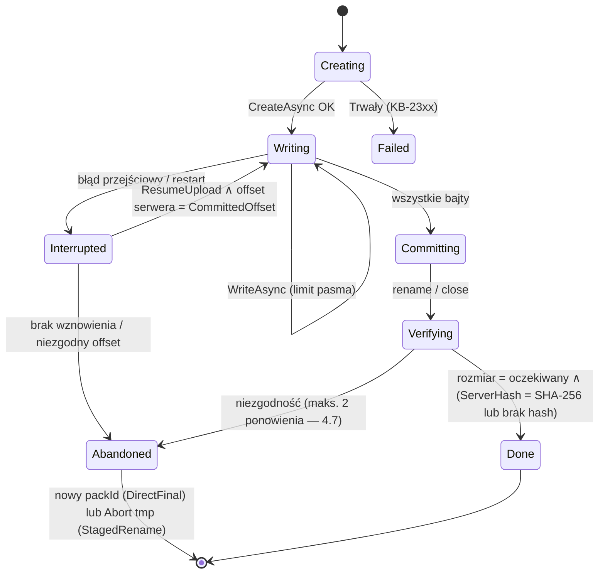

- **Alternatywy:** zawsze DirectFinal (prostsze, ale półpliki na celach z rename); zawsze nadpisywanie przy wznowieniu (niemożliwe w append-only).
- **Uzasadnienie:** jedna implementacja pipeline’u dla obu trybów; bezpieczeństwo append-only zachowane (nigdy rename/delete/overwrite z poświadczeniem backup).
- **Ryzyka:** narastanie porzuconych packów przy niestabilnym łączu bez `ResumeUpload` → alert A06 uwzględnia „bajty porzucone”; zalecenie packów 8 MiB dla takich celów (Q16).

## R2.4.3 Mapa błędów protokołów

### Decyzja D4.8 — Jedna tabela mapowania błędów → klasa (4.7) → kod KB-2xxx (rozwija 4.7, D1.8)

| Protokół / źródło | Sygnał | Klasa | Kod | Akcja użytkownika (6.3) |
|---|---|---|---|---|
| Wspólne | timeout operacji, reset TCP, `SocketException` 10053/10054/10060 | przejściowy | KB-2001 | — (automatyczne ponowienie) |
| Wspólne | DNS: host nieznany | trwały | KB-2002 | „Sprawdź adres serwera” |
| Wspólne | odmowa połączenia (10061) przez > 5 min | przejściowy → trwały po wyczerpaniu ponowień | KB-2003 | „Serwer nie odpowiada — czy jest włączony? [Wybudź NAS]” |
| SMB / Win32 | 1219 `ERROR_SESSION_CREDENTIAL_CONFLICT` | trwały (błąd planowania — nie powinien wystąpić przy D7.4) | KB-2101 | zgłoszenie błędu + log |
| SMB / Win32 | 1326 `ERROR_LOGON_FAILURE`, 86 `ERROR_INVALID_PASSWORD` | trwały (bez ponowień — blokada konta) | KB-2102 | „Popraw hasło” |
| SMB / Win32 | 1909 konto zablokowane, 1330 hasło wygasło, 1907 hasło musi być zmienione | trwały | KB-2103 | „Konto na serwerze jest zablokowane/wygasło” |
| SSH | niezgodny klucz hosta | bezpieczeństwo | KB-2104 | 6.10 |
| SMB / Win32 | 5 `ERROR_ACCESS_DENIED` przy tworzeniu; 53 `ERROR_BAD_NETPATH`, 67 `ERROR_BAD_NET_NAME` | trwały | KB-2105 / KB-2106 | „Brak uprawnień do udziału” / „Udział nie istnieje” |
| SMB / Win32 | 64 `ERROR_NETNAME_DELETED`, 59 `ERROR_UNEXP_NET_ERR`, 121 `ERROR_SEM_TIMEOUT`, 1231 `ERROR_NETWORK_UNREACHABLE` | przejściowy | KB-2001 | — |
| SMB / Win32 | 112 `ERROR_DISK_FULL`, 39 `ERROR_HANDLE_DISK_FULL` | trwały | KB-2201 | „Brak miejsca na celu” |
| SMB | serwer tylko SMB1 / brak wymaganego szyfrowania | trwały | KB-2107 / KB-2108 | instrukcja (D4.2) |
| FTP | 421, 425, 426, 450, 451 | przejściowy | KB-2001 | — |
| FTP | 530 | trwały | KB-2102 | „Popraw hasło” |
| FTP | 452, 552 | trwały (brak miejsca/limit) | KB-2201 | „Brak miejsca na celu” |
| FTP | 550 przy STOR/MKD | trwały | KB-2105 | „Brak uprawnień” |
| FTP | 553 (nazwa niedozwolona) | trwały | KB-2302 | zgłoszenie (nazwy repo są ASCII) |
| FTP / FTPS | błąd walidacji TLS, niezgodny SPKI | bezpieczeństwo | KB-2109 | D4.11 |
| FTP | odmowa `AUTH TLS` przy wymaganym FTPS | trwały | KB-2110 | „Serwer nie obsługuje FTPS” |
| SFTP (SSH.NET) | `SshAuthenticationException` | trwały | KB-2102 | „Klucz/hasło odrzucone” |
| SFTP | `SshConnectionException`, `SshOperationTimeoutException`, `SSH_FX_CONNECTION_LOST` (7), `SSH_FX_NO_CONNECTION` (6) | przejściowy | KB-2001 | — |
| SFTP | `SSH_FX_PERMISSION_DENIED` (3) przy zapisie / `SSH_FX_NO_SUCH_FILE` (2) przy korzeniu repo | trwały | KB-2105 / KB-2106 | — |
| SFTP | `SSH_FX_FAILURE` (4) przy zapisie bez innych danych | przejściowy ×2, potem trwały | KB-2202 | „Serwer odrzuca zapis (limit/quota?)” |
| Wspólne | rozmiar/hash po zapisie ≠ oczekiwany | integralności | KB-2401 | — (2 ponowienia — 4.7) |
| Wspólne | obiekt już istnieje (kolizja nazwy) | trwały | KB-2301 | zgłoszenie błędu |
| Probe | usunięcie pliku testowego **udało się** | ostrzeżenie (degradacja ochrony) | KB-2501 | A10 (9.4) |

  Wiadomości w logach zawierają kod protokołu (np. `ftp=530`, `win32=1326`), nigdy treści komend `USER/PASS` (SEC-4.6).

## R2.4.4 Test zdolności celu (probe, D4.5) — pseudokod

```text
Probe(dest):
  s ← Open(dest, Backup)                                  // błędy → mapa D4.8
  id ← PinCheck(s.PresentedIdentity)                      // D4.11: Unknown → zwróć PendingApproval
  root ← dest.repoPath; p ← root + "/.kobian-probe-" + yyyyMMddHHmmss + "-" + rand4
  caps ← None
  w ← s.CreateAsync(p + ".tmp", 4096, StagedRename?, 0); write(rand 4096); commit → caps |= AtomicRename|RenameAllowed jeśli rename OK
       (jeśli rename odrzucony → ponów jako DirectFinal pod p; caps bez Rename)
  read(p, offset=1000, length=100) == bajty[1000..1100] → caps |= RangeRead
  write(p, resume from 4096 via APPE/append) → caps |= ResumeUpload jeśli długość = 8192
  try overwrite(p) → caps |= OverwriteAllowed jeśli się udało
  try s.DeleteAsync(p) przez surowe API protokołu (test zdolności, nie ścieżka produkcyjna) → caps |= DeleteAllowed jeśli się udało
  ServerHashAsync(p, SHA256) == lokalny → caps |= ServerSideHash
  GetFreeSpaceAsync ≠ null → caps |= FreeSpace
  protection ← DeleteAllowed ∨ OverwriteAllowed ? "Brak ochrony przed usunięciem" : "Chroni przed usunięciem"
  zapisz caps + protection + ProbedAt w dest_targets; zdarzenie ProbeCompleted; A10 jeśli spadek ochrony względem poprzedniego probe
  pozostałości: p (jeśli usunięcie zabronione) — raportowane, nazwa unikalna (D4.5)
```

  Probe jest wykonywany: przy konfiguracji (AC-38.1), co 30 dni oraz po każdej zmianie poświadczeń; zawsze poświadczeniem **backup** (nie maintenance).

## R2.4.5 Ograniczanie pasma

### Decyzja D4.9 — Hierarchiczny token bucket (globalny → cel → strumień), profile czasowe przeliczane co minutę (rozwija 4.7, 7.6)
- **Decyzja:** dwa poziomy kubełków: `global` i `dest:<id>`; każdy zapis pobiera tokeny z obu (najpierw cel, potem globalny); pojemność kubełka = 2 s ruchu przy bieżącym limicie (wygładzanie przy wielu strumieniach); profil czasowy (np. 08:00–17:00 → 2 MB/s) zmienia `rate` bez resetu zawartości. Odczyt (restore) ma osobne kubełki i domyślnie brak limitu. Dodatkowo opcja „tło sieciowe”: `SIO_PRIORITY_HINT = SocketPriorityHintVeryLow` (LEDBAT/rLEDBAT w Windows) dla połączeń FTP/SFTP — R&D it. 14.

```text
TokenBucket(rate B/s, burst B): tokens, last
Acquire(n, ct):                          // n ≤ 256 KiB (porcje zapisu dzielone)
  loop:
    now ← mono(); tokens ← min(burst, tokens + (now − last)·rate); last ← now
    if tokens ≥ n: tokens −= n; return
    wait ← (n − tokens) / rate; await Delay(min(wait, 100 ms), ct)
Write(dest, buf):
  for chunk in split(buf, 256 KiB): await destBucket.Acquire(|chunk|); await globalBucket.Acquire(|chunk|); await session.Write(chunk)
OnMinuteTick: for b in buckets: b.rate ← profile(b, localNow()); b.burst ← 2·b.rate (rate = ∞ → bez ograniczeń)
```

- **Alternatywy:** limit na poziomie systemu (QoS GPO — poza kontrolą aplikacji); proste `Task.Delay` po każdym packu (nierówny ruch).
- **Uzasadnienie:** sprawiedliwy podział przy równoległości (4.7) i łączenie limitu celu z limitem całej maszyny; zegar monotoniczny niezależny od DST (D7.2).
- **Ryzyka:** limit < 64 KiB/s przy wielu strumieniach powoduje timeouty serwerów FTP → minimalny limit 128 KiB/s na strumień, równoległość zmniejszana automatycznie.

## R2.4.6 Pula połączeń i odporność

### Decyzja D4.10 — Pula sesji per (cel, rola poświadczenia) i potok Polly 8 per operacja (rozwija 4.7)
- **Decyzja:**

| Parametr | Local | SMB | FTP/FTPS | SFTP |
|---|---|---|---|---|
| Maks. sesji w puli (domyślnie = równoległość 4.7) | 2 | 4 | 2 | 3 |
| Bezczynność do zamknięcia | — | do końca zadania (`WNetCancelConnection2` przy końcu) | 60 s | 60 s |
| Keep-alive | — | — | `NOOP` co 30 s na kanale sterującym | 30 s |
| Timeout pojedynczej operacji (Polly `Timeout`) | 120 s | 120 s | 120 s (dane), 30 s (sterowanie) | 120 s |

```csharp
var pipeline = new ResiliencePipelineBuilder()
  .AddTimeout(TimeSpan.FromSeconds(120))
  .AddRetry(new RetryStrategyOptions {
      ShouldHandle = new PredicateBuilder().Handle<StorageException>(e => e.Class is ErrorClass.Transient),
      MaxRetryAttempts = 8, BackoffType = DelayBackoffType.Exponential, UseJitter = true,
      Delay = TimeSpan.FromSeconds(1), MaxDelay = TimeSpan.FromMinutes(5) })
  .AddCircuitBreaker(new CircuitBreakerStrategyOptions {
      ShouldHandle = new PredicateBuilder().Handle<StorageException>(e => e.Class is ErrorClass.Transient),
      FailureRatio = 1.0, MinimumThroughput = 5, SamplingDuration = TimeSpan.FromMinutes(2),
      BreakDuration = TimeSpan.FromMinutes(10) })                 // „5 kolejnych błędów → 10 min” (4.7)
  .Build();                                                       // jedna instancja breakera per cel (współdzielona)
```

  SMB: połączenie `WNetAddConnection2` z flagą `CONNECT_TEMPORARY` (bez zapisu w profilu, bez litery dysku), nawiązywane raz na uruchomienie zadania, przed pierwszą sesją; `WNetCancelConnection2(fForce: false)` po zakończeniu wszystkich sesji zadania. FTP listing: `MLSD` (RFC 3659) preferowane; fallback na `LIST` parsowany **w procesie Worker** (SEC-2.5).
- **Alternatywy:** brak puli (połączenie per pack); Polly v7.
- **Uzasadnienie:** Polly 8 (`Polly.Core` 8.8.0, BSD-3-Clause) — aktualna gałąź z `ResiliencePipeline`; breaker współdzielony per cel chroni serwer i konto przed burzą połączeń z wielu strumieni.
- **Ryzyka:** ponowienia wewnątrz otwartego breakera zgłaszają `BrokenCircuitException` → mapowane na KB-2003, zadanie przechodzi w ponowienie na poziomie harmonogramu (7.6).

## R2.4.7 Tożsamość serwera i pinning

### Decyzja D4.11 — Pinning klucza publicznego (SSH host key / TLS SPKI), nie odcisku certyfikatu; zatwierdzanie przez maszynę stanów (rozwija D4.3, D4.4, SEC-4.1; zamyka L6)
- **Decyzja:** dla FTPS: jeśli łańcuch certyfikatu jest poprawny wobec systemowego magazynu zaufania i nazwa się zgadza — akceptacja, z zapisem SPKI do informacji (zmiana SPKI przy ważnym łańcuchu = zdarzenie informacyjne, nie błąd); jeśli certyfikat self-signed lub nieważny łańcuch — wymagany pin **SHA-256 z SubjectPublicKeyInfo** (przetrwa odnowienie certyfikatu z tym samym kluczem); zmiana SPKI = `KB-2109`, zatrzymanie, A09. SSH: pin SHA-256 klucza hosta (format `SHA256:base64` jak OpenSSH), obsługa wielu kluczy (rotacja przez `hostkeys-00@openssh.com` — wymaga potwierdzenia Admin).

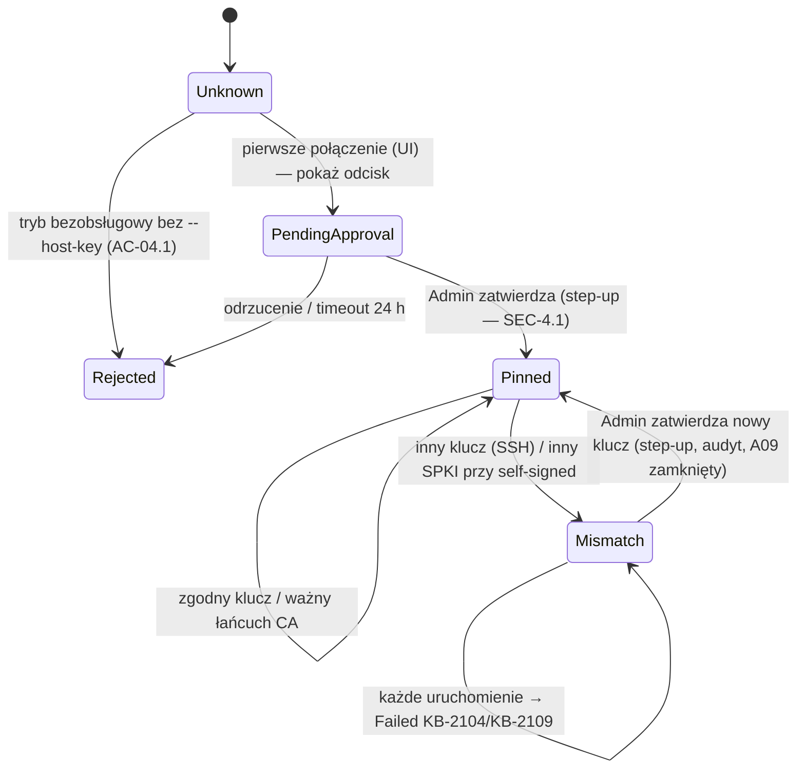

- **Alternatywy:** odcisk certyfikatu (łamie się przy odnowieniu); TOFU automatyczne (odrzucone w 4.4).
- **Uzasadnienie:** SPKI pinning to praktyka znana z HPKP/aplikacji mobilnych; przy CA-podpisanych certyfikatach unikamy fałszywych alarmów co 90 dni.
- **Ryzyka:** serwer zmieniający klucz przy odnowieniu self-signed → jednorazowe zatwierdzenie; instrukcja w dokumentacji.

### DDL celów (nowy prefiks `dest_*` — uzupełnia listę D2.11)

```sql
CREATE TABLE dest_targets (
  dest_id TEXT PRIMARY KEY, scheme TEXT NOT NULL CHECK (scheme IN ('local','smb','ftp','ftps','sftp')),
  display_name TEXT NOT NULL, endpoint TEXT NOT NULL,        -- host:port / \\serwer\udział / ścieżka; bez poświadczeń
  repo_path TEXT NOT NULL, volume_guid TEXT,                 -- USB/lokalny (4.5)
  backup_secret_ref TEXT NOT NULL REFERENCES core_secrets_ref, maintenance_secret_ref TEXT REFERENCES core_secrets_ref,
  caps INTEGER NOT NULL DEFAULT 0, protection TEXT, probed_at TEXT,
  parallelism INTEGER, pack_size INTEGER, insecure_plain_ftp INTEGER NOT NULL DEFAULT 0
) STRICT;
CREATE TABLE dest_identities (
  dest_id TEXT NOT NULL REFERENCES dest_targets, kind TEXT NOT NULL CHECK (kind IN ('ssh-hostkey','tls-spki')),
  fingerprint TEXT NOT NULL, state TEXT NOT NULL CHECK (state IN ('pending','pinned','rejected','retired')),
  approved_by_sid TEXT, approved_at TEXT, PRIMARY KEY (dest_id, fingerprint)
) STRICT, WITHOUT ROWID;
CREATE TABLE dest_bandwidth_profiles (
  scope TEXT NOT NULL,                                       -- 'global' lub dest_id
  days TEXT NOT NULL, start_local TEXT NOT NULL, end_local TEXT NOT NULL, rate_bps INTEGER, -- NULL = bez limitu
  PRIMARY KEY (scope, days, start_local)
) STRICT, WITHOUT ROWID;
```

# Bezpieczeństwo — iteracja 14 (rola 11: Ekspert bezpieczeństwa)

1. **SEC-14.1 Wymaganie testu — sesja Backup nie usuwa:** test architektury: wywołania `DeleteAsync` tylko z kodu oznaczonego `[MaintenanceOnly]`; test integracyjny: SFTP z `-P remove,rename,posix-rename@openssh.com` — pełny backup, przerwanie, wznowienie, retencja logiczna — **0 żądań** `REMOVE/RENAME` w logu serwera (`LogLevel VERBOSE`).
2. **SEC-14.2 Probe a ślady:** pliki `.kobian-probe-*` zawierają wyłącznie losowe bajty (bez nazwy hosta/zadania); nazwa z datą i losowym sufiksem.
3. **SEC-14.3 FTP:** odpowiedź `PASV/EPSV` z adresem innym niż adres kanału sterującego → użycie adresu sterującego (4.3) — test z serwerem zwracającym `127.0.0.1` i adres z LAN (ochrona przed SSRF/bounce); `insecure_plain_ftp = 1` wymaga step-up przy włączaniu i jest widoczne w raporcie zgodności.
4. **SEC-14.4 SMB:** `CONNECT_TEMPORARY`, brak `CONNECT_UPDATE_PROFILE`, brak litery dysku; poświadczenia przekazywane z magazynu DPAPI bezpośrednio do `NETRESOURCE`/`WNetAddConnection2`, bufor zerowany po wywołaniu.
5. **SEC-14.5 SPKI pinning (D4.11):** zmiana SPKI przy ważnym łańcuchu CA logowana jako zdarzenie informacyjne — **wyjątek**: cel oznaczony jako „wysokie ryzyko” (np. FTPS przez Internet) może wymagać pinningu także przy ważnym CA (opcja Admin).
6. **SEC-14.6 Korekta klucza odzyskiwania (K14.1):** sprawdzenie integralności nie może zmniejszać entropii klucza; obowiązuje format z K14.1 (256 b klucza + 16 b sumy). Uściśla SEC-13.5.

### STRIDE — nowe elementy

| Element | Zagrożenie | Kat. | Mitygacja |
|---|---|---|---|
| Tryb DirectFinal | podmiana niekompletnego packa przez napastnika na celu | T | stopka + SHA-256 z indeksu + tagi GCM (D3.10) |
| Pula sesji SMB | pozostawione połączenie z poświadczeniem po zadaniu | I, E | `WNetCancelConnection2` w `finally`, test braku sesji (`Get-SmbConnection`) |
| Maszyna stanów tożsamości | zatwierdzenie nowego klucza przez malware w sesji Operatora | S, E | tylko Admin + step-up (D2.9) |
| Profile pasma | DoS przez ustawienie 0 B/s | D | minimalna wartość 128 KiB/s, zmiana = audyt |
| Fallback `LIST` | złośliwy listing | E | parsowanie w Worker, limity długości (SEC-2.5) |

# R&D — iteracja 14 (rola 12: Dział R&D)

| Technika | Opis | Ocena | Decyzja |
|---|---|---|---|
| **LEDBAT / rLEDBAT w Windows (`SIO_PRIORITY_HINT = SocketPriorityHintVeryLow`)** | kontrola przeciążenia „w tle” — transfer ustępuje innemu ruchowi; włączana per gniazdo przed `connect()` | idealne dla kopii w godzinach pracy (NFR-06) bez ręcznych limitów; wymaga dostępu do gniazda przed połączeniem (SSH.NET/FluentFTP — do sprawdzenia możliwości wstrzyknięcia gniazda) | **Spike M0/1.1** (Q46); domyślnie wyłączone |
| **Rozszerzenie SFTP `limits@openssh.com`** | serwer podaje maks. rozmiar pakietu/odczytu/zapisu i liczbę uchwytów | pozwala dobrać rozmiar zapisów i równoległość zamiast stałych 4.7 | **Przyjęte w 1.1** (jeśli SSH.NET udostępnia; inaczej odczyt surowy) |
| **SMB compression (Windows Server 2022+/Windows 11)** | kompresja w transporcie SMB | dane repo są już skompresowane zstd i zaszyfrowane — zysk ~0 | **Odrzucone** |
| **FTP `HASH` (draft-bryan-ftpext-hash) i `XSHA256`** | hash po stronie serwera bez pobierania | już w 4.3; probe ustala dostępność (D4.4/R2.4.4) | **Potwierdzone** — bez zmian |

---

# R2.5 Bazy danych — specyfikacja implementacyjna (iteracja 15 — Specjalista baz danych)

Wejście: D5.1–D5.6, 5.2 (uprawnienia, TDE, edycje), 5.3 (profile ERP), 5.7 (pre-checki), 5.8, D8.4 (zapytania kontrolne), AC-02.1–02.3, AC-30.x, AC-32.x, NFR-07, D1.6 (Firebird), D2.11 (prefiks `dbsrc_*`), D3.8 (pole `dbMeta` w snapshotcie), otwarte Q22, Q23, Q24. Cel: gotowe zapytania T-SQL (discovery, pre-check, kontrola łańcucha, wykrywanie ERP, zapytania kontrolne), sekwencja backupu MSSQL, kody KB-3xxx i DDL katalogu źródeł bazodanowych.

### Przegląd luk

| # | Luka | Miejsce | Zamknięcie |
|---|---|---|---|
| L1 | Q23 — uprawnienie dla `RESTORE VERIFYONLY`; AC-02.1 zakłada VERIFYONLY przy `db_backupoperator` | 5.2, AC-02.1 | D5.7, K15.1 |
| L2 | Q24 — kompresja natywna w Express 2025 | 5.2 | zamknięte (R2.5.6) |
| L3 | Minimalna wersja SQL Server nieokreślona; instalacje Subiekta GT działają często na SQL < 2017 (brak `STRING_AGG`) | 5.2 | D5.8 |
| L4 | Zapytania discovery/pre-check i wykrywania ERP tylko opisowo | 5.3, 5.7 | D5.9, R2.5.2–R2.5.3 |
| L5 | Cykl życia pliku staging (nazwa, ACL, sprzątanie, hash) | D5.1, SEC-5.2 | D5.10 |
| L6 | Zapytania kontrolne ERP dla V4 nie mają definicji ani miejsca zapisu wartości wzorcowej | D8.4 | D5.11 |

## R2.5.1 Sekwencja backupu MSSQL (MVP, staging)

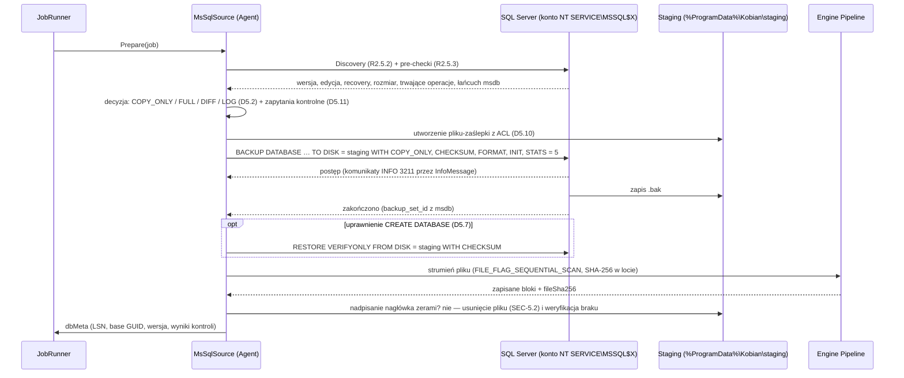

Komunikacja z SQL: `Microsoft.Data.SqlClient` 7.1.1, `CommandTimeout = 0` dla `BACKUP/RESTORE` (czas kontrolowany przez anulowanie `SqlCommand.Cancel` z tokenu zadania), postęp z `SqlConnection.InfoMessage` (`FireInfoMessageEventOnUserErrors = true`), `ApplicationName = "Kobian Backup"` (rozpoznawalność w `sys.dm_exec_sessions` — NFR-07).

## R2.5.2 Discovery (T-SQL zgodny z SQL Server 2014+)

```sql
-- D-01: serwer
SELECT CAST(SERVERPROPERTY('ProductMajorVersion') AS int) AS major,   -- 12=2014, 13=2016, 14=2017, 15=2019, 16=2022, 17=2025
       CAST(SERVERPROPERTY('ProductVersion') AS nvarchar(32)) AS version,
       CAST(SERVERPROPERTY('Edition') AS nvarchar(128)) AS edition,
       CAST(SERVERPROPERTY('EngineEdition') AS int) AS engine_edition,  -- 4 = Express
       CAST(SERVERPROPERTY('InstanceName') AS nvarchar(128)) AS instance,
       CAST(SERVERPROPERTY('IsClustered') AS int) AS is_clustered,
       CAST(SERVERPROPERTY('IsHadrEnabled') AS int) AS is_hadr;
-- D-02: bazy (bez systemowych poza opcją)
SELECT d.database_id, d.name, d.state_desc, d.recovery_model_desc, d.is_read_only,
       d.is_encrypted, d.compatibility_level, d.user_access_desc,
       (SELECT SUM(CAST(mf.size AS bigint)) * 8 * 1024 FROM sys.master_files mf
         WHERE mf.database_id = d.database_id AND mf.type = 0) AS data_bytes,
       ls.log_reuse_wait_desc
FROM sys.databases d
CROSS APPLY (SELECT d.log_reuse_wait_desc) ls
WHERE d.database_id > 4 AND d.state = 0;      -- ONLINE
-- D-03: uprawnienia bieżącego loginu w bazie (wykonywane per baza: USE [db] przez QUOTENAME w kodzie)
SELECT HAS_PERMS_BY_NAME(DB_NAME(), 'DATABASE', 'BACKUP DATABASE') AS can_backup_db,
       HAS_PERMS_BY_NAME(DB_NAME(), 'DATABASE', 'BACKUP LOG')      AS can_backup_log,
       HAS_PERMS_BY_NAME(NULL, NULL, 'VIEW SERVER STATE')          AS can_view_state,
       HAS_PERMS_BY_NAME('master', 'DATABASE', 'CREATE DATABASE') AS can_verifyonly; -- D5.7
-- D-04: TDE
SELECT DB_NAME(k.database_id) AS db, k.encryption_state, c.name AS cert_name, c.thumbprint
FROM sys.dm_database_encryption_keys k
LEFT JOIN master.sys.certificates c ON c.thumbprint = k.encryptor_thumbprint
WHERE k.database_id > 4;
```

Brak `STRING_AGG`, `STRING_SPLIT`, `TRIM` — zgodność z 2014/2016 (instalacje ERP w MŚP; w środowiskach Subiekta GT spotykany jest SQL Server < 2017 — wiedza wdrożeniowa użytkownika).

## R2.5.3 Pre-checki i kontrola łańcucha

```sql
-- P-01: trwające operacje kolidujące (5.7, AC-02.2)
SELECT r.session_id, r.command, r.percent_complete, r.start_time
FROM sys.dm_exec_requests r
WHERE r.database_id = DB_ID(@db)
  AND r.command IN ('BACKUP DATABASE','BACKUP LOG','RESTORE DATABASE','DBCC','DbccFilesCompact','DbccSpaceReclaim');
-- P-02: wolne miejsce na wolumenie stagingu — z API Windows (GetDiskFreeSpaceEx), próg 1,1 × data_bytes (D-02)
-- P-03: łańcuch — ostatnia pełna nie-COPY_ONLY i baza różnicowa (D5.2)
SELECT TOP (1) b.backup_set_id, b.backup_set_uuid, b.backup_finish_date, b.is_copy_only,
       b.first_lsn, b.last_lsn, b.database_backup_lsn, m.physical_device_name, b.user_name, b.program_name
FROM msdb.dbo.backupset b
JOIN msdb.dbo.backupmediafamily m ON m.media_set_id = b.media_set_id
WHERE b.database_name = @db AND b.type = 'D' AND b.is_copy_only = 0
ORDER BY b.backup_finish_date DESC;
SELECT differential_base_guid, differential_base_lsn
FROM sys.master_files WHERE database_id = DB_ID(@db) AND file_id = 1;
-- Reguła: łańcuch Kobian aktualny ⇔ differential_base_guid = backup_set_uuid ostatniej pełnej
--         ∧ ta pełna została wykonana przez Kobian (dbsrc_chain.full_backup_set_uuid). W przeciwnym razie → FULL + Warning „obcy backup pełny”.
-- P-04: obce kopie logów od ostatniego logu Kobian (alert — ryzyko rozdzielenia PITR)
SELECT COUNT(*) AS foreign_log_backups
FROM msdb.dbo.backupset
WHERE database_name = @db AND type = 'L' AND backup_finish_date > @lastKobianLog
  AND backup_set_uuid NOT IN (SELECT value FROM @kobianLogUuids);   -- TVP z katalogu
```

Wszystkie nazwy baz w dynamicznym SQL wyłącznie przez `QUOTENAME()` (SEC-5.1); `@db` jako parametr `sysname`. Polecenie backupu budowane z szablonu:

```sql
DECLARE @sql nvarchar(max) = N'BACKUP DATABASE ' + QUOTENAME(@db) +
  N' TO DISK = @path WITH COPY_ONLY, CHECKSUM, FORMAT, INIT, STATS = 5' +
  CASE WHEN @bufferCount IS NOT NULL THEN N', BUFFERCOUNT = ' + CAST(@bufferCount AS nvarchar(10)) ELSE N'' END +
  CASE WHEN @maxTransfer IS NOT NULL THEN N', MAXTRANSFERSIZE = ' + CAST(@maxTransfer AS nvarchar(10)) ELSE N'' END;
EXEC sp_executesql @sql, N'@path nvarchar(4000)', @path = @stagingPath;
```

Profil „niski wpływ” (5.7): `BUFFERCOUNT = 8`, `MAXTRANSFERSIZE = 1048576`; domyślny: wartości SQL Server (brak opcji). Skuteczność profilu weryfikowana NFR-07.

## R2.5.4 Wykrywanie ERP

### Decyzja D5.9 — Reguły wykrywania jako dane (JSON w zasobach), zapytania tylko odczytujące `INFORMATION_SCHEMA`/`sys.tables` (rozwija D5.3)
- **Decyzja:** każdy profil to plik `profiles/<id>.json` (wersjonowany, testowany na bazach demo/syntetycznych): `{ id, version, match: { allTables: [...], anyTables: [...] }, consistencyGroup: "...", controlQueries: [...], restoreNotesKey }`. Silnik wykrywania wykonuje jedno zapytanie per baza:

```sql
SELECT s.name AS schema_name, t.name AS table_name
FROM sys.tables t JOIN sys.schemas s ON s.schema_id = t.schema_id
WHERE t.name IN (@n1, @n2, @n3, @n4, @n5, @n6, @n7, @n8);   -- nazwy z reguł wszystkich profili, parametry
```

| Profil | `match.allTables` | Grupa spójności | Status reguły |
|---|---|---|---|
| `insert-gt` | `dok__Dokument`, `dok_Pozycja`, `tw__Towar`, `kh__Kontrahent`, `adr__Ewid` | pojedyncza baza podmiotu | tabele potwierdzone na żywej bazie (baza wiedzy użytkownika o Subiekcie GT) |
| `comarch-optima-config` | `CDN.Bazy` (schemat `CDN`) | konfiguracyjna + wszystkie bazy z `CDN.Bazy` | potwierdzone (5.3, pomoc Comarch) |
| `comarch-optima-company` | `CDN.TraNag`, `CDN.Kontrahenci` | dołączana do grupy konfiguracyjnej | do weryfikacji na bazie demo |
| `insert-nexo` | do ustalenia (Q22) | — | do weryfikacji |
| `symfonia` | do ustalenia (Q22) | — | do weryfikacji |

- **Alternatywy:** reguły wkompilowane w kod; wykrywanie po nazwach instancji.
- **Uzasadnienie:** profile aktualizowane z wydaniem bez zmian kodu (nowe wersje ERP); zapytanie jest tylko-odczytowe i nie wymaga `SELECT` na danych.
- **Ryzyka:** kolizja reguł (dwie bazy spełniają kilka profili) → priorytet profilu + wybór w kreatorze.

Lista firm Optimy: `SELECT Baz_Nazwa, Baz_NazwaBazy FROM CDN.Bazy` (nazwy kolumn do weryfikacji na bazie demo — Q22) — wynik wiąże bazy firmowe z grupą spójności (AC-30.1).

## R2.5.5 Zapytania kontrolne (V4)

### Decyzja D5.11 — Zapytania kontrolne wykonywane w momencie backupu i zapisywane w `dbMeta`; porównanie po restore testowym (rozwija D8.4, AC-32.1)
- **Decyzja:** przed `BACKUP` (ta sama transakcja nie jest możliwa — akceptujemy rozjazd z pracy w trakcie) zapytania kontrolne profilu wykonywane z `READ COMMITTED` i `LOCK_TIMEOUT 5000`; wynik (liczby i daty, **bez danych osobowych**) zapisany w `dbMeta.controls` i `dbsrc_controls`. Po restore w V4 te same zapytania; porównanie z tolerancją: liczby ≥ wartości z backupu i ≤ wartość + przyrost obserwowany w trakcie backupu (różnica `COUNT` przed i po `BACKUP`), daty max ≥ wartość wzorcowa.

| Profil | Zapytanie kontrolne | Tolerancja |
|---|---|---|
| `insert-gt` | `SELECT dok_Typ, COUNT(*) AS n, MAX(dok_DataWyst) AS last FROM dok__Dokument WHERE dok_Status <> 3 GROUP BY dok_Typ` | per typ: n w przedziale [przed, po] |
| `insert-gt` | `SELECT COUNT(*) FROM tw__Towar`; `SELECT COUNT(*) FROM kh__Kontrahent` | j.w. |
| `comarch-optima-config` | `SELECT COUNT(*) FROM CDN.Bazy` | dokładnie równe |
| generyczny MSSQL | `SELECT SUM(p.rows) FROM sys.partitions p JOIN sys.tables t ON t.object_id = p.object_id WHERE p.index_id IN (0,1)` + liczba tabel | ±0,1% (statystyki przybliżone) |

- **Alternatywy:** tylko `DBCC CHECKDB`; porównanie hashy tabel (`CHECKSUM_AGG` — kosztowne na produkcji).
- **Uzasadnienie:** wykrywa kopie „poprawne technicznie, logicznie puste/złe” (D8.4) przy koszcie kilku zapytań agregujących; `dok_Status <> 3` pomija anulowane (zgodnie z regułami schematu Subiekta GT).
- **Ryzyka:** długie `COUNT(*)` na dużych tabelach w godzinach pracy → limit czasu 30 s per zapytanie, przekroczenie = pominięcie kontroli z ostrzeżeniem (nie błąd kopii).

## R2.5.6 Polityki: VERIFYONLY, wersje, staging

### Decyzja D5.7 — `RESTORE VERIFYONLY` tylko przy jawnie nadanym `CREATE DATABASE` w `master`; domyślnie weryfikacja przez `CHECKSUM` + V4 (zamyka Q23; koryguje AC-02.1 — K15.1)
- **Decyzja:** dokumentacja SQL Server: „uzyskanie informacji o zestawie kopii lub urządzeniu wymaga uprawnienia CREATE DATABASE” (od SQL Server 2008) — dotyczy `VERIFYONLY` i `HEADERONLY`. Generator skryptu T-SQL (5.2) oferuje dwa warianty: **minimalny** (`db_backupoperator` + `VIEW SERVER STATE` + `SELECT` na `msdb.dbo.backupset`/`backupmediafamily`) i **z weryfikacją** (dodatkowo `USE master; CREATE USER [NT SERVICE\KobianAgent] FOR LOGIN …; GRANT CREATE DATABASE TO [NT SERVICE\KobianAgent];`). W wariancie minimalnym: `WITH CHECKSUM` przy backupie (błąd strony = błąd kopii), hash strumienia, a VERIFYONLY + `CHECKDB` w teście V4 (domyślnie tygodniowo — 5.8); UI pokazuje plakietkę „V1 SQL: CHECKSUM” zamiast „VERIFYONLY”.
- **Alternatywy:** wymaganie `dbcreator` (szersze: zmiana/usuwanie dowolnych baz); rezygnacja z VERIFYONLY.
- **Uzasadnienie:** `CREATE DATABASE` w `master` jest węższe niż `dbcreator`, ale nadal pozwala tworzyć bazy (zapełnienie dysku) — decyzja należy do administratora SQL, z jawnym opisem kompromisu.
- **Ryzyka:** wariant minimalny wykrywa uszkodzenie kopii dopiero w V4 → domyślna częstotliwość V4 dla baz: tygodniowo; alert A05, jeśli V4 nie wykonano w 8 dni.

### Decyzja D5.8 — Wspierane wersje SQL Server (rozwija 5.2, D1.5)

| Wersja | Status | Uzasadnienie / warunki |
|---|---|---|
| 2019, 2022, 2025 (wszystkie edycje, w tym Express) | **Wspierane** | pełna macierz (10.2) |
| 2017 | Wspierane | wsparcie rozszerzone Microsoft do 10.2027 (do weryfikacji) |
| 2014 SP3, 2016 SP3 | **Warunkowo** | popularne w instalacjach ERP; wymagane łatki TLS 1.2 dla `Encrypt=Mandatory` (do weryfikacji z SqlClient 7.1 w M0); alert „SQL bez wsparcia producenta” (analogicznie do SEC-11.3) |
| ≤ 2012 | Niewspierane | brak TLS 1.2 w starszych kompilacjach, brak `HAS_PERMS_BY_NAME`-zgodnych zachowań testowanych; komunikat z instrukcją aktualizacji |

### Decyzja D5.10 — Cykl życia pliku staging (rozwija D5.1, SEC-5.2)
- **Decyzja:** nazwa `staging\<runId>\<guid>.bak`; katalog `<runId>` tworzony przez Agenta z ACL: `NT SERVICE\KobianAgent` — pełne, `NT SERVICE\MSSQL$<instancja>` (SID usługi SQL z rejestru instancji) — `Write` + `Read` tylko w tym katalogu, bez dziedziczenia; po zakończeniu: usunięcie pliku i katalogu, weryfikacja braku (`AC-02.1`); przy starcie usługi `RecoveryService` (R2.2.3) usuwa katalogi `staging\*` starsze niż 1 h nienależące do aktywnego uruchomienia. Staging na wolumenie NTFS lokalnym (nie UNC — chyba że wariant z 5.7), z ostrzeżeniem, gdy wolumen nie jest chroniony BitLockerem (`Win32_EncryptableVolume`).
- **Alternatywy:** wspólny katalog bez podkatalogów per uruchomienie; staging w `%TEMP%` konta SQL.
- **Uzasadnienie:** ACL per uruchomienie ogranicza okno ekspozycji i uniemożliwia innym instancjom SQL dostęp do cudzych plików.
- **Ryzyka:** SQL na koncie domenowym zamiast wirtualnego → odczyt konta usługi z `sys.dm_server_services` i nadanie ACL temu kontu.

**Q24 zamknięte:** dokumentacja Microsoft wymienia kompresję kopii wyłącznie dla edycji Enterprise, Standard i Developer — Express (także 2025) jej nie obsługuje; SQL Server 2025 dodaje algorytm ZSTD (`WITH COMPRESSION (ALGORITHM = ZSTD)`). Decyzja z 5.2 (kompresja natywna wyłączona — kompresuje repo) bez zmian; profile domyślne nie zależą od edycji.

## R2.5.7 Kody błędów KB-3xxx (wybór)

| Kod | Sytuacja | Klasa | Akcja (6.3) |
|---|---|---|---|
| KB-3001 | brak połączenia z instancją (błąd 26/40/-2) | przejściowy | „Sprawdź, czy usługa SQL działa” |
| KB-3002 | logowanie odrzucone (18456) | trwały | „Uruchom skrypt uprawnień” (AC-02.3) |
| KB-3003 | brak `BACKUP DATABASE` (262/3013 z 262) | trwały | j.w. |
| KB-3004 | certyfikat TLS SQL niezgodny z pinem | bezpieczeństwo | „Zatwierdź certyfikat serwera SQL” |
| KB-3101 | kolizja z trwającą operacją (P-01) po czasie oczekiwania | pominięcie (`Skipped`) | — |
| KB-3102 | brak miejsca na staging (P-02) | trwały | „Zwolnij miejsce lub wskaż inny wolumen” |
| KB-3103 | obcy backup pełny wykryty (P-03) | ostrzeżenie → wykonano FULL | — |
| KB-3104 | obce kopie logów (P-04) | ostrzeżenie | „Ustal, które narzędzie robi kopie logów” |
| KB-3105 | log rośnie — `LOG_BACKUP` przy FULL bez kopii logów | ostrzeżenie | propozycja z 5.7 |
| KB-3201 | błąd sumy kontrolnej strony podczas `BACKUP … CHECKSUM` (3043) | integralności (krytyczny) | „Baza ma uszkodzone strony — uruchom DBCC CHECKDB” |
| KB-3202 | `VERIFYONLY` nieudane | integralności | — |
| KB-3301 | baza TDE bez kopii certyfikatu | ostrzeżenie (kopia nieodtwarzalna gdzie indziej) | „Dołącz certyfikat TDE” |
| KB-3401 | wersja SQL niewspierana / bez wsparcia producenta | ostrzeżenie | D5.8 |
| KB-3501 | dump MySQL/PG: wersja klienta poniżej minimum (CVE-2025-8714) | trwały | „Zaktualizuj narzędzia klienckie” |

## R2.5.8 DDL katalogu (prefiks `dbsrc_*`)

```sql
CREATE TABLE dbsrc_instances (
  instance_id TEXT PRIMARY KEY, engine TEXT NOT NULL CHECK (engine IN ('mssql','mysql','mariadb','postgresql','sqlite','firebird')),
  endpoint TEXT NOT NULL, auth TEXT NOT NULL CHECK (auth IN ('windows','sql','file')), secret_ref TEXT REFERENCES core_secrets_ref,
  tls_pin_spki TEXT, version TEXT, edition TEXT, discovered_at TEXT,
  can_verifyonly INTEGER NOT NULL DEFAULT 0
) STRICT;
CREATE TABLE dbsrc_databases (
  instance_id TEXT NOT NULL REFERENCES dbsrc_instances, name TEXT NOT NULL, profile_id TEXT, group_id TEXT,
  recovery_model TEXT, tde INTEGER NOT NULL DEFAULT 0, data_bytes INTEGER, PRIMARY KEY (instance_id, name)
) STRICT, WITHOUT ROWID;
CREATE TABLE dbsrc_chain (               -- „Łańcuch Kobian” (D5.2)
  instance_id TEXT NOT NULL, name TEXT NOT NULL, full_backup_set_uuid TEXT, full_snap_id TEXT,
  last_log_backup_set_uuid TEXT, last_log_finish TEXT, PRIMARY KEY (instance_id, name)
) STRICT, WITHOUT ROWID;
CREATE TABLE dbsrc_controls (            -- D5.11, bez danych osobowych
  snap_id TEXT NOT NULL, database_name TEXT NOT NULL, query_id TEXT NOT NULL, key TEXT NOT NULL,
  value_before TEXT, value_after TEXT, PRIMARY KEY (snap_id, database_name, query_id, key)
) STRICT, WITHOUT ROWID;
```

`dbMeta` w snapshotcie (CBOR, D3.8): `{1: engine, 2: serverVersion, 3: edition, 4: dbName, 5: backupType (D/I/L/dump), 6: firstLsn, 7: lastLsn, 8: databaseBackupLsn, 9: differentialBaseGuid, 10: backupSetUuid, 11: recoveryModel, 12: tde, 13: groupId, 14: controls [[queryId, key, before, after]], 15: verify ("checksum"/"verifyonly")}`.

# Bezpieczeństwo — iteracja 15 (rola 11: Ekspert bezpieczeństwa)

1. **SEC-15.1 Wymaganie testu — nazwy złośliwe:** baza o nazwie `a]; DROP DATABASE x;--'` (korpus 10.1) przechodzi discovery, pre-checki i backup; log SQL Server (`Extended Events sql_batch_starting`) nie zawiera innych poleceń niż oczekiwane (dokładna lista wzorców); wszystkie zapytania z R2.5.2–R2.5.5 parametryzowane.
2. **SEC-15.2 `CREATE DATABASE` (D5.7):** wariant „z weryfikacją” opisany w UI jako zwiększenie uprawnień; generator skryptu nigdy nie dodaje `dbcreator`/`sysadmin`; zmiana wariantu = zdarzenie audytu.
3. **SEC-15.3 Zapytania kontrolne:** wyłącznie agregaty (COUNT/MAX dat); test sprawdza, że `dbsrc_controls.value_*` nie zawiera tekstu z kolumn danych (lista dozwolonych typów wyników: liczba, data).
4. **SEC-15.4 Staging (D5.10):** ACL per uruchomienie z SID usługi SQL; test: inne konto lokalne (także członek `Kobian Operators`) nie może otworzyć pliku `.bak` podczas backupu.
5. **SEC-15.5 SQL bez wsparcia (D5.8):** alert i adnotacja w raporcie zgodności, analogicznie do SEC-11.3; połączenie z `Encrypt=Mandatory` nie może być osłabiane dla starszych wersji automatycznie — wyjątek tylko przez Admin z ostrzeżeniem.

### STRIDE — nowe elementy

| Element | Zagrożenie | Kat. | Mitygacja |
|---|---|---|---|
| Profile ERP (JSON) | podmieniony profil uruchamiający dowolne zapytania | T, E | profile w podpisanym assembly (zasoby osadzone), zapytania kontrolne z białej listy konstrukcji (SELECT agregujący) |
| Zapytania kontrolne | wyciek danych do katalogu/raportów | I | SEC-15.3 |
| Uprawnienie `CREATE DATABASE` | DoS przez tworzenie baz po przejęciu konta usługi | D, E | opcjonalne, audytowane (SEC-15.2) |
| Staging | odczyt `.bak` przez inne konto | I | SEC-15.4 |
| Wykrywanie obcych kopii (P-03/P-04) | ukrycie przez napastnika usuwającego historię `msdb` | R | porównanie z `dbsrc_chain` — brak wpisu Kobian w `msdb` = alert |

# R&D — iteracja 15 (rola 12: Dział R&D)

| Technika | Opis | Ocena | Decyzja |
|---|---|---|---|
| **ZSTD w `BACKUP … WITH COMPRESSION (ALGORITHM = ZSTD)` (SQL Server 2025, edycje Standard/Enterprise/Developer)** | szybsza i skuteczniejsza kompresja natywna | szybszy backup i mniejszy staging na Standard; ale skompresowany `.bak` niszczy reużycie bloków (D1.2) | **Opcja Zaawansowana dla Standard/Enterprise 2025**, gdy staging jest wąskim gardłem; domyślnie wyłączone |
| **Extended Events zamiast próbkowania DMV w NFR-07** | sesja XE z `sql_batch_completed` i `blocked_process_report` (próg 1 s) | dokładniejszy i tańszy pomiar wpływu niż próbkowanie co 1 s | **Przyjęte** do harnessu NFR-07 (tylko środowisko testowe) |
| **Profile ERP jako dane z sygnaturą (feed aktualizacji profili)** | profile pobierane niezależnie od wydań | szybsza reakcja na zmiany ERP; dodatkowy kanał supply-chain | **Odrzucone w 1.0** — profile tylko z wydaniem (podpis binarki) |
| **`sp_BlitzBackups`-podobna analiza historii `msdb` (First Responder Kit — MIT)** | ocena RPO/RTO na podstawie historii kopii w `msdb` | inspiracja dla raportu „inne narzędzia też robią kopie”; bez zależności | **Przyjęte koncepcyjnie** (P-03/P-04 + raport w 1.1) |

---

# R2.6 UX/UI — specyfikacja implementacyjna (iteracja 16 — Projektant UX/UI)

Wejście: sekcja 6 (D6.1–D6.5, IA 6.2, stany 6.3, kreator 6.4, przeglądarka 6.6, step-up 6.7, CLI 6.8, lokalizacja 6.9, mikrocopy 6.10, badania 6.11), AC-01.x, AC-07.x, AC-28.x, AC-29.x, NFR-01/02/13, kontrakt `kobian.v1` (D2.10), role i weryfikacja serwera (D2.9), kody KB (D1.8), K14.1 (klucz odzyskiwania 55 znaków), Q26. Cel: inwentarz ekranów z kontraktami ViewModeli i wywołaniami API, maszyna stanów kreatora, katalog komponentów, konwencje lokalizacji, kryteria dostępności i scenariusze błędów połączenia z usługą.

### Przegląd luk

| # | Luka | Miejsce | Zamknięcie |
|---|---|---|---|
| L1 | Brak listy ekranów z identyfikatorami i powiązaniem z API/rolami | 6.2 | R2.6.1, D6.6 |
| L2 | Kreator bez formalnej maszyny stanów, zachowania „Wstecz”, walidacji po stronie usługi | 6.4 | R2.6.2, D6.7 |
| L3 | UI przy niedostępnej usłudze lub niezweryfikowanym serwerze pipe (D2.9) — brak zachowania | 6.3, D2.9 | R2.6.4 |
| L4 | Q26 — wykluczenie okna klucza z przechwytywania ekranu w Avalonia | SEC-6.2 | D6.9 (zamyka Q26) |
| L5 | „Zapisz jako PDF” (D6.5) bez wybranej technologii generowania PDF i czcionki z polskimi znakami | D6.5 | D6.10 |
| L6 | Konwencja kluczy `.resx` i test kompletności tylko deklaratywnie | 6.9 | R2.6.5 |
| L7 | Zapis „myślowy” w diagramie sekwencji R2.5.1 („nadpisanie nagłówka zerami? nie — …”) | R2.5.1 | K16.1 |

## R2.6.1 Inwentarz ekranów

### Decyzja D6.6 — Każdy ekran = jeden ViewModel bez logiki w code-behind, z jawną listą wywołań API i minimalną rolą (rozwija 6.2, D2.10)
- **Decyzja:** tabela poniżej jest kontraktem UI; ViewModele testowane bez okna (`Avalonia.Headless` + atrapy klientów gRPC), każdy element interaktywny ma `AutomationProperties.AutomationId` = `<ScreenId>.<Element>` (testy E2E i czytniki ekranu — NFR-13).

| ID | Ekran | ViewModel | Wywołania API (`kobian.v1`) | Rola min. | AC / NFR |
|---|---|---|---|---|---|
| SCR-01 | Pulpit | `DashboardViewModel` | `AgentService.GetStatus`, `JobService.ListJobs`, `RunService.WatchRun` (aktywny) | Viewer | 6.3, AC-05.2 |
| SCR-02 | Lista zadań | `JobsViewModel` | `ListJobs`, `RunJob`, `SetJobEnabled` | Viewer/Operator/Admin | AC-37.1 (spójność stanów z CLI) |
| SCR-03 | Kreator zadania (6 kroków) | `JobWizardViewModel` + `Step*ViewModel` | `ListDestinations`, `ProbeDestination`, `UpsertJob(validate_only)`, `InitRepository`, `RunJob` | Admin | AC-01.1–01.3 |
| SCR-04 | Szczegóły zadania / edycja | `JobDetailViewModel` | `GetJob`, `UpsertJob`, `ListRuns`, `ExportJobs` | Viewer (odczyt) / Admin | AC-29.1 |
| SCR-05 | Uruchomienie na żywo | `RunViewModel` | `WatchRun`, `TailLog`, `CancelRun` | Viewer/Operator | 6.2 |
| SCR-06 | Przeglądarka kopii (oś czasu + drzewo) | `SnapshotBrowserViewModel` | `ListSnapshots`, `BrowseTree`, `DiffSnapshots`, `SearchFiles` | Viewer | AC-07.1, NFR-02 |
| SCR-07 | Odtwarzanie plików (plan + start) | `RestoreViewModel` | `PlanRestore`, `StartRestore`, `WatchRun` | Operator/Admin | AC-07.1–07.3 |
| SCR-08 | Odtwarzanie bazy | `DbRestoreViewModel` | `ListSnapshots`, `PlanRestore`, `StartRestore` (+ step-up) | Admin | AC-32.1–32.2 |
| SCR-09 | Cele | `DestinationsViewModel` | `ListDestinations`, `UpsertDestination`, `ProbeDestination`, `ApproveServerIdentity`, `SetSecret` | Admin | AC-38.1, D4.11 |
| SCR-10 | Historia i logi | `HistoryViewModel` | `ListRuns`, `TailLog` | Viewer | 9.2 |
| SCR-11 | Ustawienia (powiadomienia, język, motyw, tryb, aktualizacje) | `SettingsViewModel` | `GetSettings`, `UpdateSettings` | Viewer/Admin | AC-31.1 |
| SCR-12 | Klucz odzyskiwania (osobne okno) | `RecoveryKeyViewModel` | `InitRepository` (wynik) / `RevealRecoveryKey` | Admin | AC-28.1, D6.9 |
| SCR-13 | Podłącz istniejące repozytorium | `AttachRepoViewModel` | `ProbeDestination`, `AttachRepository` | Admin | AC-33.1 |
| SCR-14 | Audyt | `AuditViewModel` | `AuditService.QueryAudit` | Admin | D9.2 |
| SCR-15 | Okno step-up | `StepUpViewModel` | `BeginStepUp`, `CompleteStepUp` | — | 6.7, D2.9 |
| SCR-16 | Brak połączenia z usługą | `ConnectionViewModel` | `GetStatus` (ponawiane) | — | R2.6.4 |
| SYS-01 | Ikona w zasobniku + toasty | `TrayViewModel` | `GetStatus`, `WatchRun` | Viewer | 6.9, Q30 |

- **Alternatywy:** nawigacja oparta o widoki bez kontraktu; jeden „super-ViewModel” stanu aplikacji.
- **Uzasadnienie:** jawne powiązanie ekran → RPC → rola pozwala testować autoryzację od strony UI (przyciski wyszarzone zgodnie z `CallerInfo.role`) i wyklucza ukryte wywołania.
- **Ryzyka:** rozrost liczby ViewModeli → współdzielone komponenty (R2.6.3).

## R2.6.2 Kreator jako maszyna stanów

### Decyzja D6.7 — Kreator: szkic w pamięci UI, walidacja kroku przez `UpsertJob(validate_only = true)`, zapis tylko w kroku 6 (rozwija 6.4; rozszerza D2.10 o pole `validate_only` — dopuszczalne dodanie pola)
- **Decyzja:**

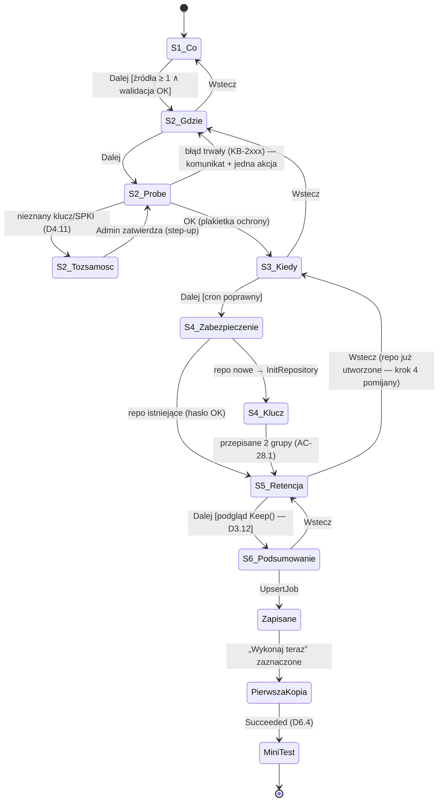

  Reguły: (1) „Wstecz” nie cofa efektów ubocznych po stronie usługi (repo utworzone w S4 pozostaje; ponowne przejście przez S4 pyta tylko o hasło); (2) przerwanie kreatora po S4 → zadanie nie powstaje, repo pozostaje jako „niepowiązane” widoczne w SCR-09 z akcją „Użyj w zadaniu”; (3) każdy krok wysyła `validate_only` — usługa zwraca listę `ValidationIssue {field, kb_code, message_key}` (jedno źródło reguł walidacji dla UI, CLI i importu JSON); (4) szacunki (rozmiar źródła, zajętość celu) liczone w tle z anulowaniem przy zmianie wyboru.
- **Alternatywy:** walidacja tylko w UI; zapis zadania po każdym kroku (szkic w katalogu).
- **Uzasadnienie:** wspólne reguły walidacji (AC-29.2 i AC-01.2 korzystają z tego samego kodu); brak „półzadań” w katalogu.
- **Ryzyka:** opóźnienie walidacji przez pipe (cel: ≤ 150 ms p95 — lokalne IPC) → walidacja synchroniczna tylko na „Dalej”, nie na każdy znak.

| Krok | Pole | Reguła (usługa) | Kod | Komunikat (klucz) |
|---|---|---|---|---|
| S1 | foldery | istnieją, czytelne dla konta usługi; brak nakładania (rodzic/dziecko w jednym zadaniu) | KB-0101 / KB-0102 | `Wizard.Sources.NotReadable` / `Wizard.Sources.Overlap` |
| S1 | baza | dostępna, uprawnienia (D-03) | KB-3002/3003 | `Wizard.Db.MissingPermission` |
| S2 | cel | probe OK, tożsamość przypięta | KB-2xxx | z D4.8 |
| S3 | cron | poprawne wyrażenie, ≥ 5 min między wystąpieniami (poza logami SQL) | KB-0201 | `Wizard.Schedule.Invalid` |
| S4 | hasło | ≥ 12 znaków, nie na liście popularnych (SEC-6.5), ≠ nazwa użytkownika/komputera | KB-0301 | `Wizard.Password.Weak` |
| S5 | retencja | `retentionLock` ≤ najkrótszy okres zachowania; co najmniej 1 reguła | KB-0401 | `Wizard.Retention.Invalid` |

## R2.6.3 Katalog komponentów

| Komponent | Zachowanie | Dostępność |
|---|---|---|
| `ProtectionBadge` | stan Chronione/Uwaga/Zagrożone/Wstrzymane: ikona + tekst + kolor (6.3) | `AutomationProperties.Name` = pełny tekst stanu; kontrast ≥ 4.5:1 |
| `KbMessage` | przyczyna (zlokalizowana), jedna główna akcja (`Command`), kod `KB-xxxx` jako link, „Szczegóły techniczne” zwinięte (zamaskowane — SEC-11.5) | fokus na akcji głównej; kod czytany jako „K B 2 1 0 4” |
| `VerifyBadge` | V1/V2/V3/V4 z datą (oś czasu) | tooltip dostępny z klawiatury |
| `TimelineStrip` | oś czasu snapshotów, wirtualizacja (≥ 10 000 punktów), grupowanie dzień/tydzień/miesiąc | strzałki ←/→ przechodzą po snapshotach, `PageUp/PageDown` po okresach |
| `SnapshotTree` | drzewo leniwie ładowane (`BrowseTree` stronicowane po 1 000) | standardowy wzorzec TreeView |
| `ProgressPanel` | faza, pliki, bajty, ETA (z `Progress`) | aktualizacje regionu „polite”, nie częściej niż co 5 s dla czytnika |
| `CronEditor` | tryb prosty (presety) / zaawansowany (pole + podgląd 5 wystąpień) | etykiety pól, błędy powiązane z polem |
| `SecretBox` | pole hasła bez kopiowania, przełącznik pokazania, miernik siły (bez wzorców złożoności — NIST) | ogłasza ocenę siły słownie |
| `StepUpDialog` | systemowe okno poświadczeń (6.7) wywoływane z UI | natywne okno Windows |

## R2.6.4 Połączenie z usługą i błędy

| Sytuacja | Wykrycie | Zachowanie UI | Zachowanie zasobnika |
|---|---|---|---|
| Usługa zatrzymana | `ConnectAsync` timeout 2 s / brak pipe | SCR-16: „Usługa Kobian nie działa. Kopie nie są wykonywane.” + [Uruchom usługę] (UAC, `sc start`) + kod KB-9001 | ikona szara z wykrzyknikiem, toast raz na sesję |
| Serwer pipe niezweryfikowany (D2.9) | PID ≠ SCM lub brak podpisu | SCR-16 w trybie bezpieczeństwa: „Nie można potwierdzić tożsamości usługi Kobian.” KB-7004, brak przycisku „Połącz mimo to” | ikona czerwona, toast przy każdym starcie |
| Utrata połączenia w trakcie | strumień `WatchRun` zerwany | baner „Ponowne łączenie…” (backoff 1–30 s), dane tylko do odczytu | bez zmian |
| Wersja API niezgodna | brak metody / `Unimplemented` | „Zaktualizuj aplikację” (UI starsze niż usługa) / „Usługa wymaga aktualizacji” | — |
| Rola niewystarczająca | `PermissionDenied` KB-7002 | akcje wyszarzone zawczasu na podstawie `GetCallerInfo`; komunikat „Wymaga roli Administrator Kobian” | — |

## R2.6.5 Lokalizacja i teksty

- Klucze `.resx`: `<Obszar>.<Element>.<Stan|Wariant>` (np. `Dashboard.Status.Protected`, `Wizard.Password.Weak`); liczby mnogie: przyrostki `.One`, `.Few`, `.Many`, `.Other` wybierane helperem CLDR (6.9).
- Teksty komunikatów KB generowane z `kb-codes.yaml` (D1.8) do `KbMessages.resx`.
- **Pseudolokalizacja** w CI: wariant `qps-ploc` (wydłużenie o 40%, znaki diakrytyczne, nawiasy) — test zrzutów ekranu headless wykrywa ucięte teksty i brakujące klucze (NFR-13).
- Formaty: daty w UI wg kultury, w eksporcie i logach ISO-8601 UTC (6.9).

## R2.6.6 Okno klucza odzyskiwania i PDF

### Decyzja D6.9 — Klucz odzyskiwania w osobnym oknie najwyższego poziomu z `WDA_EXCLUDEFROMCAPTURE` (zamyka Q26; rozwija D6.5, SEC-6.2, K14.1)
- **Decyzja:** SCR-12 to osobny `Window` (nie okno potomne ani overlay), po `Opened` UI pobiera uchwyt przez `TopLevel.TryGetPlatformHandle()` i wywołuje `SetWindowDisplayAffinity(hwnd, WDA_EXCLUDEFROMCAPTURE)` (P/Invoke przez CsWin32). Wymagania systemu: Windows 10 2004+ (na starszych zachowanie jak `WDA_MONITOR` — treść czarna w przechwyceniu); funkcja działa tylko dla okien najwyższego poziomu tego procesu i przy kompozycji DWM. Format: 55 znaków Base32 w 14 grupach (K14.1), czcionka o stałej szerokości, rozróżnienie 0/O i 1/I (alfabet RFC 4648 ich nie zawiera — informacja w UI). Potwierdzenie: przepisanie 2 losowych grup (AC-28.1). Okno nie ma przycisku zrzutu, schowek czyszczony po 60 s, zamknięcie okna czyści bufor znaków (`CryptographicOperations.ZeroMemory` na tablicy znaków).
- **Alternatywy:** wyświetlenie w głównym oknie (cała aplikacja wykluczona z przechwytywania — utrudnia wsparcie zdalne); brak ochrony.
- **Uzasadnienie:** dokumentacja Microsoft zastrzega, że to nie jest mechanizm bezpieczeństwa (np. fotografia ekranu), ale ogranicza zrzuty malware i nagrywanie sesji zdalnej (SEC-6.2) przy zerowym koszcie.
- **Ryzyka:** użytkownicy zdalnego wsparcia (P2) nie zobaczą okna przez narzędzie RDP/AnyDesk — komunikat w oknie wyjaśnia, dlaczego klient musi przepisać klucz sam.

### Decyzja D6.10 — Generowanie PDF przez PDFsharp 6 (MIT) z osadzoną czcionką Noto Sans (OFL), wspólny moduł `Kobian.Reports` (rozwija D6.5; dotyczy także 9.7 i D8.5)
- **Decyzja:** PDF klucza odzyskiwania generowany po stronie UI (klucz nie wraca do usługi), raporty zgodności i runbook DR — po stronie usługi; jeden moduł `Kobian.Reports` (PDFsharp 6.2.4 core, generacja wyłącznie, bez parsowania PDF), czcionka **Noto Sans / Noto Sans Mono** osadzona jako podzbiór (licencja SIL OFL 1.1 — zgodna z dystrybucją w produkcie). PDF klucza zapisywany wyłącznie w lokalizacji wskazanej przez użytkownika (bez plików tymczasowych — SEC-6.2).
- **Alternatywy:** QuestPDF (licencja Community z progiem przychodu — komplikuje open-core i użytkowników komercyjnych); drukarka „Microsoft Print to PDF” (zależna od konfiguracji systemu); własny minimalny generator PDF (koszt czcionek i kodowania znaków PL).
- **Uzasadnienie:** MIT, aktywny projekt (6.2.4 z 06.01.2026), obsługa .NET 10; generacja PDF nie przetwarza danych niezaufanych, więc powierzchnia ataku jest niska.
- **Ryzyka:** wydanie 7.0 w przygotowaniu (zmiany API) → przypięcie 6.2.x; czcionki zwiększają instalator o ~1–2 MB (NFR-12 bez zagrożenia).

## R2.6.7 Kryteria dostępności (uzupełnienie AC)

| AC | Given | When | Then |
|---|---|---|---|
| AC-UX.1 | kreator w trybie Prostym, tylko klawiatura | przejście kroków 1–6 | wszystkie akcje osiągalne `Tab/Shift+Tab/Enter/Spacja`, fokus widoczny (kontrast ≥ 3:1), kolejność zgodna z wizualną |
| AC-UX.2 | NVDA, SCR-01 | odczyt pulpitu | każdy `ProtectionBadge` czytany jako pełne zdanie stanu i czasu ostatniej kopii |
| AC-UX.3 | skalowanie 200%, rozdzielczość 1366×768 | SCR-03 i SCR-06 | brak obcięć tekstu i poziomego przewijania w krokach kreatora |
| AC-UX.4 | pseudolokalizacja `qps-ploc` | zrzuty wszystkich SCR | 0 brakujących kluczy, 0 obciętych etykiet |
| AC-UX.5 | motyw ciemny i jasny | tokeny stanów | kontrast ≥ 4.5:1 dla tekstu, ≥ 3:1 dla ikon stanów |

# Bezpieczeństwo — iteracja 16 (rola 11: Ekspert bezpieczeństwa)

1. **SEC-16.1 UI nie decyduje o uprawnieniach:** wyszarzenie przycisków to wygoda; test E2E: zmodyfikowany klient (wywołanie `ForgetSnapshot` bez step-up przez CLI w trybie debug) dostaje `PermissionDenied` — autoryzacja wyłącznie w usłudze (D2.9).
2. **SEC-16.2 Brak „Połącz mimo to”** przy niezweryfikowanym serwerze pipe (R2.6.4) — wymaganie testu (SEC-12.1).
3. **SEC-16.3 Okno klucza (D6.9):** wymaganie testu: na Windows 10 2004+/11 zrzut przez `Windows.Graphics.Capture` i `BitBlt` pulpitu nie zawiera znaków klucza (porównanie OCR → 0 dopasowań); pamięć: brak klucza w `string` (tylko `char[]`/`byte[]` zerowane) — test przeglądu kodu.
4. **SEC-16.4 Walidacja `validate_only`** nie może mieć efektów ubocznych (żadnego połączenia z celem poza jawnym probe w S2, żadnego zapisu w katalogu) — test: liczba zapisów w `core_events` = 0.
5. **SEC-16.5 PDF (D6.10):** generacja w procesie użytkownika (UI) dla klucza; dla raportów w usłudze — PDFsharp nie parsuje wejścia; zakaz osadzania obrazów/czcionek z lokalizacji zapisywalnych przez użytkownika.

### STRIDE — nowe elementy

| Element | Zagrożenie | Kat. | Mitygacja |
|---|---|---|---|
| SCR-12 okno klucza | przechwycenie ekranu / pamięci | I | D6.9, `char[]` zerowane |
| `validate_only` | sondowanie systemu plików usługi przez Operatora | I | wymagana rola Admin dla UpsertJob (także walidacji); odpowiedzi bez szczegółów ścieżek spoza wyboru |
| SCR-16 przy squattingu | phishing poświadczeń przez fałszywą usługę | S | brak formularzy logowania w UI; step-up tylko systemowym oknem Windows |
| Pseudolokalizacja/zrzuty CI | wyciek danych w artefaktach CI | I | tylko dane syntetyczne (SEC-11.2) |

# R&D — iteracja 16 (rola 12: Dział R&D)

| Rozwiązanie / technika | Opis | Ocena | Decyzja |
|---|---|---|---|
| **Testy zrzutów ekranu headless (Avalonia.Headless + porównanie obrazów)** | regresja wizualna bez okna i GPU | tani sposób wykrycia obcięć przy PL i 200% | **Przyjęte** (AC-UX.3, AC-UX.4) |
| **Pseudolokalizacja (`qps-ploc`, praktyka Microsoft)** | sztuczny język wykrywający teksty zakodowane na sztywno i braki miejsca | zerowy koszt licencyjny | **Przyjęte** (R2.6.5) |
| **Windows App SDK — powiadomienia z akcjami** | toasty z przyciskami „Uruchom ponownie”, „Pokaż błąd” | wymaga Windows App SDK (dodatkowy runtime) lub ręcznych rejestracji AUMID | **Odroczone do 1.1**; MVP — toasty podstawowe |
| **Accessibility Insights for Windows (Microsoft, MIT)** | automatyczne skany UIA (FastPass) | narzędzie testowe, nie zależność produktu | **Przyjęte do QA** (ręczne skany przed betą) |

---

# R2.7 Harmonogramy i automatyzacja — specyfikacja implementacyjna (iteracja 17 — Inżynier harmonogramów i automatyzacji)

Wejście: D7.1–D7.6, maszyna stanów 7.1, wyzwalacze 7.2, misfire 7.3, blokady zasobów 7.4, zasilanie 7.5, okna i ponowienia 7.6, JSON 7.8, przypadki E1–E10 (7.9), SEC-7.1–7.7, model hostów R2.2.3 (`SchedulerService`, `RunExecutor`, pojedynczy `CatalogWriter`), prefiksy `job_*`, `sched_*`, `run_*` (D2.11), AC-03.x, AC-18.1, NFR-08/10. Cel: DDL katalogu harmonogramu i uruchomień, tabela przejść stanów z warunkami i akcjami, pseudokod pętli schedulera i menedżera blokad, obsługa zdarzeń systemowych i kody KB-4xxx.

### Przegląd luk

| # | Luka | Miejsce | Zamknięcie |
|---|---|---|---|
| L1 | Brak DDL dla zadań, wyzwalaczy, wystąpień i uruchomień | 7.1, D2.11 | R2.7.1, D7.7 |
| L2 | Diagram stanów 7.1 bez warunków, akcji i reguły dla przejść niedozwolonych | 7.1 | R2.7.2, D7.8 |
| L3 | Wykrywanie skoku zegara i wznowienia z uśpienia tylko opisowo | D7.2, 7.5 | D7.9 |
| L4 | Kolejność pobierania blokad „w globalnym porządku” — ryzyko hold-and-wait przy częściowym nabyciu | D7.4 | D7.10 |
| L5 | Debounce i limity wyzwalaczy zdarzeniowych bez algorytmu (SEC-7.4) | 7.2, SEC-7.4 | D7.11 |
| L6 | Czas PRESHUTDOWN usługi nieustawiony | 7.5 | R2.7.5 |
| L7 | Luka w numeracji decyzji UX (D6.8 nieprzydzielona w it. 16) | Indeks decyzji — faza II | K17.1 |

## R2.7.1 DDL (prefiksy `job_*`, `sched_*`, `run_*`)

### Decyzja D7.7 — Definicja zadania jako dokument JSON + kolumny indeksowane; wystąpienia i uruchomienia jako osobne tabele z historią przejść (rozwija D7.1, 7.8, D2.11)
- **Decyzja:**

```sql
CREATE TABLE job_jobs (
  job_id TEXT PRIMARY KEY, name TEXT NOT NULL UNIQUE, type TEXT NOT NULL
    CHECK (type IN ('files','database','replication','restoreTest','verify')),
  definition BLOB NOT NULL,              -- JSON zgodny ze schematem 7.8 (bez sekretów), walidowany przez D6.7
  definition_sha256 BLOB NOT NULL,       -- wykrywanie zmian i audyt
  enabled INTEGER NOT NULL DEFAULT 1, protected INTEGER NOT NULL DEFAULT 0,   -- SEC-7.6
  priority INTEGER NOT NULL DEFAULT 1 CHECK (priority IN (0,1,2)),         -- 0 Low,1 Normal,2 High
  time_zone TEXT NOT NULL, misfire TEXT NOT NULL CHECK (misfire IN ('runOnceIfMissed','skip','runIfMissedWithin')),
  misfire_within_sec INTEGER, created_at TEXT NOT NULL, updated_at TEXT NOT NULL, quarantined_actions INTEGER NOT NULL DEFAULT 0
) STRICT;
CREATE TABLE sched_triggers (
  trigger_id TEXT PRIMARY KEY, job_id TEXT NOT NULL REFERENCES job_jobs ON DELETE CASCADE,
  kind TEXT NOT NULL CHECK (kind IN ('cron','interval','startup','session','device','network','idle','dependency','manual')),
  spec BLOB NOT NULL,                    -- JSON: cron/okno/repoId/zależność
  enabled INTEGER NOT NULL DEFAULT 1
) STRICT;
CREATE TABLE sched_next_fire (           -- jedno najbliższe wystąpienie per wyzwalacz czasowy
  trigger_id TEXT PRIMARY KEY REFERENCES sched_triggers ON DELETE CASCADE,
  fire_at_utc TEXT NOT NULL, computed_at_utc TEXT NOT NULL, wake_requested INTEGER NOT NULL DEFAULT 0
) STRICT;
CREATE INDEX sched_next_fire_at ON sched_next_fire(fire_at_utc);
CREATE TABLE sched_event_budget (        -- D7.11
  trigger_id TEXT PRIMARY KEY REFERENCES sched_triggers ON DELETE CASCADE,
  tokens REAL NOT NULL, refreshed_at_mono INTEGER NOT NULL, last_event_utc TEXT
) STRICT;
CREATE TABLE run_runs (
  run_id TEXT PRIMARY KEY, job_id TEXT NOT NULL REFERENCES job_jobs, trigger_id TEXT,
  scheduled_for_utc TEXT,                -- wystąpienie (dla Missed/RunOnceIfMissed)
  cause TEXT NOT NULL CHECK (cause IN ('schedule','misfire','event','dependency','manual','retry','resume')),
  state TEXT NOT NULL, attempt INTEGER NOT NULL DEFAULT 0, parent_run_id TEXT,  -- ponowienie/wznowienie
  queued_at TEXT, started_at TEXT, finished_at TEXT, kb_code TEXT, snapshot_id TEXT,
  bytes_read INTEGER, bytes_uploaded INTEGER, files INTEGER, warnings INTEGER
) STRICT;
CREATE INDEX run_by_job ON run_runs(job_id, scheduled_for_utc DESC);
CREATE INDEX run_active ON run_runs(state) WHERE state IN ('Queued','Running','Paused');
CREATE UNIQUE INDEX run_occurrence ON run_runs(trigger_id, scheduled_for_utc) WHERE cause IN ('schedule','misfire');
CREATE TABLE run_transitions (           -- historia przejść; projekcja z core_events
  run_id TEXT NOT NULL REFERENCES run_runs, seq INTEGER NOT NULL, from_state TEXT, to_state TEXT NOT NULL,
  at_utc TEXT NOT NULL, reason TEXT, kb_code TEXT, PRIMARY KEY (run_id, seq)
) STRICT, WITHOUT ROWID;
CREATE TABLE job_dependencies (          -- DAG (D7.4)
  job_id TEXT NOT NULL REFERENCES job_jobs ON DELETE CASCADE, depends_on TEXT NOT NULL REFERENCES job_jobs,
  condition TEXT NOT NULL CHECK (condition IN ('success','always')), group_no INTEGER NOT NULL DEFAULT 0, -- AND w grupie
  PRIMARY KEY (job_id, depends_on)
) STRICT, WITHOUT ROWID;
```

  Indeks unikalny `run_occurrence` gwarantuje, że jedno wystąpienie harmonogramu nie wygeneruje dwóch uruchomień (E2, E5) nawet przy błędzie logiki — drugi `INSERT` kończy się naruszeniem ograniczenia, logowanym jako `KB-4901` (błąd wewnętrzny).
- **Alternatywy:** pełna normalizacja definicji zadania do kolumn; przechowywanie wyłącznie zdarzeń (event sourcing pełny).
- **Uzasadnienie:** definicja JSON = ten sam format co eksport/import (US-29) i walidacja D6.7; kolumny tylko dla pól filtrowanych i używanych przez scheduler.
- **Ryzyka:** migracje schematu JSON → pole `schemaVersion` w definicji i migratory w kodzie (testy na korpusie definicji).

## R2.7.2 Tabela przejść

### Decyzja D7.8 — Jedna czysta funkcja przejść `Apply(state, event) → (state', actions)`; przejście spoza tabeli = błąd krytyczny (rozwija diagram 7.1)
- **Decyzja:**

| Ze stanu | Zdarzenie | Warunek | Do stanu | Akcje |
|---|---|---|---|---|
| — | `Occurrence(t)` | zadanie włączone, usługa działa | Queued | INSERT run (cause=schedule), audyt nie |
| — | `OccurrencePassed(t)` | usługa nie działała w `t` | Missed | INSERT run; dalej wg polityki (wiersz niżej) |
| Missed | `MisfirePolicy` | `runOnceIfMissed` ∧ to ostatnie pominięte wystąpienie | Queued (nowy run, cause=misfire) | opóźnienie 5 min + jitter 0–5 min |
| Missed | `MisfirePolicy` | `skip` ∨ (`runIfMissedWithin` ∧ spóźnienie > T) | Skipped | — |
| Queued | `LocksAcquired` | okno czasowe otwarte, zasilanie/sieć OK (7.5) | Running | start JobRunner |
| Queued | `WindowClosed` / `QueueTimeout` | — | Skipped | kb=KB-4101 / KB-4102 |
| Queued | `PreviousStillRunning` | polityka „pomiń” | Skipped | kb=KB-4103 |
| Running | `WindowEnd` | `onWindowEnd = pauseAtPackBoundary` | Paused | dokończ pack, zwolnij blokady oprócz `job:` |
| Paused | `WindowOpen` | blokady dostępne | Running | wznowienie (4.7) |
| Running | `Completed(status)` | — | Succeeded / Warning / Failed | zdarzenie → alerty, zależności, retencja |
| Running | `CancelRequested` | rola Operator+ | Cancelled | anulowanie tokenu, domknięcie packa |
| Running | `ServiceStopping` / `ProcessCrashDetected` | — | Interrupted | (przy crash: wykonywane przez `RecoveryService` po starcie) |
| Interrupted | `Resume` | zadanie nadal istnieje i włączone | Queued (nowy run, cause=resume, parent=stary) | reużycie packów z dziennika (D4.7) |
| Failed | `RetryDue` | błąd przejściowy ∧ attempt < limit (7.6) | Queued (nowy run, cause=retry) | — |
| Queued/Running/Paused | `JobDeleted` | — | Cancelled | — |

  Implementacja: `Apply` nie wykonuje I/O; zwraca listę akcji wykonywanych przez `RunExecutor`, a nowy stan i zdarzenie zapisuje `CatalogWriter` w jednej transakcji (stan + `run_transitions` + `core_events`). Para (stan, zdarzenie) spoza tabeli → stan `Failed` z `KB-4902` + zdarzenie `Critical` (NFR-10 — brak stanów „wiszących”).
- **Alternatywy:** biblioteka maszyn stanów (Stateless); logika rozproszona w JobRunner.
- **Uzasadnienie:** czysta funkcja = testy właściwości (każda sekwencja zdarzeń kończy się stanem terminalnym) i symulacja deterministyczna (R&D it. 10) bez dodatkowej zależności.
- **Ryzyka:** rozrost tabeli przy nowych typach zadań → tabela generowana z jednego źródła (atrybuty) i drukowana do dokumentacji w CI.

## R2.7.3 Pętla schedulera

### Decyzja D7.9 — Pętla 1 s na zegarze monotonicznym, `NextFire` trwały, detekcja skoku zegara i wznowienia z uśpienia (rozwija D7.2, D7.3, 7.5)
- **Decyzja:**

```text
SchedulerService.Run():
  OnStart():
    for trig in czasowe wyzwalacze włączonych zadań:
       missed ← Cronos.GetOccurrences(lastHandled(trig), nowUtc, tz)       // wystąpienia z okresu niedziałania
       for t in missed: Apply(Missed via OccurrencePassed(t))               // E3: N wpisów Missed
       if missed ≠ ∅: Apply(MisfirePolicy) dla ostatniego
       RecomputeNext(trig)
  loop co 1 s (PeriodicTimer, TimeProvider):
    wallNow ← TimeProvider.GetUtcNow(); monoNow ← TimeProvider.GetTimestamp()
    drift ← (wallNow − lastWall) − (monoNow − lastMono)
    if |drift| > 120 s:                                                      // ręczna zmiana zegara / NTP (E5)
       log(KB-4201, drift); for trig: RecomputeNext(trig, from = max(wallNow, lastHandled(trig)))
       // skok w tył: wystąpienia ≤ lastHandled nie są powtarzane (unikalny indeks run_occurrence)
    for nf in sched_next_fire where fire_at_utc ≤ wallNow order by fire_at_utc:
       Apply(Occurrence(nf.fire_at_utc)); markHandled(nf.trigger, nf.fire_at_utc); RecomputeNext(nf.trigger)
    lastWall, lastMono ← wallNow, monoNow
  OnPowerResume (PBT_APMRESUMEAUTOMATIC przez handler SCM):
    traktuj jak OnStart dla okresu uśpienia (polityka misfire), potem kontynuuj pętlę
RecomputeNext(trig, from = wallNow):
  next ← Cronos.GetNextOccurrence(from, tz, inclusive: false)              // DST: Cronos — luka → pierwsza poprawna chwila; nakładka → raz (D7.2)
  UPSERT sched_next_fire; if job.wake: RequestWake(next − 2 min)          // 7.5
```

  Interwały w oknie (7.2) liczone od `lastStartMono` (zegar monotoniczny) i zapisywane jako `NextFire` w UTC dla trwałości; `lastHandled(trig)` = `MAX(scheduled_for_utc)` z `run_runs` dla wyzwalacza.
- **Alternatywy:** timer na dokładną chwilę następnego wystąpienia (`Task.Delay(next − now)`) — wrażliwy na uśpienie i zmianę zegara.
- **Uzasadnienie:** tick 1 s jest tani (jedno zapytanie po indeksie `sched_next_fire_at`), a odporność na skoki zegara i uśpienie wynika z porównania obu zegarów zamiast z założeń.
- **Ryzyka:** opóźnienie do 1 s względem wystąpienia (bez znaczenia dla backupu); 86 400 zapytań/dobę do SQLite — mierzalne, ale pomijalne (odczyt z pamięci podręcznej stron).

## R2.7.4 Menedżer blokad zasobów

### Decyzja D7.10 — Nabywanie wszystkich blokad atomowo („wszystko albo nic”) w jednej sekcji krytycznej; kolejka z postarzaniem priorytetu (rozwija D7.4; zamyka L4)
- **Decyzja:**

```text
LockManager (w pamięci; stan odtwarzany po starcie z run_runs w stanie Running/Paused):
  held: Map<key, (mode, holders)>
  TryAcquireAll(run, keys: [(key, mode)]) → bool:     // jedna sekcja krytyczna — brak hold-and-wait, więc brak zakleszczeń
    lock(gate):
      if all(compatible(held[k], m) for (k,m) in keys) ∧ semafor global > 0:
         for (k,m): held[k].add(run, m); global−−; return true
      return false
  Dispatcher (wywoływany po każdej zmianie: zwolnienie, nowy Queued, tick 5 s):
    candidates ← Queued posortowane po (effectivePriority desc, queued_at asc)
    effectivePriority ← priority + floor(waitMinutes / 30)          // postarzanie: po 30 min Low = Normal
    for c in candidates:
      if TryAcquireAll(c, LocksFor(c)): Apply(LocksAcquired)
      else if waited(c) > job.queueTimeout (domyślnie 6 h): Apply(QueueTimeout) → Skipped KB-4102
  LocksFor(run): job:<id> (X); repo:<repoId> (S, X dla prune/check); smb:<serwer>:<konto> (X jeśli istnieje inne konto na tym serwerze — S dla tego samego konta);
                 db:<instancja>:<baza> (X); vss:<volumeGuid> (S); global (semafor)
```

  `compatible`: S–S zgodne; X z niczym; dla `smb:` zgodność wyznaczana kluczem serwera: dwa różne konta do jednego serwera — niezgodne (rozwiązanie Q20 utrzymane), to samo konto — zgodne.
- **Alternatywy:** pobieranie kolejnych blokad w porządku leksykograficznym z czekaniem (D7.4 pierwotnie) — poprawne, ale trzyma blokady podczas czekania na kolejne (zmniejsza przepustowość).
- **Uzasadnienie:** „wszystko albo nic” eliminuje zakleszczenia z definicji; postarzanie chroni zadania Low (V3, replikacja) przed zagłodzeniem.
- **Ryzyka:** zadanie wymagające wielu popularnych zasobów może czekać długo → `queueTimeout` + alert A02 (w raporcie dziennym), metryka czasu oczekiwania.

## R2.7.5 Zdarzenia systemowe i zasilanie

### Decyzja D7.11 — Wyzwalacze zdarzeniowe: debounce, scalanie i budżet tokenów per wyzwalacz (rozwija 7.2, SEC-7.4)
- **Decyzja:** każde zdarzenie (urządzenie, sesja, sieć, bezczynność) przechodzi przez: (1) **filtr dopasowania** (np. USB: GUID wolumenu ∧ `kobian.repo` z poprawnym MAC — SEC-7.3); (2) **debounce** 120 s (kolejne zdarzenia tego samego wyzwalacza przesuwają termin); (3) **scalanie** — jeśli zadanie jest `Queued/Running`, zdarzenie jest pomijane z zapisem w `sched_event_budget.last_event_utc`; (4) **budżet** token bucket: pojemność 6, odnowa 6/h (stan w `sched_event_budget`, przeżywa restart); brak tokenu → `Skipped` z `KB-4104` i zdarzeniem bezpieczeństwa przy ≥ 3 odrzuceniach w godzinie.
- **Alternatywy:** stały limit „1 uruchomienie na 10 min”; brak limitów.
- **Uzasadnienie:** realizuje SEC-7.4 z zachowaniem responsywności (pierwsze podłączenie dysku uruchamia kopię po 2 min).
- **Ryzyka:** użytkownik odłącza dysk przed końcem kopii → `Failed` z `KB-2106`/`KB-4105` i komunikat „Nie odłączaj dysku, dopóki ikona…”; wznowienie przy kolejnym podłączeniu (D4.7).

**Parametry systemowe usługi:** `SERVICE_CONFIG_PRESHUTDOWN_INFO` ustawiane przez instalator na 60 s (czas na domknięcie packa i zapis `Interrupted`; maksimum respektowane przez system — do weryfikacji w M0); wybudzanie przez `CreateWaitableTimerExW` + `SetWaitableTimerEx(…, fResume = TRUE)` w osobnym wątku usługi z uchwytem utrzymywanym do czasu wystąpienia; kontrola „timerów wybudzania” w aktywnym planie zasilania przez `PowerReadACValueIndex/PowerReadDCValueIndex` (ustawienie `RTCWAKE`) — UI ostrzega przy wyłączonych (7.5).

## R2.7.6 Kody KB-4xxx (wybór)

| Kod | Sytuacja | Stan | Akcja (6.3) |
|---|---|---|---|
| KB-4101 | poza oknem czasowym, start niemożliwy | Skipped | „Kopia zostanie wykonana w następnym oknie” |
| KB-4102 | przekroczony czas oczekiwania w kolejce | Skipped | „Inne zadania blokowały zasób X — rozważ zmianę godzin” |
| KB-4103 | poprzednie uruchomienie trwa | Skipped | „Wydłuż interwał lub okno” |
| KB-4104 | budżet zdarzeń wyczerpany | Skipped | — (bezpieczeństwo przy powtórzeniach) |
| KB-4105 | nośnik odłączony w trakcie | Failed | „Podłącz dysk ponownie — kopia zostanie wznowiona” |
| KB-4201 | wykryto skok zegara systemowego | informacja | — |
| KB-4202 | timery wybudzania wyłączone w planie zasilania | ostrzeżenie | „Włącz timery wybudzania” |
| KB-4301 | skrypt zmieniony (hash) | Failed | „Zatwierdź nową wersję skryptu (Administrator)” (D7.6) |
| KB-4302 | skrypt przekroczył czas | Failed / Warning wg polityki | — |
| KB-4303 | akcja z importu oczekuje na zatwierdzenie | Skipped | „Zatwierdź akcje zaimportowanego zadania” |
| KB-4401 | bateria poniżej progu / sieć taryfowana | Queued (odroczenie) | — |
| KB-4901 | naruszenie unikalności wystąpienia | błąd wewnętrzny | zgłoszenie |
| KB-4902 | niedozwolone przejście stanu | Failed + Critical | zgłoszenie |

# Bezpieczeństwo — iteracja 17 (rola 11: Ekspert bezpieczeństwa)

1. **SEC-17.1 Wymaganie testu — integralność harmonogramu:** zmiana `enabled`, `protected`, wyzwalaczy lub `misfire` dla zadania `protected = 1` bez step-up → `PermissionDenied`; z step-up → zdarzenie audytu z `definition_sha256` przed/po i alert A08 wysłany przed zastosowaniem (SEC-7.6, AS-05).
2. **SEC-17.2 Definicje JSON w katalogu** zawierają tylko `secretRef`; test NFR-11 obejmuje `job_jobs.definition`.
3. **SEC-17.3 Budżet zdarzeń (D7.11)** przechowywany trwale — restart usługi nie odnawia budżetu (ochrona przed obejściem przez wymuszenie restartu).
4. **SEC-17.4 Skok zegara jako wektor:** napastnik przestawiający zegar w przód może próbować wywołać retencję (wiek snapshotów) — retencja liczy wiek względem **maksimum** z czasu systemowego i czasu ostatniego snapshotu w repo/czasu modyfikacji na celu; skok > 24 h w przód wstrzymuje retencję do potwierdzenia Admin (rozszerza D9.3) — wymaganie dla it. 13/19 (D3.12 + A11).
5. **SEC-17.5 Wybudzanie/wyłączanie:** akcja „wyłącz po zadaniu” wymaga `SeShutdownPrivilege` (D2.12) i roli Admin przy konfiguracji; wykonywana tylko, gdy brak aktywnej sesji interaktywnej lub użytkownik nie anulował 60-sekundowego ostrzeżenia.

### STRIDE — nowe elementy

| Element | Zagrożenie | Kat. | Mitygacja |
|---|---|---|---|
| `job_jobs.definition` | modyfikacja bezpośrednio w pliku SQLite przez napastnika z SYSTEM | T | `definition_sha256` + audyt; wykrycie rozjazdu przy starcie (hash vs ostatni wpis audytu) → alert |
| Zegar systemowy | manipulacja retencją i misfire | T, D | SEC-17.4, KB-4201 |
| Kolejka i blokady | zagłodzenie zadania krytycznego przez zalew zadań Low | D | postarzanie, priorytet High dla logów SQL, limit kolejki per zadanie = 1 |
| Zdarzenia urządzeń | zalew podłączeniami | D | D7.11 |
| Tabela przejść | niedozwolone przejście maskujące błąd | R | KB-4902 + Critical |

# R&D — iteracja 17 (rola 12: Dział R&D)

| Technika | Opis | Ocena | Decyzja |
|---|---|---|---|
| **„All-or-nothing” lock acquisition (unikanie hold-and-wait, warunki Coffmana)** | jedna z klasycznych metod zapobiegania zakleszczeniom | prosta przy menedżerze w pamięci jednej usługi | **Przyjęte** (D7.10) |
| **Testy właściwości na maszynie stanów (model-based testing, np. FsCheck/CsCheck)** | losowe sekwencje zdarzeń sprawdzające niezmienniki | wysoka wartość dla D7.8; biblioteka PBT wciąż „do audytu” (10.1) | **Przyjęte koncepcyjnie**; wybór biblioteki z audytem w M0 (Q48) |
| **Wykorzystanie `UsoSvc`/Windows Update „active hours” jako sygnału okna** | odczyt godzin aktywności użytkownika do proponowania okien kopii | ciekawe dla P3, API nieudokumentowane do tego celu | **Odrzucone** |
| **Stateless (biblioteka maszyn stanów .NET)** | deklaratywne maszyny stanów | dodatkowa zależność bez wyraźnej korzyści wobec czystej funkcji z tabelą | **Odrzucone** |

---

# R2.8 Odtwarzanie i DR — specyfikacja implementacyjna (iteracja 18 — Inżynier odtwarzania i DR)

Wejście: D8.1–D8.6, 8.4 (restore DB), 8.5 (katalog, przejęcie), 8.6 (V4), 8.7 (DR kit), 8.8 (S1–S11), D3.10 (stopka, trailer), D3.12 (Keep), D4.6 (`OpenReadAsync` z długością), D5.7/D5.11 (VERIFYONLY, zapytania kontrolne), D6.6 (SCR-07/08/13), D2.9 (`AccessCheck` z tokenem klienta), SEC-3.3, SEC-6.3, SEC-8.x, AC-07.x, AC-28.2, AC-32.x, AC-33.x, AC-43.1, Q31. Cel: algorytm planera odtwarzania, dziennik wznowień, reguły mapowania ścieżek na Windows, algorytm `check --repair`, instancja testowa V4, format zestawu ratunkowego i kody KB-5xxx.

### Przegląd luk

| # | Luka | Miejsce | Zamknięcie |
|---|---|---|---|
| L1 | Planer „po packach” bez algorytmu (kolejność, odczyty zakresowe, pliki rozłożone na wiele packów) | D8.1 | R2.8.1 |
| L2 | „Dziennik restore” bez struktury | D8.1 | D8.8 |
| L3 | Normalizacja ścieżek przy zapisie na Windows (nazwy zarezerwowane, kropki/spacje końcowe, długość) | SEC-3.3 | D8.9 |
| L4 | Q31 — LocalDB jako instancja testowa (konto usługi, wersje, limity) | D8.4 | D8.7 |
| L5 | `kobian check --repair` tylko opisowo | S6 | D8.10 |
| L6 | Format `repos.json` i zawartość zestawu ratunkowego nieokreślone | D8.5 | D8.11 |

## R2.8.1 Planer odtwarzania (pseudokod, rozwija D8.1)

```text
PlanRestore(req: snapshot, include[], target, conflict, restoreAcl) → Plan:
  tree ← LoadTree(snapshot.rootTreeId)                         // przez indeks; brak indeksu → trailery (D3.10)
  files ← Walk(tree, include)                                  // filtr glob, kolejność drzewa
  for f in files: f.dst ← MapPath(target, f.relPath)            // D8.9; konflikty wg polityki (8.3)
  AuthorizeTargets(files, caller)                              // Operator: AccessCheck(token klienta, katalog docelowy, FILE_ADD_FILE|FILE_WRITE_DATA) — SEC-6.3
  need ← multimap chunkId → [(f, offsetInFile)]                // blok może wystąpić w wielu plikach i miejscach
  packs ← group need.keys by index.location(chunkId).packId
  order ← sort packs by (provider.RangeRead ? packId : liczba potrzebnych bloków desc)  // bez RangeRead: najpierw packi najbardziej „gęste”
  plan.steps ← for p in order: [ (p, ranges ← MergeAdjacent(frames(p) ∩ need, gap ≤ 1 MiB)) ]
  plan.estimate ← Σ bytes(ranges) / zmierzona przepustowość odczytu (V4/ostatni restore)
  return plan                                                  // dry-run (8.3): liczby, konflikty, czas — bez zapisu

ExecuteRestore(plan):
  for f in files: CreatePartial(f.dst + ".kobian-partial", f.size, sparse = f.sparse)   // prealokacja, FILE_FLAG_WRITE_THROUGH nie
  parallel (N = provider.RecommendedParallelism) for step in plan.steps:
     for range in step.ranges: stream ← OpenReadAsync(pack, range.offset, range.length)
        for frame in stream: verify(commitTag, GCM, limity, chunkId) → bytes   // SEC-13.3
           for (f, off) in need[frame.chunkId]: WriteAt(f.partial, off, bytes); journal.MarkChunk(f, off)
  for f in files where complete(f):
     if SHA256(f.partial) ≠ f.fileSha256: quarantine(f) ; report(KB-5201) ; continue   // AC-07.3
     ApplyMetadata(f): treść → ADS → atrybuty → znaczniki czasu → (ACL jeśli restoreAcl ∧ Admin) — kolejność 8.3
     AtomicRename(f.partial → f.dst, conflict)
```

Pamięć: `need` dla 1 mln plików ≈ 100–150 MB; dla większych zakresów planer działa partiami po 100 000 plików (każda partia osobny przebieg po packach — kompromis transferu).

## R2.8.2 Dziennik wznowień

### Decyzja D8.8 — Dziennik restore w katalogu, idempotentny na poziomie bloku; wznowienie pomija bloki zapisane i zweryfikowane pliki (rozwija D8.1, AC-18.1 analogicznie dla odczytu)
- **Decyzja:**

```sql
CREATE TABLE restore_sessions (
  run_id TEXT PRIMARY KEY REFERENCES run_runs, snap_id TEXT NOT NULL, target TEXT NOT NULL,
  caller_sid TEXT NOT NULL, conflict TEXT NOT NULL, restore_acl INTEGER NOT NULL,
  plan_sha256 BLOB NOT NULL,               -- wznowienie tylko przy identycznym planie
  files_total INTEGER, bytes_total INTEGER, state TEXT NOT NULL
) STRICT;
CREATE TABLE restore_files (
  run_id TEXT NOT NULL REFERENCES restore_sessions, file_no INTEGER NOT NULL, dst TEXT NOT NULL,
  size INTEGER NOT NULL, chunks_total INTEGER NOT NULL, chunks_done INTEGER NOT NULL DEFAULT 0,
  state TEXT NOT NULL CHECK (state IN ('pending','partial','verified','renamed','quarantined','skipped')),
  PRIMARY KEY (run_id, file_no)
) STRICT, WITHOUT ROWID;
CREATE TABLE restore_done_packs (          -- pack przetworzony w całości (wszystkie potrzebne bloki zapisane i zsynchronizowane)
  run_id TEXT NOT NULL, pack_id BLOB NOT NULL, PRIMARY KEY (run_id, pack_id)
) STRICT, WITHOUT ROWID;
```

  Zapis do dziennika co pack (nie co blok): po przetworzeniu packa — `FlushFileBuffers` na plikach dotkniętych w tym packu, potem jedna transakcja (`restore_done_packs` + liczniki `chunks_done`). Wznowienie: packi z `restore_done_packs` pomijane; pliki `verified/renamed` pomijane; pozostałe `.kobian-partial` dopisywane (bloki są nadpisywane idempotentnie).
- **Alternatywy:** wznowienie od zera; dziennik w pliku obok celu.
- **Uzasadnienie:** granulacja packa = taka sama jak przy backupie (4.7), mało zapisów do SQLite, poprawność przez idempotencję zapisu bloku pod stały offset.
- **Ryzyka:** zmiana zawartości celu między przerwaniem a wznowieniem → `plan_sha256` i ponowna kontrola konfliktów dla plików `pending`.

## R2.8.3 Mapowanie ścieżek na Windows

### Decyzja D8.9 — Funkcja `MapPath` z regułami odrzucania i bezpiecznej zamiany nazw (rozwija SEC-3.3, AS-06)
- **Decyzja:**

| Reguła | Wejście (nazwa z manifestu) | Wynik |
|---|---|---|
| R1 | zawiera `\`, `/`, NUL, znak sterujący < 0x20, `:` | **odrzucenie** pliku (KB-5101), raport |
| R2 | `.` lub `..` jako składnik | odrzucenie (KB-5101) — nie może wystąpić w poprawnym repo (limity R2.3.8) |
| R3 | nazwa zarezerwowana Windows (`CON`, `PRN`, `AUX`, `NUL`, `COM1`–`COM9`, `LPT1`–`LPT9`, także z rozszerzeniem, np. `nul.txt`; w tym `COM¹`–`COM³` i `LPT¹`–`LPT³`) | zamiana na `_<nazwa>` + wpis w raporcie „zmieniono nazwę” |
| R4 | kropka lub spacja na końcu | zamiana końcowego znaku na `_` + raport |
| R5 | znaki `< > " \| ? *` (np. z repo utworzonego na Linux w v2) | zamiana na `_` (U+005F) + raport |
| R6 | ścieżka docelowa > 32 767 znaków UTF-16 lub składnik > 255 | odrzucenie (KB-5102) |
| R7 | cel FAT32/exFAT (`GetVolumeInformation`) | ADS, ACL, sparse pomijane z ostrzeżeniem; pliki > 4 GiB na FAT32 → odrzucenie (KB-5103) |
| R8 | składnik ścieżki docelowej jest istniejącym punktem ponownej analizy (symlink/junction) | **odrzucenie** zapisu przez niego (KB-5104) — zapis `CreateFile` z `FILE_FLAG_OPEN_REPARSE_POINT` i weryfikacja `GetFinalPathNameByHandle` mieści się w `target` |
| R9 | różnica wielkości liter kolidująca w jednym katalogu (repo z Linux, v2) | druga nazwa z sufiksem ` (2)` + raport |

  Wszystkie operacje na ścieżkach z prefiksem `\\?\`; nazwy nie są normalizowane Unicode (zachowanie oryginału — R2.3.5); porównania konfliktów `OrdinalIgnoreCase`.
- **Alternatywy:** odrzucanie wszystkiego, co nietypowe; ciche zamiany.
- **Uzasadnienie:** odrzucenie tam, gdzie chodzi o bezpieczeństwo (R1, R2, R8), jawna zamiana tam, gdzie chodzi o zgodność (R3–R5, R9); każda zmiana w raporcie (nic „po cichu”).
- **Ryzyka:** aplikacje zależne od dokładnych nazw → raport z listą zmian i opcja eksportu do ZIP (zachowuje oryginalne nazwy).

## R2.8.4 Odtwarzanie bazy i test V4

### Decyzja D8.7 — Instancja testowa V4: (1) wskazana instancja testowa, (2) instancja produkcyjna z bazą tymczasową przy wariancie uprawnień „z weryfikacją”, (3) LocalDB tylko eksperymentalnie (zamyka Q31; rozwija D8.4, D5.7)
- **Decyzja:**
  1. **Zalecana:** osobna instancja SQL Server Express/Developer na hoście lub serwerze testowym (`.\KOBIANTEST`), wersja główna ≥ wersji źródła (restore na starszą wersję jest niemożliwy); login `NT SERVICE\KobianAgent` z `dbcreator` **tylko na tej instancji**.
  2. **Alternatywa:** instancja produkcyjna, gdy nadano `CREATE DATABASE` (D5.7): restore do bazy `kobian_v4_<runId8>` z plikami w katalogu piaskownicy (ACL — SEC-8.2), w oknie poza godzinami pracy, z limitem miejsca (≤ 50% wolnego), `DBCC CHECKDB WITH NO_INFOMSGS, PHYSICAL_ONLY` (krótszy) w dni robocze, pełny w weekend; usunięcie bazy po teście (`DROP DATABASE` — uprawnienie właściciela bazy utworzonej przez login).
  3. **LocalDB:** nie jako domyślna — dokumentacja Microsoft wskazuje problemy z zarządzaniem dla instancji należących do kont wbudowanych (przekierowania systemu plików), instancja działa w kontekście właściciela i wymaga profilu (`%LOCALAPPDATA%`); dostępna jako opcja eksperymentalna dla P3/małych baz po teście M0.
- **Alternatywy:** zawsze LocalDB (8.6 pierwotnie); brak V4 dla baz.
- **Uzasadnienie:** instancja testowa jest jedynym wariantem bez dodatkowych uprawnień na produkcji; wariant 2 pokrywa MŚP bez drugiej instancji przy jawnym kompromisie uprawnień.
- **Ryzyka:** obciążenie produkcji w wariancie 2 → okno nocne + profil niskiego wpływu + NFR-07 mierzone także dla V4.

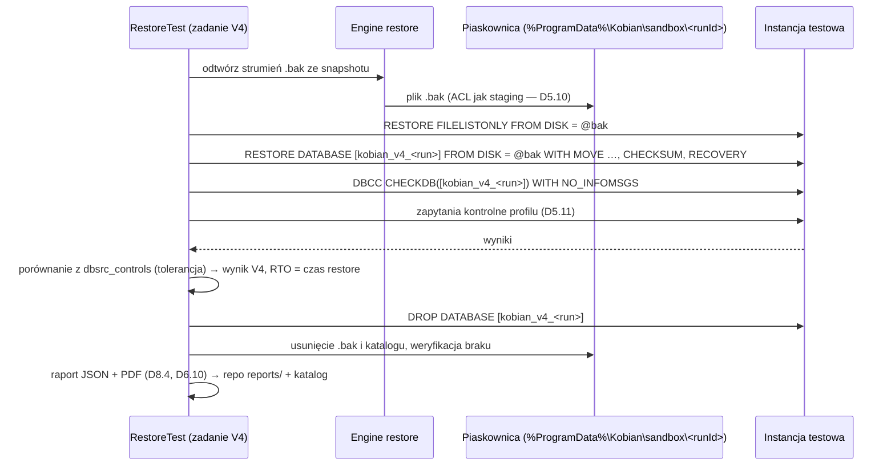

## R2.8.5 Naprawa repozytorium

### Decyzja D8.10 — `kobian check --repair`: klasyfikacja szkód i odbudowa tego, co odtwarzalne, bez usuwania danych (rozwija S6, K8.1, D3.10)
- **Decyzja:**

```text
CheckRepair(repo, level):                         // level: structure | read-data-subset | read-data
  lockExclusive(repo)                              // D3.13
  packsOnTarget ← List("data/"); indexEntries ← LoadAllIndexes() (błędne indeksy → lista uszkodzonych)
  for p in packsOnTarget \ indexed: rebuildFromTrailer(p) → nowy indeks „recovered” (jeśli stopka i commitTag OK)
  for p in indexed \ packsOnTarget: missingPacks += p
  if level ≥ subset: for p in sample(packs): verifyAllFrames(p) → corruptFrames
  damagedChunks ← chunks(missingPacks) ∪ corruptFrames
  for s in snapshots: affected(s) ← files(s) ∩ users(damagedChunks)          // przez drzewa
  report: per snapshot → {OK | Częściowo uszkodzony (lista plików) | Nieodtwarzalny (brak drzewa/korzenia)}
  actions (tylko za zgodą Admin, bez usuwania):
     oznacz snapshoty tagiem „damaged” (nowy obiekt snapshotu z tagiem, stary pozostaje)  — append-only
     wymuś FULL dla zadań, których ostatni snapshot jest uszkodzony
     jeśli istnieje replika (D7.5) zawierająca brakujące bloki → skopiuj bloki do nowego packa (re-szyfrowanie)
  nigdy: usuwanie packów/snapshotów (to robi wyłącznie prune z maintenance)
```

- **Alternatywy:** naprawa przez usuwanie uszkodzonych snapshotów (restic `repair snapshots --forget`); brak naprawy.
- **Uzasadnienie:** zgodność z append-only i zasadą „nic po cichu”; maksymalny odzysk z trailerów i replik.
- **Ryzyka:** pełne `read-data` na zdalnym celu kosztowne → domyślnie `structure` + próbka 5% (V3).

## R2.8.6 Zestaw ratunkowy

### Decyzja D8.11 — Format zestawu ratunkowego v1 (rozwija D8.5, SEC-8.3)
- **Decyzja:** katalog `KobianDRKit-<host>-<data>/` zawiera: `kobian-restore.exe` (podpisany, przenośny — US-43), `repos.json`, `runbook-pl.pdf` / `runbook-en.pdf` (D6.10), `SHA256SUMS` + `SHA256SUMS.sig` (podpis Ed25519 kluczem wydań — weryfikowany przez `kobian-restore verify-kit`), `README.txt` (instrukcja weryfikacji podpisu Authenticode w Eksploratorze).

```json
{
  "kitVersion": 1,
  "createdAt": "2026-10-12T21:00:00Z",
  "host": { "hostId": "uuid", "displayName": "SERWER-ERP" },
  "repositories": [
    {
      "repoId": "32 hex", "label": "NAS biuro",
      "scheme": "smb", "endpoint": "\\\\nas01\\kopie", "repoPath": "kobian",
      "identity": null,
      "accountHint": "konto backup na NAS (hasło w sejfie firmy — nie w zestawie)"
    },
    {
      "repoId": "32 hex", "label": "Offsite SFTP",
      "scheme": "sftp", "endpoint": "backup.example.net:22", "repoPath": "/repo",
      "identity": { "kind": "ssh-hostkey", "fingerprint": "SHA256:…" },
      "accountHint": "klucz SSH — utwórz nowy na nowym komputerze i dodaj na serwerze"
    }
  ],
  "restoreOrder": ["system", "sql-server", "erp-databases", "files"],
  "jobs": [ { "name": "ERP-noc", "type": "database", "profile": "comarch-optima-config", "repoId": "…" } ],
  "recoveryKeyLocationHint": "Koperta w sejfie zarządu (opis miejsca, nie klucz)",
  "contacts": [ { "role": "IT", "name": "do uzupełnienia przez użytkownika" } ]
}
```

  Zestaw **nie zawiera** haseł, kluczy prywatnych SSH, sekretów DPAPI, nazw plików ani danych z katalogu; „ważność” zestawu = data + hash konfiguracji (`configHash`); zmiana celu/zadania unieważnia zestaw (przypomnienie — 8.7).
- **Alternatywy:** zestaw jako zaszyfrowany plik ZIP z kluczami (wygodny, ale tworzy drugi nośnik sekretów); tylko runbook PDF.
- **Uzasadnienie:** w DR najczęściej brakuje informacji „gdzie i jak”, a nie sekretów; podpis listy sum chroni przed podmianą narzędzia (SEC-8.3).
- **Ryzyka:** użytkownik dopisze hasła do `README.txt` → ostrzeżenie w runbooku i kreatorze.

## R2.8.7 Kody KB-5xxx (wybór)

| Kod | Sytuacja | Klasa | Akcja (6.3) |
|---|---|---|---|
| KB-5001 | brak uprawnienia do zapisu w miejscu docelowym (Operator) | trwały | „Wybierz folder, do którego masz prawo zapisu” (AC-07.2) |
| KB-5002 | nadpisanie bazy produkcyjnej bez step-up | trwały | AC-32.2 |
| KB-5101 | nazwa niedozwolona w manifeście (R1/R2) | integralności/bezpieczeństwo | raport; alert przy > 0 |
| KB-5102 | ścieżka za długa | trwały (plik) | „Odtwórz do krótszej ścieżki lub do ZIP” |
| KB-5103 | ograniczenia systemu plików celu (FAT32) | ostrzeżenie/trwały (plik) | „Odtwórz na NTFS” |
| KB-5104 | próba zapisu przez punkt ponownej analizy | bezpieczeństwo | raport + alert |
| KB-5201 | hash pliku niezgodny po złożeniu | integralności | plik w kwarantannie (AC-07.3) |
| KB-5202 | brakujący pack podczas restore | integralności | „Uruchom kobian check” |
| KB-5301 | V4: zapytania kontrolne niezgodne | krytyczny | A05 |
| KB-5302 | V4: `DBCC CHECKDB` zgłosił błędy | krytyczny | A05 |
| KB-5303 | V4: brak instancji testowej o wersji ≥ źródła | ostrzeżenie | „Wskaż instancję testową” (D8.7) |
| KB-5401 | `hostId` w użyciu przez inny aktywny host (D8.3) | trwały | AC-33.2 |
| KB-5501 | zestaw ratunkowy nieaktualny | ostrzeżenie | „Utwórz nowy zestaw” |

# Bezpieczeństwo — iteracja 18 (rola 11: Ekspert bezpieczeństwa)

1. **SEC-18.1 Wymaganie testu — R8 (punkty ponownej analizy):** katalog docelowy z junction `target\a → C:\Windows` i manifest z plikiem `a\evil.dll` → zapis odrzucony (KB-5104), `C:\Windows` niezmieniony; ten sam test dla symlinku katalogowego i dla wyścigu (junction utworzony po planowaniu, przed zapisem — kontrola `GetFinalPathNameByHandle` na otwartym uchwycie).
2. **SEC-18.2 Restore Operatora:** `AccessCheck` z tokenem klienta (poziom Identification — D2.9) wykonywany na **każdym** katalogu nadrzędnym tworzonym przez restore, nie tylko na korzeniu celu.
3. **SEC-18.3 V4 na produkcji (D8.7 wariant 2):** baza testowa z `TRUSTWORTHY OFF`, bez uruchamiania procedur startowych, właściciel = login Kobian, nazwa z prefiksem `kobian_v4_` (blokada przypadkowego `DROP` innej bazy: `DROP` tylko gdy nazwa pasuje do wzorca i `create_date` ≥ start testu).
4. **SEC-18.4 Zestaw ratunkowy (D8.11):** `SHA256SUMS.sig` weryfikowany kluczem publicznym wydań wbudowanym w `kobian-restore` (ten sam łańcuch zaufania co aktualizacje D10.3); `repos.json` nie może zawierać pól sekretów — walidacja schematu przy generowaniu.
5. **SEC-18.5 `check --repair`** nie usuwa danych i działa z poświadczeniem backup (append-only); użycie maintenance tylko przez prune.

### STRIDE — nowe elementy

| Element | Zagrożenie | Kat. | Mitygacja |
|---|---|---|---|
| `MapPath` | zapis poza celem przez junction/symlink | E, T | R8, SEC-18.1 |
| Dziennik restore | podmiana `restore_files.dst` w katalogu | T | `plan_sha256` weryfikowany przy wznowieniu |
| Instancja testowa | uruchomienie kodu z odtwarzanej bazy (procedury startowe, CLR) | E | SEC-8.2, SEC-18.3 |
| Zestaw ratunkowy | podmiana `kobian-restore.exe` | T | Authenticode + `SHA256SUMS.sig` |
| `check --repair` z repliki | wstrzyknięcie bloków z podrobionej repliki | T | weryfikacja `chunkId = HMAC(K_id, plaintext)` przed użyciem |

# R&D — iteracja 18 (rola 12: Dział R&D)

| Technika | Opis | Ocena | Decyzja |
|---|---|---|---|
| **Odtwarzanie „na żądanie” (lazy restore / instant recovery plików)** | pliki dostępne natychmiast, pobierane przy pierwszym odczycie | wymaga sterownika/filtra systemu plików (Cloud Files API) — patrz D8.6 | **Odrzucone w 1.x**; ponowna ocena z Cloud Files API (bez własnego sterownika) w v2 |
| **Windows Cloud Files API (cfapi) jako „montowanie” bez własnego sterownika jądra** | placeholdery jak OneDrive, hydratacja przez dostawcę w trybie użytkownika | omija ryzyko sterownika (CVE-2026-3006 WinFsp); złożone API, tylko NTFS | **Do spike’u v2** (alternatywa dla D8.6) |
| **restic `repair index/snapshots`** | odbudowa indeksu z packów i usuwanie uszkodzonych snapshotów | inspiracja dla D8.10 bez usuwania (append-only) | **Przyjęte koncepcyjnie** |
| **SQL Server `RESTORE … WITH STOPAT` + `STANDBY` do weryfikacji logów** | odtwarzanie łańcucha w trybie tylko do odczytu między logami | przydatne w V4 dla „Łańcucha Kobian” (1.1) | **Przyjęte dla 1.1** |

---

# R2.9 Monitoring i powiadomienia — specyfikacja implementacyjna (iteracja 19 — Inżynier monitoringu i powiadomień)

Wejście: D9.1–D9.5, reguły A01–A15 (9.4), kanały 9.6, raporty 9.7, metryki 9.8, SEC-9.1–9.7, `core_events` i `core_outbox` (D2.11), `NotificationDispatcher`/`AlertEvaluator` (R2.2.3), propozycje A16 (SEC-11.3) i ochrony przed skokiem zegara (SEC-17.4), kody KB z rund 2 (D1.8), AC-05.x, NFR-08, Q34, Q36. Cel: koperta zdarzeń zewnętrznych, model i maszyna stanów alertu, reguły jako dane, format łańcucha audytu i kotwic, podpis webhooków odporny na powtórzenia, DDL `alert_*`/`audit_*` i kody KB-6xxx.

### Przegląd luk

| # | Luka | Miejsce | Zamknięcie |
|---|---|---|---|
| L1 | Brak schematu ładunku webhooków/zdarzeń dla Central | 9.6, 9.9 | D9.6 |
| L2 | Deduplikacja, przypomnienia, rozwiązanie alertu — bez maszyny stanów i klucza | 9.4 | D9.7 |
| L3 | A16 (OS/SQL bez łatek — SEC-11.3, SEC-15.5) i ochrona przed skokiem zegara (SEC-17.4) bez reguł | 9.4 | D9.8 |
| L4 | Format wpisu audytu i kotwicy tylko opisowo | D9.2 | D9.9 |
| L5 | Podpis webhooka `HMAC(secret, body)` bez znacznika czasu — możliwe powtórzenie przechwyconej wiadomości | 9.6 | D9.10, K19.1 |
| L6 | Q36 (Teams) i Q34 (zakres uprawnień M365) otwarte | 9.6, SEC-9.2 | D9.11 |

## R2.9.1 Koperta zdarzeń zewnętrznych

### Decyzja D9.6 — Zdarzenia wychodzące w formacie CloudEvents 1.0 (JSON, tryb strukturalny), typy wersjonowane (rozwija 9.6, 9.9, D2.10)
- **Decyzja:** webhooki, eksport zdarzeń i przyszły kanał do Central używają tej samej koperty; typy `pl.kobian.<obszar>.<zdarzenie>.v1`; pole `data` bez nazw plików i sekretów (SEC-9.6); serializacja ręczna (`System.Text.Json`, kontrakt w `Kobian.Api.Contracts`), bez zależności SDK CloudEvents.

```json
{
  "specversion": "1.0",
  "id": "01J…(ULID)",
  "source": "urn:kobian:host:6f1c…",
  "type": "pl.kobian.alert.opened.v1",
  "time": "2026-10-12T21:15:03Z",
  "datacontenttype": "application/json",
  "subject": "job:7a2e…",
  "data": {
    "alertId": "…", "code": "A03", "severity": "critical", "kb": "KB-6103",
    "job": { "id": "7a2e…", "name": "ERP-noc" },
    "lastSuccessUtc": "2026-10-11T20:04:00Z", "rpoSeconds": 93600,
    "messageKey": "Alert.A03.Title", "message": "Brak udanej kopii zadania ERP-noc od 26 godzin",
    "links": { "kb": "https://docs…/KB-6103" }
  }
}
```

  Typy v1: `run.finished`, `alert.opened`, `alert.reminder`, `alert.resolved`, `heartbeat`, `report.ready`, `audit.anchor`. Pole `job.name` pomijane w trybie „minimalnym” (SEC-9.6).
- **Alternatywy:** własny format JSON; format zgodny z jednym narzędziem (np. Prometheus Alertmanager).
- **Uzasadnienie:** standard CNCF obsługiwany przez wiele odbiorców (Azure Event Grid, Knative, n8n przez zwykły JSON); jedna koperta dla wszystkich kanałów ogranicza kod i testy.
- **Ryzyka:** odbiorcy oczekujący prostego `text` (Slack, Teams, Telegram) → osobne szablony renderowane z tego samego `data`.

## R2.9.2 Model alertu

### Decyzja D9.7 — Alert jako encja z kluczem deduplikacji i maszyną stanów; powiadomienia generowane z przejść (rozwija 9.4 „higiena alertów”)
- **Decyzja:** `dedupKey = code + ":" + scope` (scope: `job:<id>`, `dest:<id>`, `repo:<id>`, `host`); otwarty alert o danym kluczu jest jeden.

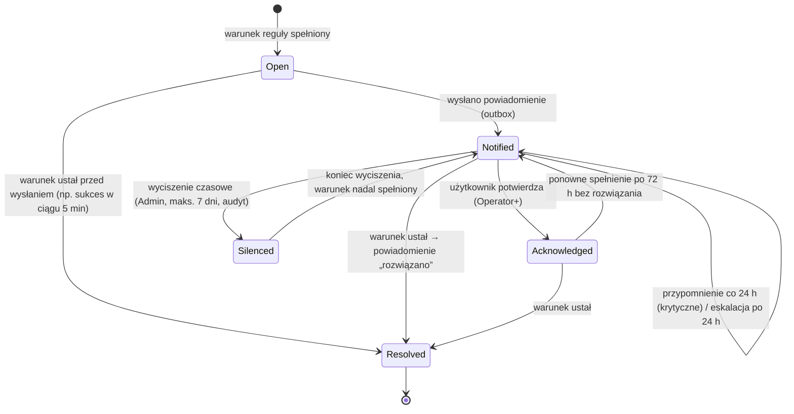

  Cisza nocna (9.4) opóźnia wysyłkę Ostrzeżeń; Krytyczne i Bezpieczeństwo — nigdy. Alerty kategorii Bezpieczeństwo nie mogą być wyciszone dłużej niż 24 h.
- **Alternatywy:** bezstanowe powiadomienie na każde zdarzenie; integracja z zewnętrznym menedżerem alertów.
- **Uzasadnienie:** realizuje AC-05.1 (jeden e-mail, przypomnienie, „rozwiązano”) w jednym miejscu; stan alertu jest też źródłem dla pulpitu (6.3) i metryki `kobian_alerts_active`.
- **Ryzyka:** „wieczne Acknowledged” → ponowne otwarcie po 72 h.

## R2.9.3 Reguły jako dane

### Decyzja D9.8 — Reguły A01–A17 opisane deklaratywnie (JSON w zasobach), ewaluowane przez jeden silnik; nowe A16 i A17 (rozwija 9.4, SEC-11.3, SEC-15.5, SEC-17.4)
- **Decyzja:** format reguły:

```json
{
  "code": "A03", "version": 1, "category": "availability", "severity": "critical",
  "trigger": { "kind": "periodic", "everySeconds": 900 },
  "scope": "job",
  "condition": { "fn": "noSuccessSince", "args": { "factor": 1.5, "minHours": 26, "useRpoIfSet": true } },
  "kb": "KB-6103", "quietHours": false, "reminderHours": 24, "escalateAfterHours": 24
}
```

  Funkcje warunków (`fn`) są zaimplementowane w kodzie i testowane jednostkowo; JSON wybiera funkcję i parametry (brak języka wyrażeń — mniejsza powierzchnia ataku). Nowe reguły:

| Kod | Reguła | Ważność | Wyzwolenie | Źródło |
|---|---|---|---|---|
| A16 | system operacyjny lub instancja SQL bez wsparcia producenta / bez łatki zbiorczej > 60 dni | Bezpieczeństwo — ostrzeżenie | codziennie | SEC-11.3, SEC-15.5, D1.5, D5.8 |
| A17 | skok zegara > 24 h w przód lub > 2 min w tył (KB-4201) — retencja wstrzymana do potwierdzenia | Bezpieczeństwo — krytyczny | zdarzenie | SEC-17.4 |

  Odczyt daty ostatniej łatki: WMI `Win32_QuickFixEngineering` (`InstalledOn`) lub historia Windows Update przez COM `Microsoft.Update.Session` (w procesie Worker, tylko odczyt); wersja SQL z D-01 (R2.5.2).
- **Alternatywy:** reguły zakodowane w klasach; język wyrażeń (np. NCalc).
- **Uzasadnienie:** reguły zmieniają progi bez zmian kodu (kalibracja A11 — Q35), a brak interpretera wyrażeń eliminuje ryzyko wstrzyknięcia.
- **Ryzyka:** rozjazd JSON ↔ funkcje → walidacja schematu przy starcie, nieznana `fn` = błąd startu komponentu (nie usługi).

```text
AlertEvaluator.Tick():                                   // co 60 s + na zdarzenia
  for rule in rules where due(rule):
    for scope in scopes(rule):                           // zadania/cele/repo/host
      active ← rule.condition.Evaluate(scope, catalog, now)
      a ← alerts.Open(rule.code, scope)
      if active ∧ a = null: alerts.Create(rule, scope) → outbox(alert.opened) chyba że quiet ∧ severity = warning
      if ¬active ∧ a ≠ null: alerts.Resolve(a) → outbox(alert.resolved)
      if active ∧ a.notified ∧ now − a.lastNotified ≥ reminder: outbox(alert.reminder); escalateIfDue(a)
```

## R2.9.4 Łańcuch audytu

### Decyzja D9.9 — Wpis audytu w kanonicznym JSON (JCS), `hash = SHA-256(prevHash ‖ JCS(entry))`, kotwice dzienne w e-mailu i w repo (rozwija D9.2)
- **Decyzja:**

```sql
CREATE TABLE audit_log (
  seq INTEGER PRIMARY KEY,                -- monotoniczny, bez AUTOINCREMENT-luk (nadawany przez CatalogWriter)
  at_utc TEXT NOT NULL, actor_sid TEXT NOT NULL, actor_name TEXT, role TEXT NOT NULL,
  channel TEXT NOT NULL CHECK (channel IN ('ui','cli','api','scheduler','installer','updater')),
  operation TEXT NOT NULL,                -- np. 'JobService.UpsertJob'
  target TEXT, params BLOB,               -- JSON zamaskowany (SEC-11.5)
  outcome TEXT NOT NULL CHECK (outcome IN ('allowed','denied','failed')), kb_code TEXT,
  prev_hash BLOB NOT NULL, hash BLOB NOT NULL
) STRICT;
CREATE TABLE audit_anchors (
  anchor_seq INTEGER PRIMARY KEY REFERENCES audit_log(seq), at_utc TEXT NOT NULL,
  hash BLOB NOT NULL, email_outbox_id INTEGER, repo_object TEXT     -- journal/<objectId> w repo
) STRICT;
CREATE TRIGGER audit_no_update BEFORE UPDATE ON audit_log BEGIN SELECT RAISE(ABORT, 'audit append-only'); END;
CREATE TRIGGER audit_no_delete BEFORE DELETE ON audit_log BEGIN SELECT RAISE(ABORT, 'audit append-only'); END;
```

  `entry` = obiekt z polami `seq, at_utc, actor_sid, role, channel, operation, target, params, outcome, kb_code` (bez `prev_hash`/`hash`), `prevHash` pierwszego wpisu = 32 B zer, hash zapisywany też do `audit.clef` (D9.1). **Kotwica** (codziennie 06:55, przed raportem 07:00): `{seq, hash, hostId, at}` → (1) w raporcie dziennym e-mail (stopka „Kotwica audytu: seq 18 422, sha256 …”), (2) jako obiekt metadanych `journal/<objectId>` w każdym repo hosta (szyfrowany `K_obj`, typ `anchor`), (3) zdarzenie `audit.anchor` (webhook). Weryfikacja: `kobian audit verify` przelicza łańcuch i porównuje z kotwicami z repo (niezależne od lokalnego katalogu). Wyzwalacze SQLite blokują UPDATE/DELETE przez kod aplikacji; ochrony przed SYSTEM z dostępem do pliku nie dają — od tego są kotwice.
- **Alternatywy:** podpis wpisów kluczem hosta; zewnętrzny log przejrzystości (odrzucony w R&D it. 9).
- **Uzasadnienie:** JCS daje deterministyczny hash niezależny od kolejności pól; trzy niezależne miejsca kotwic utrudniają ciche przepisanie historii.
- **Ryzyka:** retencja audytu (RODO — dane osobowe: nazwy kont) → przechowywanie 400 dni, potem kompaktowanie do kotwic miesięcznych (wpisy usuwane tylko przez migrację z nową kotwicą „cięcia”, audytowaną).

## R2.9.5 Webhooki i kanały

### Decyzja D9.10 — Podpis webhooka `v1=HMAC-SHA256(secret, timestamp + "." + body)` z oknem 5 min i identyfikatorem do deduplikacji (rozwija 9.6; koryguje K19.1)
- **Decyzja:** nagłówki: `Kobian-Webhook-Id` (= `id` zdarzenia), `Kobian-Webhook-Timestamp` (sekundy Unix), `Kobian-Webhook-Signature: v1=<hex>` (możliwe dwa podpisy przy rotacji sekretu: `v1=…, v1=…`). Odbiorca powinien odrzucić znacznik czasu starszy niż 300 s i powtórzony `Webhook-Id`. Wysyłka: `HttpClient` z `SocketsHttpHandler` (`AllowAutoRedirect = false`, `ConnectTimeout = 10 s`, całkowity timeout 30 s, maks. odpowiedź 64 KiB czytana i porzucana), ponowienia z outbox: 1 min, 5 min, 30 min, 2 h, 6 h, potem `dead` + alert KB-6301.
- **Alternatywy:** podpis samego ciała (9.6 pierwotnie); mTLS do odbiorcy.
- **Uzasadnienie:** schemat zbieżny z praktyką (Standard Webhooks/Stripe) — ochrona przed powtórzeniem przechwyconej wiadomości przy zachowaniu prostoty po stronie odbiorcy.
- **Ryzyka:** rozjazd zegara nadawcy i odbiorcy → tolerancja 5 min, w dokumentacji przykład weryfikacji.

### Decyzja D9.11 — Teams przez webhook Workflows (MessageCard), M365 e-mail przez SMTP OAuth z uprawnieniem do jednej skrzynki; Graph tylko z RBAC for Applications (zamyka Q36, Q34; rozwija 9.6, SEC-9.2)
- **Decyzja:**
  - **Teams:** konektory Office 365 w Teams zostały wycofane (rollout 18–22.05.2026); jedynym wspieranym kanałem jest **webhook Workflows** (Power Automate). Kobian wysyła **MessageCard** (akceptowany przez Workflows bez przeformatowania; bez przycisków) — w 1.1 opcjonalnie Adaptive Card. Kreator przyjmuje tylko adresy URL Workflows (walidacja domeny), stare adresy `*.webhook.office.com` — komunikat o wycofaniu.
  - **E-mail M365 (preferowany):** SMTP AUTH XOAUTH2 z przepływem client credentials (`SMTP.SendAsApp`); w Exchange Online jednostka usługi aplikacji otrzymuje uprawnienie **wyłącznie do skrzynki nadawczej** (rejestracja service principal i uprawnienie do jednej skrzynki — skrypt PowerShell generowany przez kreator); zakres ograniczony z natury przepływu.
  - **Graph `sendMail` (alternatywa):** tylko z ograniczeniem przez **RBAC for Applications** w Exchange Online (zakres zarządzania na jedną skrzynkę); Application Access Policies traktowane jako mechanizm starszy, zastępowany przez RBAC — nie używamy w nowych wdrożeniach.
- **Alternatywy:** stare konektory Teams; Graph `Mail.Send` bez ograniczeń (dostęp do wysyłki z każdej skrzynki dzierżawy).
- **Uzasadnienie:** zgodność z aktualnym stanem usług Microsoft (stan na 10.2026) i zasada najmniejszych uprawnień (SEC-9.2).
- **Ryzyka:** dokładne polecenia PowerShell dla SMTP OAuth i RBAC — do potwierdzenia na dzierżawie testowej w M0 (koszt w rundzie 3).

| Kanał | Format | Limit treści | Tryb minimalny (SEC-9.6) |
|---|---|---|---|
| E-mail | HTML + text/plain, szablony PL/EN | temat ≤ 120 znaków bez ścieżek | kod + stan + host |
| Webhook ogólny | CloudEvents (D9.6) | ≤ 64 KiB | `data` bez `job.name` |
| Slack | `text` + bloki (prosty mrkdwn) | ≤ 3 000 znaków | kod + stan |
| Teams (Workflows) | MessageCard | ≤ 28 KB (do weryfikacji) | kod + stan |
| Telegram | `sendMessage`, `parse_mode=HTML` z ucieczką znaków | ≤ 4 096 znaków | kod + stan |
| Heartbeat | `GET/POST <url>/<uuid>[/fail]` | — | brak danych poza statusem i czasem |

## R2.9.6 DDL alertów i kody KB-6xxx

```sql
CREATE TABLE alert_alerts (
  alert_id TEXT PRIMARY KEY, code TEXT NOT NULL, scope TEXT NOT NULL, severity TEXT NOT NULL,
  state TEXT NOT NULL CHECK (state IN ('open','notified','acknowledged','silenced','resolved')),
  opened_at TEXT NOT NULL, last_notified_at TEXT, reminders INTEGER NOT NULL DEFAULT 0, escalated INTEGER NOT NULL DEFAULT 0,
  acknowledged_by TEXT, silenced_until TEXT, resolved_at TEXT, last_payload BLOB
) STRICT;
CREATE UNIQUE INDEX alert_open_dedup ON alert_alerts(code, scope) WHERE state <> 'resolved';
CREATE TABLE alert_channels (
  channel_id TEXT PRIMARY KEY, kind TEXT NOT NULL CHECK (kind IN ('smtp','m365','webhook','slack','teams','telegram','heartbeat','toast')),
  config BLOB NOT NULL, secret_ref TEXT REFERENCES core_secrets_ref, minimal_mode INTEGER NOT NULL DEFAULT 0,
  min_severity TEXT NOT NULL DEFAULT 'warning', enabled INTEGER NOT NULL DEFAULT 1
) STRICT;
```

| Kod | Sytuacja | Klasa |
|---|---|---|
| KB-6101 | zadanie `Failed` (A01) | krytyczny |
| KB-6103 | brak udanej kopii dłużej niż RPO (A03) | krytyczny |
| KB-6111 | anomalia ransomware, retencja wstrzymana (A11/D9.3) | bezpieczeństwo |
| KB-6116 | system/SQL bez wsparcia lub łatek (A16) | bezpieczeństwo |
| KB-6117 | skok zegara, retencja wstrzymana (A17) | bezpieczeństwo |
| KB-6201 | SMTP: odrzucone uwierzytelnienie / `550 5.7.30` (Basic Auth wyłączony) | trwały kanału |
| KB-6202 | M365: token OAuth niedostępny (certyfikat wygasł — A13) | trwały kanału |
| KB-6301 | webhook: doręczenie nieudane po wszystkich ponowieniach | ostrzeżenie |
| KB-6302 | webhook: URL zablokowany (SSRF — SEC-9.3) | bezpieczeństwo |
| KB-6401 | heartbeat: nie można wysłać pingu | ostrzeżenie |
| KB-6501 | weryfikacja łańcucha audytu nieudana (rozjazd z kotwicą) | bezpieczeństwo — krytyczny |

# Bezpieczeństwo — iteracja 19 (rola 11: Ekspert bezpieczeństwa)

1. **SEC-19.1 Wymaganie testu — audyt:** ręczna zmiana wpisu `audit_log` w pliku (poza aplikacją, np. `sqlite3`) → `kobian audit verify` zwraca KB-6501 i wskazuje pierwszy niezgodny `seq`; test usunięcia ostatnich N wpisów → wykrycie przez porównanie z kotwicą w repo.
2. **SEC-19.2 Webhooki (D9.10):** blokada adresów prywatnych/link-local/loopback po rozwiązaniu DNS **i** ponownie po nawiązaniu połączenia (ochrona przed DNS rebinding) — `SocketsHttpHandler.ConnectCallback` sprawdza faktyczny adres IP; wyjątek dla LAN tylko jawnie (SEC-9.3).
3. **SEC-19.3 Reguły jako dane (D9.8):** pliki reguł osadzone w podpisanym assembly; nadpisanie progów przez Admin zapisywane w katalogu (nie w plikach) i audytowane; brak interpretera wyrażeń.
4. **SEC-19.4 M365 (D9.11):** certyfikat aplikacji nieeksportowalny w magazynie `LocalMachine\My` z ACL tylko dla `NT SERVICE\KobianAgent`; wygaśnięcie → A13 z 30-dniowym wyprzedzeniem.
5. **SEC-19.5 Rewizja:** SEC-9.6/9.6 (podpis webhooka) skorygowany przez K19.1; pozostałe decyzje bezpieczeństwa monitoringu bez zmian.

### STRIDE — nowe elementy

| Element | Zagrożenie | Kat. | Mitygacja |
|---|---|---|---|
| Podpis webhooka | powtórzenie przechwyconej wiadomości „OK” | S, T | znacznik czasu + `Webhook-Id` (D9.10) |
| `alert_alerts` | wyciszenie alertu bezpieczeństwa przez napastnika | T, D | maks. 24 h, audyt, step-up |
| Łańcuch audytu | przepisanie historii przez SYSTEM | R, T | kotwice e-mail/repo/webhook, `audit verify` |
| Odczyt historii łatek (A16) | spreparowane dane WMI | T | tylko informacyjnie — fałszywy brak alertu, nie eskalacja uprawnień |
| Teams/Slack URL | wyciek URL = możliwość publikacji w kanale | I | URL jako sekret (DPAPI), maskowanie |

# R&D — iteracja 19 (rola 12: Dział R&D)

| Rozwiązanie / technika | Opis | Ocena | Decyzja |
|---|---|---|---|
| **CloudEvents 1.0 (CNCF)** | standardowa koperta zdarzeń | wspólny format webhooków i Central | **Przyjęte** (D9.6), bez SDK |
| **Standard Webhooks (specyfikacja otwarta)** | konwencja nagłówków `webhook-id/timestamp/signature` | zbieżna z D9.10; zgodność ułatwia odbiorcom gotowe biblioteki weryfikacji | **Przyjęte koncepcyjnie** — rozważyć dokładne nazwy nagłówków ze specyfikacji w 1.0 (Q49) |
| **ntfy / Gotify (samodzielnie hostowane powiadomienia push)** | push na telefon bez usług Big Tech | prosty HTTP POST; dobre dla P2/P3 z własnym serwerem | **1.1** jako kanał „HTTP push” (wariant webhooka z szablonem) |
| **Adaptive Cards w Teams z przyciskami (Workflows)** | „Potwierdź alert” z poziomu Teams | wymaga zwrotnego wywołania do hosta (port nasłuchujący — sprzeczne z SEC-2.1) | **Odrzucone lokalnie**; możliwe przez Central v2 |

---

# R2.10 Jakość, wdrożenie i utrzymanie — specyfikacja implementacyjna (iteracja 20 — Inżynier jakości, wdrożenia i utrzymania)

Wejście: 10.1–10.10 (strategia testów, środowiska, D10.1–D10.4, roadmap, DoD), struktura solucji D2.7 (`tests/`), AC i NFR (R2.1), wektory V-01…V-10 (R2.3), tabele przejść i symulacja (R2.7), testy bezpieczeństwa SEC-11.1…SEC-19.1, kody KB (D1.8), Q37, Q48. Cel: układ projektów testowych i bramek CI, szkielet potoku, schemat wersjonowania i zgodności, format manifestu aktualizacji, generator korpusu testowego, macierz OS × funkcja oraz podsumowanie rundy 2.

### Przegląd luk

| # | Luka | Miejsce | Zamknięcie |
|---|---|---|---|
| L1 | Brak przypisania testów do etapów CI (PR / noc / wydanie) i reguł „co blokuje” | 10.1, 10.3 | D10.5 |
| L2 | Potok D10.1 opisowy; brak etapów, izolacji sekretów i artefaktów | D10.1 | D10.6 |
| L3 | Wersje produktu, formatu repo, API i schematu katalogu bez wspólnego schematu zgodności | D2.10, D2.11, D3.11, 10.8 | D10.7 |
| L4 | Manifest aktualizacji „TUF-like” bez formatu | D10.3 | D10.8 |
| L5 | Korpus „złoty” bez generatora i zasad deterministyczności | 10.1 | D10.9 |
| L6 | Q37 — warunki WiX OSMF | D10.2 | R2.10.6 (częściowo; decyzja budżetowa) |

## R2.10.1 Projekty testowe i bramki

### Decyzja D10.5 — Kategorie testów jako `Trait`, bramki per etap CI, AC Must i testy `@security` blokują (rozwija 10.1, D1.7)

| Projekt (`tests/`) | `Trait("Category")` | PR | Noc | Wydanie | Blokuje |
|---|---|---|---|---|---|
| `Kobian.Unit.Tests` | `Unit` | ✔ | ✔ | ✔ | zawsze |
| `Kobian.Format.Vectors` | `Vectors` | ✔ | ✔ | ✔ | zawsze (V-01…V-10) |
| `Kobian.Property.Tests` | `Property` | 500 przypadków | 10 000 | 10 000 | zawsze |
| `Kobian.Architecture.Tests` | `Architecture` | ✔ | ✔ | ✔ | zawsze (D2.7, D2.9, SEC-12.2, SEC-14.1) |
| `Kobian.Integration.Containers` | `Containers` | podzbiór (SFTP, MSSQL Linux) | pełna macierz 10.2 | pełna | PR: podzbiór; noc: alert |
| `Kobian.Integration.Windows` | `WindowsVm` | — | ✔ (VM Server 2019/2022/2025, Win10 LTSC, Win11) | ✔ | wydanie |
| `Kobian.E2E` | `E2E` + `AC-xx.n` | smoke (AC-01.1, AC-07.1) | wszystkie AC Must | wszystkie AC Must + S-1.0 | wydanie |
| `Kobian.Security.Tests` | `Security` + `AS-xx` | AS-01…AS-07 | + SEC-12.1, 16.3, 18.1, 19.1 | + pentest | zawsze |
| `Kobian.Fuzz` | `Fuzz` | 2 min/parser | 1 h/parser | 24 h kampania | wydanie |
| `Kobian.Perf` | `Perf` | — | NFR-03/04/05/07 | pełne | regresja > 10% (10.1) |
| `Kobian.Chaos` | `Chaos` | — | E4, NFR-10 (20 punktów przerwania) | ✔ | wydanie |

- Raport pokrycia AC (D1.7) generowany z `Trait("AC", …)` i plików `specs/*.feature`; AC Must bez zielonego testu = czerwony build od M1, AC S-1.0 = ostrzeżenie do M2, potem blokada wydania 1.0.
- Testy niestabilne: kwarantanna maks. 7 dni z biletem, licznik w raporcie nocnym; test bezpieczeństwa nie może trafić do kwarantanny.
- **Alternatywy:** jedna wielka faza testów; podział wyłącznie po projektach bez kategorii.
- **Uzasadnienie:** szybki PR (< 15 min — cel) przy pełnym pokryciu nocą; jawna lista blokad zgodna z DoD 10.9.
- **Ryzyka:** długi czas nocny (VM Windows) → równoległe runnery efemeryczne (SEC-10.1), budżet w rundzie 3.

## R2.10.2 Potok CI/CD

### Decyzja D10.6 — Potok w 7 etapach z izolacją sekretów: tylko etap „sign” ma dostęp do podpisu, tylko „publish” do kanału aktualizacji (rozwija D10.1, SEC-10.1)

```yaml
# Szkic (platforma CI do wyboru w M0; składnia przykładowa w stylu GitHub Actions)
name: kobian-release
on: { push: { tags: ["v*"] } }
permissions: { contents: read }            # domyślnie minimalne
jobs:
  build:                                   # 1. deterministyczny build + SBOM
    runs-on: [self-hosted, windows, ephemeral]
    steps:
      - uses: actions/checkout@<sha>       # akcje przypięte po SHA, nie po tagu
      - run: dotnet restore --locked-mode
      - run: dotnet build -c Release -p:ContinuousIntegrationBuild=true -p:Deterministic=true
      - run: dotnet test --filter "Category=Unit|Category=Vectors|Category=Architecture|Category=Property"
      - run: sbom-tool / cyclonedx --output sbom.cdx.json      # narzędzie do audytu w M0
      - uses: actions/upload-artifact@<sha>  # artefakty niepodpisane + SBOM + hash
  test-integration:                         # 2. kontenery + VM Windows
    needs: build
  security:                                 # 3. SAST, SCA (OSV-Scanner, dotnet list package --vulnerable), sekrety, licencje
    needs: build
  e2e:                                      # 4. AC Must + S-1.0, AS-xx, chaos, perf
    needs: [test-integration, security]
  sign:                                     # 5. Authenticode (Artifact Signing/HSM) — ręczne zatwierdzenie 2 osób
    needs: e2e
    environment: signing                    # sekrety podpisu dostępne wyłącznie tutaj
  provenance:                               # 6. atestacja SLSA (proweniencja), podpis SBOM (Sigstore — R&D it. 10)
    needs: sign
  publish:                                  # 7. MSI → winget PR, manifest aktualizacji (D10.8) podpisany kluczem online
    needs: provenance
    environment: release                    # osobne zatwierdzenie, kanał beta → stable
```

- **Alternatywy:** jeden etap „build-and-sign”; podpis na stacji dewelopera.
- **Uzasadnienie:** najcenniejsze sekrety (podpis Authenticode, klucz online manifestu) w etapach bez kodu testowego i bez dostępu z PR; zgodne z SEC-10.1 i wymaganiami SLSA 2.
- **Ryzyka:** platforma CI nieustalona (GitHub/GitLab/Azure DevOps) — wybór w M0 nie zmienia etapów; runnery Windows self-hosted wymagają utrzymania obrazów (koszt w rundzie 3).

## R2.10.3 Wersjonowanie i zgodność

### Decyzja D10.7 — Cztery niezależne osie wersji z jawną macierzą zgodności (rozwija D2.10, D2.11, D3.11, 10.8)

| Oś | Schemat | Kto podnosi | Reguła zgodności |
|---|---|---|---|
| Produkt | SemVer `MAJOR.MINOR.PATCH` (1.0.0, 1.1.0 …) | wydanie | wspierane 2 ostatnie MINOR (10.8) |
| Format repo | `formatVersion` (int) + `features[]` + `minReaderVersion` (D3.11) | silnik (it. 13) | odczyt wszystkich wersji bezterminowo; zapis bieżącej; nowa funkcja = nowy wpis w `features` (stary czytnik odmawia — KB-1002) |
| API | pakiet `kobian.v1` (D2.10) | architekt | dodawanie pól/metod w MINOR; łamiące = `v2` równolegle ≥ 1 MINOR |
| Katalog | `schema_versions` per moduł (D2.11) | moduł | migracje tylko do przodu; downgrade produktu = przywrócenie `catalog.pre-*.db` |

  Plik `compatibility.json` w każdym wydaniu: `{ product, formatWrite, formatReadMax, features, api, catalogModules {…}, minUiVersion, minAgentVersion }` — UI/CLI odczytują go przez `GetStatus` i blokują niezgodne operacje (R2.6.4).
- **Alternatywy:** jedna wersja dla wszystkiego.
- **Uzasadnienie:** format repo musi żyć dłużej niż produkt (odtwarzalność za 10 lat); API i katalog zmieniają się częściej.
- **Ryzyka:** złożoność komunikacji → `kobian version --json` wypisuje wszystkie osie (wsparcie techniczne).

## R2.10.4 Manifest aktualizacji

### Decyzja D10.8 — Manifest v1: JSON kanoniczny (JCS) podpisany Ed25519, z wygasaniem, numerem sekwencyjnym i kohortami wdrażania (rozwija D10.3, SEC-10.2)

```json
{
  "signed": {
    "type": "kobian-update-manifest", "version": 1,
    "sequence": 412,                          // monotoniczny: klient odrzuca ≤ ostatnio widzianego (rollback/freeze)
    "expires": "2026-10-26T00:00:00Z",        // ≤ 14 dni; przeterminowany = A14 „nie można sprawdzić aktualizacji”
    "channel": "stable",
    "releases": [
      {
        "product": "1.0.3", "minFromVersion": "1.0.0", "severity": "security",
        "msi": { "url": "https://updates.example/kobian-1.0.3-x64.msi", "sha256": "…", "size": 98765432 },
        "authenticode": { "publisher": "CN=…", "thumbprintsAllowed": ["…"] },
        "rollout": { "startAt": "2026-10-13T08:00:00Z", "percentPerDay": [10, 50, 100] },
        "compatibility": { "formatWrite": 1, "api": "v1" },
        "notesUrl": "https://…/1.0.3"
      }
    ],
    "keys": { "online": { "id": "k-2026-1", "notAfter": "2027-10-01T00:00:00Z" } }
  },
  "signatures": [ { "keyId": "k-2026-1", "sig": "base64(Ed25519(JCS(signed)))" } ],
  "delegation": { "root": "root-1", "sig": "base64(Ed25519_root(JCS(keys.online)))" }
}
```

  Weryfikacja w usłudze: (1) podpis delegacji kluczem głównym wbudowanym w binarkę (offline, 2-z-3 — SEC-10.2); (2) podpis manifestu kluczem online; (3) `sequence` > zapamiętany; (4) `expires` > teraz; (5) kohorta: `hash(hostId) mod 100 < percent(dnia)`; (6) po pobraniu: SHA-256 i Authenticode z listy odcisków; (7) instalacja poza oknami zadań (D10.3). Ed25519 przez `System.Security.Cryptography` (dostępność w .NET 10 BCL — **do weryfikacji**; plan B: weryfikacja przez NSec/libsodium wymagałaby audytu zależności — Q50).
- **Alternatywy:** pełna implementacja TUF (biblioteka); sam podpis Authenticode.
- **Uzasadnienie:** realizuje ochronę przed podmianą, cofnięciem wersji i zamrożeniem (SEC-10 STRIDE) minimalnym formatem; JCS jak w D3.11/D9.9 (jedna implementacja kanonikalizacji w kodzie).
- **Ryzyka:** utrata klucza online → rotacja przez nową delegację podpisaną kluczem głównym (procedura w runbooku, ćwiczona przed 1.0).

## R2.10.5 Generator korpusu i repozytoria „złote”

### Decyzja D10.9 — Deterministyczny generator korpusu (ziarno + specyfikacja YAML) i repozytoria złote wersjonowane z produktem (rozwija 10.1 „Korpus testowy złoty”)
- **Decyzja:** narzędzie `tools/corpus-gen` tworzy drzewo plików z pliku specyfikacji (`corpus/*.yaml`: liczba plików, rozkład rozmiarów, odsetek nazw PL/emoji, długie ścieżki, ADS, sparse, hard linki, junction w pętli, pliki zablokowane, ACL z deny, placeholdery OneDrive — tylko na VM z kontem testowym) i **ziarna**; ten sam plik + ziarno = bajtowo identyczne drzewo (treści z ChaCha20-DRBG zaimplementowanego testowo lub z `HMAC-SHA256(seed, ścieżka‖licznik)` — bez zależności). Repozytoria złote (`golden/<wersja produktu>/<scenariusz>.zip`) tworzone przy każdym wydaniu MINOR i przechowywane bezterminowo (testy NFR-14). Bazy syntetyczne ERP: skrypty T-SQL tworzące schemat zgodny z regułami profili (D5.9) i dane fikcyjne (SEC-11.2).
- **Alternatywy:** korpus jako duży zbiór plików w repozytorium kodu; dane z prawdziwych systemów.
- **Uzasadnienie:** powtarzalność testów właściwości i wydajności (NFR-03/04), brak danych osobowych.
- **Ryzyka:** generator nie odda realnych rozkładów → kalibracja na metadanych (bez treści) z beta-instalacji za zgodą (rozkład rozmiarów i liczby plików).

## R2.10.6 Macierz testów platform i Q37

| Funkcja | Win11 24H2/25H2 | Win10 LTSC 2021 | Win10 22H2 (best effort) | Server 2016 | Server 2019 | Server 2022 | Server 2025 |
|---|---|---|---|---|---|---|---|
| Usługa, konto wirtualne, D2.12 | noc | noc | tydzień | tydzień | noc | noc | noc |
| VSS (D2.8) | noc | noc | tydzień | tydzień | noc | noc | noc |
| SMB 3.1.1 + szyfrowanie (cel) | — | — | — | (3.1.1 niedostępny — SMB 3.02) | noc | noc | noc |
| MSSQL (lokalnie) | Express 2022 | Express 2019 | Express 2019 | Express 2016 SP3 / 2014 SP3 | 2019 | 2022 | 2025 |
| UI (Headless + ręczne NVDA) | noc / wydanie | wydanie | — | — | — | wydanie (Server z pulpitem) | — |
| Wybudzanie, zasilanie | noc (laptop VM) | — | tydzień | — | — | — | — |
| `WDA_EXCLUDEFROMCAPTURE` (D6.9) | wydanie | wydanie | wydanie | — | — | wydanie | — |

**Q37 (stan na 12.10.2026):** WiX Toolset 7.0.0 (stabilne, 06.04.2026) wymaga od użytkowników **osiągających przychód** z pakietu opłacenia Open Source Maintenance Fee przez GitHub Sponsors, zgodnie z odrębną umową EULA; Kobian w modelu open-core (D10.4) — z płatnym Central i wsparciem — podlega temu wymogowi. Kwota i treść EULA do sprawdzenia na stronie sponsorów; pytanie pozostaje otwarte jako **decyzja budżetowa** (alternatywa bez opłaty: inny generator MSI — do oceny w rundzie 3).

## R2.10.7 Podsumowanie rundy 2 (iteracje 11–20)

| Dziedzina | Artefakty implementacyjne dodane w rundzie 2 | Kluczowe decyzje |
|---|---|---|
| Wymagania (it. 11) | kanoniczna tabela zakresu, 43 AC, 15 NFR, matryca śledzenia | D1.4–D1.8 |
| Architektura (it. 12) | struktura solucji, `kobian.v1.proto`, interceptor autoryzacji, DDL wspólny | D2.7–D2.12 |
| Silnik (it. 13) | bajtowa specyfikacja Kobian Repo v1, wektory V-01…V-10, pseudokod zapisu i retencji | D3.8–D3.13 |
| Transport (it. 14) | kontrakt C#, mapa błędów, maszyny stanów zapisu i tożsamości | D4.6–D4.11 |
| Bazy (it. 15) | T-SQL discovery/pre-check/kontrola łańcucha, profile jako dane, KB-3xxx | D5.7–D5.11 |
| UX (it. 16) | inwentarz 17 ekranów, maszyna stanów kreatora, komponenty, AC dostępności | D6.6–D6.10 |
| Harmonogram (it. 17) | DDL, tabela przejść, pętla schedulera, menedżer blokad | D7.7–D7.11 |
| DR (it. 18) | planer restore, dziennik, `MapPath`, `check --repair`, zestaw ratunkowy | D8.7–D8.11 |
| Monitoring (it. 19) | CloudEvents, model alertu, reguły-dane, łańcuch audytu, webhooki | D9.6–D9.11 |
| QA (it. 20) | bramki CI, potok, wersjonowanie, manifest aktualizacji, generator korpusu | D10.5–D10.9 |

Zamknięte w rundzie 2: Q13, Q23, Q24, Q25, Q26, Q31, Q34, Q36. Otwarte wymagające decyzji człowieka: Q10, Q37 (budżet WiX), Q38 (forma prawna), Q39 (nazwa), Q45 (budżet przeglądu kryptograficznego). Wejście do rundy 3 (weryfikacja i ryzyko): spike’i Q40, Q44, Q46, Q48, Q50; koszty infrastruktury testowej (VM Windows, dzierżawa M365); pre-mortem formatu i usługi.

# Bezpieczeństwo — iteracja 20 (rola 11: Ekspert bezpieczeństwa)

1. **SEC-20.1 Potok (D10.6):** akcje CI przypięte po SHA; `permissions` minimalne domyślnie; etapy `sign`/`publish` w osobnych środowiskach z dwuosobowym zatwierdzeniem; runner efemeryczny niszczony po zadaniu; **wymaganie testu:** zadanie kontrolne w PR próbujące odczytać sekret środowiska `signing` musi zakończyć się brakiem dostępu (test konfiguracji potoku, wykonywany kwartalnie).
2. **SEC-20.2 Manifest (D10.8):** wymagania testów: (a) manifest z `sequence` mniejszym niż zapamiętany — odrzucony; (b) przeterminowany — odrzucony + A14; (c) poprawnie podpisany, ale MSI z innym odciskiem Authenticode — instalacja odmówiona; (d) delegacja klucza online po `notAfter` — odrzucona.
3. **SEC-20.3 Korpus i repozytoria złote (D10.9):** wyłącznie dane syntetyczne; repozytoria złote szyfrowane hasłami testowymi publikowanymi w repozytorium kodu — oznaczone jako testowe, nigdy używane w produkcji (skaner sekretów ma je na liście dozwolonych z adnotacją).
4. **SEC-20.4 Testy bezpieczeństwa nie trafiają do kwarantanny** (D10.5) — niestabilny test bezpieczeństwa blokuje wydanie do naprawy.
5. **SEC-20.5 Podsumowanie rundy 2:** wszystkie nowe elementy rundy mają STRIDE; otwarte ryzyka bezpieczeństwa do rundy 3: Kestrel na pipe (pentest), przegląd kryptograficzny formatu (Q45), weryfikacja Ed25519 w BCL (Q50), zachowanie `RunAsClient` (Q44).

### STRIDE — nowe elementy

| Element | Zagrożenie | Kat. | Mitygacja |
|---|---|---|---|
| Etapy CI | wyciek sekretów podpisu do kodu z PR | I, E | środowiska z zatwierdzeniem, brak sekretów w PR |
| Manifest | cofnięcie/zamrożenie wersji | T | `sequence`, `expires`, delegacja |
| `compatibility.json` | wymuszenie operacji niezgodnej wersją | T | dane z podpisanej binarki/usługi, nie z sieci |
| Repozytoria złote | użycie testowych haseł w produkcji | I | oznaczenie, skaner, zakaz w instalatorze |

# R&D — iteracja 20 (rola 12: Dział R&D)

| Rozwiązanie / technika | Opis | Ocena | Decyzja |
|---|---|---|---|
| **Mutation testing (Stryker.NET)** | mierzy, czy testy wykrywają celowo wprowadzone błędy | wartościowe dla `Kobian.Crypto`, `Kobian.Format`, `RetentionEngine`; kosztowne czasowo | **Przyjęte dla 3 projektów krytycznych** (noc tygodniowa), po audycie narzędzia (tylko CI) |
| **OpenSSF Scorecard** | automatyczna ocena praktyk bezpieczeństwa repozytorium (ochrona gałęzi, przypięte akcje, podpisy) | tani wskaźnik dla SEC-10.1; wynik publikowany przy open-source | **Przyjęte** od M1 |
| **Reproducible builds weryfikowane drugim, niezależnym buildem** | porównanie hashy z dwóch runnerów | rozszerza R&D it. 10 (cel 1.1 dla całości) | **Potwierdzone**: `kobian-restore` w 1.0, całość 1.1 |
| **winget + Intune (Win32 app) jako jedyne kanały aktualizacji dla firm** | aktualizacje sterowane przez administratora zamiast auto-update | już w D10.3 („tylko powiadom”) | **Bez zmian** |

---

# Runda 3 — weryfikacja i ryzyko (iteracje 21–30)

Runda 3 sprawdza, czy specyfikacja z rundy 2 wytrzyma zderzenie z rzeczywistością: każda dziedzina przeprowadza pre-mortem, definiuje spike’i z mierzalnymi kryteriami sukcesu, budżety wydajności i sposób pomiaru, koszty oraz kontrprzykłady, a decyzje fazy I i rundy 2 są rewidowane w świetle nowych faktów (CVE, wersje, zmiany platform i rynku).

# R3.1 Wymagania i zakres — weryfikacja i ryzyko (iteracja 21 — Product Owner / analityk wymagań)

Wejście: R2.1 (D1.4–D1.8, AC, NFR, matryca), podsumowanie rundy 2 (R2.10.7), roadmap 10.8, model biznesowy D10.4, otwarte Q10, Q32, Q35, Q37–Q50, fakty rynkowe zebrane 12.10.2026. Cel: pre-mortem zakresu i wartości, plan spike’ów M0 z kryteriami go/no-go, analiza kosztów, porównanie z konkurencją na konkretnych scenariuszach, kontrprzykłady dla AC/NFR i rewizja decyzji.

### Przegląd luk

| # | Luka / nowy fakt | Miejsce | Zamknięcie |
|---|---|---|---|
| L1 | Spike’i rozproszone po 12 pytaniach (Q15, Q19, Q21, Q22, Q40, Q41, Q44, Q46–Q48, Q50) bez wspólnego planu i kryteriów | Otwarte pytania | R3.1.2, D1.9 |
| L2 | Brak listy „co wycinamy najpierw” przy poślizgu — kategoria S-1.0 bez kolejności | D1.4 | D1.10 |
| L3 | Brak zestawienia kosztów (ludzie, licencje, infrastruktura testowa, audyty) | 10.8, Q37, Q45 | R3.1.3 |
| L4 | **Nowy fakt:** historia wersji Cobian Reflector oznacza 2.7.20 (03.07.2024) jako „ostatnią aktualizację”; Q9 opisywało Reflector jako rozwijany | Q9, 1.1 | K21.1, D1.11 |
| L5 | Brak ilościowych kryteriów wyjścia z bety (10.8: „0 krytycznych przez 30 dni”) | 10.8 | D1.12 |
| L6 | AC/NFR nie sprawdzone na kontrprzykładach (duże źródła P3, martwy host, Defender) | R2.1 | R3.1.5 |

## R3.1.1 Pre-mortem zakresu i wartości

Założenie: jest marzec 2028, Kobian 1.0 nie odniósł sukcesu. Dlaczego?

| # | Scenariusz porażki | P-stwo | Wpływ | Wczesny sygnał (mierzalny) | Mitygacja (decyzja/rola) |
|---|---|---|---|---|---|
| PM-1 | 1.0 opóźnione o ≥ 6 mies. przez zakres S-1.0 i macierz Windows | wysokie | wysoki | M1 przekroczony o > 25% czasu; < 70% AC Must zielonych w połowie M2 | lista cięć D1.10; budżet Must ≤ 60% (D1.4) mierzony w rundzie 4 |
| PM-2 | Admini ERP nie ufają „nowemu narzędziu” i zostają przy skryptach / SQL Backup Master | średnie | wysoki | < 30% uczestników bety P1 włącza zadanie DB po 14 dniach | pilotaże z partnerami wdrożeniowymi ERP; raport dowodowy V4 (D8.4) jako argument; import zadań Cobian (D1.11) |
| PM-3 | Błąd formatu/krypto wykryty po 1.0 → migracja repozytoriów klientów | niskie | krytyczny | uwagi przeglądu SEC-13.1 klasy „wysoka” | przegląd kryptograficzny przed M2 (Q45), wektory V-xx, `features[]` (D3.11) |
| PM-4 | Zmiana platformy Microsoft (SMTP OAuth, Teams, łańcuch podpisu, .NET LTS) psuje funkcje w terenie | średnie | średni | komunikaty Message Center dot. SMTP/Teams/Entra; testy nocne M365 czerwone | monitorowanie MC (A14 dla zespołu), SLA łatek 7 dni (D10.3) |
| PM-5 | Nazwa „Kobian” zablokowana prawnie po publikacji | średnie | wysoki | wynik badania UPRP/EUIPO (Q39) | decyzja o nazwie **przed** publiczną betą (bramka D1.9) |
| PM-6 | P3 (dom) nie konwertuje — produkt zbyt „firmowy” | średnie | niski–średni | NFR-01 niespełnione w badaniu; > 30% porzuceń kreatora w telemetrii opt-in | tryb Prosty (D6.2), kontrprzykłady R3.1.5; P3 jako segment wtórny w 1.0 |
| PM-7 | Brak przychodu — Central (v2) zbyt późno, wsparcie nie sprzedaje się | wysokie | wysoki | < 5 płatnych umów wsparcia w 6 mies. po GA | walidacja zainteresowania Central w becie (R&D it. 21: „fake door” z etyką), wcześniejszy „Central Lite” (raporty zbiorcze e-mail) — rewizja w rundzie 5 |
| PM-8 | Ransomware szyfruje kopie mimo produktu (zła konfiguracja celu) → utrata zaufania | średnie | krytyczny | odsetek celów z plakietką „nie chroni przed usunięciem” > 50% w becie | kreator promuje append-only (D4.5), raport zgodności eksponuje poziom ochrony, rekomendacja offsite |

## R3.1.2 Plan spike’ów M0

### Decyzja D1.9 — M0 jako zbiór spike’ów z kryteriami go/no-go i planem B; wyjście z M0 = wszystkie spike’i rozstrzygnięte (rozwija 10.8 „M0 — prototypy ryzyk”)
- **Decyzja:**

| ID | Pytanie | Hipoteza | Kryterium sukcesu (go) | Limit czasu | Plan B (no-go) |
|---|---|---|---|---|---|
| SP-01 | Q15 + D2.8/D2.12: VSS z CsWin32 w procesie Worker na koncie wirtualnym z `VssAccessControl = 2` | działa na Server 2016–2025 i Win10 LTSC/11 | migawka + odczyt pliku zablokowanego + automatyczne zwolnienie po zabiciu Workera na 5 systemach; 0 `E_ACCESSDENIED` | 8 dni | AlphaVSS przypięty (D3.6); członkostwo w Backup Operators jako ostateczność (udokumentowane ryzyko) |
| SP-02 | Q44: `RunAsClient` w Kestrel named pipe, poziom Identification, bez `SeImpersonatePrivilege` | tożsamość i grupy klienta dostępne | poprawna rola dla 4 typów kont (admin podniesiony/niepodniesiony, operator, viewer); test squattingu SEC-12.1 zielony | 4 dni | `ImpersonateNamedPipeClient` przez P/Invoke z `SeImpersonatePrivilege` (wpis w D2.12) lub StreamJsonRpc (D2.4 plan B) |
| SP-03 | Q21: SSH.NET przy RTT 100 ms / 1 Gb/s | ≥ 50% przepustowości OpenSSH `sftp` przy 3 połączeniach | ≥ 50 MB/s na łączu emulowanym; brak wycieków pamięci w 2 h | 4 dni | więcej połączeń; backend `sftp.exe` w Worker (D4.4 alternatywa) |
| SP-04 | Q19: FluentFTP 55 z vsftpd `require_ssl_reuse=YES` | działa | 1 000 uploadów 8 MiB bez błędów TLS | 2 dni | dokumentacja konfiguracji serwera (wyłączenie wymogu) |
| SP-05 | Q50: Ed25519 w BCL .NET 10 na Windows | dostępne | weryfikacja wektorów RFC 8032 przez API BCL | 1 dzień | ECDSA P-256 (BCL) dla manifestu i zestawu DR — zmiana D10.8 |
| SP-06 | Q46: LEDBAT przez `SIO_PRIORITY_HINT` w SSH.NET/FluentFTP | możliwe przez własne gniazdo | ruch tła ustępuje (spadek przepustowości kopii ≥ 70% przy równoległym pobieraniu) | 3 dni | tylko token bucket (D4.9) |
| SP-07 | SqlClient 7.1 + `Encrypt=Mandatory` z SQL 2014 SP3 / 2016 SP3 (D5.8) | działa po łatkach TLS 1.2 | połączenie, backup, msdb na obu wersjach | 2 dni | 2014/2016 tylko z `Encrypt=Optional` w LAN + ostrzeżenie A16 (decyzja Admin) |
| SP-08 | Q22, Q47: schematy InsERT GT/nexo, Symfonia, Optima na bazach demo | reguły D5.9 rozpoznają bazy | 100% trafień na bazach demo, 0 fałszywych na 20 bazach innych systemów | 5 dni (+ dostęp do baz demo) | profile nexo/Symfonia przesunięte do 1.1 (US-30 bez zmian dla Optima i GT) |
| SP-09 | Q41: wywiady (5 × P1, 3 × P2) | ERP i „brak cichych porażek” to główne motywacje | ≥ 6/8 potwierdza; zebrane wersje Windows/SQL (D1.5, D5.8) i progi NFR-07 | 15 dni kalendarzowych (równolegle) | rewizja D1.3/D1.4 przed M1 |
| SP-10 | Q48: biblioteka testów właściwości | FsCheck lub CsCheck spełnia audyt | licencja, utrzymanie, brak CVE; generator drzew plików w ≤ 1 dzień | 2 dni | własny prosty generator |
| SP-11 | Q40: Windows 10 22H2 z ESU a .NET 10 | działa, ale formalnie poza listą | usługa + UI + VSS działają; opis statusu w dokumentacji | 1 dzień | Win10 22H2 „niewspierany” (komunikat w instalatorze) |
| SP-12 | Q52: format konfiguracji Cobian Reflector | import zadań możliwy | odczyt listy zadań, źródeł, harmonogramów z 3 przykładowych konfiguracji | 3 dni | brak importu; przewodnik migracji ręcznej |

  **Bramka wyjścia z M0:** wszystkie SP rozstrzygnięte (go lub plan B przyjęty) **oraz** decyzje człowieka: nazwa (Q39), forma prawna (Q38), budżet przeglądu kryptograficznego (Q45) i opłaty WiX (Q37) — bez nich nie startuje publiczna beta.
- **Alternatywy:** spike’i „przy okazji” w M1; brak bramki.
- **Uzasadnienie:** 6 z 12 spike’ów dotyczy decyzji architektonicznych, których zmiana w M2 kosztowałaby przepisanie fundamentów (usługa, IPC, format); limit czasu wymusza rozstrzygnięcie.
- **Ryzyka:** M0 wydłuża się (suma limitów ≈ 50 osobodni przy 4 osobach ≈ 3 tygodnie roboczych + wywiady) — mieści się w szacunku 1–2 mies. z 10.8.

## R3.1.3 Analiza kosztów (szacunek do weryfikacji)

| Pozycja | Założenie | Szacunek | Pewność / źródło |
|---|---|---|---|
| Zespół | 3 dev + 1 QA (10.8), M0 1,5 mies., M1 3, M2 3, GA 1,5 → ~9 mies. | ~36 osobomiesięcy | średnia (do rozbicia na zadania w rundzie 4) |
| Rezerwa na ryzyko | 20% na PM-1 | ~7 osobomiesięcy | założenie |
| Podpis kodu | Azure Artifact Signing (D10.1) | ~9,99 USD/mies. (audyt it. 10; aktualny cennik niedostępny dla regionu PL na stronie — do weryfikacji) | średnia |
| WiX OSMF | sponsoring GitHub (Q37) | do ustalenia | niska — decyzja budżetowa |
| Przegląd kryptograficzny formatu | zewnętrzny audytor, zakres R2.3 | do wyceny ofertowej (Q45) | niska |
| Pentest usługi i API | przed 1.0 (SEC-10.4) | do wyceny ofertowej | niska |
| Dzierżawa M365 do testów | E5 sandbox wymaga subskrypcji Visual Studio Professional/Enterprise lub programu partnerskiego; alternatywa: najtańszy płatny plan z 1–2 licencjami | koszt subskrypcji VS lub ~1–2 licencji/mies. — do weryfikacji | średnia |
| VM Windows w CI | licencje Windows Server (wersje ewaluacyjne 180 dni dopuszczalne do testów — do weryfikacji warunków), sprzęt/chmura dla runnerów efemerycznych | koszt infrastruktury — do wyceny w rundzie 3 (rola 10, it. 30) | niska |
| SQL Server do testów | Developer i Express — bez opłat | 0 | wysoka |
| Bazy demo ERP | licencje producentów (Q22) | do ustalenia z producentami/partnerami | niska |

  Wniosek: koszt dominujący to ludzie (~90%+); pozycje zewnętrzne (audyt, pentest, M365, CI) wymagają **decyzji budżetowej** przed M1 (Q51).

## R3.1.4 Porównanie z konkurencją na scenariuszach

Stan konkurencji według dokumentacji producentów (12.10.2026; oceny „wg dokumentacji — do weryfikacji testem” w spike’u porównawczym bety): Cobian Reflector 2.7.20 (03.07.2024, oznaczony na stronie historii jako ostatnia aktualizacja; darmowy), SQL Backup Master (wersja podstawowa darmowa; Standard od 49 USD, Pro od 69 USD za komputer, licencje wieczyste), Veeam Agent for Windows Free (jedno zadanie, bez harmonogramów dziennych/okien i bez przetwarzania aplikacyjnego — te tylko w edycji Server), Duplicati 2.x (bezpłatny klient, płatna konsola), restic/Kopia (CLI-first, darmowe).

| Scenariusz | Kobian 1.0 (plan) | Cobian Reflector | SQL Backup Master | Veeam Agent Free | Duplicati | restic / Kopia |
|---|---|---|---|---|---|---|
| SC-1: Optima na SQL Express, nocna kopia spójna `COPY_ONLY` + pliki, NAS + offsite, alert e-mail | ✔ jedno narzędzie, profil ERP, V4 z zapytaniami kontrolnymi | ◐ pliki tak; baza tylko przez skrypt `sqlcmd` | ✔ baza; pliki — nie | ✘ brak przetwarzania aplikacyjnego w Free | ◐ pliki; baza przez skrypt | ◐ pliki; baza przez skrypt |
| SC-2: Laptop P3, kopia po podłączeniu USB, odtworzenie pliku sprzed 3 mies. | ✔ (US-14, oś czasu) | ✔ zdarzenia/harmonogram, ◐ wersjonowanie | ✘ | ◐ (obraz/pliki, jedno zadanie) | ◐ | ◐ CLI / Kopia UI |
| SC-3: Ransomware z uprawnieniami admina na hoście, cel SFTP | ✔ append-only + probe + retentionLock + alert A11 | ✘ konto z pełnymi prawami | ✘ | ◐ (repozytorium Veeam z immutability w płatnych) | ✘ | ✔ restic rest-server `--append-only` / ◐ Kopia |
| SC-4: Wymiana serwera — odtworzenie bez starego komputera | ✔ klucz odzyskiwania + `kobian-restore` + DR kit | ◐ archiwa zip/7z dostępne bez narzędzia | ✔ pliki .bak | ✔ (nośnik odzyskiwania) | ◐ wymaga Duplicati | ✔ |
| SC-5: Dowód dla audytora NIS2 (raport testów odtworzenia, audyt zmian) | ✔ raport zgodności + łańcuch audytu | ✘ | ◐ logi | ◐ raporty (płatne edycje bogatsze) | ✘ | ✘ |
| SC-6: Serwisant z 10 klientami — jeden widok | ◐ e-maile + heartbeat (Central w v2) | ✘ | ✘ | ✘ (konsola w płatnych) | ✔ konsola płatna | ✘ |

  Wnioski: (1) przewaga Kobian jest najsilniejsza w SC-1, SC-3, SC-5 — tam koncentrujemy przekaz i testy beta; (2) SC-6 to luka wobec Duplicati — wzmacnia PM-7 (rewizja Central w rundzie 5); (3) zakończenie rozwoju Cobian Reflector (L4) tworzy grupę użytkowników szukających następcy — D1.11.

## R3.1.5 Kontrprzykłady dla AC i NFR

| # | Kontrprzykład | Dotyczy | Rozstrzygnięcie |
|---|---|---|---|
| CE-1 | P3 wybiera „Zdjęcia” 400 GB na USB 2.0 — pierwsza kopia trwa godziny, NFR-01 (≤ 5 min do „Chronione”) niespełnialne | NFR-01, AC-01.1 | NFR-01 mierzymy do stanu „**Kopia w toku — pierwsza kopia, szacowany czas X**” z działającym harmonogramem; „Chronione” dopiero po pierwszym snapshotcie — doprecyzowanie bez zmiany progu (K21.2) |
| CE-2 | Host ERP całkowicie martwy — lokalny A03 nie zostanie wysłany | AC-05.1 | AC-05.1 dotyczy działającego hosta; dla martwego hosta AC-34.1 (heartbeat) — dopisane w R3.1.6 |
| CE-3 | Microsoft Defender skanuje każdy odczyt w czasie kopii → NFR-03 (150 MB/s) niespełnione | NFR-03 | NFR-03 mierzony z włączonym Defenderem (realny) **i** z wyłączeniem dla procesu (referencyjny); dokumentacja wyklucza katalog stagingu i repo lokalne z skanowania na żywo tylko na wyraźną decyzję admina |
| CE-4 | Operator odtwarza plik z udziału, do którego w chwili backupu nie miał dostępu | AC-07.2, SEC-8 STRIDE | 1.0: Operator tylko do folderu z prawem zapisu (SEC-6.3), ale może odczytać treść cudzych plików → **ograniczenie Operatora do zadań przypisanych** (`job.operators[]`) jako S-1.0; porównanie ACL (v1.1) bez zmian |
| CE-5 | Komputer w strefie czasowej zmienionej przez użytkownika (podróż) | AC-03.1 | harmonogram w strefie zadania (D7.2), nie systemowej — AC bez zmian; dopisany test zmiany strefy systemu |
| CE-6 | Baza ERP 60 GB na Express 2025 (limit 50 GB na plik danych — 5.2) | AC-30.x | nie dotyczy Express (nie istnieje taka baza); dla Standard — AC-02.1 z czasem i stagingiem 1,1 × — bez zmian |
| CE-7 | Klucz odzyskiwania przepisany z błędem w jednej grupie | AC-28.2 | CRC-16 (K14.1) wykrywa literówkę i wskazuje grupę — dopisany AC-28.3 (R3.1.6) |

## R3.1.6 Decyzje i uzupełnienia AC

### Decyzja D1.10 — Kolejność cięć zakresu S-1.0 przy poślizgu (rozwija D1.4)
- **Decyzja:** przy prognozie przekroczenia terminu 1.0 o > 15% PO przesuwa do 1.1 kolejno: (1) US-39 anomalia ransomware (zostaje wykrywanie zniknięcia snapshotów A07), (2) US-35 raport zgodności PDF (zostaje JSON), (3) US-21 V4 dla plików (zostaje V4 dla baz), (4) US-12 FTPS, (5) US-17 limity pasma (zostają okna czasowe), (6) US-36 DR kit (zostaje `kobian-restore` i runbook ogólny). **Nie podlegają cięciu:** US-11 VSS, US-19 GFS, US-23 append-only, US-34 heartbeat.
- **Alternatywy:** przesunięcie daty zamiast zakresu; cięcie według kosztu, nie wartości.
- **Uzasadnienie:** zachowane są elementy chroniące przed utratą danych i ransomware (wartość rdzeniowa); w pierwszej kolejności wypadają funkcje dowodowe/wygodowe z działającą wersją uproszczoną.
- **Ryzyka:** PM-2 (zaufanie adminów ERP) słabnie bez raportu PDF → wersja JSON + szablon wydruku w dokumentacji.

### Decyzja D1.11 — Segment „następcy Cobian”: import zadań Cobian Reflector jako Should 1.1 (rozwija 1.1, 1.6; zależy od SP-12)
- **Decyzja:** nowa historia **US-44** (P1/P3): „Jako użytkownik Cobian Reflector importuję listę zadań (źródła, filtry, harmonogramy, cele) do Kobian i dostaję raport, czego nie dało się przenieść” — **S (1.1)**; hasła z konfiguracji Cobian **nie są importowane** (kreator prosi o nie ponownie); przewodnik migracji ręcznej w dokumentacji 1.0 niezależnie od wyniku SP-12.
- **Alternatywy:** brak importu; import w 1.0.
- **Uzasadnienie:** strona historii wersji Cobian Reflector oznacza 2.7.20 jako ostatnią aktualizację — użytkownicy szukają następcy; import obniża koszt zmiany narzędzia (PM-2), ale nie powinien blokować 1.0.
- **Ryzyka:** nieudokumentowany format → SP-12; zależność od interpretacji „ostatniej aktualizacji” — weryfikacja przed komunikacją marketingową (Q52).

### Decyzja D1.12 — Ilościowe kryteria wyjścia z bety M2 (rozwija 10.8, 1.7)
- **Decyzja:**

| Kryterium | Próg |
|---|---|
| Instalacje aktywne w becie | ≥ 40 (w tym ≥ 15 P1 z bazą ERP, ≥ 5 P2, ≥ 10 P3) |
| Uruchomienia zakończone `Succeeded/Warning` | ≥ 98% (poza błędami środowiska klienta sklasyfikowanymi jako trwałe) |
| Testy V4 udane dla baz | 100% wykonanych (porażka = błąd blokujący) |
| Awarie procesu usługi | ≤ 1 na 1 000 godzin pracy usługi, 0 utraty danych |
| Błędy krytyczne/wysokie otwarte | 0 przez 30 dni (10.8) |
| NFR-01 / NFR-02 w badaniu | spełnione (6.11) |
| Plakietka „chroni przed usunięciem” | ≥ 40% celów (sygnał PM-8; poniżej — przegląd kreatora, nie blokada) |

- **Alternatywy:** wyjście z bety według daty.
- **Uzasadnienie:** mierzalne kryteria zastępują subiektywną ocenę „gotowe”; telemetria opt-in i raporty heartbeat dostarczają danych bez nazw plików (RODO).
- **Ryzyka:** zbyt mało uczestników → rekrutacja przez partnerów ERP od M1.

**Uzupełnienia AC (wynik R3.1.5):**

| AC | Given | When | Then |
|---|---|---|---|
| AC-34.1 | heartbeat skonfigurowany, okno 26 h | host wyłączony / usługa zatrzymana | zewnętrzna usługa wysyła alert; Kobian nie jest wymagany do wykrycia (D9.4) |
| AC-28.3 | klucz odzyskiwania z błędem w jednym znaku | wprowadzenie w `kobian-restore` | komunikat „Błąd w grupie N” (CRC-16, K14.1) przed jakąkolwiek próbą odszyfrowania |
| AC-01.4 | źródło 400 GB, USB 2.0 | koniec kreatora | stan „Pierwsza kopia w toku” z szacowanym czasem; harmonogram aktywny; NFR-01 liczony do tego stanu (K21.2) |

## R3.1.7 Rewizja decyzji

| Decyzja | Nowe fakty (12.10.2026) | Wynik rewizji |
|---|---|---|
| D1.1 MVP bez dedup globalnej | dedup w łańcuchu (US-22a) już w MVP; konkurenci CLI mają dedup globalną | **Utrzymana** — przewaga w SC-1/3/5 nie wymaga dedup globalnej |
| D1.3 ERP pierwszej kategorii | SQL Backup Master tani i wieczysty (49–69 USD) — konkurencja cenowa dla samych baz | **Utrzymana**, wzmocniona: wyróżnikiem jest połączenie baza + pliki + V4 z zapytaniami kontrolnymi + raport |
| D1.5 platformy | konsumenckie ESU Windows 10 przedłużone do 12.10.2027; Server 2016 EOL 12.01.2027 | **Utrzymana**; SP-11 |
| D10.4 open-core Apache-2.0 | Cobian Reflector bez rozwoju; Duplicati z płatną konsolą | **Utrzymana**; PM-7 przenosi ocenę monetyzacji do rundy 5 |
| Q9 (status konkurencji) | Reflector 2.7.20 oznaczony jako ostatnia aktualizacja | **Skorygowane** — K21.1 |

# Bezpieczeństwo — iteracja 21 (rola 11: Ekspert bezpieczeństwa)

1. **SEC-21.1 Bramka bezpieczeństwa w M0 (D1.9):** spike’i SP-01, SP-02, SP-05 mają kryteria bezpieczeństwa obowiązkowe (brak `E_ACCESSDENIED` bez poszerzania uprawnień; test squattingu; wektory RFC 8032) — „go” bez nich jest niedopuszczalne; wynik każdego spike’u zawiera wpis o wpływie na STRIDE.
2. **SEC-21.2 Import Cobian (D1.11) — wymaganie:** parser konfiguracji Cobian działa w procesie Worker jako parser niezaufanych danych (fuzzing, limity); hasła i zaszyfrowane pola z konfiguracji są ignorowane i nie trafiają do logów ani katalogu; skrypty pre/post z konfiguracji importowane jako nieaktywne (SEC-6.7).
3. **SEC-21.3 Operator przypisany do zadań (CE-4):** nowe wymaganie S-1.0: rola Operator działa wyłącznie na zadaniach z listy `operators[]` (SID-y), weryfikowane w interceptorze (D2.9) — ogranicza odczyt cudzych danych przez restore „do własnego folderu”.
4. **SEC-21.4 Kryteria bety (D1.12):** telemetria opt-in bez nazw plików, ścieżek, nazw baz i hostów (identyfikator losowy instalacji); zgoda wyrażana w instalatorze i odwoływalna w ustawieniach (RODO art. 7 ust. 3).
5. **SEC-21.5 Pre-mortem PM-3 i PM-8** traktowane jako ryzyka bezpieczeństwa z właścicielem (rola 11) i przeglądem przy każdym kamieniu.

### STRIDE — nowe elementy

| Element | Zagrożenie | Kat. | Mitygacja |
|---|---|---|---|
| Import konfiguracji Cobian | złośliwy plik konfiguracji (parser) | E, D | Worker, fuzzing, limity (SEC-21.2) |
| Telemetria bety | identyfikacja użytkownika po metadanych | I | SEC-21.4 |
| Lista `operators[]` | eskalacja przez modyfikację listy | E | zmiana tylko Admin + audyt |

# R&D — iteracja 21 (rola 12: Dział R&D)

| Technika | Opis | Ocena | Decyzja |
|---|---|---|---|
| **Pre-mortem (Gary Klein, HBR 2007)** | wyobrażenie porażki i wyjaśnianie przyczyn wstecz | zastosowane (R3.1.1); tanie, odporne na optymizm planistyczny | **Przyjęte** jako stały element rundy 3 dla każdej dziedziny |
| **„Fake door” / smoke test zainteresowania funkcją (np. Central)** | przycisk/funkcja widoczna, kliknięcie zapisuje zainteresowanie i uczciwie informuje „w przygotowaniu” | szybka walidacja PM-7; wymaga jawności (bez wprowadzania w błąd) | **Przyjęte w becie** z komunikatem wprost i bez zbierania danych osobowych |
| **Opportunity Solution Tree (Teresa Torres)** | mapowanie: cel → szanse (potrzeby) → rozwiązania → eksperymenty | porządkuje wyniki wywiadów SP-09 | **Przyjęte** do syntezy wywiadów |
| **RICE (Reach, Impact, Confidence, Effort) do kolejności cięć** | liczbowy priorytet funkcji | uzupełnia D1.10 przy nowych pozycjach backlogu; brak danych Reach przed betą | **Odroczone do rundy 4** (gdy będą estymaty Effort) |

---

# R3.2 Architektura systemowa — weryfikacja i ryzyko (iteracja 22 — Architekt systemowy)

Wejście: sekcja 2, R2.2 (D2.7–D2.12), STRIDE it. 2 i 12, R3.1 (PM-1…PM-8, SP-01…SP-12, R3.1.3, CE-1…CE-7), NFR-05/09/10/12/15, Q44, Q50, fakty z 2026-10-12 (biuletyny .NET, OSV, nuget.org). Cel: pre-mortem architektury, spike’i M0, budżety zasobów, koszt dziedziny, kontrprzykłady i rewizja D2.x.

### Przegląd luk

| # | Luka / nowy fakt | Miejsce | Zamknięcie |
|---|---|---|---|
| L1 | D2.7 mówi o „16 projektach produkcyjnych”, a lista w R2.2.1 zawiera 17 (z `Kobian.Restore.Standalone`) | D2.7 | K22.1 |
| L2 | Named pipe jest osiągalny przez sieć (SMB `\\host\pipe\…`); ACL z grupą Administrators dopuszcza zdalnego administratora — STRIDE it. 2/12 tego nie obejmuje | D2.9, SEC-2.1 | D2.15, SEC-22.1, Q53 |
| L3 | Plan B dla Kestrel (StreamJsonRpc) bez mierzalnych wyzwalaczy przełączenia i bez profilu utwardzenia Kestrel/gRPC | D2.4, Q11 | D2.13 |
| L4 | **Nowy fakt (stan na 2026-10-12):** biuletyn .NET z 08.09.2026 (10.0.12) — CVE-2026-69304 (ASP.NET Core, DoS przez obsługę danych skompresowanych), CVE-2026-69806 (lokalne podniesienie uprawnień, CVSS 7.0) [źródło: devblogs.microsoft.com, aicybr.com] | D2.4, D2.6 | D2.13, NFR-21 |
| L5 | **Nowy fakt:** CVE-2026-11822 (SQLite FTS5, CVSS 4.0 8.5, naprawione w 3.53.2; OSV, publ. 09.06.2026) — katalog nie ma polityki rozszerzeń SQLite ani otwierania plików z niezaufanych źródeł | D2.3, D2.11 | D2.14 |
| L6 | Pojedynczy `CatalogWriter` (R2.2.3) bez budżetu przepustowości i bez priorytetów — ryzyko zagłodzenia przejść stanów przez masowy zapis indeksu plików | R2.2.3, NFR-04, NFR-10 | D2.14, NFR-17, SP-14 |
| L7 | Brak zachowania przy braku miejsca na wolumenie `%ProgramData%` oraz przy uruchomieniu drugiej instancji Agenta | R2.2.3 | CE-11, CE-12, D2.14, D2.15 |
| L8 | Brak współbieżności optymistycznej (dwóch adminów RDP) i negocjacji wersji klient–usługa po aktualizacji | D2.10 | D2.16, CE-8, CE-9 |
| L9 | `ServiceSidType` i rozmiar dystrybucji self-contained „do potwierdzenia / do pomiaru” | D2.12 pkt 4, D2.1 | SP-13, SP-15 |

## R3.2.1 Pre-mortem architektury

Założenie: jest marzec 2028, architektura okazała się przyczyną porażki 1.0. Dlaczego?

| # | Scenariusz porażki | P-stwo | Wpływ | Wczesny sygnał (mierzalny) | Mitygacja |
|---|---|---|---|---|---|
| PM-9 | Comiesięczne CVE w ASP.NET Core/runtime wymuszają przebudowę self-contained; zespół nie dotrzymuje 7 dni | średnie | wysoki | mediana czasu „Patch Tuesday → wydanie Kobian” > 7 dni w 2 kolejnych miesiącach (NFR-21) | automatyczny PR podbicia runtime w potoku (D10.6), ograniczona powierzchnia Kestrel (D2.13), wyzwalacz planu B (D2.13) |
| PM-10 | `CatalogWriter` jako wąskie gardło: zapis indeksu 1 mln plików zagładza przejścia stanów, NFR-04 niespełnione | średnie | wysoki | głębokość kolejki p99 > 1 000 poleceń lub czas commitu przejścia stanu p99 > 100 ms w teście Perf (NFR-17) | kolejka priorytetowa i paczki transakcji (D2.14); SP-14 z planem B (osobny plik indeksu) |
| PM-11 | Po auto-aktualizacji usługi otwarty starszy UI wysyła żądania niezgodne semantycznie → błędne decyzje operatora | średnie | średni | > 0,5% wywołań z `Unimplemented`/`FailedPrecondition` z kodem KB-7006 w telemetrii bety | negocjacja `api_revision` (D2.16), mapowanie nieznanych wartości enum (CE-9), test N-1 w bramce wydania (D10.5) |
| PM-12 | U klientów z regułami ASR „prevalence/age” Defendera, WDAC lub AppLocker proces `Kobian.Worker.exe` jest blokowany → brak VSS i skryptów | średnie | wysoki | > 2% instalacji bety z KB-7008 lub zdarzeniem blokady ASR/WDAC w Event Log w ciągu 14 dni | podpis Authenticode od M1, preflight instalatora (SP-16), dokumentacja reguł wydawcy dla WDAC/AppLocker |
| PM-13 | Wyciek pamięci w długo działającej usłudze (Kestrel + pipeline + bufory) przekracza NFR-05 po tygodniach pracy | niskie–średnie | średni | trend `Private Bytes` > 5 MB/24 h w teście soak 72 h; liczba restartów SCM > 0 w becie | ciężkie operacje w Worker (D2.8), `GCHeapHardLimit` dla Agenta, test soak w bramce nocnej (NFR-05) |
| PM-14 | Uszkodzenie `catalog.db` lub pełny dysk kończy się pętlą restartów zamiast trybu awaryjnego | niskie | wysoki | `integrity_check` z błędem lub `SQLITE_FULL` u > 0,1% instalacji bety | tryby pracy usługi (R3.2.3), plik rezerwy, `kobian catalog rebuild` (NFR-15), alert przez Event Log poza katalogiem (AC-05.4) |

## R3.2.2 Spike’i architektury (uzupełniają D1.9)

| ID | Pytanie | Hipoteza | Kryterium „go” | Limit | Plan B |
|---|---|---|---|---|---|
| SP-13 | Czy `ServiceSidType = Restricted` dla Agenta zachowuje dostęp do SMB z jawnymi poświadczeniami (`WNetAddConnection2`), MSSQL przez login `NT SERVICE\KobianAgent` i VSS przez Worker | Restricted łamie co najmniej jeden z przepływów | macierz 3 przepływów × Server 2019/2022/2025 udokumentowana; decyzja Restricted/Unrestricted z dowodem [cel: 9/9 przepływów działa w wybranym trybie] | 2 osobodni [szacunek] | `Unrestricted` (stan D2.12 pkt 4) z wpisem ryzyka w STRIDE |
| SP-14 | Czy jeden `CatalogWriter` z kolejką priorytetową spełnia NFR-17 przy zapisie indeksu 1 mln plików | tak, przy paczkach ≤ 5 000 wierszy / ≤ 50 ms | [cel] ≥ 50 000 wierszy/s na SSD referencyjnym, ≥ 10 000 na HDD 7200 obr./min; commit przejścia stanu p99 ≤ 100 ms w trakcie zapisu masowego | 3 osobodni [szacunek] | indeks plików w osobnym pliku `catalog-index.db` (`ATTACH`, osobny pisarz) albo wyłącznie w repozytorium z cache w katalogu |
| SP-15 | Rozmiar i czas startu dystrybucji self-contained: trzy aplikacje (Agent, UI, CLI) w jednym katalogu ze wspólnymi plikami runtime, ReadyToRun, bez trimmingu | wspólny katalog runtime mieści MSI w NFR-12 | [cel] MSI ≤ 150 MB, instalacja ≤ 220 MB na dysku, gotowość API ≤ 10 s SSD / ≤ 30 s HDD (NFR-09, NFR-18) | 2 osobodni [szacunek] | osobne katalogi runtime per aplikacja z kompresją MSI; trimming tylko dla CLI |
| SP-16 | Czy podpisany `Kobian.Worker.exe` startuje przy regułach ASR Defendera w trybie blokady (w tym reguła „prevalence, age or trusted list”), WDAC w trybie wymuszania z regułą wydawcy i AppLocker | uruchamia się przy regule wydawcy; ASR „prevalence” blokuje nowe wydania przez pierwsze dni | macierz 4 polityk × Win11/Server 2022; preflight wykrywa blokadę i zwraca KB-7008 z instrukcją [cel: 0 cichych porażek] | 3 osobodni [szacunek] | dokumentacja wykluczeń i wymóg reguły wydawcy; ostrzeżenie w kreatorze, gdy preflight nie przejdzie |

Rozszerzenie SP-02 (bez nowego ID): dopisać sprawdzenie, czy `NamedPipeServerStream` w .NET 10 tworzy pipe z flagą `PIPE_REJECT_REMOTE_CLIENTS` i czy połączenie z drugiej maszyny jest odrzucane przy ACL z D2.15 (Q53). Suma spike’ów architektury: SP-02 (4) + SP-13…SP-16 (10) = **14 osobodni** [szacunek].

## R3.2.3 Budżety zasobów i tryby pracy usługi

| ID | Wymaganie | Próg [cel] | Metoda weryfikacji | Spike / test |
|---|---|---|---|---|
| NFR-16 | Latencja API podczas trwającej kopii (8 równoległych klientów) | `GetStatus` p99 ≤ 50 ms; `ListRuns` (strona 100) p99 ≤ 200 ms; `WatchRun` opóźnienie zdarzenia p99 ≤ 500 ms | klient obciążeniowy przez rzeczywisty pipe, VM 4 vCPU / 8 GB / SSD | test Perf noc |
| NFR-17 | Katalog: przepustowość i priorytet | zapis indeksu ≥ 50 000 wierszy/s SSD; commit przejścia stanu p99 ≤ 100 ms przy zapisie masowym; głębokość kolejki p99 ≤ 1 000 | licznik kolejki `CatalogWriter` (metryka D9.5), korpus 1 mln plików (D10.9) | SP-14, test Perf |
| NFR-18 | Start usługi na HDD i dużym katalogu | gotowość API ≤ 30 s na HDD przy katalogu 0,5 GB; `PRAGMA quick_check` ≤ 5 s na SSD dla 0,5 GB | VM z dławieniem IOPS (Hyper-V QoS), od `SERVICE_START_PENDING` do pierwszej odpowiedzi | SP-15, test Integration.Windows |
| NFR-19 | Proces Worker | start do gotowości p95 ≤ 500 ms; pamięć ≤ 150 MB (limit job object); 0 osieroconych procesów po zabiciu Agenta | test chaos: zabicie Agenta w trakcie migawki → Worker kończy się przez `JOB_OBJECT_LIMIT_KILL_ON_JOB_CLOSE` | SP-01, test chaos |
| NFR-20 | Czas budowy | build Release ≤ 4 min (D2.7); build + testy kategorii PR ≤ 12 min | czas zadań potoku (D10.6) mierzony na runnerze referencyjnym | M1 |
| NFR-21 | Czas reakcji na łatkę .NET dotyczącą komponentów w produkcie | wydanie Kobian ≤ 7 dni od biuletynu .NET (D2.6); ≤ 72 h przy CVSS ≥ 9,0 w ASP.NET Core lub runtime | dziennik wydań vs data biuletynu; alert dla zespołu (PM-9) | proces, od M2 |

### Decyzja D2.14 — Katalog: kolejka priorytetowa `CatalogWriter`, utwardzenie SQLite, plik rezerwy i tryby pracy usługi (rozwija D2.3, D2.11, R2.2.3)
- **Decyzja:**
  1. `CatalogWriter` ma dwie kolejki: **sterowania** (przejścia stanów, audyt, outbox, idempotencja) i **masową** (indeks plików `snap_*`, dziennik uploadu). Kolejka sterowania jest zawsze opróżniana przed kolejną paczką masową; paczka masowa ≤ 5 000 wierszy lub ≤ 50 ms trwania transakcji.
  2. Utwardzenie połączeń: `PRAGMA trusted_schema = OFF`, `PRAGMA cell_size_check = ON`, `SQLITE_DBCONFIG_DEFENSIVE` włączone, `load_extension` wyłączone, brak FTS5 i innych modułów wirtualnych w schemacie (wyszukiwanie `SearchFiles` przez indeks na kolumnie znormalizowanej nazwy i ścieżki — rola 8 doprecyzowuje w swojej rundzie 3). Minimalna wersja biblioteki SQLite ≥ 3.53.2 sprawdzana przy starcie (`sqlite_version()`); niższa wersja = usługa nie startuje (wpis Event Log, kod wyjścia procesu 3) — instalator dostarcza właściwą bibliotekę, więc sytuacja oznacza podmianę plików.
  3. Usługa **nigdy** nie otwiera pliku katalogu pochodzącego z zewnątrz (kopia od klienta, plik z repozytorium); `kobian catalog rebuild` zawsze tworzy nowy plik z manifestów (D8.2), a kopie `catalog.pre-*.db` (D2.11) są otwierane wyłącznie przez mechanizm przywrócenia po nieudanej aktualizacji tej samej instalacji.
  4. Plik rezerwy `%ProgramData%\Kobian\reserve.bin` (64 MiB [szacunek]) tworzony przy instalacji; przy `SQLITE_FULL` usługa usuwa go, kończy bieżące transakcje sterowania, wstrzymuje nowe uruchomienia i przechodzi w tryb **BrakMiejsca** (diagram niżej); plik odtwarzany po odzyskaniu ≥ 2 × 64 MiB wolnego miejsca.
- **Alternatywy:** dwa pliki bazy od początku (sterowanie + indeks); pisarze wielowątkowi z `BEGIN IMMEDIATE` i ponowieniami; brak rezerwy (alert dopiero po porażce).
- **Uzasadnienie:** kolejka priorytetowa zachowuje NFR-10 niezależnie od obciążenia indeksem; utwardzenie zamyka klasę ataków przez spreparowany plik bazy (L5) bez kosztu funkcjonalnego; rezerwa pozwala zapisać stan terminalny i audyt przy zapełnionym dysku.
- **Ryzyka:** wyszukiwanie bez FTS5 wolniejsze dla bardzo dużych katalogów → budżet w rundzie 3 roli 8; rezerwa 64 MiB zbędna na dużych dyskach — koszt pomijalny.

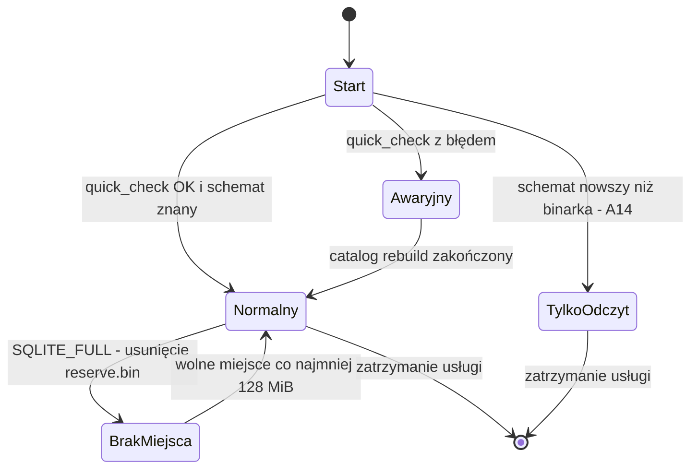

| Tryb | Scheduler | API | Heartbeat (D9.4) | Alert |
|---|---|---|---|---|
| Normalny | działa | pełne | wysyłany zgodnie z konfiguracją | — |
| TylkoOdczyt | zatrzymany | tylko metody Viewer | **nie** wysyłany (zewnętrzna usługa wykryje brak — AC-34.2) | A14 przez Event Log i e-mail bez outboxu |
| Awaryjny | zatrzymany | `GetStatus`, `RebuildCatalog` (Admin) | nie wysyłany | Critical w Event Log; e-mail bezpośrednio z konfiguracji zapisanej w rejestrze |
| BrakMiejsca | nowe uruchomienia wstrzymane, bieżące domykane jako `Interrupted` | pełne do odczytu, mutacje → `ResourceExhausted` | wysyłany z flagą `degraded` | AC-05.4 |

## R3.2.4 Powierzchnia Kestrel i plan B

### Decyzja D2.13 — Profil utwardzenia Kestrel/gRPC i mierzalne wyzwalacze przejścia na StreamJsonRpc (rozwija D2.4, D2.10; dotyczy Q11)
- **Decyzja:**
  1. Tylko HTTP/2 na named pipe, bez nasłuchu TCP (SEC-2.1), bez kompresji gRPC w obu kierunkach (pusta lista `CompressionProviders` — żądanie z `grpc-encoding` innym niż `identity` kończy się `Unimplemented`), limity jak w konfiguracji poniżej, `EnableDetailedErrors = false`.
  2. Transport API ukryty za portem `IAgentTransport` w `Kobian.Agent` i `IAgentClient` w `Kobian.Api.Contracts` — implementacje usług nie znają typów ASP.NET Core poza adapterem; koszt przejścia na StreamJsonRpc ograniczony do adaptera i testów [szacunek: 10 osobodni].
  3. **Wyzwalacze planu B** (dowolny spełniony → decyzja architekta w ≤ 10 dni roboczych, wpis jako nowa decyzja D): (a) SP-02 kończy się no-go; (b) ≥ 2 CVE o CVSS ≥ 7,0 w ciągu 12 mies. dotyczące Kestrel/HTTP/2 osiągalne w konfiguracji named pipe bez uwierzytelnienia; (c) NFR-16 niespełnione po 2 iteracjach optymalizacji; (d) wydanie łatki Kestrel wymaga zmiany API transportu częściej niż raz na wydanie MINOR.
- **Alternatywy:** natychmiastowe przejście na StreamJsonRpc; utrzymanie Kestrel bez wyzwalaczy; własny protokół ramkowany na pipe.
- **Uzasadnienie:** CVE-2026-69304 pokazuje, że wyłączenie nieużywanych funkcji zmniejsza ekspozycję; adapter zachowuje kontrakt wspólny z Central (AD-7), a wyzwalacze zamieniają spór „czy Kestrel” w decyzję opartą na danych.
- **Ryzyka:** brak kompresji zwiększa rozmiar `TailLog` i `SearchFiles` — przy lokalnym pipe pomijalne; adapter dodaje warstwę do utrzymania.

```csharp
builder.WebHost.UseNamedPipes(o => { o.CurrentUserOnly = false; o.PipeSecurity = AgentPipeSecurity.Build(); });
builder.WebHost.ConfigureKestrel(k =>
{
    k.AddServerHeader = false;
    k.Limits.MaxConcurrentConnections = 32;
    k.Limits.MaxRequestBodySize = 4 * 1024 * 1024;
    k.Limits.Http2.MaxStreamsPerConnection = 8;
    k.Limits.Http2.MaxRequestHeaderFieldSize = 16 * 1024;
    k.ListenNamedPipe("Kobian.Agent.v1", l => l.Protocols = HttpProtocols.Http2);
});
builder.Services.AddGrpc(o =>
{
    o.CompressionProviders.Clear();
    o.ResponseCompressionAlgorithm = null;
    o.MaxReceiveMessageSize = 4 * 1024 * 1024;
    o.EnableDetailedErrors = false;
    o.Interceptors.Add<AuthorizationInterceptor>();   // R2.2.4
});
```

### Decyzja D2.15 — Odrzucanie klientów zdalnych pipe i pojedyncza instancja Agenta (rozwija D2.9, SEC-2.1)
- **Decyzja:**
  1. `PipeSecurity` zawiera regułę **Deny** dla SID `NT AUTHORITY\NETWORK` (S-1-5-2, `WellKnownSidType.NetworkSid`) przed regułami Allow z D2.9; tokeny logowania sieciowego zawierają ten SID, lokalne procesy — nie.
  2. Niezależnie od ACL SP-02 sprawdza obecność `PIPE_REJECT_REMOTE_CLIENTS` w pipe tworzonym przez .NET 10 (Q53); brak flagi nie zmienia decyzji (ACL wystarcza), ale jest odnotowywany w STRIDE.
  3. Pojedyncza instancja: Agent przy starcie tworzy nazwany mutex `Global\Kobian.Agent.Instance` (ACL: konto usługi, SYSTEM) i otwiera `catalog.db.lock` z wyłącznością; niepowodzenie = zakończenie z kodem KB-7007 i wpisem Event Log, bez dotykania katalogu (CE-12).
- **Alternatywy:** wyłącznie flaga `PIPE_REJECT_REMOTE_CLIENTS`; sprawdzanie nazwy komputera klienta w interceptorze; zapora blokująca SMB (poza kontrolą produktu).
- **Uzasadnienie:** SMB (port 445) jest otwarty na większości serwerów MŚP, a zdalny administrator domeny bez reguły Deny uzyskałby rolę Admin przez sieć — z pominięciem założenia „API tylko lokalne” (AD-7: zdalnie wyłącznie Central przez mTLS w v2).
- **Ryzyka:** serwisant P2 oczekujący zdalnego `kobian status` — sesja WinRM ma token sieciowy i również zostanie odrzucona; obsługiwana ścieżka to RDP (wynik testu SP-02 do dokumentacji P2).

### Decyzja D2.16 — Współbieżność optymistyczna encji konfiguracyjnych i negocjacja wersji API (rozwija D2.10, D10.7)
- **Decyzja:**
  1. `Job`, `Destination` i `Settings` mają pole `revision` (int64, nadawane przez katalog przy każdej zmianie); żądania `Upsert*`/`Update*` niosą `expected_revision` (0 = tworzenie). Niezgodność → `FailedPrecondition` z kodem **KB-7005** i aktualną rewizją w `kb-detail`; UI pokazuje porównanie zmian i pozwala ponowić na nowej wersji.
  2. `AgentStatus` dostaje pola (dopisane na końcu komunikatu): `api_revision` (rośnie przy każdej zmianie kontraktu w MINOR) i `min_client_revision`. Klient z rewizją niższą niż `min_client_revision` przechodzi w tryb tylko do odczytu z komunikatem **KB-7006** („Zaktualizowano usługę — uruchom ponownie aplikację”); CLI kończy się kodem 4 dla poleceń mutujących.
  3. Klienci mapują nieznane wartości enum (proto3 przekazuje je jako liczby) na „Nieznany stan (kod N)” bez awarii; test N-1 (UI/CLI poprzedniego MINOR vs bieżący Agent) w bramce wydania (D10.5).
- **Alternatywy:** „ostatni zapis wygrywa”; blokady pesymistyczne edycji; wymuszenie identycznej wersji klienta i usługi.
- **Uzasadnienie:** wiele sesji RDP to typowe środowisko P1/P2 — „ostatni zapis wygrywa” cicho niszczy zmiany (sprzeczne z 1.8); negocjacja rewizji obsługuje okno między aktualizacją usługi a restartem UI.
- **Ryzyka:** konflikt przy imporcie zadań (US-29) → import tworzy nowe zadania lub wymaga `expected_revision` z eksportu; podnoszenie `min_client_revision` tylko przy zmianie semantyki bezpieczeństwa lub stanu.

## R3.2.5 Koszt dziedziny do 1.0

| ID | Pozycja | Osobodni [szacunek] | Licencje / infrastruktura |
|---|---|---|---|
| KOSZT-1 | Szkielet solucji, `Directory.Packages.props`, test architektury, ADR z planu (D2.7, R&D it. 12) | 8 | 0 (narzędzia MIT/Apache) |
| KOSZT-2 | `Kobian.Api.Contracts`: `.proto`, `buf lint/breaking`, interceptor autoryzacji, step-up, idempotencja, rewizje (D2.9, D2.10, D2.16) | 16 | 0 |
| KOSZT-3 | Host Agenta: `IHostedService`, `BackgroundTaskRegistry`, `CatalogWriter` z kolejką priorytetową, migracje, tryby pracy (R2.2.3, D2.11, D2.14) | 20 | 0 |
| KOSZT-4 | Host Worker: protokół ramek, job object, weryfikacja podpisu, preflight ASR/WDAC (D2.8, SP-16) | 10 | 0 |
| KOSZT-5 | Profil uprawnień usługi i ACL pipe w custom action MSI (D2.12, D2.15) — współdzielone z rolą 10 | 6 | 0 |
| KOSZT-6 | Spike’i SP-02, SP-13…SP-16 | 14 | VM ewaluacyjne Windows Server (koszt w pozycjach infrastruktury roli 10, it. 30) |
| KOSZT-7 | Adapter transportu i rezerwa na plan B StreamJsonRpc (D2.13) | 4 (adapter) + 10 (rezerwa warunkowa) | 0 |
| KOSZT-8 | Utrzymanie łatek .NET do 1.0 (~9 cykli × 0,5 osobodnia) i przeglądy architektury PR | 12 | 0 |

Razem: **90 osobodni** (100 z rezerwą) ≈ 4,3–4,8 osobomiesiąca [szacunek: 21 osobodni/mies.], ok. 12–13% budżetu R3.1.3; licencje zewnętrzne: 0.

## R3.2.6 Przypadki brzegowe i kontrprzykłady

| # | Kontrprzykład | Dotyczy | Rozstrzygnięcie |
|---|---|---|---|
| CE-8 | Dwóch administratorów w sesjach RDP edytuje to samo zadanie; drugi zapis nadpisuje pierwszy | D2.10, US-01 | D2.16; nowe **AC-01.5** |
| CE-9 | UI otwarte podczas auto-aktualizacji usługi dostaje nowy stan `RunState` i nieznane pola | D2.10, D10.7 | D2.16 pkt 2–3; nowe **AC-37.2** |
| CE-10 | Po ręcznym cofnięciu wersji produktu (bez przywrócenia `catalog.pre-*.db`) usługa startuje w trybie tylko do odczytu, a heartbeat nadal raportuje „OK” | D2.11, AC-34.1 | tryb TylkoOdczyt nie wysyła heartbeatu (R3.2.3); nowe **AC-34.2** |
| CE-11 | Wolumen `%ProgramData%` zapełnia się w trakcie kopii (staging MSSQL na tym samym dysku) — `SQLITE_FULL` blokuje zapis stanu i outboxu | R2.2.3, NFR-10 | D2.14 pkt 4; nowe **AC-05.4** |
| CE-12 | Administrator uruchamia `Kobian.Agent.exe --console` do diagnostyki przy działającej usłudze — dwa schedulery i dwóch pisarzy katalogu | R2.2.3 | D2.15 pkt 3; nowe **AC-37.3** |
| CE-13 | Administrator domeny łączy się z `\\serwer\pipe\Kobian.Agent.v1` z innego komputera | D2.9, AD-7 | D2.15 pkt 1–2; SEC-22.1 |

| AC | Given | When | Then |
|---|---|---|---|
| AC-01.5 | zadanie w rewizji 7 otwarte w dwóch sesjach UI | sesja A zapisuje (rewizja 8), sesja B zapisuje z `expected_revision = 7` | B dostaje KB-7005 z porównaniem zmian; rewizja 8 nienaruszona; audyt zawiera oba zdarzenia |
| AC-37.2 | Agent z `min_client_revision` wyższym niż rewizja CLI | `kobian run <zadanie>` | kod wyjścia 4, komunikat KB-7006; polecenia tylko do odczytu działają |
| AC-34.2 | usługa w trybie TylkoOdczyt | upływ okna heartbeatu | heartbeat nie jest wysyłany, zewnętrzna usługa alarmuje; Event Log zawiera A14 |
| AC-05.4 | wolumen danych pełny w trakcie kopii | `SQLITE_FULL` | uruchomienie kończy się `Interrupted` zapisanym w katalogu (z rezerwy), alert przez Event Log i bezpośredni e-mail ≤ 2 min, nowe uruchomienia wstrzymane |
| AC-37.3 | usługa działa | drugi proces Agenta startuje | proces kończy się w ≤ 2 s z KB-7007, `catalog.db` niezmieniony (porównanie sumy), wpis w Event Log |

Kody nowe (zakres architektury i API w rejestrze D1.8): **KB-7005** rewizja nieaktualna, **KB-7006** klient niezgodny z wersją API usługi, **KB-7007** druga instancja usługi, **KB-7008** start procesu Worker zablokowany przez politykę systemu (ASR/WDAC/AppLocker).

## R3.2.7 Rewizja decyzji dziedziny

| Decyzja | Nowe fakty (stan na 2026-10-12, źródło) | Wynik |
|---|---|---|
| D2.1 .NET 10 LTS | 10.0.12 z 08.09.2026; biuletyn wrześniowy: 8 CVE, w tym CVE-2026-69806 (lokalne EoP, CVSS 7.0) i CVE-2026-69304 (ASP.NET Core DoS) [devblogs.microsoft.com, aicybr.com]; kolejny Patch Tuesday 13.10.2026 | **Utrzymana**; NFR-21 formalizuje SLA łatek |
| D2.3 SQLite WAL | CVE-2026-11822 (FTS5, naprawione 3.53.2) [osv.dev] | **Utrzymana i uzupełniona** — D2.14 (minimum 3.53.2, brak FTS5, utwardzenie) |
| D2.4 / Q11 Kestrel na pipe | j.w. CVE-2026-69304; brak nowych CVE dotyczących wyłącznie transportu named pipe (do weryfikacji w MSRC przed M1) | **Utrzymana** z profilem i wyzwalaczami D2.13 |
| D2.9 tożsamość z pipe | dostęp zdalny przez SMB nieobjęty | **Uzupełniona** — D2.15 |
| D2.6, D2.7, D2.12 | rozmiar dystrybucji „do pomiaru”; liczba projektów niespójna; `ServiceSidType` nierozstrzygnięty | **Utrzymane**; SP-15, K22.1, SP-13 |

# Bezpieczeństwo — iteracja 22 (rola 11: Ekspert bezpieczeństwa)

Recenzja R3.2: kierunek zmian zmniejsza powierzchnię ataku; najważniejsze jest domknięcie dostępu sieciowego do pipe (CE-13), który wcześniej omijał założenie „API tylko lokalne”.

1. **SEC-22.1 Test odrzucenia klienta zdalnego (E2E, bramka wydania):** z drugiej VM w tej samej domenie konto z grupy Administrators serwera łączy się z `\\serwer\pipe\Kobian.Agent.v1` — wynik `ERROR_ACCESS_DENIED` przed jakimkolwiek wywołaniem gRPC; ten sam test z sesji WinRM na serwerze — odmowa udokumentowana jako oczekiwana. Kryterium: 0 udanych połączeń sieciowych w 3 konfiguracjach (domena, grupa robocza, konto lokalne o tym samym haśle).
2. **SEC-22.2 Brak kompresji gRPC:** test kontraktowy wysyła żądanie z `grpc-encoding: gzip` i ramką „bomby dekompresyjnej” — odpowiedź `Unimplemented`, pamięć procesu bez wzrostu > 10 MB.
3. **SEC-22.3 Utwardzenie SQLite:** test jednostkowy katalogu sprawdza po otwarciu połączenia `trusted_schema = 0`, `cell_size_check = 1`, flagę DEFENSIVE i brak możliwości `load_extension`; test architektury odrzuca w migracjach słowa `VIRTUAL TABLE` i `fts5`.
4. **SEC-22.4 Pojedyncza instancja:** mutex i blokada pliku z ACL tylko dla konta usługi i SYSTEM — użytkownik bez uprawnień nie może zająć nazwy mutexu przed startem usługi (squatting); test: utworzenie mutexu z konta Viewer przed startem usługi → usługa wykrywa obcego właściciela, kończy się KB-7007 i alarmem Critical zamiast cichego niedziałania.
5. **SEC-22.5 Rewizja:** CVE-2026-69806 (lokalne EoP w .NET) dotyczy procesu z `SeBackupPrivilege` — klasa „wysoka” dla produktu niezależnie od CVSS; NFR-21 obowiązuje z progiem 72 h dla tej klasy. Decyzje D2.8, D2.9, D2.12 bez zmian.

### STRIDE — nowe elementy

| Element | Zagrożenie | Kat. | Mitygacja |
|---|---|---|---|
| Pipe przez SMB | zdalny administrator jako Admin API | E, S | Deny `NETWORK` (D2.15), SEC-22.1 |
| Mutex instancji | zajęcie nazwy przed startem usługi | D | ACL + wykrycie obcego właściciela (SEC-22.4) |
| Plik rezerwy | usunięcie przez inny proces → brak zapasu | D | ACL katalogu danych (2.6); kontrola obecności przy starcie |
| Pole `revision` | wymuszenie konfliktów w pętli | D | limit wywołań mutujących per SID (R2.2.4 `rateLimit`) |

# R&D — iteracja 22 (rola 12: Dział R&D)

| Technika | Opis | Ocena | Decyzja |
|---|---|---|---|
| **AF_UNIX (gniazda domeny Unix) na Windows 10 1803+ / Server 2019+** | Kestrel obsługuje `ListenUnixSocket`; ten sam transport na Windows i Linux v2, ACL przez uprawnienia pliku gniazda | ujednolica port Linux (AD-4), ale na Windows brak tożsamości klienta z tokenu (odpowiednik `RunAsClient`) i Server 2016 bez wsparcia | **Odrzucone dla Windows 1.x**; **przyjęte koncepcyjnie dla Linux v2** (`SO_PEERCRED`) — wpis do rundy 5 roli 2 |
| **ArchUnitNET** (testy reguł architektury, Apache-2.0) | deklaratywne reguły zależności zamiast własnej refleksji (D2.7) | czytelniejsze reguły; dodatkowa zależność testowa — audyt CVE/utrzymania wymagany przed użyciem | **Odroczone** — własne testy refleksji wystarczą do M1; ponowna ocena, gdy reguł > 30 |
| **Wzorzec „ballast file” (plik rezerwy na dysku danych)** | znany z praktyk operacyjnych baz i serwerów (rezerwa usuwana przy zapełnieniu dysku, by zapisać stan i pozwolić na sprzątanie) | tani, deterministyczny, rozwiązuje CE-11 | **Przyjęte** (D2.14 pkt 4) |

---

# R3.3 Silnik backupu — weryfikacja i ryzyko (iteracja 23 — Inżynier silnika backupu)

Wejście: sekcja 3, R2.3 (D3.8–D3.13, V-01…V-10, KB-1xxx), R3.1 (PM-1…PM-8, SP-01…SP-12, R3.1.3, CE-1…CE-7), R3.2 (NFR-16…NFR-21, D2.14), NFR-03/04/05/10/14/15, Q15, fakty z 2026-10-12 (nuget.org, GitHub borgbackup). Cel: pre-mortem silnika, spike’i M0, budżety, koszt dziedziny, kontrprzykłady i rewizja D3.x. Czytanie selektywne (plan > 450 KB): sekcje 3, R2.3, R3.1, R3.2, indeksy i rejestry.

### Przegląd luk

| # | Luka / nowy fakt | Miejsce | Zamknięcie |
|---|---|---|---|
| L1 | **Nowy fakt (2026-10-12, github.com/borgbackup/borg/pull/9853):** w Borg błąd zapisu do repozytorium (ENOSPC) był opakowany jak błąd odczytu pliku źródłowego — kopia kończyła się kodem 0, a archiwum odwoływało się do niezapisanych bloków. Pseudokod R2.3.6 nie rozróżnia klas błędów ani nie wymaga weryfikacji packów przed zapisem snapshotu | R2.3.6, 3.7 | D3.14, K23.2, CE-14, AC-08.4, NFR-26, SP-18 |
| L2 | Zbiór `dedup` w RAM: „1 mln bloków ≈ 56 MB” pomija narzut struktury .NET, a 10 mln małych plików to 10 mln bloków (≈ 560 MB danych surowych) — przekracza NFR-05 już w v1, nie w v2 | R2.3.6 | D3.15, K23.3, NFR-22, SP-19 |
| L3 | Limity R2.3.8 są wewnętrznie sprzeczne: `rawLength` drzewa ≤ 16 MiB, a katalog z 200 000 plików (≈ 210 B/wpis [szacunek]) ma ≈ 42 MB; plik 2 TiB ma 524 288 bloków (≈ 17 MB samej listy) | R2.3.5, R2.3.8 | D3.18, K23.1, CE-16, AC-08.6 |
| L4 | Brak konsolidacji plików indeksu: jeden `.idx` na uruchomienie daje setki obiektów na celu FTP/SFTP i wolny start | R2.3.5, D3.7 | D3.16, PM-17 |
| L5 | Wykrywanie zmian (3.2) zakłada stabilne `mtime`/`FileId`; brak reguły dla FAT/exFAT (ziarno 2 s) i dla plików zmienianych w trakcie odczytu bez VSS | 3.2, 3.6 | D3.17, CE-15, CE-17, AC-08.5, AC-11.1, SP-20 |
| L6 | Brak wymogu, by błąd zapisu do repo nigdy nie dawał statusu Warning/Succeeded; status Succeeded mimo pominiętych plików | 3.7, D3.7 | D3.14 (tabela klas), AC-08.4 |
| L7 | Pytania dziedziny z weryfikacji prototypem: Q15 (CsWin32/VSS) — pozostaje otwarte do SP-01; nowe Q54, Q55 | Otwarte pytania | Q54, Q55 |

## R3.3.1 Pre-mortem silnika

Założenie: jest marzec 2028, silnik backupu jest przyczyną porażki 1.0. Dlaczego?

| # | Scenariusz porażki | P-stwo | Wpływ | Wczesny sygnał (mierzalny) | Mitygacja |
|---|---|---|---|---|---|
| PM-15 | Cicha utrata danych: kopia „udana”, a snapshot odwołuje się do bloku, którego pack nie dotarł (ENOSPC, zerwany upload, awaria w locie) — wykryta dopiero przy restore | niskie | krytyczny | `dangling > 0` w teście chaos (NFR-26) lub w V2/V3 u bety; jakikolwiek KB-1403 | D3.14 (commit tylko po weryfikacji), SP-18, V2 po commit, V4 tygodniowo (D5.7) |
| PM-16 | Dedup przekracza NFR-05 przy 10+ mln małych plików (skład ERP, skany, Maildir) | średnie | wysoki | `Private Bytes` p99 > 500 MB w teście 10 mln (NFR-22); KB-1404 w > 5% instalacji | D3.15 (tabela dokładna do 2 mln + Bloom + katalog), SP-19 |
| PM-17 | Proliferacja indeksów: po roku codziennych kopii > 400 plików `.idx` na celu; start, V2 i restore trwają godzinami (FTP/SFTP z RTT) | średnie | średni | liczba aktywnych `.idx` > 200 lub czas wczytania indeksu > 5 min na LAN | D3.16 (konsolidacja), NFR-25 |
| PM-18 | Prune usuwa pack nadal żywy (błąd zbioru żywych lub wyścig z uruchomieniem) | niskie | krytyczny | V3/V4 zgłasza brakujący blok po prune; test właściwości AC-10.1/10.3 czerwony | dwufazowość i karencja 24 h (D3.7), blokada wyłączna (D3.13), wstrzymanie prune przy pierwszej niezgodności, prune z dry-run w UI |
| PM-19 | Zmiana kodowania metadanych (wersja `System.Formats.Cbor`, błąd w kanonizacji) zmienia `treeId`: dedup drzew przestaje działać, przyrost „bez zmian” zapisuje setki MB | średnie | średni | `bytesNew` bez zmian w źródle > 1 MiB (NFR-27); wektory V-07/V-08 czerwone | wektory w CI, repozytoria złote (D10.9); `chunkId` liczony z plaintext — zmiana kompresji nie psuje dedup |
| PM-20 | Pliki aktywnie zapisywane (PST, bazy plikowe, dzienniki) zapisane niespójnie bez VSS, wykryte dopiero przy restore | średnie | wysoki | odsetek plików z flagą `unstable` > 0,5% przebiegu lub niezgodność hash w V4 dla pliku z flagą | D3.17 (stat przed/po z uchwytu, ponowienia, flaga, KB-1401), VSS jako domyślny wybór (D3.6), SP-20 |

## R3.3.2 Spike’i silnika (uzupełniają D1.9; SP-01 pozostaje w R3.1.2)

| ID | Pytanie | Hipoteza | Kryterium „go” | Limit | Plan B |
|---|---|---|---|---|---|
| SP-17 | Czy etap zstd 3 (ZstdSharp.Port 0.8.8) + AES-256-GCM + HMAC `chunkId` spełnia NFR-03 na 4 rdzeniach | zarządzany port osiąga ≥ 120 MB/s na rdzeń | [cel] ≥ 120 MB/s/rdzeń na korpusie mieszanym (D10.9), ≥ 150 MB/s end-to-end przy 3 rdzeniach roboczych, pamięć etapu ≤ 150 MB; AEAD ≥ 1 GB/s z AES-NI | 3 osobodni [szacunek] | Brotli z BCL dla profilu „Szybki”; natywne libzstd w Worker (nowa zależność — audyt przed użyciem) |
| SP-18 | Czy protokół D3.14 daje zero snapshotów z brakującym blokiem po awarii procesu, ENOSPC i zerwaniu łącza | tak, przy commit po weryfikacji packów | [cel] 0 snapshotów z referencją do brakującego bloku w 300 uruchomieniach: 200 × zabicie procesu w 20 punktach potoku, 50 × ENOSPC (VHD 1 GB), 50 × zerwany SFTP; niezależny weryfikator pełnej spójności | 4 osobodni [szacunek] | pełny Stat każdego packa z indeksu przed commit (koszt czasu) |
| SP-19 | Czy D3.15 i D3.18 mieszczą się w NFR-05 przy 10 mln plików, katalogu 200 000 plików i pliku 2 TiB (sparse) | tabela 2 mln + Bloom + katalog wystarcza | [cel] `Private Bytes` p99 ≤ 500 MB, struktura dedup ≤ 150 MB, FP Bloom ≤ 1,5%, strony drzew ≤ 8 MiB, skan bez zmian 10 mln plików ≤ 30 min | 3 osobodni [szacunek] | dedup wyłącznie przez `repo_chunk_index` w katalogu; w 1.0 limit 5 mln plików/zadanie (udokumentowany) |
| SP-20 | Czy stat z uchwytu przed i po odczycie wykrywa modyfikację otwartego pliku bez VSS (NTFS aktualizuje `LastWriteTime` w katalogu z opóźnieniem — do weryfikacji) | `FILE_BASIC_INFO` z uchwytu odzwierciedla zapisy natychmiast | [cel] 100% wykrytych niespójnych odczytów w 1 000 plikach modyfikowanych co 50 ms; 0 fałszywych alarmów dla niezmienianych | 2 osobodni [szacunek] | podwójny odczyt z porównaniem hash dla plików „aktywnych”; ostrzeżenie „użyj VSS” |

Suma spike’ów silnika: SP-17…SP-20 = **12 osobodni**; z SP-01 (8) = **20 osobodni** [szacunek]. Plan M0 po tej iteracji: SP-01…SP-12 (≈ 50, w tym 15 dni kalendarzowych wywiadów), SP-13…SP-16 (10), SP-17…SP-20 (12) = **≈ 72 osobodni** [szacunek]; konsolidacja i obsada — it. 30.

## R3.3.3 Budżety wydajności i zasobów silnika

| ID | Wymaganie | Próg [cel] | Metoda weryfikacji | Spike / test |
|---|---|---|---|---|
| NFR-22 | Pamięć struktury dedup | ≤ 150 MB dla 10 mln bloków; cały proces ≤ 500 MB (NFR-05) | korpus 10 mln plików (D10.9), `Private Bytes` p99 co 1 s, VM 4 vCPU / 8 GB / SSD | SP-19, test Perf noc |
| NFR-23 | Narzut formatu (nagłówki, ramki, trailery, indeks) | ≤ 1% rozmiaru po kompresji dla bloków 4 MiB; ≤ 3% dla korpusu małych plików (mediana 20 KiB) | statystyki snapshotu (`bytesNew` vs suma plików repo) na korpusie | test Perf |
| NFR-24 | Przepustowość etapu kompresja + AEAD + HMAC | ≥ 120 MB/s na rdzeń (zstd 3, korpus mieszany) | BenchmarkDotNet na sprzęcie referencyjnym z repo | SP-17 |
| NFR-25 | Retencja i konsolidacja | `Keep` dla 5 000 snapshotów ≤ 1 s; wczytanie indeksów repo po konsolidacji ≤ 60 s na LAN 1 Gb/s dla 365 snapshotów; aktywnych `.idx` ≤ 64 | test właściwości + korpus z 365 uruchomieniami | AC-10.1, test Perf |
| NFR-26 | Spójność po awarii | 0 snapshotów z referencją do brakującego bloku (100% uruchomień chaos) | harness chaos: zabicie procesu, ENOSPC, zerwanie łącza; niezależny weryfikator | SP-18, bramka nocna |
| NFR-27 | Przyrost bez zmian w źródle | ≤ 1 MiB nowych bajtów w repo (snapshot + indeks, 0 nowych packów danych) dla 1 mln plików | dwa uruchomienia na niezmienionym korpusie, odczyt `bytesNew` | test Perf, PM-19 |

## R3.3.4 Koszt dziedziny do 1.0

| ID | Pozycja | Osobodni [szacunek] | Licencje / infrastruktura |
|---|---|---|---|
| KOSZT-9 | Format v1: pisarz i czytnik packów, indeksów, snapshotów, kanoniczny CBOR, stronicowanie (D3.8–D3.11, D3.18), wektory V-01…V-12 | 28 | 0 |
| KOSZT-10 | Potok backupu: enumeracja, planner, reader, chunker, packer, kolejki, dedup (D3.14, D3.15), klasyfikacja błędów | 30 | 0 |
| KOSZT-11 | Interop NTFS: VSS przez CsWin32, reparse, ADS, sparse, ACL, chmurowe, odczyt spójny (3.6, D3.6, D3.17) | 22 | VM Windows w CI (pozycja roli 10, it. 30) |
| KOSZT-12 | Klucze: KDF, opakowania, klucz odzyskiwania, DPAPI, unieważnianie (D3.4, D3.5, D3.9, D3.11) | 14 | 0 |
| KOSZT-13 | Retencja GFS, prune dwufazowy, blokady, konsolidacja indeksów (D3.12, D3.13, D3.16) | 18 | 0 |
| KOSZT-14 | Weryfikacja V1–V3 i polecenie `check` (bez `--repair` — rola 8) | 10 | 0 |
| KOSZT-15 | Spike’i SP-01 (8) i SP-17…SP-20 (12) | 20 | VM Windows (ewaluacyjne) |
| KOSZT-16 | Testy własne: właściwości (`Keep`, ścieżki), chaos potoku, korpus i repozytoria złote (we współpracy z rolą 10) | 16 | 0 |
| KOSZT-17 | Rezerwa warunkowa: plan B kompresji (natywne libzstd/Brotli) i dedup wyłącznie przez katalog | 8 | 0 |

Razem: **166 osobodni** (158 + 8 rezerwy) ≈ 7,9 osobomiesiąca [szacunek: 21 osobodni/mies.], ok. 22% budżetu R3.1.3 (756 osobodni); licencje zewnętrzne: 0. Pozycje spike’ów nie dublują KOSZT-6 (R3.2).

## R3.3.5 Przypadki brzegowe i kontrprzykłady

| # | Kontrprzykład | Dotyczy | Rozstrzygnięcie |
|---|---|---|---|
| CE-14 | Cel zapełnia się przy ostatnim packu; upload kończy się błędem klasyfikowanym jak problem z plikiem źródłowym, a snapshot zostaje zapisany (błąd klasy Borg) | R2.3.6, 3.7 | D3.14: błąd zapisu do repo = Failed, brak snapshotu; **AC-08.4** |
| CE-15 | Plik PST zmienia się w trakcie odczytu, VSS wyłączony; kopia zawiera pół starej, pół nowej treści | 3.6, US-11 | D3.17: stat przed/po, 2 ponowienia, flaga `unstable`, KB-1401; **AC-11.1** |
| CE-16 | Katalog z 200 000 skanów i plik VHDX 2 TiB przekraczają `rawLength` drzewa | R2.3.8, D3.8 | D3.18 i K23.1; **AC-08.6** |
| CE-17 | Pendrive exFAT jako źródło: plik zmieniony w tej samej 2-sekundowej komórce `mtime` co poprzednia kopia, ten sam rozmiar, brak `FileId` | 3.2, SC-2 | D3.17 pkt 2 (zasada „racily clean”); **AC-08.5** |
| CE-18 | Dwa zadania zapisują do jednego repozytorium; ten sam blok trafia do dwóch packów, a prune jednego łańcucha usuwa „swój” pack | D3.2, D3.7, D3.13 | duplikaty bloków są dozwolone; prune usuwa wyłącznie packi bez żadnej referencji żadnego snapshotu repo; **AC-10.3** |
| CE-19 | Katalog case-sensitive (WSL/flaga NTFS) zawiera `Plik.txt` i `plik.txt`; restore na cel bez rozróżniania wielkości liter | R2.3.5, D8.9 | repo przechowuje oba wpisy (sortowanie bajtowe); restore nie nadpisuje i raportuje konflikt wg D8.9; **AC-08.7**; przypadek dodany do korpusu D10.9 |

| AC | Given | When | Then |
|---|---|---|---|
| AC-08.4 | cel z limitem 1 GB zapełniony w trakcie zapisu packa | uruchomienie zadania | status Failed z KB-1402, kod wyjścia CLI ≠ 0, brak nowego snapshotu na celu i w katalogu, żaden zapisany indeks nie wskazuje brakującego packa; kolejne uruchomienie po zwolnieniu miejsca kończy się Succeeded |
| AC-08.5 | źródło exFAT; plik zmieniony 1 s po rozpoczęciu poprzedniego snapshotu, ten sam rozmiar i ten sam `mtime` | kopia przyrostowa | plik jest ponownie odczytany i zapisany z nową treścią (hash różny), snapshot zawiera nową wersję |
| AC-08.6 | katalog z 200 000 plików i plik sparse 2 TiB | kopia i restore | żadna strona drzewa nie przekracza 8 MiB, restore daje identyczne `fileSha256` dla próbki 1 000 plików; brak KB-1302/KB-1305 |
| AC-10.3 | dwa zadania w jednym repozytorium, wspólne bloki | prune po usunięciu snapshotów jednego zadania | packi referencjonowane przez drugie zadanie nietknięte; restore drugiego zadania poprawny |
| AC-11.1 | plik zapisywany co 50 ms, brak VSS | kopia | po 2 ponowieniach wpis z flagą `unstable`, Warning z KB-1401, status uruchomienia Warning (nie Succeeded) |
| AC-08.7 | `Plik.txt` i `plik.txt` w jednym katalogu | kopia i restore na NTFS bez rozróżniania wielkości liter | oba wpisy w snapshotcie; jeden plik odtworzony, drugi raportowany jako konflikt, brak nadpisania |

Kody nowe (zakres silnika, D1.8): **KB-1401** plik zmienił się w trakcie odczytu (Warning), **KB-1402** błąd zapisu do repozytorium — uruchomienie przerwane (Failed), **KB-1403** niespójność referencji wykryta przed zatwierdzeniem snapshotu (Failed, integralność), **KB-1404** tryb dedup z filtrem Bloom (Info), **KB-1405** plik źródłowy nieczytelny — pominięty (Warning).

## R3.3.6 Decyzje

### Decyzja D3.14 — Niezmienniki zapisu, klasy błędów i commit po weryfikacji (rozwija D3.1, 3.7; K23.2)
- **Decyzja:**
  1. Klasy błędów: **Source-Read** (odmowa dostępu, naruszenie współdzielenia po ponowieniach) → Warning, plik na liście pominiętych (KB-1405); **Source-Unstable** → Warning z flagą (D3.17); **Repo-Write** (zapis packa, indeksu lub snapshotu, w tym ENOSPC, odmowa, zerwanie po wyczerpaniu ponowień Polly — D4.10) → uruchomienie Failed, KB-1402, snapshot **nie powstaje**; **Integrity** (niespójność referencji) → Failed, KB-1403; **Internal** (kompresja, AEAD, RNG) → Failed. Status Succeeded wymaga zera pominiętych i zero `unstable`; w przeciwnym razie Warning.
  2. Niezmienniki: **I-1** snapshot powstaje tylko, gdy `repoWriteErrors = 0`; **I-2** każdy nowy pack ma w `repo_upload_journal` stan `verified` (V1: rozmiar i SHA-256 po stronie celu, gdy cel to umożliwia); **I-3** każdy `chunkId` z drzew (nowych i reużytych) jest w nowym indeksie albo w indeksie z `allowedPacks` — sprawdzane na **dokładnych** danych (indeksy lub `repo_chunk_index`), nigdy na samym filtrze Bloom; packi z `mark_delete_at` są wyłączone z `allowedPacks`.
  3. Commit (ostatni zapis): indeks → odczyt kontrolny i porównanie hash → snapshot jako `snapshots/<id>.snap.part` (StagedRename; przy DirectFinal zapis końcowy po odczycie kontrolnym indeksu) → rename → dopiero wtedy transakcja katalogu. Awaria po zapisie snapshotu, a przed katalogiem: uruchomienie `Interrupted`, a snapshot importowany przy rekoncyliacji (D8.2) po weryfikacji V2.
  4. Snapshot dostaje klucz 17: `{1: pominięte, 2: unstable}` (liczniki); klucze ≥ 32 w obiektach metadanych są informacyjne i ignorowane przez czytnik v1; zmiana semantyki wymaga `features` (D3.11).
- **Alternatywy:** pełny Stat każdego packa przed commit (pewniejszy, wolny na FTP); V2 wyłącznie po commit (stan R2.3.6); snapshot zapisywany zawsze, z flagą „niekompletny”.
- **Uzasadnienie:** błąd klasy Borg powstaje, gdy zapis do repo trafi do ścieżki „ostrzeżenie per plik”; jawne klasy i niezmienniki czynią go testowalnym (NFR-26, SP-18). Commit po weryfikacji zachowuje zasadę „manifest ostatni” (2.5).
- **Ryzyka:** wymagane wsparcie StagedRename przez cele (Q54); odczyt kontrolny indeksu wydłuża zakończenie o jeden odczyt (pomijalne).

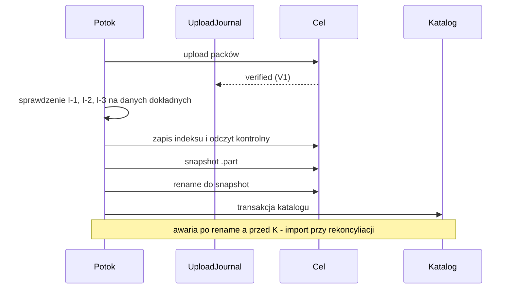

### Decyzja D3.15 — Dedup w trzech warstwach: tabela dokładna, filtr Bloom, indeks w katalogu (rozwija D3.2; K23.3)
- **Decyzja:** do 2 mln bloków w `allowedPacks` — tabela z otwartym adresowaniem (klucz 32 B, wartość 8 B, współczynnik wypełnienia 0,7 ≈ 115 MB [szacunek]); powyżej progu — filtr Bloom 10 bitów/wpis (FP ≈ 1% [szacunek]) plus tabela katalogu `repo_chunk_index` (`repo_id`, `chunk_id BLOB(32)`, `pack_id BLOB(16)`, PRIMARY KEY (`repo_id`, `chunk_id`), `STRICT, WITHOUT ROWID`) z zapytaniami partiami po 500; wynik „może istnieć” zawsze potwierdzany w tabeli, a niepotwierdzony = blok nowy. Bloki nowe w uruchomieniu trafiają do filtra i do tabeli tymczasowej `repo_run_chunks` przez kolejkę masową `CatalogWriter` (D2.14). Przejście do trybu Bloom odnotowywane jako KB-1404 (Info). Próg 2 mln i parametry — kalibracja w SP-19 (Q55).
- **Alternatywy:** wyłącznie tabela w RAM (przekroczenie NFR-05); wyłącznie katalog (wolniejszy skan); filtr binary fuse (statyczny, zależność).
- **Uzasadnienie:** fałszywy wynik dodatni filtra kosztuje zapytanie, nie poprawność; wynik ujemny oznacza ponowne wysłanie bloku (dopuszczalny duplikat — CE-18). Pamięć jest ograniczona niezależnie od liczby plików.
- **Ryzyka:** rozmiar `repo_chunk_index` (≈ 600 MB dla 10 mln bloków [szacunek]) — odbudowywalny z indeksów (D8.2); obciążenie kolejki masowej — NFR-17.

### Decyzja D3.16 — Konsolidacja indeksów (rozwija R2.3.5, D3.7)
- **Decyzja:** zadanie utrzymaniowe uruchamiane, gdy aktywnych `.idx` > 32 lub suma małych (< 1 MiB) > 16; czyta aktywne indeksy, zapisuje `index/<new>.idx` z unią wpisów i polem 2 (zastąpione `indexId`), weryfikuje hash i dopiero wtedy oznacza stare jako zastąpione w katalogu. Snapshoty nie są przepisywane (pole 11 niezmienne); czytnik rozwiązuje `indexId` przez zamknięcie relacji „zastąpiony przez”. Stare `.idx` usuwa wyłącznie prune po karencji. Konsolidacja wymaga blokady współdzielonej i jest zgodna z celami append-only (tylko nowe pliki).
- **Alternatywy:** jeden indeks nadpisywany (łamie append-only); konsolidacja przy każdym uruchomieniu; brak konsolidacji (restic: `repack`/`prune` — do weryfikacji).
- **Uzasadnienie:** ogranicza liczbę obiektów na celu zdalnym i czas startu (PM-17, NFR-25) bez naruszania niezmienności snapshotów.
- **Ryzyka:** błąd w zamknięciu relacji powoduje „brakujący indeks” — test właściwości na losowych łańcuchach konsolidacji; `check` raportuje indeksy osierocone.

### Decyzja D3.17 — Odczyt spójny pliku i wykrywanie zmian (rozwija 3.2, 3.6)
- **Decyzja:**
  1. Pliki otwierane z `FILE_SHARE_READ | WRITE | DELETE`; `FILE_BASIC_INFO` i `FILE_STANDARD_INFO` z **uchwytu** przed i po odczycie; różnica rozmiaru, `LastWriteTime` lub `ChangeTime` → do 2 ponowień co 2 s; po wyczerpaniu — wersja z ostatniego odczytu zapisana z flagą `unstable` (klucz 16, bit 0), Warning KB-1401. Opcja zadania „pomiń niespójne”. VSS (D3.6) pozostaje zalecaną metodą dla katalogów z aktywnymi plikami.
  2. Reguła „racily clean” (wzorzec z Git — dokumentacja racy-git, do weryfikacji): wpis z poprzedniego manifestu jest reużyty bez odczytu tylko, gdy `mtime` pliku jest starsze niż `snapshot.time − ε` (ε = 2 s dla FAT/exFAT i przy braku `FileId`, 1 s w pozostałych przypadkach); inaczej plik jest odczytywany i porównywany po hash. `snapshot.time` = początek enumeracji.
- **Alternatywy:** zawsze pomijać zmieniane pliki (utrata danych); podwójny odczyt wszystkich plików (koszt); archive bit (odrzucone w 3.2).
- **Uzasadnienie:** koszt reguły 2 jest pomijalny (dotyczy plików zmienionych tuż przed poprzednim uruchomieniem), a zamyka cichą utratę zmian na nośnikach P3.
- **Ryzyka:** zachowanie `LastWriteTime` otwartych plików NTFS wymaga potwierdzenia (SP-20); wzrost odczytów po długim wyłączeniu zegara.

### Decyzja D3.18 — Stronicowanie drzew i list bloków dużych plików (rozwija D3.8, D3.10; K23.1)
- **Decyzja:** katalog do 2 048 wpisów i 1 MiB surowo pozostaje pojedynczym blobem `{1: [wpis…]}`. Większy dzielony jest na **strony** (blob typu 2 `{1: [wpis…]}`) o granicach wyznaczanych deterministycznie: strona zamyka się po wpisie, dla którego `u16(HMAC(K_id, nazwa)[0..2]) mod 1024 = 0`, albo wymuszenie przy 20 000 wpisach lub 8 MiB; wstawienie pliku zmienia zwykle jedną stronę. Katalog stronicowany to **węzeł indeksowy** `{2: [[pierwszaNazwa, treeIdStrony]…]}` (≤ 4 096 stron, nazwy ściśle rosnące; naruszenie → KB-1305). Plik o > 8 192 blokach (32 GiB) ma w drzewie `9: []` i `17: [listId…]`; **lista bloków** to blob typu 3 `[chunkId…]` (≤ 16 384 pozycji, kolejność wg offsetu). Limit KB-1305 dotyczy strony; limit `rawLength` drzewa 16 MiB zostaje jako twarda bariera. Nowe wektory V-11 (katalog stronicowany, wstawienie jednego pliku zmienia jedną stronę) i V-12 (plik 40 GiB z listami).
- **Alternatywy:** podniesienie `rawLength` do 128 MiB (RAM i czas parsowania, wzorzec DoS); stały podział po liczbie wpisów (przesunięcie granic po wstawieniu — pełne ponowne wysłanie); osobny format dla dużych plików.
- **Uzasadnienie:** granice zależne od treści zachowują stabilność `treeId` (dedup drzew, NFR-27); indirekcja (jak w Kopii — do weryfikacji) utrzymuje małe obiekty i limity parsera SEC-3.3.
- **Ryzyka:** przejście progu 2 048 wpisów powoduje jednorazowe ponowne zapisanie katalogu; format zmieniony przed 1.0, więc bez migracji — wymaga ponownego przeglądu krypto (SEC-13.1).

K23.1 i inne korekty: patrz sekcja „Korekty”. Wpływ na v1: zmiana pól CBOR (klucze 16, 17 wpisu, 17 snapshotu) i typu blobu 3 jest wprowadzana **przed** pierwszym repozytorium produkcyjnym; dla v2 (CDC, dedup globalna) pozostaje `features[]`.

## R3.3.7 Wnioski z konkurencji (scenariusze SC)

| Scenariusz | Obserwacja | Wniosek dla Kobian |
|---|---|---|
| SC-3 / awaria zapisu | Borg: błąd zapisu repo traktowany jak ostrzeżenie pliku → archiwum z brakującymi blokami (PR #9853, 2026-10-12) | D3.14 jako testowalny niezmiennik, nie tylko konwencja |
| SC-1 / duże katalogi | restic trzyma katalog w jednym blobie drzewa (do weryfikacji), Kopia używa obiektów pośrednich (do weryfikacji) | D3.18 — stronicowanie przed 1.0 |
| SC-4 / odtwarzanie | spójność `check` zależy od indeksów; wiele małych indeksów spowalnia start | D3.16 |

## R3.3.8 Rewizja decyzji dziedziny

| Decyzja | Nowe fakty (2026-10-12, źródło) | Wynik |
|---|---|---|
| D3.1 format repo | CE-16 pokazuje lukę limitów | **Utrzymana i uzupełniona** — D3.18 |
| D3.2 semantyka trybów | CE-18: duplikaty bloków dopuszczalne | **Utrzymana** |
| D3.3 zstd (ZstdSharp.Port) | 0.8.8 z 29.04.2026 nadal najnowsza, MIT, bez ostrzeżeń [nuget.org] | **Utrzymana**; wyzwalacz wymiany: SP-17 no-go |
| D3.4 / D3.9 krypto | bez nowych faktów; zalecenie liczby iteracji PBKDF2 — weryfikacja aktualności OWASP w it. 23 niedostępna | **Utrzymana**; „do weryfikacji” w SEC-23.4 |
| D3.6 VSS CsWin32 | Q15 nadal otwarte | **Utrzymana** do wyniku SP-01 |
| D3.7 / D3.12 retencja i prune | PM-18, CE-18 | **Utrzymana**; wyzwalacz: pierwszy pack żywy usunięty = wstrzymanie prune |
| D3.8 / D3.10 CBOR i pack | CE-16 | **Uzupełnione** — D3.18, K23.1 |
| D3.13 blokady | bez zmian | **Utrzymana** |

# Bezpieczeństwo — iteracja 23 (rola 11: Ekspert bezpieczeństwa)

Recenzja R3.3: największe ryzyko to cicha utrata integralności (PM-15) i nowe powierzchnie parsera (strony, listy bloków).

1. **SEC-23.1 Commit po weryfikacji — test chaos jako bramka wydania:** kryterium = NFR-26 (0 snapshotów z brakującym blokiem w 300 uruchomieniach SP-18); harness zawiera niezależnego weryfikatora, który nie używa kodu zapisu.
2. **SEC-23.2 Filtr Bloom i cache nie są źródłem prawdy:** test z filtrem wymuszonym na 100% wyniku „może istnieć” oraz z `repo_chunk_index` pozbawionym połowy wpisów — kopia i restore poprawne (zero błędnie pominiętych bloków); modyfikacja katalogu przez inny proces jest ograniczona ACL (2.6) i wykrywana przez `check`.
3. **SEC-23.3 Parser stron i list:** limity: ≤ 4 096 stron, nazwy ściśle rosnące, ≤ 16 384 pozycji listy, suma bloków pliku zgodna z `size`; test fuzz (10.1) dla węzła indeksowego i listy; przekroczenie → KB-1305 bez alokacji ponad limit.
4. **SEC-23.4 Zalecenie PBKDF2:** aktualność liczby iteracji (600 000) do potwierdzenia w OWASP Password Storage Cheat Sheet przed M1; parametr jest w `keys/*.key` pod AAD (V-04), więc podniesienie nie wymaga zmiany formatu.
5. **SEC-23.5 Flaga `unstable`:** restore pliku z flagą wyświetla ostrzeżenie i nie jest traktowany jako dowód integralności w raporcie zgodności (SC-5).

### STRIDE — nowe elementy

| Element | Zagrożenie | Kat. | Mitygacja |
|---|---|---|---|
| Węzeł indeksowy stron | pominięcie lub zdublowanie strony przez podmianę blobów | T | AEAD z AAD wiążącym `chunkId` (D3.10), ścisły porządek nazw, `fileSha256` |
| `repo_chunk_index` / filtr | wstrzyknięcie fałszywych wpisów → pominięty upload | T | I-3 na danych dokładnych, `check`, ACL katalogu |
| Plik `.snap.part` | podmiana przed rename | T, S | zapis z uprawnieniami konta celu, odczyt kontrolny, MAC lock/header |
| Indeks konsolidowany | usunięcie wpisu „zastąpiony” → brak indeksu | D | zamknięcie relacji weryfikowane przez `check`, kopie w snapshotach (pole 11) |

# R&D — iteracja 23 (rola 12: Dział R&D)

| Technika | Opis | Ocena | Decyzja |
|---|---|---|---|
| **Filtr Bloom jako prefiltr dedup (rewizja)** | w R2.3.6 wskazany dopiero dla v2; nowe dowody: 10 mln małych plików przekracza NFR-05 w v1 | koszt ~40 linii, brak zależności; filtr binary fuse (≈ 9 bitów/wpis) jest statyczny i wymaga zależności | **Przyjęte w v1** (D3.15); binary fuse **odroczone** |
| **Preflight wolnego miejsca na celu** | SMB: `GetDiskFreeSpaceEx`; SFTP: rozszerzenie `statvfs@openssh.com`; FTP: brak standardu (do weryfikacji) | heurystyka ostrzegawcza, nie gwarancja (miejsce może zniknąć w trakcie) | **Przyjęte jako ostrzeżenie** przed startem; nie zastępuje D3.14 |
| **Obiekty pośrednie (indirect objects) dla dużych obiektów** | wzorzec Kopii: obiekt dzielony na listę identyfikatorów (do weryfikacji w dokumentacji) | rozwiązuje listy bloków dużych plików i katalogów | **Przyjęte** (D3.18) |
| **Suma kontrolna ramki zstd (content checksum)** | dodatkowy xxHash64 w ramce | ramka jest już uwierzytelniona tagiem GCM; dodatkowa suma nie wykrywa niczego nowego | **Odrzucone** |

---

# Rejestr ryzyk i spike’ów — faza II

| ID | Iteracja | Dziedzina | Typ (PM/SP) | Opis (1 zdanie) | Kryterium / mitygacja | Status |
|---|---|---|---|---|---|---|
| PM-1 | 21 | Wymagania i zakres | PM | 1.0 opóźnione o ≥ 6 mies. przez zakres S-1.0 i macierz Windows | lista cięć D1.10; budżet Must ≤ 60% (D1.4) | otwarte |
| PM-2 | 21 | Wymagania i zakres | PM | Admini ERP zostają przy skryptach / SQL Backup Master | pilotaże z partnerami ERP, raport V4, import Cobian (D1.11) | otwarte |
| PM-3 | 21 | Wymagania i zakres | PM | Błąd formatu/krypto wykryty po 1.0 wymusza migrację repozytoriów | przegląd kryptograficzny przed M2 (Q45), wektory, `features[]` | otwarte |
| PM-4 | 21 | Wymagania i zakres | PM | Zmiana platformy Microsoft psuje funkcje w terenie | monitorowanie Message Center, SLA łatek 7 dni (D10.3) | otwarte |
| PM-5 | 21 | Wymagania i zakres | PM | Nazwa „Kobian” zablokowana prawnie po publikacji | decyzja o nazwie przed publiczną betą (Q39, D1.9) | otwarte |
| PM-6 | 21 | Wymagania i zakres | PM | P3 nie konwertuje — produkt zbyt „firmowy” | tryb Prosty (D6.2), P3 segmentem wtórnym | otwarte |
| PM-7 | 21 | Wymagania i zakres | PM | Brak przychodu — Central zbyt późno, wsparcie się nie sprzedaje | „fake door” w becie, Central Lite — rewizja w rundzie 5 | otwarte |
| PM-8 | 21 | Wymagania i zakres | PM | Ransomware szyfruje kopie przy złej konfiguracji celu | promocja append-only (D4.5), poziom ochrony w raporcie | otwarte |
| SP-01 | 21 | Wymagania i zakres | SP | VSS z CsWin32 w Worker na koncie wirtualnym z `VssAccessControl = 2` | go: 5 systemów, 0 `E_ACCESSDENIED`; plan B AlphaVSS | otwarte |
| SP-02 | 21 | Wymagania i zakres | SP | `RunAsClient` w Kestrel named pipe bez `SeImpersonatePrivilege` (Q44; rozszerzony o Q53) | go: role 4 typów kont, test squattingu; plan B P/Invoke lub StreamJsonRpc | otwarte |
| SP-03 | 21 | Wymagania i zakres | SP | SSH.NET przy RTT 100 ms (Q21) | go: ≥ 50 MB/s, brak wycieków 2 h; plan B `sftp.exe` | otwarte |
| SP-04 | 21 | Wymagania i zakres | SP | FluentFTP z `require_ssl_reuse` (Q19) | go: 1 000 uploadów bez błędów TLS | otwarte |
| SP-05 | 21 | Wymagania i zakres | SP | Ed25519 w BCL .NET 10 (Q50) | go: wektory RFC 8032; plan B ECDSA P-256 | otwarte |
| SP-06 | 21 | Wymagania i zakres | SP | LEDBAT przez `SIO_PRIORITY_HINT` (Q46) | go: ustępowanie ruchu ≥ 70%; plan B token bucket | otwarte |
| SP-07 | 21 | Wymagania i zakres | SP | SqlClient 7.1 `Encrypt=Mandatory` z SQL 2014/2016 SP3 | go: połączenie i backup na obu; plan B `Encrypt=Optional` w LAN | otwarte |
| SP-08 | 21 | Wymagania i zakres | SP | Schematy ERP na bazach demo (Q22, Q47) | go: 100% trafień, 0 fałszywych; plan B nexo/Symfonia w 1.1 | otwarte |
| SP-09 | 21 | Wymagania i zakres | SP | Wywiady 5 × P1, 3 × P2 (Q41) | go: ≥ 6/8 potwierdza motywacje | otwarte |
| SP-10 | 21 | Wymagania i zakres | SP | Biblioteka testów właściwości (Q48) | go: audyt licencji/CVE; plan B własny generator | otwarte |
| SP-11 | 21 | Wymagania i zakres | SP | Windows 10 22H2 z ESU a .NET 10 (Q40) | go: usługa, UI, VSS działają | otwarte |
| SP-12 | 21 | Wymagania i zakres | SP | Format konfiguracji Cobian Reflector (Q52) | go: odczyt 3 przykładowych konfiguracji; plan B przewodnik ręczny | otwarte |
| PM-9 | 22 | Architektura | PM | Comiesięczne CVE runtime/ASP.NET Core i przebudowa self-contained przekraczają SLA 7 dni | sygnał NFR-21; automatyczny PR runtime, D2.13 | otwarte |
| PM-10 | 22 | Architektura | PM | `CatalogWriter` zagładza przejścia stanów przy zapisie indeksu 1 mln plików | sygnał NFR-17; kolejki D2.14, SP-14 | otwarte |
| PM-11 | 22 | Architektura | PM | Starszy UI po auto-aktualizacji usługi wysyła żądania niezgodne semantycznie | sygnał > 0,5% KB-7006; D2.16, test N-1 | otwarte |
| PM-12 | 22 | Architektura | PM | ASR/WDAC/AppLocker blokuje `Kobian.Worker.exe` u klientów | sygnał > 2% instalacji z KB-7008; podpis, preflight SP-16 | otwarte |
| PM-13 | 22 | Architektura | PM | Wyciek pamięci usługi w długim działaniu przekracza NFR-05 | sygnał trend > 5 MB/24 h w soak 72 h; Worker, `GCHeapHardLimit` | otwarte |
| PM-14 | 22 | Architektura | PM | Uszkodzony lub pełny katalog powoduje pętlę restartów | tryby pracy i plik rezerwy (D2.14), AC-05.4 | otwarte |
| SP-13 | 22 | Architektura | SP | `ServiceSidType = Restricted` a SMB, MSSQL i VSS | go: macierz 9/9 przepływów; plan B Unrestricted | otwarte |
| SP-14 | 22 | Architektura | SP | Przepustowość `CatalogWriter` z kolejką priorytetową | go: ≥ 50 000 wierszy/s SSD, commit p99 ≤ 100 ms; plan B `catalog-index.db` | otwarte |
| SP-15 | 22 | Architektura | SP | Rozmiar i start dystrybucji self-contained ze wspólnym katalogiem runtime | go: MSI ≤ 150 MB, API ≤ 10 s SSD / 30 s HDD | otwarte |
| SP-16 | 22 | Architektura | SP | Start podpisanego Worker przy ASR, WDAC i AppLocker | go: 0 cichych porażek, preflight z KB-7008 | otwarte |
| PM-15 | 23 | Silnik | PM | Cicha utrata danych: snapshot odwołuje się do brakującego bloku po ENOSPC lub zerwanym uploadzie | sygnał dangling > 0 (NFR-26); D3.14, SP-18 | otwarte |
| PM-16 | 23 | Silnik | PM | Dedup przekracza NFR-05 przy 10+ mln małych plików | sygnał Private Bytes p99 > 500 MB (NFR-22); D3.15, SP-19 | otwarte |
| PM-17 | 23 | Silnik | PM | Proliferacja plików indeksu spowalnia start, V2 i restore | sygnał > 200 aktywnych .idx; D3.16, NFR-25 | otwarte |
| PM-18 | 23 | Silnik | PM | Prune usuwa pack nadal żywy | sygnał V3/V4 brak bloku po prune; karencja, blokada, wstrzymanie prune | otwarte |
| PM-19 | 23 | Silnik | PM | Zmiana kodowania CBOR zmienia treeId i psuje dedup drzew | sygnał NFR-27; wektory V-07/V-08, repozytoria złote | otwarte |
| PM-20 | 23 | Silnik | PM | Pliki aktywnie zapisywane skopiowane niespójnie bez VSS | sygnał unstable > 0,5%; D3.17, SP-20 | otwarte |
| SP-17 | 23 | Silnik | SP | Przepustowość zstd 3 + AEAD + HMAC w ZstdSharp.Port | go: ≥ 120 MB/s/rdzeń, ≥ 150 MB/s end-to-end; plan B Brotli/libzstd | otwarte |
| SP-18 | 23 | Silnik | SP | Spójność po awarii, ENOSPC i zerwaniu łącza (D3.14) | go: 0 snapshotów z brakującym blokiem w 300 uruchomieniach; plan B pełny Stat packów | otwarte |
| SP-19 | 23 | Silnik | SP | Pamięć dedup i stronicowanie przy 10 mln plików, katalogu 200 000 i pliku 2 TiB | go: Private Bytes p99 ≤ 500 MB, FP Bloom ≤ 1,5%; plan B dedup przez katalog | otwarte |
| SP-20 | 23 | Silnik | SP | Wykrywanie modyfikacji otwartego pliku przez stat z uchwytu bez VSS | go: 100% wykrytych, 0 fałszywych; plan B podwójny odczyt | otwarte |

---

# Indeks decyzji — faza II

| ID | Iteracja | Dziedzina | Decyzja (1 zdanie) | Rozwija / zmienia |
|---|---|---|---|---|
| D1.4 | 11 | Wymagania i zakres | Jedna kanoniczna tabela zakresu z kategoriami M / S-1.0 / S / C / W i budżetem Must ≤ 60% | rozwija 1.4, 1.5, 10.8; zmienia przez K11.1, K11.2 |
| D1.5 | 11 | Wymagania i zakres | Wsparcie OS powiązane z cyklem Microsoft i listą OS .NET 10 (Win10 22H2 i Server 2016 warunkowo, 2012 R2 nie) | rozwija 1.3, D2.1; K11.3 |
| D1.6 | 11 | Wymagania i zakres | Firebird jako Could ≥ 1.1 warunkowo (≥ 10% bety), przez `gbak` użytkownika | zamyka Q25; wzorzec D5.4 |
| D1.7 | 11 | Wymagania i zakres | Kryteria akceptacji w `specs/*.feature`, każdy AC Must powiązany z testem w CI | rozwija 10.1, 10.9 |
| D1.8 | 11 | Wymagania i zakres | Rejestr kodów `KB-xxxx` z zakresami per dziedzina, generowany do C# i `.resx` | rozwija 6.3, 6.10, 9.2 |
| D2.7 | 12 | Architektura | Solucja z 16 projektami produkcyjnymi i regułami referencji pilnowanymi testem architektury | rozwija 2.3, D2.1 |
| D2.8 | 12 | Architektura | Requester VSS w krótkotrwałym procesie Worker z jawnym deskryptorem `CoInitializeSecurity` | rozwija D3.6, SEC-2.5 |
| D2.9 | 12 | Architektura | Tożsamość klienta z tokenu pipe (Identification), weryfikacja serwera przez PID z SCM i podpis; domyślna odmowa | rozwija SEC-2.2; K12.1 |
| D2.10 | 12 | Architektura | Jeden pakiet `kobian.v1`, błędy z trailerem `kb-code`, idempotencja `request_id`, zgodność wstecz | rozwija D2.4, D1.8 |
| D2.11 | 12 | Architektura | Tabele katalogu z prefiksami per moduł, migracje tylko do przodu z kopią `VACUUM INTO` | rozwija D2.3, D8.2 |
| D2.12 | 12 | Architektura | Profil uprawnień usługi: RequiredPrivileges, prawa LSA, `VssAccessControl = 2`, akcje odzyskiwania SCM | rozwija D2.5; zamyka Q13; K12.2 |
| D3.8 | 13 | Silnik | Metadane w deterministycznym CBOR (RFC 8949 §4.2) przez `System.Formats.Cbor` | rozwija 3.1, R&D it. 3 |
| D3.9 | 13 | Silnik | Etykiety HKDF, klucze per pack/obiekt, nonce licznikowy (pack) i losowy (obiekt), `commitTag` | rozwija D3.4 |
| D3.10 | 13 | Silnik | Pack: nagłówek 64 B, ramki AEAD z AAD wiążącym pozycję i chunkId, zaszyfrowany trailer, stopka 16 B | rozwija 3.1, K8.1 |
| D3.11 | 13 | Silnik | `kobian.repo` JSON + MAC nad JCS; pliki kluczy z AAD chroniącym parametry KDF; `features` | rozwija D3.4, D3.5; K13.1 |
| D3.12 | 13 | Silnik | Retencja GFS jako czysta funkcja „najnowszy w okresie” + reguły zależności i blokad | rozwija D3.7 |
| D3.13 | 13 | Silnik | Blokady repo jako dzierżawy z MAC i TTL 30 min | rozwija 3.1, D7.4, D8.3 |
| D4.6 | 14 | Transport | Kontrakt `IStorageProvider` v1: fabryka, sesja, `WriteMode`, `StorageCaps`, `PresentedIdentity`; delete tylko z roli Maintenance | rozwija 4.1, 2.7 |
| D4.7 | 14 | Transport | Obiekty write-once: StagedRename lub DirectFinal; wznowienie tylko tej samej nazwy, inaczej nowy packId | rozwija 4.4, 4.6, 4.7 |
| D4.8 | 14 | Transport | Tabela mapowania błędów SMB/FTP/SFTP/TLS na klasy i kody KB-2xxx | rozwija 4.7, D1.8 |
| D4.9 | 14 | Transport | Hierarchiczny token bucket (globalny → cel), profile czasowe, opcja LEDBAT | rozwija 4.7, 7.6 |
| D4.10 | 14 | Transport | Pula sesji per cel i rola, potok Polly 8 (timeout, retry, współdzielony breaker), SMB `CONNECT_TEMPORARY` | rozwija 4.7 |
| D4.11 | 14 | Transport | Pinning SPKI/klucza hosta z maszyną stanów zatwierdzania; ważny łańcuch CA bez fałszywych alarmów | rozwija D4.3, D4.4, SEC-4.1 |
| D5.7 | 15 | Bazy danych | VERIFYONLY tylko przy jawnym `CREATE DATABASE` w master; domyślnie CHECKSUM + V4 tygodniowo | zamyka Q23; K15.1 |
| D5.8 | 15 | Bazy danych | Wspierane SQL Server: 2017–2025 pełnie, 2014 SP3/2016 SP3 warunkowo, ≤ 2012 nie | rozwija 5.2, D1.5 |
| D5.9 | 15 | Bazy danych | Wykrywanie ERP regułami-danymi (profile JSON) jednym zapytaniem do `sys.tables` | rozwija D5.3 |
| D5.10 | 15 | Bazy danych | Staging per uruchomienie z ACL dla SID usługi SQL, sprzątanie przy starcie | rozwija D5.1, SEC-5.2 |
| D5.11 | 15 | Bazy danych | Zapytania kontrolne (agregaty) w chwili backupu, porównanie z tolerancją w V4 | rozwija D8.4 |
| D6.6 | 16 | UX/UI | Inwentarz 17 ekranów: ViewModel bez code-behind, lista RPC, rola minimalna, AutomationId | rozwija 6.2, D2.10 |
| D6.7 | 16 | UX/UI | Kreator jako maszyna stanów; walidacja kroków przez `UpsertJob(validate_only)` — wspólne reguły dla UI/CLI/importu | rozwija 6.4, D2.10 |
| D6.9 | 16 | UX/UI | Klucz odzyskiwania w osobnym oknie z `WDA_EXCLUDEFROMCAPTURE`, 55 znaków Base32 | zamyka Q26; rozwija D6.5, K14.1 |
| D6.10 | 16 | UX/UI | PDF przez PDFsharp 6 (MIT) + Noto Sans (OFL) we wspólnym module `Kobian.Reports` | rozwija D6.5, 9.7, D8.5 |
| D7.7 | 17 | Harmonogramy | DDL `job_*`/`sched_*`/`run_*`; definicja zadania jako JSON; unikalność wystąpienia wymuszona indeksem | rozwija D7.1, 7.8, D2.11 |
| D7.8 | 17 | Harmonogramy | Czysta funkcja przejść z tabelą warunków i akcji; przejście spoza tabeli = Failed + Critical | rozwija 7.1 |
| D7.9 | 17 | Harmonogramy | Pętla 1 s, trwały NextFire, detekcja skoku zegara (zegar ścienny vs monotoniczny) i wznowienia z uśpienia | rozwija D7.2, D7.3, 7.5 |
| D7.10 | 17 | Harmonogramy | Blokady zasobów nabywane atomowo „wszystko albo nic”, kolejka z postarzaniem priorytetu | rozwija D7.4 |
| D7.11 | 17 | Harmonogramy | Wyzwalacze zdarzeniowe: filtr, debounce 120 s, scalanie, trwały budżet 6/h | rozwija 7.2, SEC-7.4 |
| D8.7 | 18 | Odtwarzanie i DR | Instancja testowa V4: osobna instancja (zalecane), produkcja z bazą tymczasową przy `CREATE DATABASE`, LocalDB tylko eksperymentalnie | zamyka Q31; rozwija D8.4, D5.7 |
| D8.8 | 18 | Odtwarzanie i DR | Dziennik restore w katalogu z granulacją packa i idempotentnym zapisem bloków | rozwija D8.1 |
| D8.9 | 18 | Odtwarzanie i DR | `MapPath`: 9 reguł odrzucania/zamiany nazw na Windows, zapis bez przechodzenia przez punkty ponownej analizy | rozwija SEC-3.3 |
| D8.10 | 18 | Odtwarzanie i DR | `check --repair`: klasyfikacja szkód, odbudowa z trailerów i replik, bez usuwania | rozwija S6, K8.1 |
| D8.11 | 18 | Odtwarzanie i DR | Zestaw ratunkowy v1: `kobian-restore.exe`, `repos.json` bez sekretów, runbook PDF, podpisane sumy | rozwija D8.5, SEC-8.3 |
| D9.6 | 19 | Monitoring | Zdarzenia wychodzące w formacie CloudEvents 1.0, typy `pl.kobian.*.v1`, bez SDK | rozwija 9.6, 9.9, D2.10 |
| D9.7 | 19 | Monitoring | Alert jako encja z kluczem deduplikacji i maszyną stanów (przypomnienia, eskalacja, wyciszenie) | rozwija 9.4 |
| D9.8 | 19 | Monitoring | Reguły A01–A17 jako dane JSON z funkcjami w kodzie; nowe A16 (brak łatek/wsparcia) i A17 (skok zegara) | rozwija 9.4, SEC-11.3, SEC-17.4 |
| D9.9 | 19 | Monitoring | Audyt: JCS + SHA-256 łańcuchowo, wyzwalacze append-only, kotwice dzienne w e-mailu, repo i webhooku | rozwija D9.2 |
| D9.10 | 19 | Monitoring | Podpis webhooka z timestampem i identyfikatorem, harmonogram ponowień outbox | rozwija 9.6; K19.1 |
| D9.11 | 19 | Monitoring | Teams przez webhook Workflows (MessageCard); M365 SMTP OAuth na jedną skrzynkę; Graph tylko z RBAC for Applications | zamyka Q34, Q36 |
| D10.5 | 20 | Jakość i wdrożenie | Kategorie testów jako `Trait`, bramki per etap (PR/noc/wydanie); AC Must i testy bezpieczeństwa blokują | rozwija 10.1, D1.7 |
| D10.6 | 20 | Jakość i wdrożenie | Potok 7-etapowy z izolacją sekretów podpisu i publikacji, akcje przypięte po SHA | rozwija D10.1, SEC-10.1 |
| D10.7 | 20 | Jakość i wdrożenie | Cztery osie wersji (produkt, format, API, katalog) i `compatibility.json` | rozwija D2.10, D2.11, D3.11 |
| D10.8 | 20 | Jakość i wdrożenie | Manifest aktualizacji JCS + Ed25519 z `sequence`, `expires`, delegacją klucza i kohortami | rozwija D10.3, SEC-10.2 |
| D10.9 | 20 | Jakość i wdrożenie | Deterministyczny generator korpusu (YAML + ziarno) i repozytoria złote per wydanie MINOR | rozwija 10.1 |
| D1.9 | 21 | Wymagania i zakres | M0 jako 12 spike’ów z kryteriami go/no-go i planem B; bramka wyjścia obejmuje decyzje człowieka (Q37–Q39, Q45) | rozwija 10.8 |
| D1.10 | 21 | Wymagania i zakres | Kolejność cięć S-1.0 przy poślizgu > 15%; VSS, GFS, append-only, heartbeat nienaruszalne | rozwija D1.4 |
| D1.11 | 21 | Wymagania i zakres | US-44 import zadań Cobian Reflector jako Should 1.1, bez importu haseł | rozwija 1.1, 1.6; K21.1 |
| D1.12 | 21 | Wymagania i zakres | Ilościowe kryteria wyjścia z bety M2 (instalacje, sukces uruchomień, V4, awarie, NFR) | rozwija 10.8, 1.7 |
| D2.13 | 22 | Architektura | Profil utwardzenia Kestrel/gRPC (HTTP/2, bez kompresji, limity), adapter transportu i mierzalne wyzwalacze planu B StreamJsonRpc | rozwija D2.4, D2.10; dotyczy Q11 |
| D2.14 | 22 | Architektura | `CatalogWriter` z kolejką sterowania i masową, utwardzenie SQLite (≥ 3.53.2, bez FTS5 i rozszerzeń), plik rezerwy i tryby pracy usługi | rozwija D2.3, D2.11, R2.2.3 |
| D2.15 | 22 | Architektura | Reguła Deny dla SID `NETWORK` na pipe API oraz pojedyncza instancja Agenta (mutex + blokada pliku katalogu) | rozwija D2.9, SEC-2.1 |
| D2.16 | 22 | Architektura | Współbieżność optymistyczna (`revision`/`expected_revision`) i negocjacja `api_revision`/`min_client_revision` | rozwija D2.10, D10.7 |
| D3.14 | 23 | Silnik | Klasy błędów i niezmienniki zapisu: błąd zapisu do repo = Failed bez snapshotu, commit dopiero po weryfikacji packów i referencji na danych dokładnych | rozwija D3.1, 3.7; K23.2 |
| D3.15 | 23 | Silnik | Dedup trójwarstwowy: tabela dokładna do 2 mln bloków, powyżej filtr Bloom z potwierdzeniem w `repo_chunk_index` | rozwija D3.2; K23.3 |
| D3.16 | 23 | Silnik | Konsolidacja indeksów jako zadanie utrzymaniowe z relacją „zastąpiony przez”, zgodna z append-only | rozwija R2.3.5, D3.7 |
| D3.17 | 23 | Silnik | Odczyt spójny z uchwytu (stat przed/po, ponowienia, flaga `unstable`) i reguła „racily clean” dla wykrywania zmian | rozwija 3.2, 3.6 |
| D3.18 | 23 | Silnik | Stronicowanie drzew (granice z HMAC nazwy) i listy bloków dużych plików jako blob typu 3 | rozwija D3.8, D3.10; K23.1 |

---

# Zależności — audyt

Zasady: żadnych pobrań ani instalacji; tylko ocena. Kryteria: CVE (NVD/GHSA/OSV), utrzymanie projektu, supply-chain, licencja.

| Nazwa | Wersja | Licencja | Znane CVE | Ocena ryzyka | Decyzja |
|---|---|---|---|---|---|
| *(brak zależności zaproponowanych w iteracji 1)* | — | — | — | — | Audyt rozpocznie się w iteracji 2 (wybór stacku) |
| .NET runtime + SDK | 10.0.x (LTS, wsparcie do XI 2028) | MIT | Łatki miesięczne; CVE-2025-55315 (ASP.NET Core/Kestrel, CVSS 9.9) naprawione od 10.0.0-rc.2 | Niskie przy polityce łatek ≤ 7 dni | **Przyjęte** (D2.1); .NET 8/9 odrzucone — EOL 10.11.2026 |
| ASP.NET Core / Kestrel (named pipes) + Grpc.AspNetCore | zgodne z .NET 10 | MIT / Apache-2.0 | Historyczne CVE w Grpc.Core (CVE-2023-32732, stara implementacja natywna — nie używamy); dla grpc-dotnet brak znanych krytycznych otwartych (do weryfikacji w GHSA przed implementacją) | Średnie (powierzchnia sieciowa w usłudze) | **Przyjęte warunkowo** (D2.4, SEC-2.1); plan B StreamJsonRpc |
| Avalonia | 11.3.x (11.3.10 z 18.12.2025); 12.x — do weryfikacji | MIT | Brak znanych krytycznych CVE (do weryfikacji w GHSA/OSV) | Niskie–średnie (projekt firmowy, sponsoring 2025) | **Przyjęte** (D2.2) — tylko pakiety rdzenia MIT |
| Microsoft.Data.Sqlite + SQLitePCLRaw.bundle_e_sqlite3 | 10.0.x / 3.0.5 (aktualizacja 27.07.2026) | MIT / Apache-2.0 | SQLite: CVE-2025-6965 (CVSS 7.7, naprawione w 3.50.2); pakiet deklaruje SQLite ≥ 3.53.4 (do potwierdzenia wersji natywnej w buildzie) | Niskie | **Przyjęte** (D2.3); CI sprawdza `sqlite_version()` ≥ 3.50.2 |
| Microsoft.Extensions.Hosting.WindowsServices / .Systemd | 10.0.x | MIT | Brak znanych | Niskie | **Przyjęte** |
| System.Security.Cryptography.ProtectedData (DPAPI) | 10.0.x | MIT | Brak znanych | Niskie | **Przyjęte** (SEC-2.3) |
| ZstdSharp.Port | 0.8.8 (29.04.2026) | MIT | Brak ostrzeżeń na nuget.org; 281 mln pobrań | Niskie (1 główny maintainer — ryzyko bus factor) | **Przyjęte** (D3.3); fallback Brotli wbudowany |
| SharpCompress | ≤ 0.47.4 podatne | MIT | CVE-2026-44788 (path traversal / zapis plików przez symlink w TAR, CVSS 5.9–6.5, GHSA-6c8g-7p36-r338); CVE-2021-39208 (partial path traversal) | Średnie | **Odrzucone** — LZMA/7z poza MVP; ewentualny import archiwów Cobian (v2) tylko w wersji z łatką i w procesie Worker |
| AlphaVSS | 2.0.3 (27.07.2023) | Apache-2.0 | Brak znanych CVE | Średnie (brak aktualizacji 3 lata, natywny C++/CLI) | **Plan B** (D3.6), przypięty hash |
| Microsoft.Windows.CsWin32 | aktualna (do weryfikacji wersji) | MIT | Brak znanych | Niskie (Microsoft) | **Przyjęte warunkowo** — weryfikacja pokrycia VSS |
| Konscious.Security.Cryptography.Argon2 | 1.3.1 (19.06.2024) | MIT | Brak znanych | Średnie (rzadkie wydania) | **Odroczone** (D3.5); PBKDF2 wbudowany |
| Kryptografia .NET (`AesGcm`, `HKDF`, `HMACSHA256`, `Rfc2898DeriveBytes`) | .NET 10 | MIT | Łatki w ramach runtime | Niskie | **Przyjęte** |
| SSH.NET (Renci.SshNet) | ≥ 2026.0.0 (09.08.2026) | MIT | ≤ 2025.1.0: CVE-2026-48798 (ScpClient path traversal, CVSS 7.1), CVE-2026-85756 (ScpClient OS command injection, CVSS 7.5); historycznie Terrapin CVE-2023-48795 (naprawione) | Niskie przy min. wersji i zakazie ScpClient | **Przyjęte** (D4.4) |
| FluentFTP | ≥ 55.0.0 (17.09.2026) | MIT | Brak znanych w nuget.org/OSV (do ponownej weryfikacji przed implementacją) | Niskie | **Przyjęte** (D4.3) |
| SMBLibrary | 1.5.7 | LGPL-3.0-or-later | Brak znanych | Średnie (1 maintainer, LGPL wymaga dynamicznego linkowania i udostępnienia zmian) | **Odrzucone w MVP**; kandydat dla Linux v2 |
| Polly (Polly.Core) | 8.6.x | BSD-3-Clause | Brak znanych | Niskie | **Przyjęte** (4.7) |
| Klient SMB Windows (`mpr.dll` WNet API) | systemowy | — (system) | Łatany przez Windows Update | Niskie | **Przyjęte** (D4.2) |
| Microsoft.Data.SqlClient | 7.1.1 (29.09.2026) | MIT | Historycznie CVE-2024-0056 (security feature bypass, CVSS 8.7; naprawione w 2.1.7/3.1.5/4.0.5/5.1.3); dla 7.1.1 brak ostrzeżeń na nuget.org | Niskie | **Przyjęte** (5.2) |
| MySqlConnector | 2.6.2 (11.08.2026) | MIT | Brak ostrzeżeń na nuget.org | Niskie | **Przyjęte** — tylko discovery/pre-checki; dump przez narzędzie producenta |
| Npgsql | 10.0.3 (27.05.2026) | PostgreSQL License | Historycznie CVE-2024-32655 (SQL injection przez przepełnienie rozmiaru komunikatu; naprawione w 8.0.3 i odpowiednich gałęziach — do weryfikacji listy); 10.0.3 bez ostrzeżeń | Niskie | **Przyjęte** — discovery/pre-checki |
| `pg_dump`/`pg_dumpall`/`pg_restore` (binaria użytkownika) | ≥ 17.6 / 16.10 / 15.14 / 14.19 / 13.22 | PostgreSQL License | CVE-2025-8714 (CVSS 8.8) w starszych | Średnie (zależne od środowiska) | **Przyjęte z wymuszeniem wersji** (D5.5) |
| `mysqldump`/`mariadb-dump` (binaria użytkownika) | aktualne wydania producenta | GPL-2.0 (nie dystrybuujemy) | CVE-2024-21096 (MySQL, klasa injection przy restore; do weryfikacji wersji naprawczych) | Średnie | **Przyjęte, nie dystrybuowane** (D5.4) |
| SQL Server VDI (`sqlvdi.dll`) | systemowe (z SQL Server) | Microsoft EULA | — | Niskie | **v1.1** |
| Avalonia | 12.1.4 (09.10.2026); seria 12.x od 07.04.2026 | MIT | Brak ostrzeżeń na nuget.org; brak znanych krytycznych (do weryfikacji GHSA przed wydaniem) | Niskie–średnie | **Przyjęte** (D6.1) — zastępuje 11.3.x z audytu it. 2 |
| CommunityToolkit.Mvvm | 8.4.2 (25.03.2026) | MIT | Brak ostrzeżeń | Niskie (.NET Foundation) | **Przyjęte** (D6.1) |
| Lista popularnych haseł (np. z projektu SecLists) | — | do weryfikacji (MIT dla SecLists — do potwierdzenia) | n/d | Niskie | **Do weryfikacji licencji** (SEC-6.5) |
| Cronos | 0.13.0 (29.04.2026) | MIT | Brak ostrzeżeń na nuget.org | Niskie (HangfireIO; mała, audytowalna biblioteka) | **Przyjęte** (D7.1) |
| Quartz.NET | 4.4.0 (07.10.2026) | Apache-2.0 | Brak ostrzeżeń na nuget.org | Niskie | **Odroczone** (Central v2) |
| Windows Task Scheduler / `SetWaitableTimerEx` | systemowe | — | łatane przez Windows Update | Niskie | **Przyjęte pomocniczo** (7.5) |
| WinFsp | ≤ 2.1.25156 podatne | GPLv3 z wyjątkiem FLOSS / licencja komercyjna | CVE-2026-3006 (race condition → przepełnienie sterty jądra → LPE; CSA AL-2026-043) | Wysokie (sterownik jądra) | **Odrzucone w MVP** (D8.6) |
| Dokany | — | MIT/LGPL (do weryfikacji) | historyczne CVE sterownika (np. CVE-2018-5410) | Wysokie (sterownik jądra) | **Odrzucone w MVP** (D8.6) |
| SQL Server Express LocalDB | wersja zgodna z wersją źródłową | Microsoft EULA (darmowa) | łatane przez Microsoft Update | Niskie–średnie | **Przyjęte warunkowo** do testów V4 (Q31) |
| MailKit + MimeKit | 4.18.1 (27.09.2026) | MIT | MimeKit < 4.15.1: CVE-2026-30227 (CRLF → SMTP/header injection, CVSS 3.1 5.3); MailKit 4.5.0–4.15.1 oznaczone na nuget.org jako podatne (moderate) | Niskie przy ≥ 4.18.1 | **Przyjęte** (9.6, SEC-9.1) |
| Microsoft.Identity.Client (MSAL) | 4.91.0 (12.10.2026) | MIT | Brak ostrzeżeń na nuget.org | Niskie | **Przyjęte** (OAuth2 M365) |
| Serilog (+ Serilog.Sinks.File, Serilog.Formatting.Compact) | 4.3.x (stabilna — do potwierdzenia numeru) | Apache-2.0 | Brak znanych | Średnie (mała liczba maintainerów — do weryfikacji) | **Przyjęte** za abstrakcją MEL (D9.1) |
| Microsoft.Extensions.Logging.EventLog | 10.0.x | MIT | Brak znanych | Niskie | **Przyjęte** |
| OpenTelemetry .NET (`OpenTelemetry.Exporter.OpenTelemetryProtocol`) | 1.19.1 (21.09.2026) | Apache-2.0 | Wersje 1.11.2–1.15.2 oznaczone jako podatne (moderate); 1.15.3+ bez ostrzeżeń | Niskie przy ≥ 1.19.1 | **Przyjęte opcjonalnie** (D9.5) |
| prometheus-net | — | MIT | — | n/d | **Odrzucone** — wymaga endpointu HTTP (SEC-2.1) |
| windows_exporter (instalowany przez klienta) | — | MIT (do weryfikacji) | do weryfikacji przed rekomendacją w dokumentacji | Niskie | **Rekomendowane, nie dystrybuowane** |
| xunit.v3 | 4.0.2 (09.10.2026) | Apache-2.0 | Brak ostrzeżeń na nuget.org | Niskie | **Przyjęte** (10.1) |
| Testcontainers for .NET | 4.16.0 (08.10.2026) | MIT | Brak ostrzeżeń na nuget.org | Niskie (tylko testy) | **Przyjęte** (10.1) |
| WiX Toolset | v6+ (7.x — do weryfikacji) | MS-RL + EULA z Open Source Maintenance Fee od v6.0 (05.04.2025) | do weryfikacji | Niskie (narzędzie budowania), koszt OSMF | **Przyjęte** (D10.2), warunki OSMF — Q37 |
| Velopack | 1.2.161 (29.09.2026) | MIT | Brak ostrzeżeń (1.2.158 wycofana — krytyczne błędy) | Niskie | **Odrzucone** dla usługi (instalacja per-user) |
| Obraz `linuxserver/openssh-server` | Alpine 3.24 (05.07.2026), aktualizacje tygodniowe | do weryfikacji (repozytorium źródłowe) | skan przed użyciem | Niskie (tylko testy) | **Przyjęte** z przypięciem digestu |
| Obraz `crazymax/samba` | Alpine, aktualizacja ~07.2026 | do weryfikacji | skan przed użyciem | Niskie–średnie | **Przyjęte warunkowo** (testy protokołu; ACL na VM Windows) |
| Azure Artifact Signing | usługa (~9,99 USD/mies.) | komercyjna | n/d | Niskie | **Preferowane** (D10.1) — kwalifikowalność organizacji z UE (Q38) |
| SharpFuzz / Toxiproxy / biblioteka PBT | — | do weryfikacji | do audytu | Niskie (tylko testy) | **Do audytu przed użyciem** |
| Reqnroll (+ Reqnroll.xUnit) | 3.3.4 (23.03.2026) | BSD-3-Clause | Brak ostrzeżeń na nuget.org; brak znanych CVE (depscope, stan 03.2026); wsparcie xUnit v3 od 3.1 | Niskie–średnie (tylko testy, nie dystrybuowane; przerwa w wydaniach ~6,5 mies.; liczba aktywnych maintainerów do weryfikacji) | **Odroczone do spike’a M0** (D1.7, Q43) — re-audyt przed użyciem |
| Firebird `gbak` (binaria serwera użytkownika) — audyt it. 11 | serwer ≥ 3.0.14 / 4.0.7 / 5.0.4 | IPL / IDPL (nie dystrybuujemy) | CVE-2026-28224 (DoS bez uwierzytelnienia przez `op_crypt_key_callback`, CVSS 8.2, PoC publiczny; naprawione 3.0.14/4.0.7/5.0.4); CVE-2025-24975 (pula połączeń zewnętrznych, CVSS 8.8 NIST / 7.1 CNA; naprawione 4.0.6/5.0.2) | Średnie (zależne od środowiska klienta) | **Warunkowo ≥ 1.1** (D1.6) — pre-check wersji serwera z ostrzeżeniem |
| Grpc.AspNetCore (+ Grpc.Net.Client) — audyt it. 12 | 2.84.0 (21.09.2026) | Apache-2.0 | Brak ostrzeżeń na nuget.org; historyczne CVE dotyczyły natywnego Grpc.Core (nieużywany) | Niskie | **Przyjęte** (D2.10) — zastępuje „zgodne z .NET 10, do weryfikacji” z it. 2 |
| Google.Protobuf | 3.36.2 (17.09.2026) | BSD-3-Clause | Brak ostrzeżeń na nuget.org; CVE-2026-89418 dotyczy protobuf-javascript (nie C#); limit rekursji parsera C# domyślnie aktywny | Niskie | **Przyjęte** |
| Grpc.Tools (generator kodu, czas budowania) | zgodna z Grpc.AspNetCore (do potwierdzenia numeru) | Apache-2.0 | Brak znanych | Niskie (narzędzie budowania, natywny `protoc` — przypięty) | **Przyjęte** |
| Buf CLI (`buf lint`/`buf breaking`) | 1.7x (do przypięcia przy wdrożeniu) | Apache-2.0 | do audytu przy wdrożeniu | Niskie (tylko CI) | **Przyjęte warunkowo** (R&D it. 12) |
| System.Formats.Cbor | 10.0.12 (08.09.2026) | MIT | Brak ostrzeżeń na nuget.org; brak znanych CVE (alternatywa PeterO.Cbor: CVE-2024-21909, DoS, 4.0.0–4.5.0) | Niskie (Microsoft, bez zależności na .NET 8+) | **Przyjęte** (D3.8) |
| ZstdSharp.Port — re-audyt it. 13 | 0.8.8 (29.04.2026) — bez nowszego wydania | MIT | Brak ostrzeżeń na nuget.org | Niskie; brak wydań od 5,5 mies. — obserwacja bus factor | **Bez zmian** (D3.3) |
| SSH.NET — re-audyt it. 14 | 2026.0.0 (09.08.2026) — nadal najnowsza | MIT | nuget.org: wszystkie wersje 2023.0.0–2025.1.0 oznaczone „co najmniej jedna podatność wysoka”; 2026.0.0 bez oznaczenia | Niskie przy ≥ 2026.0.0 | **Bez zmian** (D4.4); reguła CI: wersja < 2026.0.0 = błąd |
| FluentFTP — re-audyt it. 14 | 55.0.0 (17.09.2026) | MIT | Brak ostrzeżeń na nuget.org | Niskie | **Bez zmian** (D4.3) |
| Polly.Core — re-audyt it. 14 | 8.8.0 (14.09.2026) | BSD-3-Clause | Brak ostrzeżeń na nuget.org | Niskie | **Przyjęte** (D4.10) — doprecyzowanie wersji z „8.6.x” |
| Microsoft.Data.SqlClient — re-audyt it. 15 | 7.1.1 (29.09.2026) — nadal najnowsza | MIT | Brak ostrzeżeń na nuget.org | Niskie | **Bez zmian**; zgodność TLS 1.2 z SQL 2014/2016 — test M0 (D5.8) |
| Avalonia — re-audyt it. 16 | 12.1.4 (09.10.2026) — wydania co 2–4 tyg. | MIT | Brak ostrzeżeń na nuget.org | Niskie | **Bez zmian** (D6.1) |
| CommunityToolkit.Mvvm — re-audyt it. 16 | 8.4.2 (25.03.2026) — nadal najnowsza | MIT | Brak ostrzeżeń | Niskie | **Bez zmian** |
| PDFsharp (core) | 6.2.4 (06.01.2026); 7.0.0 w wersji preview | MIT | Brak ostrzeżeń na nuget.org; brak znanych CVE (wyszukiwanie GHSA/NVD) | Niskie (tylko generacja PDF); 9 mies. bez wydania stabilnego — obserwacja | **Przyjęte** (D6.10), przypięcie 6.2.x |
| Czcionki Noto Sans / Noto Sans Mono | aktualne z repozytorium Google Fonts (do przypięcia hash) | SIL OFL 1.1 | n/d | Niskie | **Przyjęte** (D6.10) |
| Cronos — re-audyt it. 17 | 0.13.0 (29.04.2026) — nadal najnowsza | MIT | Brak ostrzeżeń na nuget.org | Niskie | **Bez zmian** (D7.1) |
| MailKit + MimeKit — re-audyt it. 19 | 4.18.1 (27.09.2026) — nadal najnowsza | MIT | nuget.org: 4.5.0–4.15.1 oznaczone (moderate); 4.16.0+ bez oznaczeń | Niskie | **Bez zmian** (≥ 4.18.1) |
| WiX Toolset (WixToolset.Sdk) — re-audyt it. 20 | 7.0.0 (06.04.2026) | MS-RL + EULA Open Source Maintenance Fee (użytkownicy osiągający przychód — sponsoring GitHub) | Brak ostrzeżeń na nuget.org | Niskie technicznie; koszt/warunki — decyzja budżetowa (Q37) | **Przyjęte warunkowo** (D10.2) |
| xunit.v3 — re-audyt it. 20 | 4.0.2 (09.10.2026) | Apache-2.0 | Brak ostrzeżeń | Niskie | **Bez zmian** |
| Stryker.NET | do audytu przy wdrożeniu | Apache-2.0 (do potwierdzenia) | do audytu | Niskie (tylko CI) | **Do audytu przed użyciem** (R&D it. 20) |
| .NET runtime + SDK — re-audyt it. 22 | 10.0.12 (08.09.2026); kolejny biuletyn 13.10.2026 | MIT | biuletyn 09.2026: 8 CVE, m.in. CVE-2026-69806 (lokalne EoP, CVSS 7.0), CVE-2026-69304 (ASP.NET Core, DoS — dane skompresowane), CVE-2026-58649 (6.5); CVE-2026-69439/-71328/-69522 dotyczą `Microsoft.DiaSymReader.Native` (nie dystrybuowany) | Średnie przy SLA ≤ 7 dni / 72 h (NFR-21) | **Bez zmian** (D2.1); minimum 10.0.12; kompresja gRPC wyłączona (D2.13) |
| Grpc.AspNetCore (+ Grpc.Net.Client) — re-audyt it. 22 | odczyty nuget.org rozbieżne: 2.80.0 (30.04.2026) / 2.83.0 / 2.84.0 (21.09.2026, audyt it. 12) | Apache-2.0 | Brak ostrzeżeń na nuget.org | Niskie | **Bez zmian** (D2.10); wersja przypinana w M0 przez `packages.lock.json` po weryfikacji źródła |
| Microsoft.Data.Sqlite + SQLitePCLRaw.bundle_e_sqlite3 — re-audyt it. 22 | 10.0.x / 3.0.5 | MIT / Apache-2.0 | CVE-2026-11822 (FTS5, CVSS 4.0 8.5, naprawione w SQLite 3.53.2; osv.dev, publ. 09.06.2026) | Niskie przy FTS5 nieużywanym i bibliotece ≥ 3.53.2 | **Bez zmian** (D2.3); minimum natywnej biblioteki podniesione do 3.53.2 (D2.14), kontrola przy starcie i w CI |
| ArchUnitNET | — | Apache-2.0 | do audytu przed użyciem | Niskie (tylko testy) | **Odroczone** (R&D it. 22) |
| ZstdSharp.Port — re-audyt it. 23 | 0.8.9 nie wydano; 0.8.8 (29.04.2026) — nadal najnowsza (nuget.org, odczyt 2026-10-12) | MIT | Brak ostrzeżeń na nuget.org | Niskie; 5,5 mies. bez wydania — obserwacja bus factor; wyzwalacz wymiany: SP-17 no-go | **Bez zmian** (D3.3) |

---

# Otwarte pytania

| ID | Pytanie | Status | Odpowiedzialna iteracja |
|---|---|---|---|
| Q1 | Stack technologiczny (.NET / Go / Rust / Python) i UI (WPF/Avalonia/WinUI)? | Otwarte **[rozwiązane w it. 2]** — C#/.NET 10 LTS + Avalonia (D2.1, D2.2) | 2 |
| Q2 | Czy Linux wchodzi do MVP, czy dopiero v2? (obecnie: v2) | Otwarte **[rozwiązane w it. 2]** — Linux w v2; rdzeń wieloplatformowy od MVP (AD-4, 2.6) | 2 |
| Q3 | Format kopii MVP: archiwum (zip/7z/tar+zstd) czy własny kontener? Jak przygotować pod dedup? | Otwarte **[rozwiązane w it. 3]** — własny format Kobian Repo v1: pack+index+manifest, bloki zmiennej długości (D3.1) | 3 |
| Q4 | Czy FTPS wchodzi do MVP, czy 1.1? | Otwarte **[rozwiązane w it. 4]** — FTPS (Explicit AUTH TLS) w MVP jako Should razem z FTP; SFTP/SMB Must (D4.3) | 4 |
| Q5 | Którą konfigurację uprawnień MSSQL wymagają ERP (Subiekt GT/Nexo, Optima, Symfonia) dla BACKUP DATABASE? | Otwarte (do weryfikacji w dokumentacji) **[rozwiązane w it. 5]** — db_backupoperator + VIEW ANY DATABASE/VIEW SERVER STATE + SELECT na msdb.backupset, bez sysadmin (5.2); nazwy instancji ERP przeniesione do Q22 | 5 |
| Q6 | Model licencyjny i dystrybucji (open-source / open-core / komercyjny)? | Otwarte **[rozwiązane w it. 10]** — open-core: rdzeń Apache-2.0, Kobian Central i wsparcie komercyjnie (D10.4) | 10 |
| Q7 | Gdzie przechowywać klucz odzyskiwania i jak go prezentować użytkownikowi (P3)? | Otwarte **[rozwiązane w it. 6]** — DPAPI LocalMachine do pracy bezobsługowej + klucz odzyskiwania pokazywany raz z potwierdzeniem (D3.4, D6.5); scenariusze użycia w it. 8 | 2, 6, 8 |
| Q8 | Kryterium „brak kopii od X dni" — gdzie liczone (lokalnie vs centralnie) bez agenta dla P3? | Otwarte **[rozwiązane w it. 9]** — reguła lokalna A03 + zewnętrzny heartbeat dead man's switch (D9.4); w v2 Central | 9 |
| Q9 | Status utrzymania Cobian Backup/Reflector i Duplicati w 2026 (do weryfikacji źródeł pierwotnych) | Otwarte **[rozwiązane w it. 10]** — Cobian Backup zakończony (11.2.0.582, 06.12.2012, kod sprzedany), Cobian Reflector rozwijany od 02.2021 (Wikipedia); Duplicati 2.3 stable 04.2026 z płatną konsolą (duplicati.com) | 2 |
| Q10 | Pusty plik `plan.md.txt` w katalogu — czy użytkownik zamierzał używać go zamiast `plan.md`? | Otwarte (do człowieka) | — |
| Q11 | Kestrel named pipe vs StreamJsonRpc — wynik audytu powierzchni ataku i wydajności streamingu logów | Otwarte **[rozwiązane w it. 10]** — Kestrel na named pipe przyjęty warunkowo (D2.4); decyzja końcowa po pentestcie w 1.0, plan B StreamJsonRpc (10.1, SEC-10.4) | 9, 10 |
| Q12 | KDF dla hasła repozytorium: Argon2id (zależność zewnętrzna) vs PBKDF2-SHA256 (wbudowany) | Otwarte **[rozwiązane w it. 3]** — PBKDF2-HMAC-SHA256 w MVP, Argon2id po audycie (D3.5) | 3 |
| Q13 | Czy konto wirtualne `NT SERVICE\KobianAgent` wystarcza dla VSS i MSSQL bez członkostwa w Backup Operators? | Otwarte (do weryfikacji testem) | 3, 5 [rozwiązane w it. 12 — D2.12, R2.2.6 (VssAccessControl = 2 + login Windows; potwierdzenie testem M0)] |
| Q14 | Szyfrowanie katalogu `catalog.db` (SQLCipher) — tak/nie | Otwarte **[rozwiązane w it. 8]** — nie w MVP — ACL + BitLocker, katalog odtwarzalny z repo (8.5) | 8 |
| Q15 | Czy win32metadata/CsWin32 pokrywa `IVssBackupComponents` w stopniu wystarczającym (D3.6)? | Otwarte (do weryfikacji prototypem) | 10 |
| Q16 | Domyślny rozmiar packa per typ celu — strojenie po testach FTP/SFTP | Otwarte **[rozwiązane w it. 4]** — pack 8 MiB dla FTP/SFTP, 16 MiB domyślnie, 64 MiB lokalnie/SMB; strojenie po benchmarku it. 10 (4.3, 3.1) | 4 |
| Q17 | Specyfikacja formatu Kobian Repo v1 jako osobny dokument publiczny + niezależne narzędzie `kobian-restore` | Otwarte **[rozwiązane w it. 8]** — otwarta specyfikacja Kobian Repo v1 + przenośny kobian-restore w DR kit (8.7) | 8, 10 |
| Q18 | Repack częściowo używanych packów (prune pełny) — v1.1 czy v2? | Otwarte **[rozwiązane w it. 8]** — repack w v1.1, dwufazowo z poświadczeniem maintenance (8.10) | 8 |
| Q19 | Obsługa TLS session reuse na kanale danych FTPS (vsftpd `require_ssl_reuse`) w FluentFTP | Otwarte (test) | 10 |
| Q20 | Obejście błędu 1219 (wiele poświadczeń do jednego serwera SMB) — serializacja vs alias | Otwarte **[rozwiązane w it. 7]** — blokada zasobu `smb:<serwer>:<konto>` serializuje różne konta do tego samego serwera (D7.4) | 7 |
| Q21 | Wydajność SSH.NET na łączach o wysokim RTT vs OpenSSH — czy potrzebny backend `sftp.exe`? | Otwarte (benchmark) | 10 |
| Q22 | Potwierdzenie nazw instancji i schematów: InsERT GT (`INSERTGT`), nexo (`INSERTNEXO`, prefiks baz), Symfonia — w dokumentacji producentów / na bazach demo | Otwarte (do weryfikacji) | 10 |
| Q23 | Czy `RESTORE VERIFYONLY` wymaga `CREATE DATABASE`/sysadmin, czy wystarczy `db_backupoperator`? | Otwarte (test) | 8 [rozwiązane w it. 15 — D5.7 (wymagane CREATE DATABASE; domyślnie CHECKSUM + V4)] |
| Q24 | Czy SQL Server Express 2025 wspiera natywną kompresję backupu? (wpływ na domyślne profile) | Otwarte (do weryfikacji) | 10 [rozwiązane w it. 15 — R2.5.6 (Express bez kompresji natywnej; ZSTD w 2025 Standard/Enterprise)] |
| Q25 | Firebird (gbak) i inne silniki używane przez polskie ERP — czy w v1.1? | Otwarte | 10 [rozwiązane w it. 11 — D1.6, R2.1.6] |
| Q26 | Czy Avalonia 12 pozwala ustawić `WDA_EXCLUDEFROMCAPTURE` na oknie (SEC-6.2)? | Otwarte (prototyp) | 10 [rozwiązane w it. 16 — D6.9 (TryGetPlatformHandle + SetWindowDisplayAffinity, Windows 10 2004+)] |
| Q27 | Źródło i licencja listy popularnych haseł (PL + EN) | Otwarte | 10 |
| Q28 | Indeks nazw plików do wyszukiwania w wersjach — rozmiar katalogu przy milionach plików × setkach snapshotów | Otwarte **[rozwiązane w it. 8]** — indeks delta + słownik ścieżek, szacunek ~0,5 GB dla 1 mln plików × 365 snapshotów, limit historii na laptopach (8.5) | 8 |
| Q29 | Domyślna polityka misfire dla serwerów (RunOnceIfMissed vs Skip) — potwierdzić w badaniu P1 | Otwarte **[rozwiązane w it. 10]** — domyślnie RunOnceIfMissed dla stacji, Skip opcjonalnie dla serwerów z oknem nocnym; walidacja w becie M2 (10.8) | 10 |
| Q30 | Czy komponent sesyjny (ikona w zasobniku) jest wymagany do wyzwalaczy bezczynności/prezentacji, gdy UI nie działa? | Otwarte **[rozwiązane w it. 9]** — tak dla bezczynności/prezentacji/toastów; reszta wyzwalaczy działa w usłudze bez UI (9.6, 7.2) | 9 |
| Q31 | LocalDB jako instancja testowa — zgodność wersji z produkcyjnym SQL i limity rozmiaru dla baz > 10 GB | Otwarte (test) | 10 [rozwiązane w it. 18 — D8.7 (LocalDB tylko eksperymentalnie; zalecana osobna instancja testowa ≥ wersji źródła)] |
| Q32 | Rekomendowane narzędzie do obrazu systemu (bare-metal) dla P1 — ocena w v2 | Otwarte | 10 |
| Q33 | Format raportu dowodowego V4 (PDF/JSON) — czy wystarcza audytorom NIS2? | Otwarte **[rozwiązane w it. 9]** — PDF dla ludzi + JSON maszynowo, w raporcie zgodności miesięcznym (9.7); akceptacja audytorów do sprawdzenia w becie | 9 |
| Q34 | Aktualny mechanizm ograniczania uprawnień aplikacji Graph/EXO do jednej skrzynki (Application Access Policy vs RBAC for Applications) | Otwarte (do weryfikacji) | 10 [rozwiązane w it. 19 — D9.11 (RBAC for Applications zamiast Application Access Policies; preferowany SMTP OAuth z uprawnieniem do jednej skrzynki)] |
| Q35 | Progi heurystyki ransomware A11 — kalibracja na danych beta | Otwarte | 10 |
| Q36 | Stan webhooków Teams (wycofywanie konektorów Office 365 → Workflows) | Otwarte (do weryfikacji) | 10 [rozwiązane w it. 19 — D9.11 (konektory O365 wycofane 18–22.05.2026; webhook Workflows z MessageCard)] |
| Q37 | Warunki i koszt Open Source Maintenance Fee WiX v6+ dla projektu open-core | Otwarte (do weryfikacji) | M0 |
| Q38 | Forma prawna wydawcy (spółka/JDG) — warunek dla Azure Artifact Signing i wizerunku wydawcy w SmartScreen | Otwarte (decyzja biznesowa) | M0 |
| Q39 | Badanie znaków towarowych dla nazwy „Kobian” (podobieństwo do „Cobian”) i ewentualna nazwa docelowa | Otwarte (do weryfikacji prawnej) | M0 |
| Q40 | Czy Windows 10 22H2 (Home/Pro) z ESU jest formalnie wspieranym OS dla .NET 10? Lista OS .NET 10 wymienia tylko wydania LTSC/IoT (1607, 1809, 21H2) — wpływ na D1.5 | Otwarte (do weryfikacji) | M0 |
| Q41 | Walidacja person i założeń (D1.3: ERP głównym powodem kopii; udział Server 2016 w bazie P1; progi NFR-07) — 8 wywiadów (5 × P1, 3 × P2) przed M2 | Otwarte (badanie) | M0–M2 |
| Q42 | Czy wspierać Windows Server 2012/2012 R2 (z ESU, wspierane przez .NET 10) — decyzja na danych z bety | Otwarte (dane z bety) | M2 |
| Q43 | Wykonywanie Gherkin: Reqnroll vs xUnit z tagami AC — kryteria spike’a: czas uruchomienia, utrzymanie, jakość raportu | Otwarte (spike) | M0 |
| Q44 | Spike M0: czy `NamedPipeServerStream.RunAsClient` w Kestrel named pipes daje tożsamość klienta przy poziomie Identification bez `SeImpersonatePrivilege` usługi; zachowanie dla administratora z tokenem ograniczonym (UAC) | Otwarte (spike) | M0 |
| Q45 | Czy przegląd kryptograficzny formatu (SEC-13.1) można przeprowadzić przed M2 — wybór wykonawcy i budżet | Otwarte (decyzja biznesowa: budżet) | M1 |
| Q46 | Czy SSH.NET 2026.x i FluentFTP 55.x pozwalają ustawić `SIO_PRIORITY_HINT` przed `connect()` (własne gniazdo / fabryka gniazd) — warunek LEDBAT (R&D it. 14) | Otwarte (spike) | M0 |
| Q47 | Nazwy kolumn `CDN.Bazy` i tabel kontrolnych Optimy (`CDN.TraNag`, `CDN.Kontrahenci`) — weryfikacja na bazie demo Comarch | Otwarte (do weryfikacji) | M0 |
| Q48 | Wybór biblioteki testów właściwości (FsCheck vs CsCheck vs własny generator) — audyt licencji, utrzymania i CVE | Otwarte (audyt) | M0 |
| Q49 | Czy przyjąć dokładne nazwy nagłówków ze specyfikacji Standard Webhooks (`webhook-id`, `webhook-timestamp`, `webhook-signature`) zamiast prefiksu `Kobian-` (D9.10) — zgodność z bibliotekami odbiorców | Otwarte (decyzja techniczna przed 1.0) | M2 |
| Q50 | Czy .NET 10 BCL udostępnia weryfikację podpisów Ed25519 na Windows (wymóg D10.8, D3.x zestaw ratunkowy) — jeśli nie: audyt biblioteki (np. NSec) lub zmiana algorytmu na ECDSA P-256 | Otwarte (spike) | M0 |
| Q51 | Zatwierdzenie budżetu zewnętrznego przed M1: przegląd kryptograficzny, pentest, dostęp do dzierżawy M365 (subskrypcja Visual Studio lub licencje), infrastruktura VM Windows w CI, opłata WiX — kwoty z ofert | Otwarte (decyzja biznesowa: budżet) | M0 |
| Q52 | Format konfiguracji Cobian Reflector (lista zadań) i potwierdzenie statusu projektu (strona historii wersji: 2.7.20 z 03.07.2024 jako ostatnia aktualizacja) przed komunikacją marketingową | Otwarte (spike SP-12, weryfikacja) | M0 |
| Q53 | Czy `NamedPipeServerStream` w .NET 10 (transport named pipes Kestrel) tworzy pipe z flagą `PIPE_REJECT_REMOTE_CLIENTS`; czy połączenie z innej maszyny i z sesji WinRM jest odrzucane przy ACL z D2.15 | Otwarte (spike SP-02) | M0 |
| Q54 | Czy rename (StagedRename) jest atomowy i dostępny na celach MVP (SMB, SFTP, FTPS) w stopniu wymaganym przez commit snapshotu z D3.14; jeśli nie — który cel używa DirectFinal z odczytem kontrolnym | Otwarte (spike transportu / SP-18) | M0 |
| Q55 | Kalibracja D3.15 i D3.18: próg 2 mln bloków dla tabeli dokładnej, parametry filtru Bloom, modulo granicy strony (1024) | Otwarte (spike SP-19) | M0 |

# Korekty

(brak)


- **K3.1 (dot. D2.6, iteracja 2):** tytuł decyzji D2.6 brzmi „framework-dependent dla usługi”, a treść decyzji wybiera **self-contained**. Obowiązuje treść: dystrybucja **self-contained** z wymuszonym rebuildem po łatkach runtime. Tytuł był błędny.
- **K3.2 (dot. D1.1 i US-01, iteracja 1):** w uzasadnieniu D1.1 pada potrzeba „widzę swoje pliki na NAS”. Po D3.1 (format repozytorium z szyfrowanymi metadanymi) ta potrzeba jest realizowana przez **przeglądarkę kopii (restore browser, it. 6/8) i eksport snapshotu do folderu/ZIP**, a nie przez jawne pliki na celu. Jawna kopia 1:1 bez szyfrowania zostaje jako opcja „Mirror” z kategorią **Could** (v1.1), z ostrzeżeniem RODO.


- **K8.1 (uzupełnienie 3.1, iteracja 3):** struktura packa w 3.1 opisuje „sekwencję zaszyfrowanych bloków”, a mapowanie bloków jest tylko w `index/`. Uzupełnienie: każdy pack kończy się **zaszyfrowanym trailerem** (`chunkId, offset, length` + długość trailera) — wymagane, by indeks dało się odbudować skanem packów (8.5, scenariusz S6/S7). Bez tego utrata `index/` byłaby nieodwracalna.


- **K10.1 (dot. SEC-3.2, iteracja 3):** zdanie „Długości packów są stałe (padding do 16 MiB nie jest wymagany…)” jest wewnętrznie sprzeczne — packi **nie** mają stałej długości (ostatni pack w uruchomieniu jest mniejszy, a rozmiar zależy od typu celu — 3.1, Q16). Poprawny wniosek: długości packów są zmienne i nie stosujemy paddingu; wyciek informacji o rozmiarach oceniony jako niski i zaakceptowany.
- **K10.2 (dot. nagłówka statusu, iteracje 1–10):** licznik „Status: iteracja N/10” oznacza numer **następnej** iteracji do wykonania. Po wykonaniu iteracji 10 licznik pozostaje „10/10” z adnotacją „Plan ukończony” (zgodnie z regułą: N = 10 i wpis dla iteracji 10 w dzienniku → koniec pracy), zamiast przejścia na „11/10”.

- **K11.1 (dot. 1.5 i US-11/12/19/21, iteracja 1):** zakres 1.5 umieszcza VSS, FTP/FTPS i GFS w v1.1, a automatyczne testy odtwarzania w v2; roadmap 10.8 i D8.4 umieszczają je w 1.0 GA. Obowiązuje kanoniczna tabela zakresu R2.1.1 (D1.4): kategoria **S-1.0** (cel 1.0). FTP jawny pozostaje z flagą „niezabezpieczony” (D4.3).
- **K11.2 (dot. US-22, iteracja 1):** „Deduplikacja blokowa — Could” jest nieaktualna po D3.1/D3.2: dedup w obrębie łańcucha zadania jest częścią MVP (**US-22a, Must**); kategorię Could ma wyłącznie dedup globalna z CDC (**US-22b**, v2).
- **K11.3 (dot. 1.3, iteracja 1):** „Windows 10/11 i Windows Server 2016+” zastąpione polityką D1.5: Windows 10 22H2 (nie-LTSC) i Server 2016 — wsparcie warunkowe (cykl wsparcia Microsoft, lista OS .NET 10), Server 2012/R2 — niewspierany w 1.0.
- **K11.4 (dot. 1.7 i sekcji 10, iteracje 1 i 10):** metryka „wpływ backupu MSSQL na pracę ERP — pomiar w it. 10” nie otrzymała w it. 10 metody ani progów. Uzupełnia ją NFR-07 (R2.1.3).
- **K11.5 (dot. SEC-1.1, iteracja 1):** „szyfrowanie opt-out z ostrzeżeniem” jest sprzeczne z D3.1/D3.4 (format zawsze szyfruje dane i metadane). Obowiązuje: repozytorium Kobian Repo v1 jest **zawsze** szyfrowane; niezaszyfrowana kopia możliwa wyłącznie w trybie Mirror (US-42, Could) z ostrzeżeniem RODO (SEC-11.4).

- **K12.1 (dot. STRIDE it. 2, wiersz „Named pipe gRPC”, kolumna S):** „klient weryfikuje PID/SID serwera” i „`FILE_FLAG_FIRST_PIPE_INSTANCE`” nie wystarczają: wszystkie instancje pipe dzielą deskryptor pierwszej, więc SID właściciela nie wykrywa intruza, a Kestrel tworzy wiele instancji. Obowiązuje D2.9: brak `CreateNewInstance` dla klientów w ACL oraz porównanie PID serwera pipe z PID usługi z SCM i weryfikacja podpisu obrazu procesu.
- **K12.2 (dot. D2.5, iteracja 2):** zdanie „VSS wymaga uprawnień backupowych” jest niepełne — requester VSS spoza Administrators/Backup Operators/LocalSystem dostaje `E_ACCESSDENIED` niezależnie od `SeBackupPrivilege`. Obowiązuje D2.12: wpis `VssAccessControl` dla `NT SERVICE\KobianAgent` z wartością 2 oraz requester w procesie Worker (D2.8).

- **K13.1 (dot. 3.1, iteracja 3):** opis `kobian.repo` jako „nagłówek jawny … wrapped keys” jest nieaktualny: opakowania klucza głównego znajdują się wyłącznie w `keys/<keyId>.key`, a `kobian.repo` zawiera tylko listę `keyId` w treści objętej MAC (D3.11). Tabela „Struktura repozytorium” w 3.1 obowiązuje w pozostałym zakresie.

- **K14.1 (dot. D6.5, iteracja 6, oraz SEC-13.5, iteracja 13):** „52 znaki Base32 … + suma kontrolna” jest niespójne z kluczem 256-bitowym (D3.9): 52 znaki Base32 to 260 bitów, co zostawia 4 bity na sumę kontrolną. Obowiązuje: klucz odzyskiwania = 32 B klucza + 2 B CRC-16/CCITT nad kluczem = 34 B = **55 znaków Base32** (alfabet RFC 4648 bez dopełnienia), prezentowanych w 14 grupach (13 × 4 + 1 × 3). Suma kontrolna wykrywa literówki i nie zmniejsza entropii klucza. Sformułowanie w SEC-13.5 („suma kontrolna to CRC-16 na 30 B? Nie: …”) było szkicem roboczym — obowiązuje treść tej korekty.

- **K15.1 (dot. AC-02.1, iteracja 11, i tabeli „Kompresja i weryfikacja” w 5.2):** „VERIFYONLY OK” po każdym backupie zakłada uprawnienie `CREATE DATABASE` w `master`, którego nie daje `db_backupoperator`. Obowiązuje D5.7: w wariancie minimalnym uprawnień AC-02.1 wymaga zamiast tego zakończenia `BACKUP … WITH CHECKSUM` bez błędu i zgodnego hasha strumienia; VERIFYONLY jest częścią AC tylko przy wariancie „z weryfikacją”, a w pozostałych przypadkach w teście V4.

- **K16.1 (dot. R2.5.1, iteracja 15):** w diagramie sekwencji backupu MSSQL krok „nadpisanie nagłówka zerami? nie — usunięcie pliku (SEC-5.2) i weryfikacja braku” jest roboczym zapisem. Obowiązuje: po przesłaniu strumienia plik staging jest **usuwany** (bez nadpisywania zerami — na SSD nie daje gwarancji usunięcia, ochroną jest ACL i BitLocker — D5.10), a następnie sprawdzany jest jego brak.

- **K17.1 (dot. Indeksu decyzji — faza II, iteracja 16):** numer **D6.8** nie został przydzielony (decyzje UX w it. 16: D6.6, D6.7, D6.9, D6.10). Numer pozostaje pusty, aby nie zmieniać istniejących odwołań; konwencje lokalizacji z R2.6.5 nie mają statusu osobnej decyzji.

- **K19.1 (dot. 9.6, iteracja 9, wiersz „Webhook ogólny”):** nagłówek `X-Kobian-Signature: sha256=HMAC(secret, body)` nie chroni przed powtórzeniem przechwyconej wiadomości. Obowiązuje D9.10: `Kobian-Webhook-Id`, `Kobian-Webhook-Timestamp`, `Kobian-Webhook-Signature: v1=HMAC-SHA256(secret, timestamp + "." + body)` z oknem 300 s (nazwy nagłówków mogą zostać ujednolicone ze specyfikacją Standard Webhooks — Q49).

- **K21.1 (dot. Q9, rozwiązanego w it. 10):** opis „Cobian Reflector rozwijany od 02.2021” jest nieaktualny — strona historii wersji (cobiansoft.com, stan 12.10.2026) oznacza wydanie 2.7.20 z 03.07.2024 jako ostatnią aktualizację programu. Wniosek rynkowy w D1.11; potwierdzenie przed komunikacją publiczną — Q52.
- **K21.2 (dot. NFR-01 i AC-01.1, iteracja 11):** stan końcowy pomiaru NFR-01 doprecyzowany: dla źródeł, których pierwsza kopia nie mieści się w 5 minutach, pomiar kończy się w stanie „Pierwsza kopia w toku” z aktywnym harmonogramem i szacunkiem czasu (AC-01.4); AC-01.1 (2 GB) bez zmian.
- **K22.1 (dot. D2.7, iteracja 12, oraz wiersza indeksu D2.7):** „16 projektów produkcyjnych” jest niespójne z listą w R2.2.1, która zawiera **17** projektów (w tym `Kobian.Restore.Standalone`). Obowiązuje lista z R2.2.1 — 17 projektów produkcyjnych; reguły referencji bez zmian.
- **K23.1 (dot. R2.3.8, wiersze „Wpisów w jednym drzewie ≤ 1 000 000” i „rawLength ≤ 16 MiB (tree)”):** limity są sprzeczne — przy ≈ 210 B na wpis [szacunek] 16 MiB mieści ≈ 80 000 wpisów, więc katalog z 200 000 plików nie mógłby zostać zapisany. Obowiązuje D3.18: KB-1305 dotyczy strony (≤ 20 000 wpisów, ≤ 8 MiB), katalog dzielony na strony pod węzłem indeksowym (≤ 4 096 stron); limit 1 000 000 wpisów nie obowiązuje.
- **K23.2 (dot. R2.3.6, pseudokod `Backup`):** pseudokod nie rozróżnia błędów odczytu źródła od błędów zapisu do repo i dopuszcza zapis snapshotu bez weryfikacji packów (komentarz „V2(snapshot)” po commit nie wystarcza). Obowiązuje D3.14: klasy błędów, niezmienniki I-1…I-3 i commit po weryfikacji.
- **K23.3 (dot. R2.3.6, zdanie o pamięci zbioru `dedup`):** „1 mln bloków ≈ 56 MB” pomija narzut struktury .NET, a filtr Bloom nie jest potrzebny dopiero w v2 — 10 mln małych plików to 10 mln bloków. Obowiązuje D3.15 (tabela dokładna do 2 mln bloków, powyżej filtr Bloom i `repo_chunk_index`).
